
<b>English</b> · <a href="README.zh-CN.md">简体中文</a>

  <picture>
    <source media="(prefers-color-scheme: dark)" srcset="docs/readme/mallard-dark.png">
    
  </picture>

<h1 align="center">Mallard</h1>

  <b>Git for agent sessions.</b> 
  Your code travels with Git. Your Codex and Claude sessions travel with Mallard.

  
  

  <a href="https://github.com/Git4Agent/mallard-app/releases/latest"><b>Download</b></a> · <a href="https://mallard-ai.com">Website</a> · <a href="https://mallard-ai.com/docs">Docs</a>

  <a href="https://mallard-ai.com">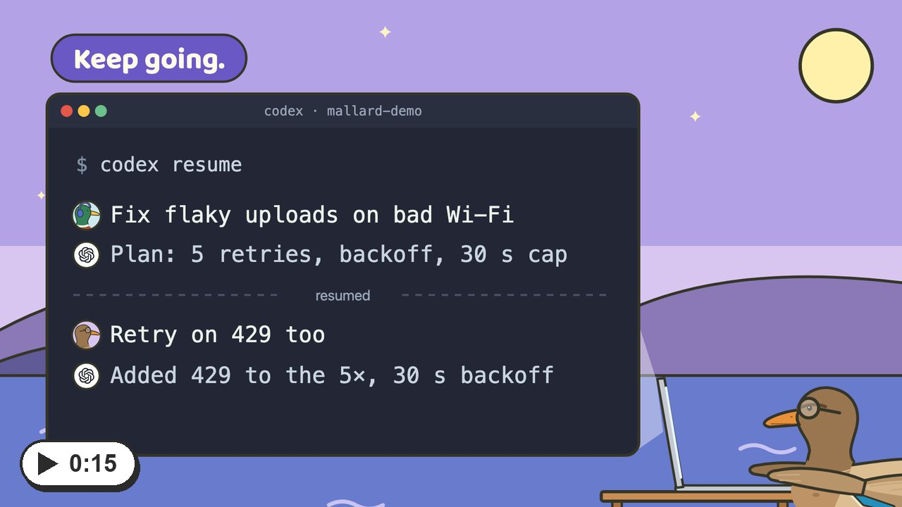</a>

## What you can do

<table>
<tr>
<td width="50%" valign="top">
<a href="https://mallard-ai.com/landing/use-cases/pr-review.mp4">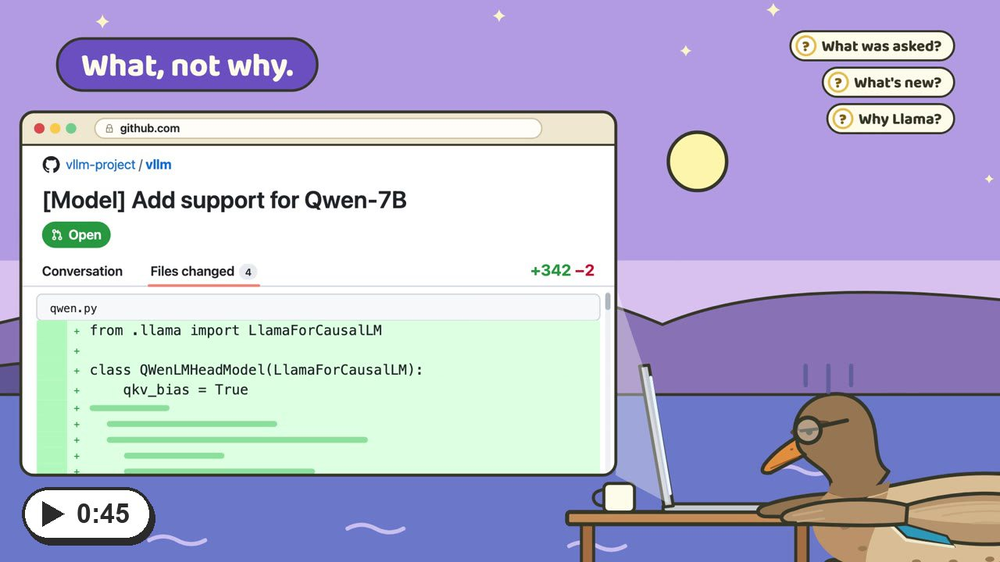</a>
 <b>A better way to PR</b> The diff shows what. The chat shows why.
</td>
<td width="50%" valign="top">
<a href="https://mallard-ai.com/landing/use-cases/team.mp4">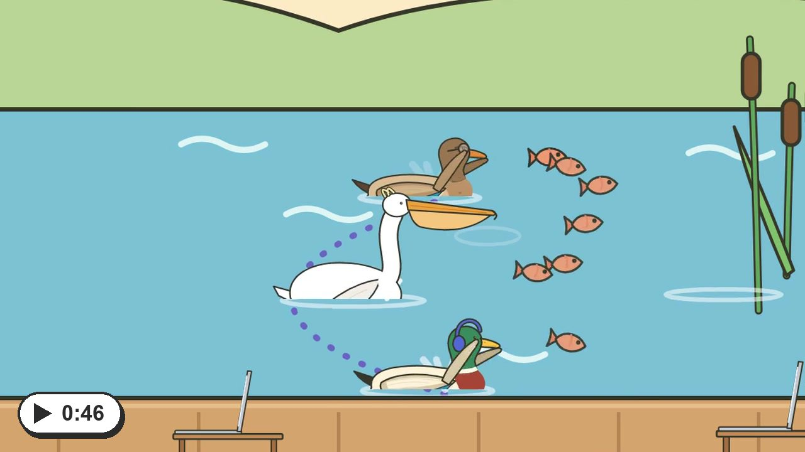</a>
 <b>What one learns, the flock knows</b> Push your chats. Teammates read them, or pull and keep going.
</td>
</tr>
<tr>
<td width="50%" valign="top">
<a href="https://mallard-ai.com/landing/use-cases/laptops.mp4">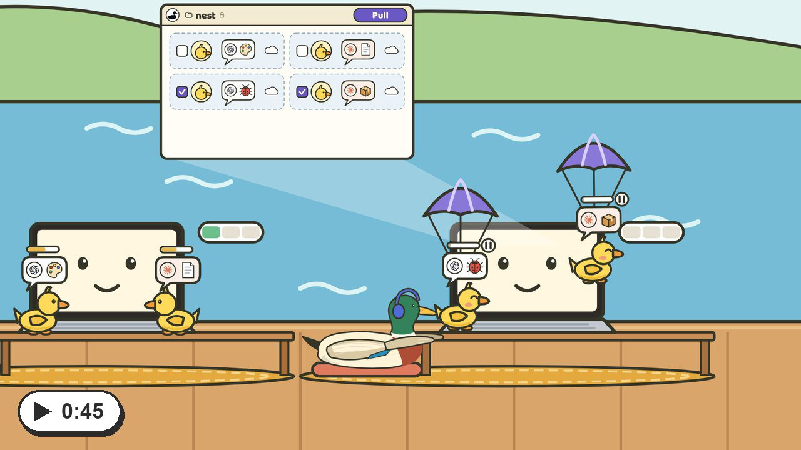</a>
 <b>More wings for one duck</b> Push from a busy laptop. Pull on your others.
</td>
<td width="50%" valign="top">
<a href="https://mallard-ai.com/landing/use-cases/new-teammate.mp4">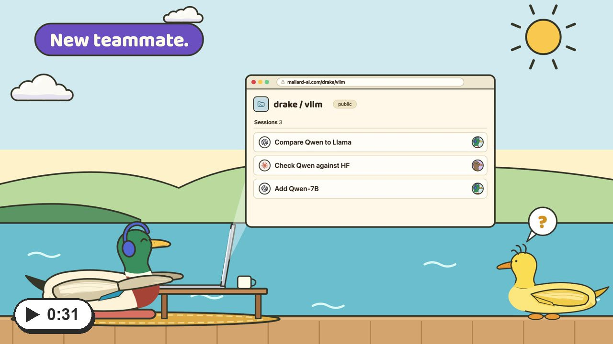</a>
 <b>Welcome to the flock</b> Send the link. They pull the history and catch up.
</td>
</tr>
</table>

## Examples

Public on Mallard Cloud. Open one, or pull it into Mallard.

<table>
<tr>
<td width="33%" valign="top">
<a href="https://mallard-ai.com/rikaqu0223-arch/mallard-with-pelican"><picture>
  <source media="(prefers-color-scheme: dark)" srcset="docs/readme/example-mallard-with-pelican-dark.jpg">
  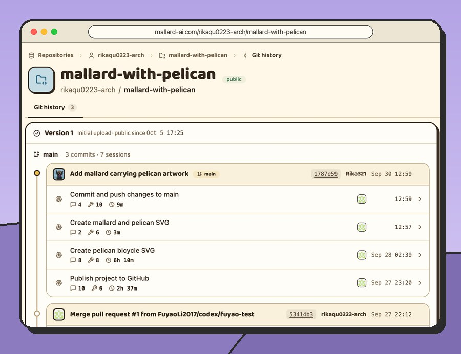
</picture></a>
 <a href="https://mallard-ai.com/rikaqu0223-arch/mallard-with-pelican"><b>mallard-with-pelican</b></a> A Git project: Codex and Claude sessions under each commit.
</td>
<td width="33%" valign="top">
<a href="https://mallard-ai.com/rikaqu0223-arch/mallardNonGit"><picture>
  <source media="(prefers-color-scheme: dark)" srcset="docs/readme/example-mallardNonGit-dark.jpg">
  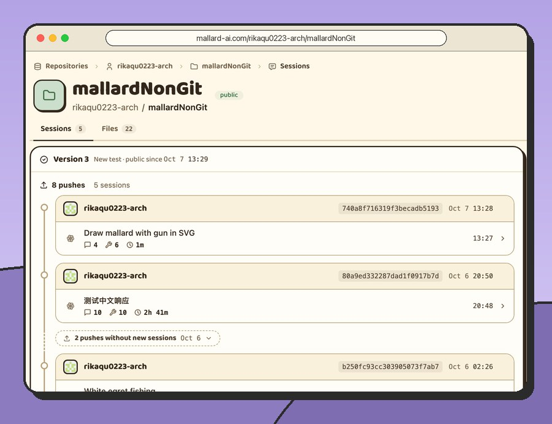
</picture></a>
 <a href="https://mallard-ai.com/rikaqu0223-arch/mallardNonGit"><b>mallardNonGit</b></a> A folder without Git: its sessions and files, together.
</td>
<td width="33%" valign="top">
<a href="https://mallard-ai.com/rikaqu0223-arch/Maple"><picture>
  <source media="(prefers-color-scheme: dark)" srcset="docs/readme/example-Maple-dark.jpg">
  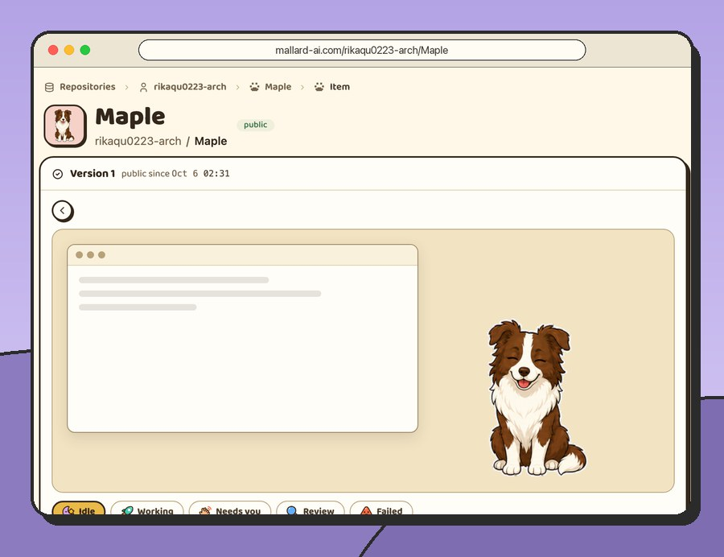
</picture></a>
 <a href="https://mallard-ai.com/rikaqu0223-arch/Maple"><b>Maple</b></a> A Codex desktop pet, ready to pull.
</td>
</tr>
</table>

## Get started

[Download Mallard](https://github.com/Git4Agent/mallard-app/releases/latest) for macOS or Windows, then:

### 1. [Add a storage](https://mallard-ai.com/docs/add-a-storage)

Where your sessions live: Mallard Cloud, a folder, Cloudflare R2 or Dropbox.

<picture>
  <source media="(prefers-color-scheme: dark)" srcset="docs/readme/storage-dark.jpg">
  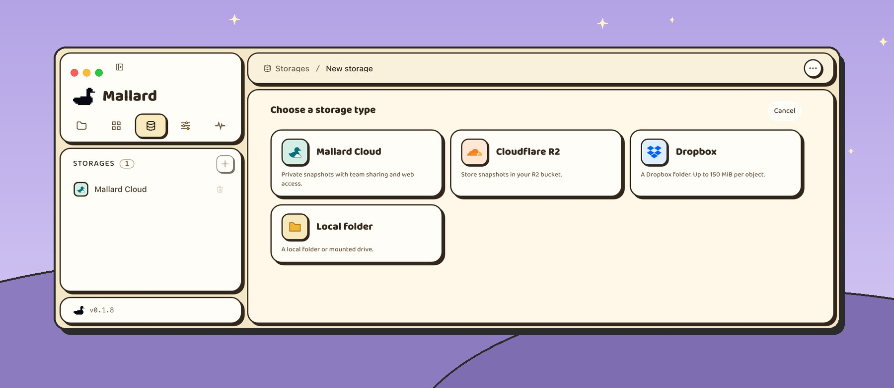
</picture>

### 2. [Add a project](https://mallard-ai.com/docs/add-a-project)

Pick a folder where Codex or Claude worked.

<picture>
  <source media="(prefers-color-scheme: dark)" srcset="docs/readme/newproject-dark.jpg">
  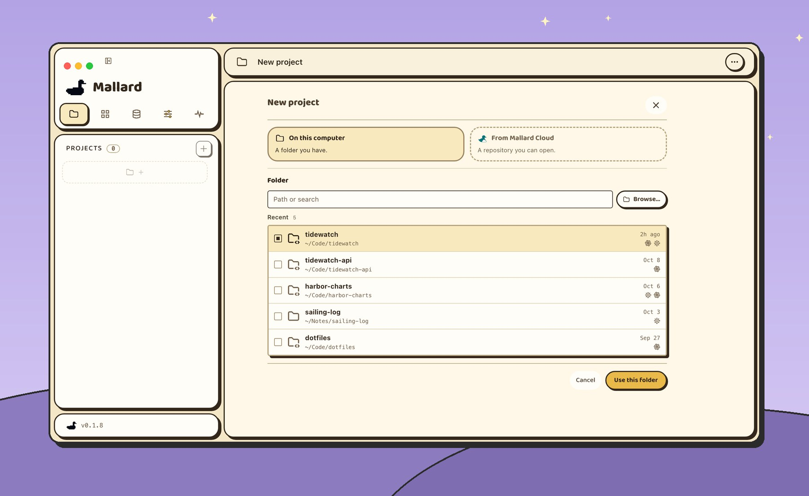
</picture>

### 3. [Push and pull](https://mallard-ai.com/docs/push-and-pull)

**Push**: you pick which sessions to push.

<picture>
  <source media="(prefers-color-scheme: dark)" srcset="docs/readme/push-dark.jpg">
  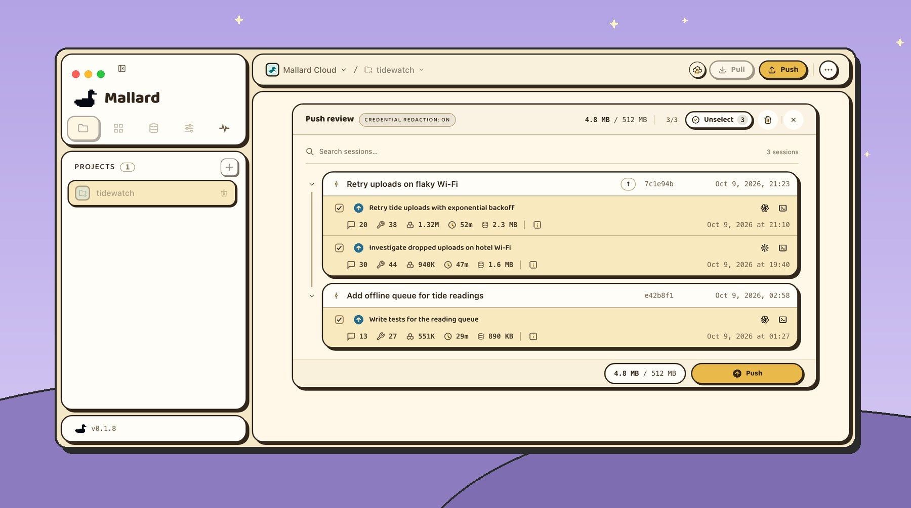
</picture>

**Pull**: you decide which sessions to pull, too.

<picture>
  <source media="(prefers-color-scheme: dark)" srcset="docs/readme/pull-dark.jpg">
  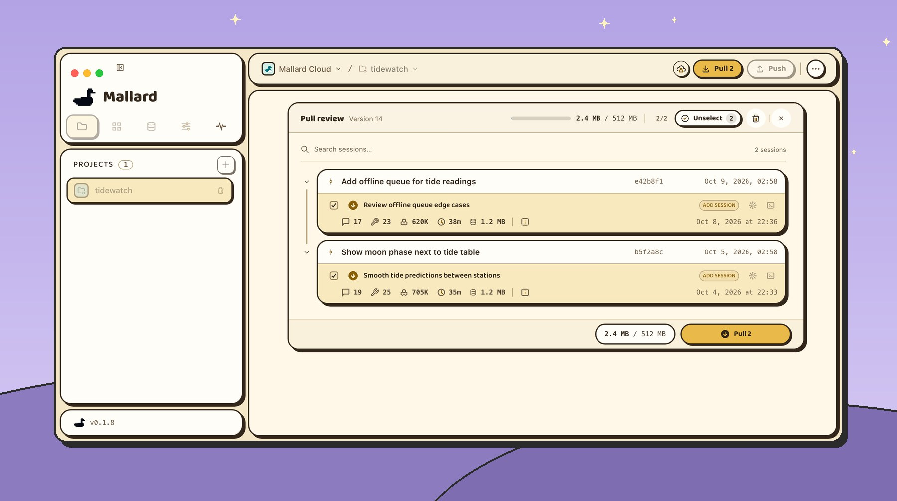
</picture>

## Works with

- **Agents:** <picture><source media="(prefers-color-scheme: dark)" srcset="docs/readme/codex-dark.svg"></picture>&nbsp;Codex · &nbsp;Claude Code
- **Also shares:** Skills (Codex, Claude) and Codex pets, pushed and pulled like sessions
- **Storage:** &nbsp;Mallard Cloud · &nbsp;A folder · &nbsp;Cloudflare R2 · &nbsp;Dropbox
- **Computers:** macOS 12 or newer (Apple silicon, Intel), Windows x64

## Your data stays yours

- You pick and review every session before anything moves.
- Nothing on your computer is replaced or deleted without your OK.
- Storage passwords and folder paths stay on your computer.
- Chats can hold keys you pasted. Turn on **Credential redaction** in Settings › Privacy to hide them.
- Mallard Cloud pushes stay private to you and the people you invite.

## How it works

Mallard needs only three things from a storage: List, Put and Get. No Git server.

- **A push only adds.** Files named by their SHA-256 go up first, then a manifest, then one small record. Until the record lands, the version doesn't exist.
- **The listing is the history.** Each record names its parent; follow them from the root to the current version. When two pushes land in the same seconds, the earlier wins and the other is told to compare again.
- **A pull applies the version it reviewed,** even after a newer push.
- **Sign-ins, backups and logs never go to storage.**

[Read the storage layout →](https://mallard-ai.com/docs/storage-layout)

## FAQ

<b>Is Mallard free?</b>

Yes. The Mallard app is free and open source under the [MIT License](LICENSE): use it, change it and share it, at work or at home.

<b>Can I use my own storage?</b>

Yes. Use a folder on your computer or a mounted drive, your own Cloudflare R2 bucket, or your Dropbox. Mallard Cloud is optional: it adds GitHub sign-in and a website where your team reads sessions.

<b>Does Mallard upload my code?</b>

No. In a Git project your code travels through Git, as always; Mallard moves the sessions. In a folder without Git, you can tick files to travel too.

<b>Which agents does it support?</b>

Codex and Claude Code, in the terminal or in their desktop apps.

---

[Build from source](docs/DEVELOPMENT.md) · [Technical report](TECHNICAL_REPORT.md) · Built for [OpenAI Build Week](https://devpost.com/software/agentgithub) · [MIT License](LICENSE) Thanks to the [LINUX DO](https://linux.do) community for its support.
