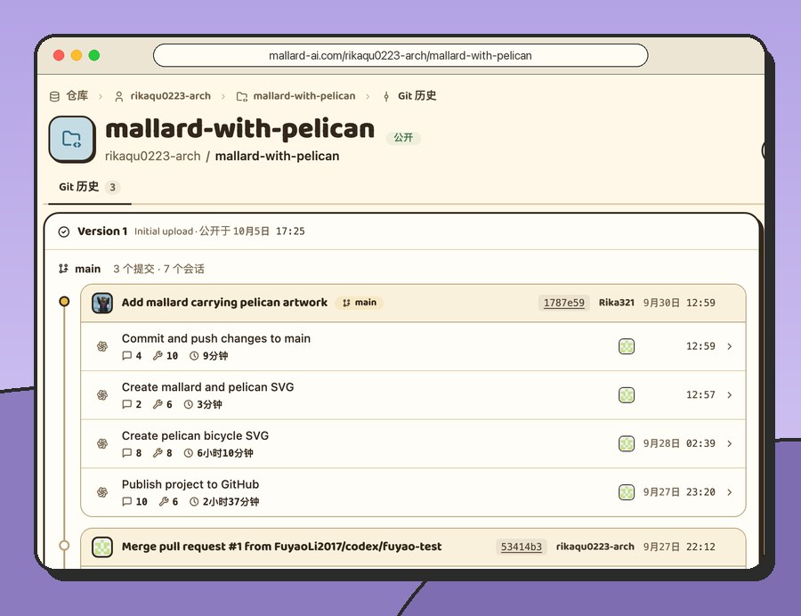
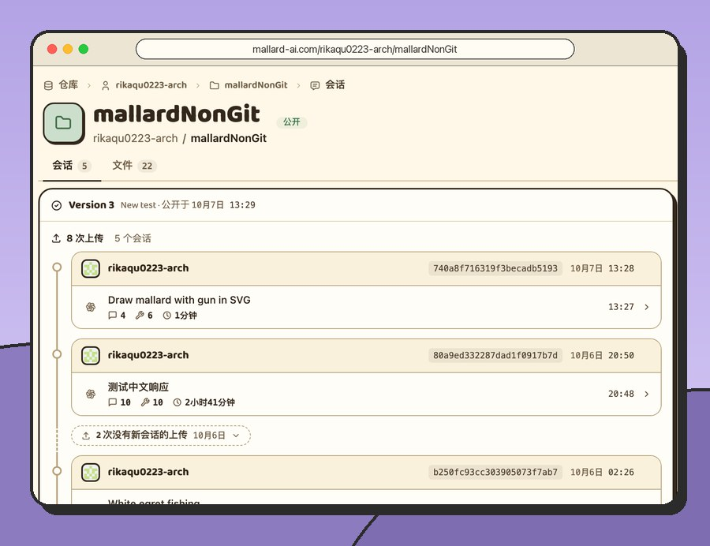
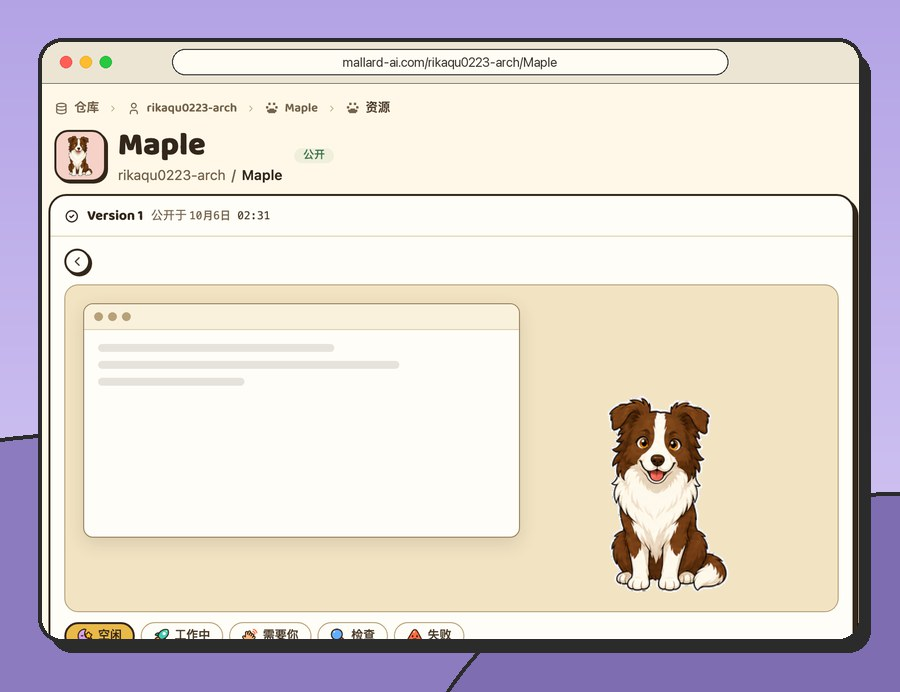
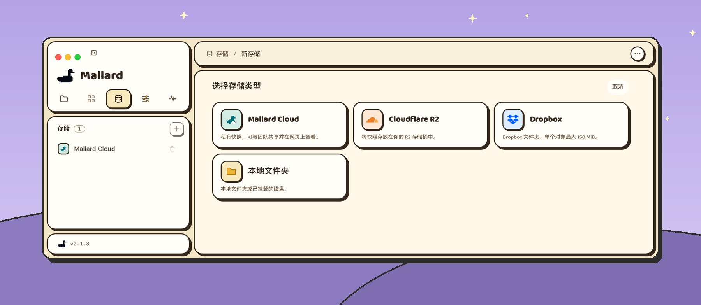
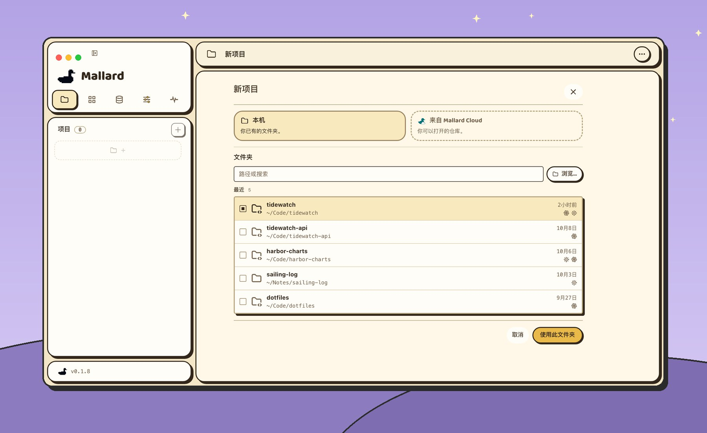
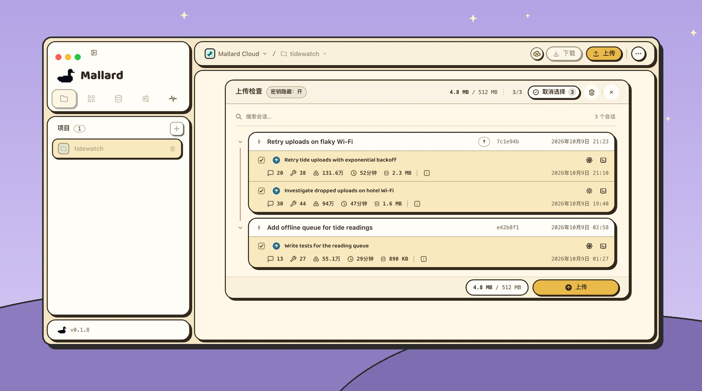
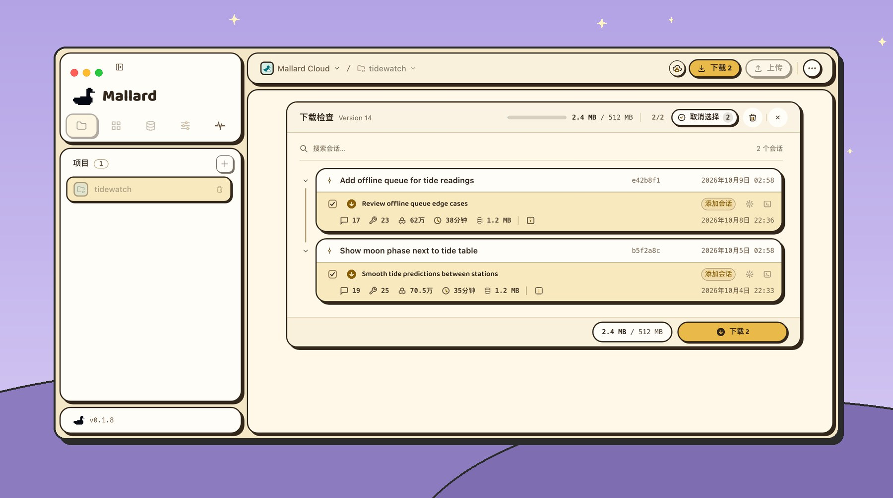

  <picture>
    <source media="(prefers-color-scheme: dark)" srcset="docs/readme/mallard-dark.png">
    
  </picture>

<h1 align="center">Mallard</h1>

  <b>为 Codex 和 Claude 打造的Git。</b> 
  代码交给 Git，Codex 和 Claude 会话交给 Mallard。

  
  

  <a href="https://github.com/Git4Agent/mallard-app/releases/latest"><b>下载</b></a> · <a href="https://mallard-ai.com">网站</a> · <a href="https://mallard-ai.com/docs">文档</a> · <a href="README.md">English</a> · <b>简体中文</b>

  

## 能做什么

<table>
<tr>
<td width="50%" valign="top">

 <b>更好贡献 PR 的方式</b> Code Diff 说明结果，Agent session说明过程。
</td>
<td width="50%" valign="top">

 <b>一只学会，全群都会</b> 上传你的对话，同事阅读，或下载后接着做。
</td>
</tr>
<tr>
<td width="50%" valign="top">

 <b>一只鸭，多双翅膀</b> 从满载的电脑上传，在其他空闲电脑上下载。
</td>
<td width="50%" valign="top">

 <b>欢迎加入鸭群</b> 发一个链接，新同事下载历史，马上跟上。
</td>
</tr>
</table>

## 示例

Mallard Cloud 上的公开仓库：在网页上打开，或下载到 Mallard。

<table>
<tr>
<td width="33%" valign="top">
<a href="https://mallard-ai.com/rikaqu0223-arch/mallard-with-pelican"><picture>
  <source media="(prefers-color-scheme: dark)" srcset="docs/readme/example-mallard-with-pelican-dark-zh.jpg">
  
</picture></a>
 <a href="https://mallard-ai.com/rikaqu0223-arch/mallard-with-pelican"><b>mallard-with-pelican</b></a> 一个 Git 项目：每个提交下的 Codex 和 Claude 会话。
</td>
<td width="33%" valign="top">
<a href="https://mallard-ai.com/rikaqu0223-arch/mallardNonGit"><picture>
  <source media="(prefers-color-scheme: dark)" srcset="docs/readme/example-mallardNonGit-dark-zh.jpg">
  
</picture></a>
 <a href="https://mallard-ai.com/rikaqu0223-arch/mallardNonGit"><b>mallardNonGit</b></a> 没有 Git 的文件夹：会话和文件一起同步。
</td>
<td width="33%" valign="top">
<a href="https://mallard-ai.com/rikaqu0223-arch/Maple"><picture>
  <source media="(prefers-color-scheme: dark)" srcset="docs/readme/example-Maple-dark-zh.jpg">
  
</picture></a>
 <a href="https://mallard-ai.com/rikaqu0223-arch/Maple"><b>Maple</b></a> 一只 Codex 桌面宠物，可直接下载。
</td>
</tr>
</table>

## 开始使用

[下载 Mallard](https://github.com/Git4Agent/mallard-app/releases/latest)（macOS 或 Windows），然后：

### 1. [添加存储](https://mallard-ai.com/docs/add-a-storage)

会话存放的地方：Mallard Cloud、本地文件夹、Cloudflare R2 或 Dropbox。

<picture>
  <source media="(prefers-color-scheme: dark)" srcset="docs/readme/storage-dark-zh.jpg">
  
</picture>

### 2. [添加项目](https://mallard-ai.com/docs/add-a-project)

选一个 Codex 或 Claude 工作过的文件夹。

<picture>
  <source media="(prefers-color-scheme: dark)" srcset="docs/readme/newproject-dark-zh.jpg">
  
</picture>

### 3. [上传和下载](https://mallard-ai.com/docs/push-and-pull)

**上传**：上传哪些会话，由你挑选。

<picture>
  <source media="(prefers-color-scheme: dark)" srcset="docs/readme/push-dark-zh.jpg">
  
</picture>

**下载**：下载哪些会话，也由你决定。

<picture>
  <source media="(prefers-color-scheme: dark)" srcset="docs/readme/pull-dark-zh.jpg">
  
</picture>

## 支持

- **代理：** <picture><source media="(prefers-color-scheme: dark)" srcset="docs/readme/codex-dark.svg"></picture>&nbsp;Codex · &nbsp;Claude Code
- **还能同步：** Skill（Codex、Claude）和 Codex 桌面宠物，与会话一样上传和下载
- **存储：** &nbsp;Mallard Cloud · &nbsp;本地文件夹 · &nbsp;Cloudflare R2 · &nbsp;Dropbox
- **系统：** macOS 12 及以上（Apple 芯片、Intel）、Windows（x64）

## 数据由你掌控

- 传输前，检查并选择会话。
- 存储凭据保存在你的电脑上。
- 在 设置 › 隐私 中启用 **密钥隐藏**，隐藏对话中检测到的密钥。
- 上传到 Mallard Cloud 的内容仅你和你邀请的人可见。

## 工作原理

Mallard 对存储只有三个要求：List、Put 和 Get，不需要 Git 服务器。

- **上传只新增，不修改。** 先写入以 SHA-256 命名的对象，再写清单，最后写一条记录。记录写入之前，这个 Version 并不存在。
- **列表就是历史。** 每条记录都记着它的父项，从 root 顺着往下走，尽头就是当前的 Version。同一时刻的两次上传，较早上传的被采用，较晚上传被告知重试。
- **下载应用的是它检查过的那个 Version，** 即使之后有新的上传。
- **登录信息、备份和日志不会存到存储里。**

[阅读存储布局 →](https://mallard-ai.com/docs/storage-layout)

## 社区

加入 [Discord](https://discord.gg/srnWNQUsB)，或使用微信扫描下方二维码，加入 Mallard 内测群。

二维码有效期为 10 月 19 日前，详见图片。点击图片可查看原图。

## 常见问题

<b>Mallard 免费吗？</b>

免费。Mallard 应用基于 [MIT 许可证](LICENSE) 开源：可自由使用、修改和分享，工作和个人都可以。

<b>可以用自己的存储吗？</b>

可以。本地文件夹或挂载的磁盘、你自己的 Cloudflare R2 存储桶，或你的 Dropbox 都行。Mallard Cloud 不是必须的：它额外提供 GitHub 登录，以及让团队阅读会话的网站。

<b>Mallard 会上传我的代码吗？</b>

不会。Git 项目的代码照常通过 Git 传输，Mallard 只传会话。没有 Git 的文件夹，可以勾选文件一起传输。

<b>支持哪些代理？</b>

Codex 和 Claude Code，命令行和桌面应用都支持。

---

[从源码构建](docs/DEVELOPMENT.md) · [技术报告](TECHNICAL_REPORT.md) · 为 [OpenAI Build Week](https://devpost.com/software/agentgithub) 打造 · [MIT 许可证](LICENSE) 感谢 [LINUX DO](https://linux.do) 社区的支持。
