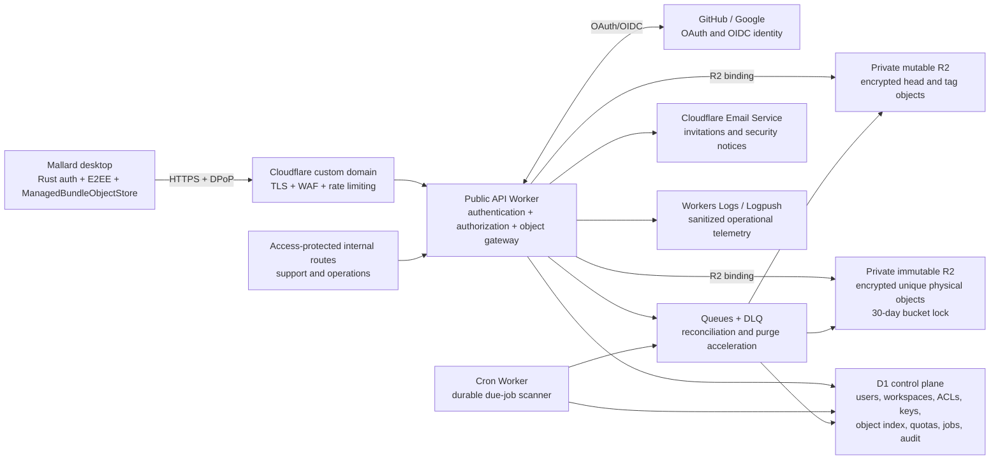

# Mallard Managed Cloud v2: Cloudflare R2, D1, Identity, Teams, and End-to-End Encryption

- **Status:** Proposal
- **Last reviewed:** August 2, 2026
- **Scope:** production foundation for a Mallard-operated managed cloud
- **Current implementation baseline:** Mallard 0.1.2, machine-local schema 1,
  portable bundle schema 1
- **Relationship to the earlier proposal:** supersedes
  [CLOUDFLARE_R2_MANAGED_CLOUD_ARCHITECTURE.md](CLOUDFLARE_R2_MANAGED_CLOUD_ARCHITECTURE.md)
  for future design and implementation

## 1. Decision

Mallard should offer a managed, multi-tenant cloud provider backed by
Cloudflare Workers, D1, and private R2 storage. The service is operated by
Mallard and is distinct from the existing local-folder and user-owned R2
providers.

The service has four non-negotiable properties:

1. The desktop application never receives the managed R2 credentials or an
   administrative service token.
2. The current schema-1 bundle protocol remains the portable data model.
3. D1 authorizes every account, workspace, repository, and object operation;
   an object identifier alone grants no access.
4. Every repository object body is encrypted before it leaves the Tauri Rust
   backend. Mallard's cloud service can route and account for objects but
   cannot read heads, tags, manifests, commits, or payloads.

This is a master architecture, not a single implementation milestone. Delivery
is divided into four independently reviewable programs:

1. Cloud control plane and object gateway.
2. Authentication, users, devices, and team management.
3. End-to-end encryption, key distribution, rotation, and recovery.
4. Desktop managed-provider integration and production rollout.

## 2. Goals and non-goals

### 2.1 Goals

- Let one user securely sync Mallard projects across multiple devices without
  provisioning a Cloudflare account or copying R2 credentials.
- Support personal and team workspaces with workspace-wide roles.
- Preserve Mallard's immutable-object publication order and single-winner head
  compare-and-swap behavior.
- Keep local-folder and BYO R2 behavior unchanged.
- Make authentication, quota accounting, retries, deletion, and partial
  failure behavior explicit and testable.
- Provide end-to-end content confidentiality from the first managed-cloud
  release.
- Establish a production-shaped operational model even if the initial rollout
  uses a small allowlist.

### 2.2 Deferred work

The first design deliberately excludes:

- billing, paid subscriptions, invoices, and payment-provider integration;
- direct email/password and email-code login;
- self-hosting the managed service;
- per-repository access-control lists;
- a web account-management portal;
- public demo repositories or a public gallery;
- regional shards, including US/EU jurisdiction shards, or customer-selected
  residency;
- shared-CDN caching of private objects;
- presigned direct R2 access;
- Durable Objects;
- server-side plaintext search, previews, malware scanning, or embeddings; and
- moving a repository between workspaces in place.

GitHub and Google are the public identity providers. Cloudflare Email Service
is used only for team invitations and security notices, not as an
authentication provider.

## 3. Compatibility with current Mallard

### 3.1 Portable bundle protocol

The managed provider preserves the current portable layout and schema:

```text
.mallard/
|-- _storage.json
`-- v1/repositories/<bundle-id>/
    |-- _head.json
    |-- _tag.json
    |-- _objects/<payload-sha256>
    |-- _manifests/<generation>-<commit-id>.json
    `-- _commits/<generation>-<commit-id>.json
```

`_uploads/` remains only a reserved logical namespace. The current publisher
does not write it, and the managed-cloud multipart protocol does not revive it.
Multipart state is service-local D1/R2 state, not portable bundle state.

Portable bundle manifests remain schema 1. The managed adapter must preserve
the current `BundleObjectStore` contract:

```rust
trait BundleObjectStore {
    fn get(&self, key: &ObjectKey) -> Result<Option<StoredObject>, String>;
    fn get_many(&self, keys: &[ObjectKey])
        -> Result<Vec<Option<StoredObject>>, String>;
    fn put_immutable(&self, key: &ObjectKey, bytes: &[u8])
        -> Result<ImmutablePutOutcome, String>;
    fn put_many(&self, objects: Vec<(ObjectKey, Bytes)>)
        -> Result<Vec<ImmutablePutOutcome>, String>;
    fn compare_and_swap(
        &self,
        key: &ObjectKey,
        expectation: &CasExpectation,
        bytes: &[u8],
    ) -> Result<CasOutcome, String>;
    fn list(
        &self,
        prefix: &ObjectPrefix,
        cursor: Option<&str>,
        limit: usize,
    ) -> Result<StoreListPage, String>;
}
```

The adapter returns decrypted plaintext bytes to the bundle engine while
retaining the service's ciphertext ETag in `StoredObject.etag`. The bundle
engine therefore continues to verify plaintext manifest and payload hashes,
and its existing CAS logic remains unchanged.

### 3.2 Machine-local configuration

Adding a third storage kind is a machine-local schema change. The implementation
must perform one atomic, one-way migration from `sync_config.json` schema 1 to
schema 2. After migration, only schema 2 is read or written; there is no
permanent dual execution path.

The serialized storage variants become conceptually:

```text
local    -> id, name, local_dir, exclusions
s3       -> id, name, bucket, account/endpoint/region, credential references,
            conditional-write capability, exclusions
managed  -> id, name, service_base_url, workspace_id, exclusions
```

An initial flat DTO may retain empty fields used by other variants, but
`StorageKind::Managed` must be explicit in Rust and `"managed"` must be
explicit in TypeScript. A managed record contains no access token, refresh
token, recovery material, private key, or R2 key.

Non-secret account and device references live in a bounded, atomic
`~/.mallard/cloud_state.json` document with its own schema and revision.
Refresh tokens, device private keys, account key packages, and recovery
material live in the platform keychain:

- macOS Keychain;
- Windows Credential Manager; and
- Linux Secret Service.

Managed cloud is unavailable when a supported keychain cannot be opened.
There is no plaintext fallback.

### 3.3 Storage marker

The managed adapter synthesizes the existing marker:

```json
{"format":"mallard-storage","layout_version":1}
```

The Worker does not allocate a tenant object for this marker. A matching
immutable `put` returns `AlreadyPresent`; any other value is rejected locally.
This keeps `BundleEngine::open` behavior aligned across all providers.

## 4. Cloudflare topology



### 4.1 Cloudflare resources

The first production deployment uses:

- one public API Worker on a Mallard-controlled custom domain;
- one D1 database for the global control plane;
- one private immutable R2 bucket;
- one private mutable R2 bucket;
- one work queue and one dead-letter queue;
- one Cron trigger for due-job discovery and stale-state reconciliation;
- Cloudflare Worker Secrets or Secrets Store bindings for OAuth client
  secrets, token-signing keys, email lookup HMAC keys, and service-side field
  encryption keys;
- Cloudflare Email Service for invitations and security notifications;
- WAF and rate-limiting rules on the public domain;
- a separate internal hostname protected by Cloudflare Access; and
- Workers Logs with optional Logpush for retained operational telemetry.

The service is a single global deployment using Cloudflare automatic
placement. Regional data shards are a later architecture, not a hidden
requirement of this one.

### 4.2 Why no Durable Object

Mallard already requires object-store CAS for the one mutable authority:
`_head.json`. R2 conditional operations supply that primitive. D1 transactions,
unique constraints, quota triggers, and explicit upload state machines cover
the remaining coordination.

Adding a Durable Object per workspace would create a second application
database and a second recovery/migration path without removing the unavoidable
D1-to-R2 partial-failure boundary. It should be reconsidered only after
measured D1 contention demonstrates a need.

### 4.3 Network boundary

The Worker is the only public storage gateway. The desktop never receives
official-service R2 credentials and cannot address a physical object key.

The R2 buckets have no public custom domain and no `r2.dev` production path.
Only bound Workers can read or write them. The public API never accepts:

- an R2 bucket name;
- a physical R2 key;
- a tenant prefix;
- a Cloudflare account ID; or
- arbitrary Worker callback or redirect destinations.

Private object responses use `Cache-Control: private, no-store` in v1. The
desktop's existing bounded in-memory cache may contain verified plaintext
during one process lifetime, but the managed provider does not add a plaintext
disk cache.

## 5. Authority and trust boundaries

### 5.1 Sources of truth

| Concern | Authority |
| --- | --- |
| User identity and account state | D1 |
| Device and refresh-session state | D1 |
| Workspace membership and role | D1 |
| Workspace key-grant metadata | D1; envelope contents are client-authenticated |
| Repository ownership and lifecycle | D1 |
| Logical immutable-key allocation | D1 unique constraint |
| Quota reservation and usage ledger | D1 |
| Immutable ciphertext bytes | Immutable R2 bucket |
| Mutable head/tag ciphertext and CAS ETag | Mutable R2 bucket |
| Async work that must eventually happen | D1 deletion/reconciliation job |
| Queue delivery | Acceleration only; never the sole durable record |
| Portable snapshot integrity | Existing Mallard schema-1 hash chain after decryption |

### 5.2 Threat model

The design protects against:

- an untrusted or modified open-source client;
- guessing or learning another repository ID;
- cross-workspace and cross-user access attempts;
- stolen bearer tokens without the device proof key;
- replayed OAuth state, app codes, refresh tokens, and mutating requests;
- path traversal and physical-key injection;
- duplicate or concurrent immutable uploads;
- concurrent head publication;
- interrupted D1/R2 operations;
- an R2 credential leak from the desktop, because no such credential exists
  there; and
- a cloud operator or R2 reader attempting to inspect repository object
  bodies.

The design cannot protect against:

- malware or an attacker controlling an authorized, unlocked endpoint;
- a user deliberately exporting plaintext;
- an authorized member retaining plaintext or keys learned before removal;
- total loss of every trusted device and the recovery key;
- traffic analysis from visible routing metadata; or
- a malicious service denying availability, deleting unlocked data after its
  retention period, or serving stale ciphertext.

Mallard's existing hashes and E2EE authentication detect stale or modified
ciphertext. They cannot force an untrusted service to remain available.

### 5.3 Visible metadata

E2EE covers every repository object body. The service still observes:

- users, devices, workspace membership, and roles;
- workspace and repository opaque IDs;
- the schema-1 logical object namespace;
- bundle IDs and `_objects/<sha256>` key components;
- ciphertext sizes and transfer timing;
- object creation/update times;
- current R2 ETags;
- quota counters; and
- account, repository, and deletion lifecycle state.

Workspace names, repository display metadata, heads, tags, manifests, commits,
and payload content are encrypted. Visible payload hash keys permit
confirmation attacks against guessed plaintext and are an acknowledged
compatibility trade-off. Hiding logical keys would require a different
listing/index protocol and is deferred.

## 6. Managed object storage

### 6.1 Logical and physical keys

Clients continue to use validated Mallard logical keys. D1 maps them to
service-generated physical keys:

```text
logical:
  .mallard/v1/repositories/<bundle-id>/_objects/<sha256>

physical immutable:
  immutable/<workspace-id>/<repository-id>/<object-id>

logical:
  .mallard/v1/repositories/<bundle-id>/_head.json

physical mutable:
  mutable/<workspace-id>/<repository-id>/_head.json
```

The tag uses the same stable mapping with `_tag.json`. Clients can neither
choose nor observe either physical key.

`object-id` is 128 random bits generated by the Worker. Immutable multipart
uploads always target this unique physical key. Completing one upload can
therefore never overwrite the bytes allocated to a different logical object.

D1 has a unique `(repository_id, logical_key)` constraint. When allocation
finds an existing ready object, the adapter downloads, decrypts, and
byte-compares it. It returns `AlreadyPresent` only if the plaintext matches.
A mismatch is an immutable-key integrity error. An existing non-ready
allocation returns a retryable conflict unless the caller presents the same
idempotency key and request digest; a client can never take over an unrelated
upload session.

### 6.2 Small and multipart uploads

Ciphertext no larger than 16 MiB uses one authenticated Worker request.
Larger ciphertext uses R2 multipart upload through the Worker:

1. Allocate the immutable logical object and reserve its full ciphertext size
   in D1.
2. Create an R2 multipart upload for the unique physical key.
3. Upload uniform 16 MiB parts; only the last part may be smaller.
4. Record each returned part ETag and size in D1.
5. Complete using exactly the D1-recorded ordered part set.
6. In one D1 transaction, mark the logical object ready, mark the upload
   complete, move reserved bytes to used bytes, and update repository counters.

The upload session expires after 24 hours. R2's incomplete-multipart lifecycle
is a secondary cleanup mechanism. A Cron scan owns the application-level
expiry and quota release.

An `Idempotency-Key` is unique within a repository. Repeating allocation with
the same key and same request digest returns the same upload state. Reusing it
with different parameters returns `409 idempotency_mismatch`.

### 6.3 Mutable head and tag writes

Only `_head.json` and `_tag.json` are accepted by the mutable route.

- `CasExpectation::Absent` becomes `If-None-Match: *`.
- `CasExpectation::Match(etag)` becomes `If-Match: "<etag>"`.
- A successful R2 conditional write returns the new ciphertext ETag.
- A failed condition returns `412 precondition_failed`; the adapter maps it to
  `CasOutcome::Conflict`.

R2 is the CAS authority. D1's mutable-object row is an index and audit mirror.
If the R2 write succeeds and the D1 mirror update fails, the response is
ambiguous. A retry with the same idempotency key reads R2, compares the
ciphertext digest, repairs D1, and returns the original success. It must not
blindly submit a second write.

The service refuses head/tag writes while `workspaces.key_rotation_required`
is true.

### 6.4 Listing and reads

`list` queries D1's logical-key index, never the R2 bucket. Results are sorted
by `(logical_key, object_id)` and paginated with an opaque authenticated
cursor. The API limit is 1–1,000; the adapter can build the bundle engine's
larger bounded page by consuming multiple API pages.

`get` resolves the authorized logical key through D1 and streams the R2
ciphertext. `get_many` uses bounded parallel individual reads rather than a
single multipart response. The Rust adapter decrypts and authenticates every
frame before exposing plaintext to the bundle engine.

### 6.5 Retention lock

The immutable bucket has an age-based lock of exactly 2,592,000 seconds on the
`immutable/` prefix, or equivalently on the entire dedicated bucket. This:

- prevents premature deletion and overwrite of newly written immutable
  ciphertext;
- aligns maximum lock delay with the selected 30-day deletion recovery
  contract; and
- means orphan cleanup may be delayed until an object's own lock expires.

Mutable head/tag objects are in a separate bucket and are not retention
locked. No normal public API exposes object deletion.

## 7. End-to-end encryption

### 7.1 Key hierarchy

```text
random recovery key (offline, user-held)
    |
    `-- encrypts account key package recovery envelope

account key package, version N
    |-- X25519 private wrapping key
    `-- Ed25519 private signing seed
             |
             | HPKE
             v
workspace key epoch 1, 2, ...
             |
             | HKDF per repository object
             v
MCE1 object subkey

device X25519 key
    `-- receives an HPKE envelope containing the account key package

device DPoP signing key
    `-- proves possession for service requests
```

All private keys are generated in the Tauri Rust backend with an operating
system CSPRNG. Secret buffers must use zeroization-capable types and must not
cross the WebView boundary.

Every workspace epoch key is an independently generated random 256-bit value.
Epoch keys are never derived from a user password, recovery key, previous
epoch, repository identifier, or provider credential.

### 7.2 MCE1 object envelope

`MCE1` is a versioned framed format. Version 1 uses:

- HKDF-SHA-256 for per-object subkeys;
- XChaCha20-Poly1305 for content frames;
- 4 MiB plaintext frames;
- a random 128-bit nonce prefix per encryption; and
- a 64-bit big-endian frame counter appended to that prefix to form each
  192-bit XChaCha nonce.

The fixed binary header is:

```text
magic                 4 bytes   ASCII "MCE1"
format_version        1 byte    0x01
algorithm             1 byte    0x01 = XChaCha20-Poly1305 framed
key_epoch             4 bytes   unsigned big-endian
frame_size            4 bytes   unsigned big-endian; exactly 4,194,304
plaintext_length      8 bytes   unsigned big-endian
nonce_prefix         16 bytes   random
```

The object subkey is:

```text
HKDF-Extract(
  salt = SHA-256("mallard-managed-cloud/mce1" || workspace_id),
  IKM  = workspace_epoch_key
)

HKDF-Expand(
  PRK,
  info = length_prefixed(
    "object-key",
    repository_id,
    UTF8(logical_object_key)
  ),
  L = 32
)
```

Each frame stores `ciphertext || 16-byte tag`. Full-frame sizes are implied by
the header; the final plaintext length is derived from `plaintext_length`.
There is no unauthenticated per-frame length field.

Frame indexes start at zero. A non-empty object has
`ceil(plaintext_length / frame_size)` frames. An empty object has exactly one
authenticated zero-length frame, represented by its 16-byte tag, so the header
is authenticated even when there is no plaintext.

Associated data for frame `i` is the canonical length-prefixed encoding of:

```text
"mallard-managed-cloud/mce1-frame"
service_origin
workspace_id
repository_id
logical_object_key
the complete fixed header
frame_index
```

Because the fixed header is authenticated, this binds every frame to the key
epoch and declared plaintext length in addition to the service, workspace,
repository, logical key, and zero-based frame index.

Decryptors reject:

- an unknown magic, version, or algorithm;
- a frame size other than 4 MiB;
- an epoch with no authorized key envelope;
- length overflow or more frames than the header permits;
- a missing, extra, reordered, or unauthenticated frame; and
- plaintext whose existing Mallard schema-1 hash checks fail after decryption.

Every encryption, including a mutable-head retry, starts with a new random
nonce prefix. Idempotent retries reuse the already produced ciphertext bytes
or reconcile by digest; they do not re-encrypt and assume an identical ETag.

### 7.3 Key envelopes

Public-key envelopes that carry an account key package to a device or a
workspace key to an account version use HPKE base mode with:

```text
DHKEM(X25519, HKDF-SHA-256)
HKDF-SHA-256
ChaCha20-Poly1305
```

An account key package contains its version, X25519 private key, and Ed25519
private seed. It is:

- encrypted to each trusted device's X25519 public key; and
- separately encrypted under the user's random recovery key.

The recovery package is a separate symmetric envelope: version marker
`MCR1`, a random 192-bit nonce, and XChaCha20-Poly1305 ciphertext under the
256-bit recovery key. Its associated data binds the service origin, user ID,
account-key version, and public-key digests. Cloudflare stores only this
encrypted package and its non-secret version metadata.

Workspace key grants are HPKE-encrypted to a recipient account-version X25519
public key. The granting account signs the canonical envelope metadata with
Ed25519. The signature binds workspace ID, epoch, recipient user and account
key version, ciphertext digest, granting user/device, and creation time.

The Worker verifies signatures and membership authorization but cannot decrypt
the envelope.

### 7.4 Recovery and device enrollment

Initial setup displays a random 256-bit recovery key once, encoded with a
checksum and grouped for transcription. Mallard asks the user to confirm a
subset before enabling managed sync. The recovery key is never uploaded or
logged.

A new device:

1. Signs in with GitHub or Google.
2. Generates device encryption and DPoP key pairs.
3. Registers as `pending`.
4. Either enters the recovery key or requests approval from a trusted device.
5. Obtains/decrypts an account key package envelope.
6. Signs its enrollment and becomes `trusted`.

Existing-device approval presents a short comparison code derived from both
device public keys and the enrollment transaction. The approving user must
compare the code on both devices before release of the envelope.

Losing every trusted device and the recovery key is unrecoverable by design.
Support can delete the account but cannot recover repository plaintext.

### 7.5 Membership changes and rotation

Adding a member gives that user envelopes for every retained workspace key
epoch, so the member can read workspace history.

Removing an active member:

1. Revokes service authorization and outstanding invitations immediately.
2. Marks `key_rotation_required`.
3. Blocks every repository write, including immutable allocation, part upload,
   completion, and mutable head/tag writes. Reconciliation aborts in-flight
   uploads and releases their reservations; clients re-encrypt after rotation.
4. Requires an owner/admin device to generate a new independent workspace key.
5. Uploads a signed envelope for every remaining active member.
6. Advances `current_key_epoch` by exactly one and re-enables writes.

Existing immutable objects remain encrypted under their historical epochs.
New objects use the new epoch. A removed member may retain plaintext,
ciphertext, or old keys previously acquired; no cryptographic system can claw
those bytes back.

Device revocation terminates that device's sessions immediately. If compromise
is suspected, the user rotates the account key package and workspace owners
rotate affected workspace epochs. A simple "remove old laptop" action does not
claim to revoke already downloaded keys.

## 8. Authentication and user management

### 8.1 OAuth broker

Mallard is a public native client and cannot keep an OAuth client secret. The
Worker is the confidential broker:

1. The Rust backend binds a random loopback port on `127.0.0.1`, generates
   app state and an S256 PKCE verifier/challenge, and creates an auth
   transaction.
2. It opens the system browser on the Worker authorization route.
3. The Worker creates provider state and an OIDC nonce where applicable, then
   redirects to GitHub or Google.
4. The provider returns to one fixed HTTPS Worker callback.
5. The Worker verifies state/nonce, exchanges the provider code using a secret
   binding, resolves the stable provider subject, and discards provider tokens
   after identity lookup.
6. The Worker redirects a single-use Mallard app code to the exact allowlisted
   loopback callback.
7. The Rust backend exchanges that code plus the PKCE verifier and device
   public keys for a Mallard session.

Only literal loopback IP callbacks are accepted. `localhost`, arbitrary host
names, non-HTTP callbacks, URL credentials, fragments, and callback paths
outside the fixed Mallard path are rejected.

GitHub requests only identity/profile and verified-email access. Google
requests only `openid email profile`. Mallard never requests repository,
Drive, Calendar, organization-management, or other product scopes for login.

### 8.2 Identity linking

The stable identity key is `(issuer, provider_subject)`. Email is not an
identity key.

- First login creates a user and one personal workspace.
- A signed-in user may start an explicit reauthenticated provider-link flow.
- A matching verified email never silently joins two users.
- If a second provider already belongs to another Mallard user, linking fails.
- Automated account merging is out of scope for v1.

Email lookup uses `HMAC-SHA-256(service_email_lookup_key,
normalized_verified_email)`. When delivery is required, the normalized email
is retained only in a service-encrypted D1 field.

Service-encrypted fields use a versioned AES-256-GCM field envelope with a
random 96-bit nonce and associated data binding table, row ID, field name, and
key version. The field-encryption and email-lookup keys are separate Worker
secrets and rotate independently. These fields are decrypted only long enough
to send an invitation or security notice.

### 8.3 Mallard sessions

Access tokens are audience- and scope-restricted JWTs with a 10-minute
lifetime. They include user, session, and device IDs plus a DPoP confirmation
thumbprint. Token signing keys are versioned secrets with a `kid`.

Refresh tokens are random 256-bit opaque values:

- stored in the OS keychain on the desktop;
- stored only as HMAC hashes in D1;
- valid for at most 30 days;
- rotated on every successful refresh; and
- organized into a session family.

Reusing an already rotated token marks replay, revokes the entire family, and
creates a security audit event. Logout and device revocation are idempotent.

Every authenticated request carries a DPoP proof over method, absolute URI,
access-token hash, issued time, and unique `jti`. Mutating requests and token
refreshes record a short-lived D1 replay hash. Read-only requests still verify
the proof and its time window but do not write one D1 row per read.

### 8.4 Workspaces and roles

Every user has exactly one personal workspace. Team workspaces may have
multiple owners.

| Role | Read | Push | Create/archive repository | Invite/remove | Change roles | Delete workspace |
| --- | --- | --- | --- | --- | --- | --- |
| Owner | Yes | Yes | Yes | Yes | Yes, including owners | Yes |
| Admin | Yes | Yes | Yes | Non-owners | Member/viewer only | No |
| Member | Yes | Yes | No | No | No | No |
| Viewer | Yes | No | No | No | No | No |

Roles apply to every repository in a workspace. A workspace can never lose its
last active owner.

### 8.5 Two-phase invitations

Invitations target a verified normalized email and expire after seven days.

For an existing Mallard user, the inviter can immediately encrypt historical
workspace epochs to the known account public key. Membership becomes active
only after the invitee accepts.

For a new user:

1. The invite is sent without a workspace key.
2. The user signs in and accepts.
3. Membership enters `awaiting_key`.
4. An owner/admin device reviews the pending user and uploads signed envelopes
   for every retained epoch.
5. D1 activates the membership only when all envelopes are present.

The service never places a workspace key or key-wrapping secret in email.

## 9. D1 control-plane schema

### 9.1 Conventions

- IDs are 32 lowercase hexadecimal characters generated from 128 random bits.
- Timestamps are UTC Unix epoch milliseconds in signed D1 `INTEGER` values.
- SHA-256/HMAC values are 32-byte `BLOB`s.
- Public enums are constrained with `CHECK`.
- All queries are prepared and bounded.
- Foreign keys are enabled.
- Authorization and mutation flows start a D1 session at the primary.
- V2 does not depend on D1 read replicas. If they are enabled later, they may
  serve only non-authoritative catalog views where a stale result cannot grant
  access or approve a write.

### 9.2 Initial migration

The following SQL is the normative initial D1 schema. Later changes use
forward-only numbered migrations.

```sql
-- D1 enforces foreign keys. Local SQLite validators enable PRAGMA
-- foreign_keys = ON on their connection before applying this migration.

CREATE TABLE schema_migrations (
  version INTEGER PRIMARY KEY,
  name TEXT NOT NULL UNIQUE CHECK (length(name) BETWEEN 1 AND 128),
  applied_at_ms INTEGER NOT NULL CHECK (applied_at_ms >= 0)
);

CREATE TABLE users (
  id TEXT PRIMARY KEY
    CHECK (length(id) = 32 AND id NOT GLOB '*[^0-9a-f]*'),
  status TEXT NOT NULL
    CHECK (status IN ('active', 'disabled', 'deleting', 'deleted')),
  profile_ciphertext BLOB CHECK (
    profile_ciphertext IS NULL OR length(profile_ciphertext) BETWEEN 1 AND 65536
  ),
  created_at_ms INTEGER NOT NULL CHECK (created_at_ms >= 0),
  updated_at_ms INTEGER NOT NULL CHECK (updated_at_ms >= created_at_ms),
  deleted_at_ms INTEGER CHECK (deleted_at_ms IS NULL OR deleted_at_ms >= created_at_ms)
);

CREATE TABLE external_identities (
  id TEXT PRIMARY KEY
    CHECK (length(id) = 32 AND id NOT GLOB '*[^0-9a-f]*'),
  user_id TEXT NOT NULL REFERENCES users(id) ON DELETE CASCADE,
  provider TEXT NOT NULL CHECK (provider IN ('github', 'google')),
  issuer TEXT NOT NULL CHECK (length(issuer) BETWEEN 1 AND 512),
  provider_subject TEXT NOT NULL CHECK (length(provider_subject) BETWEEN 1 AND 512),
  email_lookup_hash BLOB CHECK (
    email_lookup_hash IS NULL OR length(email_lookup_hash) = 32
  ),
  email_ciphertext BLOB CHECK (
    email_ciphertext IS NULL OR length(email_ciphertext) BETWEEN 1 AND 4096
  ),
  email_verified INTEGER NOT NULL CHECK (email_verified IN (0, 1)),
  created_at_ms INTEGER NOT NULL CHECK (created_at_ms >= 0),
  last_login_at_ms INTEGER NOT NULL CHECK (last_login_at_ms >= created_at_ms),
  UNIQUE (issuer, provider_subject)
);

CREATE INDEX external_identities_user
  ON external_identities(user_id, provider);
CREATE INDEX external_identities_email
  ON external_identities(email_lookup_hash)
  WHERE email_lookup_hash IS NOT NULL AND email_verified = 1;

CREATE TABLE oauth_transactions (
  id TEXT PRIMARY KEY
    CHECK (length(id) = 32 AND id NOT GLOB '*[^0-9a-f]*'),
  provider TEXT NOT NULL CHECK (provider IN ('github', 'google')),
  app_state_hash BLOB NOT NULL CHECK (length(app_state_hash) = 32),
  provider_state_hash BLOB NOT NULL CHECK (length(provider_state_hash) = 32),
  oidc_nonce_hash BLOB CHECK (oidc_nonce_hash IS NULL OR length(oidc_nonce_hash) = 32),
  pkce_challenge TEXT NOT NULL CHECK (length(pkce_challenge) = 43),
  loopback_redirect_uri TEXT NOT NULL
    CHECK (length(loopback_redirect_uri) BETWEEN 1 AND 512),
  status TEXT NOT NULL CHECK (status IN ('pending', 'callback_complete', 'consumed', 'expired')),
  created_at_ms INTEGER NOT NULL CHECK (created_at_ms >= 0),
  expires_at_ms INTEGER NOT NULL CHECK (expires_at_ms > created_at_ms),
  consumed_at_ms INTEGER CHECK (consumed_at_ms IS NULL OR consumed_at_ms >= created_at_ms)
);

CREATE INDEX oauth_transactions_expiry
  ON oauth_transactions(status, expires_at_ms);

CREATE TABLE authorization_codes (
  code_hash BLOB PRIMARY KEY CHECK (length(code_hash) = 32),
  transaction_id TEXT NOT NULL
    REFERENCES oauth_transactions(id) ON DELETE CASCADE,
  user_id TEXT NOT NULL REFERENCES users(id) ON DELETE CASCADE,
  pkce_challenge TEXT NOT NULL CHECK (length(pkce_challenge) = 43),
  loopback_redirect_uri TEXT NOT NULL
    CHECK (length(loopback_redirect_uri) BETWEEN 1 AND 512),
  created_at_ms INTEGER NOT NULL CHECK (created_at_ms >= 0),
  expires_at_ms INTEGER NOT NULL CHECK (expires_at_ms > created_at_ms),
  consumed_at_ms INTEGER CHECK (consumed_at_ms IS NULL OR consumed_at_ms >= created_at_ms)
);

CREATE INDEX authorization_codes_expiry
  ON authorization_codes(expires_at_ms)
  WHERE consumed_at_ms IS NULL;

CREATE TABLE devices (
  id TEXT PRIMARY KEY
    CHECK (length(id) = 32 AND id NOT GLOB '*[^0-9a-f]*'),
  user_id TEXT NOT NULL REFERENCES users(id) ON DELETE CASCADE,
  status TEXT NOT NULL CHECK (status IN ('pending', 'trusted', 'revoked')),
  platform TEXT NOT NULL CHECK (platform IN ('macos', 'windows', 'linux')),
  name_ciphertext BLOB NOT NULL CHECK (length(name_ciphertext) BETWEEN 1 AND 4096),
  encryption_public_key BLOB NOT NULL CHECK (length(encryption_public_key) = 32),
  dpop_public_jwk TEXT NOT NULL CHECK (length(dpop_public_jwk) BETWEEN 1 AND 2048),
  approved_by_device_id TEXT REFERENCES devices(id) ON DELETE SET NULL,
  created_at_ms INTEGER NOT NULL CHECK (created_at_ms >= 0),
  approved_at_ms INTEGER CHECK (approved_at_ms IS NULL OR approved_at_ms >= created_at_ms),
  last_seen_at_ms INTEGER CHECK (last_seen_at_ms IS NULL OR last_seen_at_ms >= created_at_ms),
  revoked_at_ms INTEGER CHECK (revoked_at_ms IS NULL OR revoked_at_ms >= created_at_ms),
  UNIQUE (user_id, encryption_public_key)
);

CREATE INDEX devices_user_status ON devices(user_id, status);

CREATE TABLE refresh_sessions (
  id TEXT PRIMARY KEY
    CHECK (length(id) = 32 AND id NOT GLOB '*[^0-9a-f]*'),
  family_id TEXT NOT NULL
    CHECK (length(family_id) = 32 AND family_id NOT GLOB '*[^0-9a-f]*'),
  parent_session_id TEXT REFERENCES refresh_sessions(id) ON DELETE SET NULL,
  user_id TEXT NOT NULL REFERENCES users(id) ON DELETE CASCADE,
  device_id TEXT NOT NULL REFERENCES devices(id) ON DELETE CASCADE,
  token_hash BLOB NOT NULL UNIQUE CHECK (length(token_hash) = 32),
  status TEXT NOT NULL CHECK (status IN ('active', 'rotated', 'revoked', 'replay')),
  created_at_ms INTEGER NOT NULL CHECK (created_at_ms >= 0),
  expires_at_ms INTEGER NOT NULL CHECK (expires_at_ms > created_at_ms),
  last_used_at_ms INTEGER CHECK (last_used_at_ms IS NULL OR last_used_at_ms >= created_at_ms),
  rotated_at_ms INTEGER CHECK (rotated_at_ms IS NULL OR rotated_at_ms >= created_at_ms),
  revoked_at_ms INTEGER CHECK (revoked_at_ms IS NULL OR revoked_at_ms >= created_at_ms),
  replay_detected_at_ms INTEGER CHECK (
    replay_detected_at_ms IS NULL OR replay_detected_at_ms >= created_at_ms
  )
);

CREATE INDEX refresh_sessions_family
  ON refresh_sessions(family_id, status);
CREATE INDEX refresh_sessions_device
  ON refresh_sessions(device_id, status, expires_at_ms);

CREATE TABLE dpop_replays (
  session_id TEXT NOT NULL REFERENCES refresh_sessions(id) ON DELETE CASCADE,
  jti_hash BLOB NOT NULL CHECK (length(jti_hash) = 32),
  expires_at_ms INTEGER NOT NULL CHECK (expires_at_ms >= 0),
  PRIMARY KEY (session_id, jti_hash)
);

CREATE INDEX dpop_replays_expiry ON dpop_replays(expires_at_ms);

CREATE TABLE idempotency_records (
  actor_user_id TEXT NOT NULL REFERENCES users(id) ON DELETE CASCADE,
  route_scope TEXT NOT NULL CHECK (length(route_scope) BETWEEN 1 AND 128),
  idempotency_key TEXT NOT NULL
    CHECK (length(idempotency_key) BETWEEN 16 AND 256),
  request_digest BLOB NOT NULL CHECK (length(request_digest) = 32),
  status TEXT NOT NULL CHECK (status IN ('processing', 'complete', 'failed')),
  response_status INTEGER CHECK (
    response_status IS NULL OR response_status BETWEEN 200 AND 599
  ),
  response_json TEXT CHECK (
    response_json IS NULL OR length(response_json) BETWEEN 2 AND 4096
  ),
  resource_id TEXT CHECK (
    resource_id IS NULL OR length(resource_id) BETWEEN 1 AND 128
  ),
  created_at_ms INTEGER NOT NULL CHECK (created_at_ms >= 0),
  updated_at_ms INTEGER NOT NULL CHECK (updated_at_ms >= created_at_ms),
  expires_at_ms INTEGER NOT NULL CHECK (expires_at_ms > created_at_ms),
  PRIMARY KEY (actor_user_id, route_scope, idempotency_key)
);

CREATE INDEX idempotency_records_expiry
  ON idempotency_records(status, expires_at_ms);

CREATE TABLE account_key_versions (
  user_id TEXT NOT NULL REFERENCES users(id) ON DELETE CASCADE,
  key_version INTEGER NOT NULL CHECK (key_version >= 1),
  status TEXT NOT NULL CHECK (status IN ('active', 'retired')),
  wrapping_public_key BLOB NOT NULL CHECK (length(wrapping_public_key) = 32),
  signing_public_key BLOB NOT NULL CHECK (length(signing_public_key) = 32),
  recovery_envelope BLOB NOT NULL
    CHECK (length(recovery_envelope) BETWEEN 1 AND 65536),
  created_at_ms INTEGER NOT NULL CHECK (created_at_ms >= 0),
  retired_at_ms INTEGER CHECK (retired_at_ms IS NULL OR retired_at_ms >= created_at_ms),
  PRIMARY KEY (user_id, key_version)
);

CREATE UNIQUE INDEX one_active_account_key
  ON account_key_versions(user_id)
  WHERE status = 'active';

CREATE TABLE device_key_envelopes (
  user_id TEXT NOT NULL,
  account_key_version INTEGER NOT NULL,
  device_id TEXT NOT NULL REFERENCES devices(id) ON DELETE CASCADE,
  envelope BLOB NOT NULL CHECK (length(envelope) BETWEEN 1 AND 65536),
  granted_by_device_id TEXT REFERENCES devices(id) ON DELETE SET NULL,
  signature BLOB NOT NULL CHECK (length(signature) = 64),
  created_at_ms INTEGER NOT NULL CHECK (created_at_ms >= 0),
  revoked_at_ms INTEGER CHECK (revoked_at_ms IS NULL OR revoked_at_ms >= created_at_ms),
  PRIMARY KEY (user_id, account_key_version, device_id),
  FOREIGN KEY (user_id, account_key_version)
    REFERENCES account_key_versions(user_id, key_version) ON DELETE CASCADE
);

CREATE TABLE workspaces (
  id TEXT PRIMARY KEY
    CHECK (length(id) = 32 AND id NOT GLOB '*[^0-9a-f]*'),
  kind TEXT NOT NULL CHECK (kind IN ('personal', 'team')),
  status TEXT NOT NULL CHECK (status IN ('active', 'archived', 'deleting', 'deleted')),
  created_by_user_id TEXT NOT NULL REFERENCES users(id) ON DELETE RESTRICT,
  metadata_ciphertext BLOB NOT NULL
    CHECK (length(metadata_ciphertext) BETWEEN 1 AND 65536),
  current_key_epoch INTEGER NOT NULL CHECK (current_key_epoch >= 1),
  key_rotation_required INTEGER NOT NULL DEFAULT 0
    CHECK (key_rotation_required IN (0, 1)),
  created_at_ms INTEGER NOT NULL CHECK (created_at_ms >= 0),
  updated_at_ms INTEGER NOT NULL CHECK (updated_at_ms >= created_at_ms),
  archived_at_ms INTEGER CHECK (archived_at_ms IS NULL OR archived_at_ms >= created_at_ms),
  delete_after_ms INTEGER CHECK (delete_after_ms IS NULL OR delete_after_ms >= created_at_ms),
  deleted_at_ms INTEGER CHECK (deleted_at_ms IS NULL OR deleted_at_ms >= created_at_ms)
);

CREATE UNIQUE INDEX one_personal_workspace_per_user
  ON workspaces(created_by_user_id)
  WHERE kind = 'personal' AND status <> 'deleted';
CREATE INDEX workspaces_lifecycle
  ON workspaces(status, delete_after_ms);

CREATE TABLE workspace_memberships (
  workspace_id TEXT NOT NULL REFERENCES workspaces(id) ON DELETE CASCADE,
  user_id TEXT NOT NULL REFERENCES users(id) ON DELETE CASCADE,
  role TEXT NOT NULL CHECK (role IN ('owner', 'admin', 'member', 'viewer')),
  status TEXT NOT NULL CHECK (
    status IN ('invited', 'awaiting_key', 'active', 'suspended', 'removed')
  ),
  account_key_version INTEGER NOT NULL CHECK (account_key_version >= 1),
  invited_by_user_id TEXT REFERENCES users(id) ON DELETE SET NULL,
  created_at_ms INTEGER NOT NULL CHECK (created_at_ms >= 0),
  joined_at_ms INTEGER CHECK (joined_at_ms IS NULL OR joined_at_ms >= created_at_ms),
  removed_at_ms INTEGER CHECK (removed_at_ms IS NULL OR removed_at_ms >= created_at_ms),
  PRIMARY KEY (workspace_id, user_id),
  CHECK (status <> 'active' OR joined_at_ms IS NOT NULL),
  CHECK (status <> 'removed' OR removed_at_ms IS NOT NULL),
  FOREIGN KEY (user_id, account_key_version)
    REFERENCES account_key_versions(user_id, key_version) ON DELETE RESTRICT
);

CREATE INDEX workspace_memberships_user
  ON workspace_memberships(user_id, status);
CREATE INDEX workspace_memberships_role
  ON workspace_memberships(workspace_id, status, role);

CREATE TABLE workspace_invitations (
  id TEXT PRIMARY KEY
    CHECK (length(id) = 32 AND id NOT GLOB '*[^0-9a-f]*'),
  workspace_id TEXT NOT NULL REFERENCES workspaces(id) ON DELETE CASCADE,
  email_lookup_hash BLOB NOT NULL CHECK (length(email_lookup_hash) = 32),
  email_ciphertext BLOB NOT NULL
    CHECK (length(email_ciphertext) BETWEEN 1 AND 4096),
  role TEXT NOT NULL CHECK (role IN ('owner', 'admin', 'member', 'viewer')),
  token_hash BLOB NOT NULL UNIQUE CHECK (length(token_hash) = 32),
  status TEXT NOT NULL CHECK (
    status IN ('pending', 'accepted', 'awaiting_key', 'active', 'revoked', 'expired')
  ),
  invited_by_user_id TEXT NOT NULL REFERENCES users(id) ON DELETE RESTRICT,
  accepted_by_user_id TEXT REFERENCES users(id) ON DELETE SET NULL,
  created_at_ms INTEGER NOT NULL CHECK (created_at_ms >= 0),
  expires_at_ms INTEGER NOT NULL CHECK (expires_at_ms > created_at_ms),
  accepted_at_ms INTEGER CHECK (accepted_at_ms IS NULL OR accepted_at_ms >= created_at_ms),
  activated_at_ms INTEGER CHECK (activated_at_ms IS NULL OR activated_at_ms >= created_at_ms),
  revoked_at_ms INTEGER CHECK (revoked_at_ms IS NULL OR revoked_at_ms >= created_at_ms)
);

CREATE INDEX workspace_invitations_lookup
  ON workspace_invitations(email_lookup_hash, status, expires_at_ms);

CREATE TABLE workspace_key_envelopes (
  workspace_id TEXT NOT NULL REFERENCES workspaces(id) ON DELETE CASCADE,
  key_epoch INTEGER NOT NULL CHECK (key_epoch >= 1),
  recipient_user_id TEXT NOT NULL,
  recipient_account_key_version INTEGER NOT NULL,
  envelope BLOB NOT NULL CHECK (length(envelope) BETWEEN 1 AND 65536),
  granted_by_user_id TEXT NOT NULL REFERENCES users(id) ON DELETE RESTRICT,
  granted_by_device_id TEXT NOT NULL REFERENCES devices(id) ON DELETE RESTRICT,
  signature BLOB NOT NULL CHECK (length(signature) = 64),
  created_at_ms INTEGER NOT NULL CHECK (created_at_ms >= 0),
  revoked_at_ms INTEGER CHECK (revoked_at_ms IS NULL OR revoked_at_ms >= created_at_ms),
  PRIMARY KEY (
    workspace_id,
    key_epoch,
    recipient_user_id,
    recipient_account_key_version
  ),
  FOREIGN KEY (workspace_id, recipient_user_id)
    REFERENCES workspace_memberships(workspace_id, user_id) ON DELETE CASCADE,
  FOREIGN KEY (recipient_user_id, recipient_account_key_version)
    REFERENCES account_key_versions(user_id, key_version) ON DELETE RESTRICT
);

CREATE TABLE workspace_limits (
  workspace_id TEXT PRIMARY KEY REFERENCES workspaces(id) ON DELETE CASCADE,
  plan_code TEXT NOT NULL CHECK (plan_code IN ('free', 'internal')),
  storage_limit_bytes INTEGER NOT NULL CHECK (storage_limit_bytes >= 0),
  used_bytes INTEGER NOT NULL DEFAULT 0 CHECK (used_bytes >= 0),
  reserved_bytes INTEGER NOT NULL DEFAULT 0 CHECK (reserved_bytes >= 0),
  repository_limit INTEGER NOT NULL CHECK (repository_limit BETWEEN 1 AND 100000),
  member_limit INTEGER NOT NULL CHECK (member_limit BETWEEN 1 AND 100000),
  request_rate_tier TEXT NOT NULL CHECK (request_rate_tier IN ('free', 'internal')),
  override_reason_ciphertext BLOB CHECK (
    override_reason_ciphertext IS NULL
    OR length(override_reason_ciphertext) BETWEEN 1 AND 8192
  ),
  updated_at_ms INTEGER NOT NULL CHECK (updated_at_ms >= 0)
);

CREATE TABLE repositories (
  id TEXT PRIMARY KEY
    CHECK (length(id) = 32 AND id NOT GLOB '*[^0-9a-f]*'),
  workspace_id TEXT NOT NULL REFERENCES workspaces(id) ON DELETE CASCADE,
  bundle_id TEXT NOT NULL
    CHECK (length(bundle_id) = 32 AND bundle_id NOT GLOB '*[^0-9a-f]*'),
  status TEXT NOT NULL CHECK (status IN ('active', 'archived', 'deleting', 'deleted')),
  metadata_ciphertext BLOB NOT NULL
    CHECK (length(metadata_ciphertext) BETWEEN 1 AND 65536),
  created_by_user_id TEXT NOT NULL REFERENCES users(id) ON DELETE RESTRICT,
  object_count INTEGER NOT NULL DEFAULT 0 CHECK (object_count >= 0),
  ciphertext_bytes INTEGER NOT NULL DEFAULT 0 CHECK (ciphertext_bytes >= 0),
  created_at_ms INTEGER NOT NULL CHECK (created_at_ms >= 0),
  updated_at_ms INTEGER NOT NULL CHECK (updated_at_ms >= created_at_ms),
  archived_at_ms INTEGER CHECK (archived_at_ms IS NULL OR archived_at_ms >= created_at_ms),
  delete_after_ms INTEGER CHECK (delete_after_ms IS NULL OR delete_after_ms >= created_at_ms),
  deleted_at_ms INTEGER CHECK (deleted_at_ms IS NULL OR deleted_at_ms >= created_at_ms),
  UNIQUE (workspace_id, bundle_id)
);

CREATE INDEX repositories_workspace
  ON repositories(workspace_id, status, id);
CREATE INDEX repositories_lifecycle
  ON repositories(status, delete_after_ms);

CREATE TABLE repository_immutable_objects (
  id TEXT PRIMARY KEY
    CHECK (length(id) = 32 AND id NOT GLOB '*[^0-9a-f]*'),
  repository_id TEXT NOT NULL REFERENCES repositories(id) ON DELETE CASCADE,
  logical_key TEXT NOT NULL CHECK (length(logical_key) BETWEEN 1 AND 2048),
  physical_key TEXT NOT NULL UNIQUE CHECK (length(physical_key) BETWEEN 1 AND 1024),
  state TEXT NOT NULL CHECK (
    state IN ('reserved', 'uploading', 'ready', 'orphaned', 'deleting', 'deleted')
  ),
  key_epoch INTEGER NOT NULL CHECK (key_epoch >= 1),
  ciphertext_size INTEGER NOT NULL CHECK (ciphertext_size >= 0),
  ciphertext_sha256 BLOB NOT NULL CHECK (length(ciphertext_sha256) = 32),
  r2_etag TEXT CHECK (r2_etag IS NULL OR length(r2_etag) BETWEEN 1 AND 512),
  created_by_device_id TEXT NOT NULL REFERENCES devices(id) ON DELETE RESTRICT,
  created_at_ms INTEGER NOT NULL CHECK (created_at_ms >= 0),
  ready_at_ms INTEGER CHECK (ready_at_ms IS NULL OR ready_at_ms >= created_at_ms),
  deleted_at_ms INTEGER CHECK (deleted_at_ms IS NULL OR deleted_at_ms >= created_at_ms),
  CHECK (state <> 'ready' OR (r2_etag IS NOT NULL AND ready_at_ms IS NOT NULL)),
  UNIQUE (repository_id, logical_key)
);

CREATE INDEX immutable_objects_list
  ON repository_immutable_objects(repository_id, state, logical_key, id);

CREATE TABLE repository_mutable_objects (
  repository_id TEXT NOT NULL REFERENCES repositories(id) ON DELETE CASCADE,
  logical_key TEXT NOT NULL CHECK (logical_key IN ('_head.json', '_tag.json')),
  physical_key TEXT NOT NULL UNIQUE CHECK (length(physical_key) BETWEEN 1 AND 1024),
  r2_etag TEXT NOT NULL CHECK (length(r2_etag) BETWEEN 1 AND 512),
  key_epoch INTEGER NOT NULL CHECK (key_epoch >= 1),
  ciphertext_size INTEGER NOT NULL CHECK (ciphertext_size >= 0),
  ciphertext_sha256 BLOB NOT NULL CHECK (length(ciphertext_sha256) = 32),
  object_version INTEGER NOT NULL CHECK (object_version >= 1),
  updated_by_device_id TEXT NOT NULL REFERENCES devices(id) ON DELETE RESTRICT,
  updated_at_ms INTEGER NOT NULL CHECK (updated_at_ms >= 0),
  PRIMARY KEY (repository_id, logical_key)
);

CREATE TABLE upload_sessions (
  id TEXT PRIMARY KEY
    CHECK (length(id) = 32 AND id NOT GLOB '*[^0-9a-f]*'),
  repository_id TEXT NOT NULL REFERENCES repositories(id) ON DELETE CASCADE,
  immutable_object_id TEXT NOT NULL
    REFERENCES repository_immutable_objects(id) ON DELETE CASCADE,
  idempotency_key TEXT NOT NULL CHECK (length(idempotency_key) BETWEEN 16 AND 256),
  request_digest BLOB NOT NULL CHECK (length(request_digest) = 32),
  strategy TEXT NOT NULL CHECK (strategy IN ('single', 'multipart')),
  r2_upload_id_ciphertext BLOB CHECK (
    r2_upload_id_ciphertext IS NULL
    OR length(r2_upload_id_ciphertext) BETWEEN 1 AND 4096
  ),
  part_size INTEGER NOT NULL CHECK (part_size = 16777216),
  expected_ciphertext_size INTEGER NOT NULL CHECK (expected_ciphertext_size >= 0),
  status TEXT NOT NULL CHECK (
    status IN (
      'allocated', 'uploading', 'finalizing', 'complete',
      'aborted', 'expired', 'failed'
    )
  ),
  created_at_ms INTEGER NOT NULL CHECK (created_at_ms >= 0),
  updated_at_ms INTEGER NOT NULL CHECK (updated_at_ms >= created_at_ms),
  expires_at_ms INTEGER NOT NULL CHECK (expires_at_ms > created_at_ms),
  completed_at_ms INTEGER CHECK (completed_at_ms IS NULL OR completed_at_ms >= created_at_ms),
  CHECK (status <> 'complete' OR completed_at_ms IS NOT NULL),
  UNIQUE (repository_id, idempotency_key)
);

CREATE UNIQUE INDEX one_open_upload_per_object
  ON upload_sessions(immutable_object_id)
  WHERE status IN ('allocated', 'uploading', 'finalizing');
CREATE INDEX upload_sessions_expiry
  ON upload_sessions(status, expires_at_ms);

CREATE TABLE upload_parts (
  upload_session_id TEXT NOT NULL
    REFERENCES upload_sessions(id) ON DELETE CASCADE,
  part_number INTEGER NOT NULL CHECK (part_number BETWEEN 1 AND 10000),
  r2_etag TEXT NOT NULL CHECK (length(r2_etag) BETWEEN 1 AND 512),
  size_bytes INTEGER NOT NULL CHECK (size_bytes BETWEEN 1 AND 16777216),
  ciphertext_sha256 BLOB NOT NULL CHECK (length(ciphertext_sha256) = 32),
  created_at_ms INTEGER NOT NULL CHECK (created_at_ms >= 0),
  PRIMARY KEY (upload_session_id, part_number)
);

CREATE TABLE deletion_jobs (
  id TEXT PRIMARY KEY
    CHECK (length(id) = 32 AND id NOT GLOB '*[^0-9a-f]*'),
  kind TEXT NOT NULL CHECK (
    kind IN ('repository', 'workspace', 'user', 'orphan_upload', 'orphan_object')
  ),
  target_id TEXT NOT NULL
    CHECK (length(target_id) = 32 AND target_id NOT GLOB '*[^0-9a-f]*'),
  status TEXT NOT NULL CHECK (
    status IN ('pending', 'enqueued', 'running', 'retry', 'complete', 'dead')
  ),
  not_before_ms INTEGER NOT NULL CHECK (not_before_ms >= 0),
  next_attempt_at_ms INTEGER NOT NULL CHECK (next_attempt_at_ms >= 0),
  attempts INTEGER NOT NULL DEFAULT 0 CHECK (attempts >= 0),
  last_error_code TEXT CHECK (
    last_error_code IS NULL OR length(last_error_code) BETWEEN 1 AND 128
  ),
  created_at_ms INTEGER NOT NULL CHECK (created_at_ms >= 0),
  updated_at_ms INTEGER NOT NULL CHECK (updated_at_ms >= created_at_ms),
  completed_at_ms INTEGER CHECK (completed_at_ms IS NULL OR completed_at_ms >= created_at_ms)
);

CREATE UNIQUE INDEX one_live_deletion_job
  ON deletion_jobs(kind, target_id)
  WHERE status IN ('pending', 'enqueued', 'running', 'retry');
CREATE INDEX deletion_jobs_due
  ON deletion_jobs(status, next_attempt_at_ms, not_before_ms);

CREATE TABLE audit_events (
  id TEXT PRIMARY KEY
    CHECK (length(id) = 32 AND id NOT GLOB '*[^0-9a-f]*'),
  workspace_id TEXT REFERENCES workspaces(id) ON DELETE SET NULL,
  user_id TEXT REFERENCES users(id) ON DELETE SET NULL,
  device_id TEXT REFERENCES devices(id) ON DELETE SET NULL,
  event_type TEXT NOT NULL CHECK (length(event_type) BETWEEN 1 AND 128),
  target_type TEXT CHECK (target_type IS NULL OR length(target_type) BETWEEN 1 AND 64),
  target_id TEXT CHECK (
    target_id IS NULL
    OR (length(target_id) = 32 AND target_id NOT GLOB '*[^0-9a-f]*')
  ),
  outcome TEXT NOT NULL CHECK (outcome IN ('success', 'denied', 'conflict', 'failed')),
  request_id TEXT NOT NULL CHECK (length(request_id) BETWEEN 1 AND 128),
  ip_prefix_hash BLOB CHECK (ip_prefix_hash IS NULL OR length(ip_prefix_hash) = 32),
  details_json TEXT CHECK (details_json IS NULL OR length(details_json) <= 4096),
  created_at_ms INTEGER NOT NULL CHECK (created_at_ms >= 0)
);

CREATE INDEX audit_events_workspace_time
  ON audit_events(workspace_id, created_at_ms DESC);
CREATE INDEX audit_events_user_time
  ON audit_events(user_id, created_at_ms DESC);
CREATE INDEX audit_events_type_time
  ON audit_events(event_type, created_at_ms DESC);

CREATE TRIGGER require_allocated_upload_insert
BEFORE INSERT ON upload_sessions
WHEN NEW.status <> 'allocated'
BEGIN
  SELECT RAISE(ABORT, 'upload_must_start_allocated');
END;

CREATE TRIGGER reserve_upload_quota
BEFORE INSERT ON upload_sessions
WHEN NEW.status = 'allocated'
BEGIN
  SELECT CASE
    WHEN NOT EXISTS (
      SELECT 1
      FROM workspace_limits l
      JOIN repositories r ON r.workspace_id = l.workspace_id
      WHERE r.id = NEW.repository_id
    )
    THEN RAISE(ABORT, 'workspace_limits_missing')
    WHEN (
      SELECT l.used_bytes + l.reserved_bytes + NEW.expected_ciphertext_size
      FROM workspace_limits l
      JOIN repositories r ON r.workspace_id = l.workspace_id
      WHERE r.id = NEW.repository_id
    ) > (
      SELECT l.storage_limit_bytes
      FROM workspace_limits l
      JOIN repositories r ON r.workspace_id = l.workspace_id
      WHERE r.id = NEW.repository_id
    )
    THEN RAISE(ABORT, 'quota_exceeded')
  END;

  UPDATE workspace_limits
  SET reserved_bytes = reserved_bytes + NEW.expected_ciphertext_size,
      updated_at_ms = max(updated_at_ms, NEW.created_at_ms)
  WHERE workspace_id = (
    SELECT workspace_id FROM repositories WHERE id = NEW.repository_id
  );
END;

CREATE TRIGGER validate_upload_status_transition
BEFORE UPDATE OF status ON upload_sessions
WHEN NEW.status <> OLD.status
 AND NOT (
   (OLD.status = 'allocated'
     AND NEW.status IN ('uploading', 'finalizing', 'aborted', 'expired', 'failed'))
   OR (OLD.status = 'uploading'
     AND NEW.status IN ('finalizing', 'aborted', 'expired', 'failed'))
   OR (OLD.status = 'finalizing'
     AND NEW.status IN ('complete', 'aborted', 'expired', 'failed'))
 )
BEGIN
  SELECT RAISE(ABORT, 'invalid_upload_status_transition');
END;

CREATE TRIGGER complete_upload_quota
AFTER UPDATE OF status ON upload_sessions
WHEN OLD.status IN ('allocated', 'uploading', 'finalizing')
 AND NEW.status = 'complete'
BEGIN
  UPDATE workspace_limits
  SET reserved_bytes = reserved_bytes - NEW.expected_ciphertext_size,
      used_bytes = used_bytes + NEW.expected_ciphertext_size,
      updated_at_ms = max(updated_at_ms, NEW.updated_at_ms)
  WHERE workspace_id = (
    SELECT workspace_id FROM repositories WHERE id = NEW.repository_id
  );
END;

CREATE TRIGGER release_upload_quota
AFTER UPDATE OF status ON upload_sessions
WHEN OLD.status IN ('allocated', 'uploading', 'finalizing')
 AND NEW.status IN ('aborted', 'expired', 'failed')
BEGIN
  UPDATE workspace_limits
  SET reserved_bytes = reserved_bytes - NEW.expected_ciphertext_size,
      updated_at_ms = max(updated_at_ms, NEW.updated_at_ms)
  WHERE workspace_id = (
    SELECT workspace_id FROM repositories WHERE id = NEW.repository_id
  );
END;

CREATE TRIGGER prevent_active_upload_delete
BEFORE DELETE ON upload_sessions
WHEN OLD.status IN ('allocated', 'uploading', 'finalizing')
BEGIN
  SELECT RAISE(ABORT, 'active_upload_must_be_aborted_first');
END;

CREATE TRIGGER prevent_direct_active_membership_insert
BEFORE INSERT ON workspace_memberships
WHEN NEW.status = 'active'
BEGIN
  SELECT RAISE(ABORT, 'membership_must_be_keyed_before_activation');
END;

CREATE TRIGGER require_membership_key_envelopes
BEFORE UPDATE OF status ON workspace_memberships
WHEN NEW.status = 'active' AND OLD.status <> 'active'
 AND (
   SELECT count(*)
   FROM workspace_key_envelopes e
   WHERE e.workspace_id = NEW.workspace_id
     AND e.recipient_user_id = NEW.user_id
     AND e.recipient_account_key_version = NEW.account_key_version
     AND e.revoked_at_ms IS NULL
     AND e.key_epoch BETWEEN 1 AND (
       SELECT current_key_epoch FROM workspaces WHERE id = NEW.workspace_id
     )
 ) < (
   SELECT current_key_epoch FROM workspaces WHERE id = NEW.workspace_id
 )
BEGIN
  SELECT RAISE(ABORT, 'membership_key_envelopes_missing');
END;

CREATE TRIGGER prevent_last_owner_update
BEFORE UPDATE OF role, status ON workspace_memberships
WHEN OLD.role = 'owner'
 AND OLD.status = 'active'
 AND (NEW.role <> 'owner' OR NEW.status <> 'active')
 AND EXISTS (
   SELECT 1 FROM workspaces w
   WHERE w.id = OLD.workspace_id AND w.status NOT IN ('deleting', 'deleted')
 )
 AND NOT EXISTS (
   SELECT 1
   FROM workspace_memberships m
   WHERE m.workspace_id = OLD.workspace_id
     AND m.user_id <> OLD.user_id
     AND m.role = 'owner'
     AND m.status = 'active'
 )
BEGIN
  SELECT RAISE(ABORT, 'workspace_requires_owner');
END;

CREATE TRIGGER prevent_last_owner_delete
BEFORE DELETE ON workspace_memberships
WHEN OLD.role = 'owner'
 AND OLD.status = 'active'
 AND EXISTS (
   SELECT 1 FROM workspaces w
   WHERE w.id = OLD.workspace_id AND w.status NOT IN ('deleting', 'deleted')
 )
 AND NOT EXISTS (
   SELECT 1
   FROM workspace_memberships m
   WHERE m.workspace_id = OLD.workspace_id
     AND m.user_id <> OLD.user_id
     AND m.role = 'owner'
     AND m.status = 'active'
 )
BEGIN
  SELECT RAISE(ABORT, 'workspace_requires_owner');
END;

CREATE TRIGGER require_rotation_after_member_removal
AFTER UPDATE OF status ON workspace_memberships
WHEN OLD.status = 'active' AND NEW.status = 'removed'
BEGIN
  UPDATE workspaces
  SET key_rotation_required = 1,
      updated_at_ms = max(updated_at_ms, NEW.removed_at_ms)
  WHERE id = NEW.workspace_id AND kind = 'team';
END;

CREATE TRIGGER validate_workspace_epoch_advance
BEFORE UPDATE OF current_key_epoch ON workspaces
WHEN NEW.current_key_epoch <> OLD.current_key_epoch
BEGIN
  SELECT CASE
    WHEN NEW.current_key_epoch <> OLD.current_key_epoch + 1
    THEN RAISE(ABORT, 'workspace_key_epoch_must_increment_once')
    WHEN (
      SELECT count(*)
      FROM workspace_memberships m
      WHERE m.workspace_id = OLD.id AND m.status = 'active'
    ) <> (
      SELECT count(DISTINCT e.recipient_user_id)
      FROM workspace_key_envelopes e
      JOIN workspace_memberships m
        ON m.workspace_id = e.workspace_id
       AND m.user_id = e.recipient_user_id
      WHERE e.workspace_id = OLD.id
        AND e.key_epoch = NEW.current_key_epoch
        AND e.revoked_at_ms IS NULL
        AND m.status = 'active'
        AND e.recipient_account_key_version = m.account_key_version
    )
    THEN RAISE(ABORT, 'new_epoch_envelopes_missing')
  END;
END;

CREATE TRIGGER finish_workspace_epoch_advance
AFTER UPDATE OF current_key_epoch ON workspaces
WHEN NEW.current_key_epoch = OLD.current_key_epoch + 1
BEGIN
  UPDATE workspaces
  SET key_rotation_required = 0
  WHERE id = NEW.id;
END;

INSERT INTO schema_migrations(version, name, applied_at_ms)
VALUES (1, 'initial_managed_cloud_control_plane', 0);
```

The migration runner replaces the final `applied_at_ms = 0` with deployment
time in its transaction. The zero value keeps the SQL executable in local and
CI validation.

### 9.3 Service-level invariants above SQL

Some rules require authorization context and remain service logic:

- A personal workspace has only its user as owner.
- Owner promotion requires an existing owner.
- Admins cannot invite, promote, demote, suspend, or remove owners.
- Repository and member counts are checked against limits in the same D1
  transaction that creates the row.
- Inserts and updates follow explicit state-transition allowlists; enum checks
  alone do not authorize skipping a state.
- An immutable object becomes `ready` in the same D1 transaction that
  completes its upload quota ledger.
- `current_key_epoch` advances only after signed envelopes have been verified.
- Mutating repository routes reject archived/deleting workspaces and
  repositories.
- Every object-write route rejects a workspace whose
  `key_rotation_required` flag is set; key-grant and epoch-advance routes are
  the only mutations used to clear it.
- D1 ciphertext/hash fields are bounded before a query is issued.
- Deletion jobs are inserted before the API acknowledges archive/delete.
- Generic idempotency responses never contain tokens, email values, key
  envelopes, ciphertext, or other secret-bearing response bodies.

## 10. Public API

### 10.1 Common contract

The production base URL is configured by release channel, for example:

```text
https://api.mallard.example
```

All application endpoints are under `/v1`. JSON requests use
`Content-Type: application/json`; ciphertext bodies use
`application/vnd.mallard.mce1`. Every response contains
`X-Request-Id`.

Authenticated requests require:

```text
Authorization: DPoP <access-token>
DPoP: <proof-jwt>
```

State-changing requests also require:

```text
Idempotency-Key: <16-256 printable ASCII characters>
```

The header is validated before logging or database access. Browser OAuth
navigation/callbacks, authorization-code exchange, and refresh rotation use
their own single-use transaction, code, or token-family records instead of the
generic idempotency table.

Object preconditions use standard `If-Match` and `If-None-Match`. Ciphertext
metadata uses:

```text
X-Mallard-Ciphertext-Length
X-Mallard-Ciphertext-SHA256
X-Mallard-Key-Epoch
```

Client-provided ciphertext digests support idempotency and reconciliation.
They are not proof of plaintext correctness. MCE1 authentication and the
existing bundle hash chain provide end-to-end integrity.

Errors have one bounded shape:

```json
{
  "error": {
    "code": "precondition_failed",
    "message": "The repository changed; refresh and review again.",
    "request_id": "01...",
    "retryable": false
  }
}
```

Responses never expose provider tokens, token hashes, stack traces, D1 SQL,
bucket names, physical R2 keys, service secrets, or another tenant's
existence.

### 10.2 Authentication and identity routes

| Method | Route | Purpose |
| --- | --- | --- |
| `POST` | `/v1/auth/transactions` | Create provider state, PKCE binding, and exact loopback callback |
| `GET` | `/v1/auth/{provider}/authorize` | Enter the system-browser provider flow |
| `GET` | `/v1/auth/{provider}/callback` | Fixed GitHub/Google callback |
| `POST` | `/v1/auth/token` | Consume one-time app code and PKCE verifier |
| `POST` | `/v1/auth/refresh` | Rotate a device-bound refresh session |
| `POST` | `/v1/auth/logout` | Revoke the current session family |
| `GET` | `/v1/me` | Read the current account summary |
| `PATCH` | `/v1/me` | Update encrypted profile metadata |
| `POST` | `/v1/me/identities/{provider}/link` | Start explicit reauthenticated identity linking |
| `DELETE` | `/v1/me/identities/{provider}` | Unlink while retaining at least one identity |
| `POST` | `/v1/me/archive` | Begin account deletion preflight |
| `POST` | `/v1/me/delete` | Schedule deletion after ownership checks |

Auth transaction and app codes expire after five minutes and are single-use.

### 10.3 Device and key routes

| Method | Route | Purpose |
| --- | --- | --- |
| `GET` | `/v1/devices` | List the caller's devices and session state |
| `POST` | `/v1/devices` | Register a pending device and public keys |
| `POST` | `/v1/devices/{device_id}/approve` | Store a signed device account-key envelope |
| `POST` | `/v1/devices/{device_id}/revoke` | Revoke device sessions |
| `GET` | `/v1/me/account-keys/current` | Read public account-key metadata |
| `PUT` | `/v1/me/account-keys/{version}` | Publish a signed account-key version |
| `GET` | `/v1/me/recovery-package` | Fetch the encrypted recovery package |
| `PUT` | `/v1/me/recovery-package` | Replace the encrypted recovery package during key rotation |

The API never accepts or returns the recovery key itself.

### 10.4 Workspace and membership routes

| Method | Route | Purpose |
| --- | --- | --- |
| `GET` | `/v1/workspaces` | List authorized encrypted workspace summaries |
| `POST` | `/v1/workspaces` | Create a team workspace, first epoch, owner, and limit row |
| `GET` | `/v1/workspaces/{workspace_id}` | Read encrypted metadata, role, limits, and key state |
| `PATCH` | `/v1/workspaces/{workspace_id}` | Update encrypted metadata |
| `GET` | `/v1/workspaces/{workspace_id}/members` | List roles and public key versions |
| `PATCH` | `/v1/workspaces/{workspace_id}/members/{user_id}` | Change role/status under role policy |
| `POST` | `/v1/workspaces/{workspace_id}/invitations` | Create and email an invitation |
| `POST` | `/v1/invitations/accept` | Accept a body-carried token into active or awaiting-key state |
| `POST` | `/v1/workspaces/{workspace_id}/key-grants` | Publish signed epoch envelopes |
| `POST` | `/v1/workspaces/{workspace_id}/key-epochs` | Atomically advance a fully enveloped epoch |
| `GET` | `/v1/workspaces/{workspace_id}/limits` | Read quota and count limits |
| `POST` | `/v1/workspaces/{workspace_id}/archive` | Begin 30-day deletion recovery |
| `POST` | `/v1/workspaces/{workspace_id}/restore` | Restore within the recovery window |

Invitation tokens are random bearer values sent only to the destination email.
D1 stores their hashes. Acceptance still requires an authenticated identity
whose verified email lookup hash matches the invitation.

The email carries the token in a URL fragment or as a transcription code; the
API accepts it only in the POST body. It never appears in an API path, query
string, referrer, analytics field, or log.

### 10.5 Repository and object routes

| Method | Route | Purpose |
| --- | --- | --- |
| `GET` | `/v1/workspaces/{workspace_id}/repositories` | List encrypted repository summaries |
| `POST` | `/v1/workspaces/{workspace_id}/repositories` | Allocate a repository for a schema-1 bundle ID |
| `GET` | `/v1/repositories/{repository_id}` | Read repository state and encrypted metadata |
| `PATCH` | `/v1/repositories/{repository_id}` | Update encrypted metadata |
| `GET` | `/v1/repositories/{repository_id}/objects` | Cursor-list authorized logical keys |
| `GET` | `/v1/repositories/{repository_id}/objects/{logical_key_b64}` | Stream one ciphertext object |
| `POST` | `/v1/repositories/{repository_id}/immutable-uploads` | Allocate/resume an immutable object upload |
| `PUT` | `/v1/uploads/{upload_id}/body` | Complete a single-request immutable upload |
| `PUT` | `/v1/uploads/{upload_id}/parts/{part_number}` | Upload one multipart part |
| `POST` | `/v1/uploads/{upload_id}/complete` | Complete the exact recorded multipart set |
| `POST` | `/v1/uploads/{upload_id}/abort` | Abort a staging upload and release quota |
| `PUT` | `/v1/repositories/{repository_id}/mutable/{name}` | Conditionally write encrypted `head` or `tag` |
| `POST` | `/v1/repositories/{repository_id}/archive` | Begin 30-day deletion recovery |
| `POST` | `/v1/repositories/{repository_id}/restore` | Restore within the recovery window |

`logical_key_b64` is unpadded base64url of the validated UTF-8 logical key.
The Worker decodes and validates it against the repository's bundle ID and the
known schema-1 namespaces before querying D1.

### 10.6 Internal routes

Internal routes live under `/internal/v1` on a separate Access-protected
hostname. They support:

- user/workspace disablement;
- quota overrides with encrypted reason;
- deletion-job retry;
- DLQ inspection and replay;
- sanitized audit lookup by opaque ID; and
- service health and migration status.

The Worker validates the Cloudflare Access JWT signature, issuer, audience,
and expiry. Presence of an Access header alone is never sufficient.

### 10.7 Status codes

| Status | Meaning |
| --- | --- |
| `400` | Malformed request, callback, cursor, or logical key |
| `401` | Missing/invalid/expired access token or DPoP proof |
| `403` | Authenticated caller lacks a role capability |
| `404` | Resource absent or not visible to the caller |
| `409` | Idempotency mismatch, key rotation required, or invalid workflow state |
| `412` | Immutable/mutable object precondition failed |
| `413` | Request or object exceeds a hard size limit |
| `422` | Valid request violates quota, membership, or lifecycle policy |
| `429` | Per-IP, per-user, or per-workspace rate limit |
| `503` | Retryable D1, R2, Queue, or provider dependency failure |

An unauthorized cross-tenant identifier returns `404`, not `403`.

## 11. Critical flows

### 11.1 First login and personal workspace

1. Complete OAuth/PKCE and register a pending device.
2. Create the user, external identity, personal workspace, owner membership,
   and default free limits in one D1 transaction.
3. The client generates the account key package, recovery key, device
   envelope, workspace epoch 1, and owner workspace envelope.
4. Publish and verify those envelopes.
5. Activate the device and membership.
6. Display and confirm the recovery key before repository creation is allowed.

If step 3–5 is abandoned, a scheduled cleanup deletes the incomplete account
after 24 hours. No managed repository can exist yet.

### 11.2 Push through `ManagedBundleObjectStore`

1. Refresh the head and decrypt it.
2. Capture/review locally using the existing Mallard flow.
3. Encrypt new payload, manifest, and commit objects with the current
   workspace epoch.
4. Allocate and upload each immutable logical object idempotently.
5. Encrypt the new head with a fresh MCE1 nonce.
6. Conditionally write the head with the previously observed ciphertext ETag.
7. On conflict, return `CasOutcome::Conflict`; Mallard refreshes and replans.
8. Best-effort encrypt and conditionally update the discovery tag.

The Worker cannot decide whether a manifest is semantically correct because it
cannot decrypt it. The existing desktop review, validation, SHA-256 chain, and
publish order remain the trust boundary.

### 11.3 Pull

1. Authorize the repository and stream the encrypted head.
2. Authenticate/decrypt it and verify its schema-1 identity.
3. Fetch and decrypt the immutable manifest.
4. Let the current bundle engine build the review plan.
5. Fetch/decrypt only approved payload objects.
6. Preserve all current revision, digest, generation, expiry, backup, and
   explicit-approval checks before local apply.

Managed cloud does not weaken Pull review or add a server-triggered apply path.

### 11.4 New-user team invitation

1. Owner/admin creates an invitation to a verified normalized email.
2. Worker stores token hash and service-encrypted destination, then sends a
   generic email without workspace secrets.
3. Recipient signs in and accepts; D1 creates `awaiting_key` membership.
4. Owner/admin desktop sees a pending grant.
5. It verifies the recipient account public key, encrypts every retained
   epoch, signs the grant set, and uploads it.
6. D1's activation trigger confirms all epochs and changes membership to
   active.

### 11.5 Interrupted immutable upload

- Before R2 creation: D1 allocation remains resumable.
- During parts: client lists its recorded parts and resumes missing parts.
- R2 complete succeeds, D1 finalize fails: retry `HEAD`s the unique physical
  key, verifies recorded size/ETag, then finalizes D1.
- D1 expires first: session becomes terminal and quota is released; any R2
  staging upload is aborted best-effort.
- Orphaned completed physical object: create a durable orphan job and delete
  only after retention permits.

### 11.6 Account deletion

1. Reauthenticate and revoke new login/link activity.
2. Refuse deletion while the user is the last owner of any team workspace;
   the user must transfer ownership or complete deletion of that team first.
   Merely scheduling the team's archive is not sufficient.
3. Archive the personal workspace and memberships.
4. Revoke refresh families and devices.
5. Insert a user deletion job with `not_before = now + 30 days`.
6. Allow reauthentication/recovery only for explicit cancellation during the
   window.
7. After the window, delete R2 objects when locks permit, remove identity
   fields and key envelopes, and retain only de-identified audit events
   required by policy.

## 12. Consistency and failure handling

### 12.1 D1-to-R2 state machines

D1 and R2 do not share a transaction. Every cross-service workflow has:

- a durable D1 state;
- an idempotency key and request digest;
- a unique physical target;
- bounded retries with exponential backoff and jitter;
- a reconciliation rule based on R2 `HEAD`/ETag and D1 state;
- a terminal failure/dead state; and
- a sanitized audit event.

The API never reports success before the authoritative operation completes.
When the operation completed but its response was lost, the idempotency record
must reproduce the result.

### 12.2 Queue and Cron contract

Queue messages contain only a job ID, job type, attempt, and trace ID. They
contain no email, token, key envelope, object key, or user content.

D1 is the outbox and job authority:

1. The request transaction inserts/updates the job row.
2. Queue send is best-effort after commit.
3. Cron periodically selects due D1 rows and re-enqueues them.
4. Consumers claim work with a conditional state update.
5. Repeated failures move the queue message to a DLQ and the D1 job to
   `retry` or `dead`.

Queue retention therefore cannot silently lose required deletion or
reconciliation work.

### 12.3 Cursor and idempotency integrity

Cursors are opaque authenticated values containing query scope, last logical
key/ID, and expiry. A cursor from one workspace/repository cannot be replayed
against another.

Idempotency records are scoped to the authenticated principal and target.
Results are retained for at least the maximum client retry window and never
permit a request body mismatch.

## 13. Data lifecycle, backup, and operations

### 13.1 Archive and deletion

Repository and workspace archive:

- immediately blocks ordinary reads/writes except status and restore;
- records `delete_after_ms = archived_at + 30 days`;
- creates a durable deletion job; and
- is owner-restorable during the window.

At expiry, the worker:

1. verifies the D1 target is still deleting;
2. deletes unlocked mutable objects;
3. enumerates D1 immutable mappings and deletes only lock-expired objects;
4. retries locked objects at their earliest eligible time;
5. removes object-index rows only after confirmed R2 absence;
6. de-identifies or deletes associated audit metadata according to retention;
   and
7. marks the job and target complete.

There is no arbitrary-key delete endpoint.

### 13.2 Backup and disaster recovery

- D1 Time Travel supplies the first 30 days of point-in-time recovery on the
  paid production plan.
- At least weekly, a restricted operational backup runner invokes Cloudflare's
  D1 export API, streams the SQL export through authenticated encryption with a
  dedicated service backup key, and writes only ciphertext to a separate
  private recovery bucket.
- Because Cloudflare documents that a running D1 export can block other
  database requests, the runner uses a declared maintenance window, an
  availability check, bounded cancellation, and an alert on overrun. Growth
  that makes this violate the service objective triggers sharding or an
  incremental backup redesign before rollout expands.
- Recovery runbooks restore into a non-production database first, validate
  schema and counts, then perform a controlled production cutover.
- R2 object bodies need no plaintext backup path; immutable bucket lock
  protects the recent window.

Restoring D1 can resurrect mappings to already deleted R2 objects. The recovery
runbook must reconcile every restored active object mapping with R2 before
reopening writes.

### 13.3 Audit and observability

Security audit events include:

- auth success/failure and provider;
- identity link/unlink;
- refresh replay and session revocation;
- device enrollment/revocation;
- invitation create/accept/revoke;
- role and key-epoch changes;
- repository create/archive/restore/delete;
- cross-tenant denial;
- immutable conflict and head CAS conflict;
- quota denial/override;
- deletion/reconciliation result; and
- internal administrative action.

Audit `details_json` and operational logs contain enumerated reason codes and
bounded counts only. They must not contain email, display names, logical object
keys, physical R2 keys, internal or local paths, provider credentials,
provider/access/refresh tokens, key material, ciphertext or plaintext object
bodies, request bodies, or stack traces.

Operational dashboards and alerts cover:

- auth error and refresh-replay rates;
- cross-tenant denial rate, partitioned only by safe route class;
- 4xx/5xx by safe error code;
- D1 latency/errors and database size;
- R2 latency/errors, multipart failures/resumes, and multipart backlog;
- workspace used/reserved quota pressure by non-identifying percentile;
- quota reservations older than one hour;
- CAS conflict rate;
- Queue backlog, retry, and DLQ depth;
- deletion completion latency/rate and due jobs past their deadline; and
- key-rotation-required workspaces.

### 13.4 Capacity and future sharding

The first deployment uses one D1 database. Begin a sharding design before
either:

- D1 storage reaches 70% of the current paid per-database limit; or
- sustained primary write latency/error objectives are missed because of
  control-plane volume.

Future shards are assigned by workspace and use separate D1/R2 bindings. This
document does not define cross-shard moves.

## 14. Delivery programs

### Program A: Cloud control plane

Deliver the Worker skeleton, D1 migrations, private R2 bindings, logical object
index, immutable small/multipart upload, mutable CAS, list/read, quota ledger,
reconciliation jobs, Queue/DLQ, Cron, and Access-protected operations.

This program is testable with a non-production protocol client and opaque
fixture ciphertext; it does not wait for desktop E2EE.

### Program B: Authentication and user/team management

Deliver GitHub/Google broker login, PKCE/loopback callbacks, device-bound
rotating sessions, explicit identity linking, personal/team workspaces, roles,
invitations, limits, account lifecycle, and desktop management screens.

This program treats key envelopes as opaque signed fixtures until Program C.

### Program C: E2EE and recovery

Deliver reviewed cryptographic dependencies, MCE1 test vectors, keychain
integration, account/device/workspace envelopes, recovery confirmation,
trusted-device approval, two-phase key grants, epoch rotation, secret
zeroization, and compromise workflows.

An independent cryptographic review is a release gate.

### Program D: Desktop managed provider and rollout

Deliver machine schema-2 migration, `StorageKind::Managed`,
`ManagedBundleObjectStore`, API/error mapping, bounded parallel transfer,
managed storage/account/team UI, local activity events, parity tests, staged
rollout, runbooks, and production monitoring.

Local and BYO R2 remain available throughout rollout. Managed cloud is not the
default until all release gates pass.

## 15. Verification strategy

### 15.1 D1 schema and state machines

- Apply every migration to empty SQLite/D1 and to the previous migration.
- Verify all foreign keys, partial unique indexes, checks, and triggers.
- Concurrently reserve the final available bytes and prove only one succeeds.
- Complete, abort, expire, and retry uploads without quota leakage.
- Reject deletion of an active upload.
- Reject activation without every historical key envelope.
- Reject last-owner removal and invalid key-epoch jumps.
- Reconcile each simulated R2-success/D1-failure boundary idempotently.

### 15.2 Authentication and authorization

- Reject invalid, expired, missing, or replayed OAuth state and OIDC nonce.
- Reject wrong PKCE verifier, reused app code, and unapproved callback.
- Reject access/refresh tokens without the registered device proof.
- Rotate refresh tokens and revoke the family on replay.
- Prove equal provider emails do not auto-link users.
- Complete an explicitly initiated, reauthenticated identity link and reject a
  link whose provider subject already belongs to another user.
- Exercise every role against every workspace/repository operation.
- Return `404` for cross-tenant identifiers and never leak target metadata.
- Verify Access JWT signature, issuer, audience, and expiry on internal routes.

### 15.3 E2EE

- Publish normative MCE1 vectors for empty, one-frame, boundary, multi-frame,
  and maximum-supported objects.
- Round-trip every repository object type.
- Reject a wrong key as well as wrong workspace, repository, logical key,
  epoch, frame index, length, nonce, tag, missing frame, extra frame, and
  reordered frame.
- Verify mutable retries reconcile ciphertext rather than assuming
  deterministic encryption.
- Recover on a new device with the recovery key and with trusted-device
  approval.
- Complete two-phase team grant and historical-epoch access.
- Rotate after member removal and prove old keys cannot decrypt new writes.
- Scan logs, D1 fixtures, JSON state, and frontend events for private material.

### 15.4 Storage protocol parity

Run the shared bundle protocol against:

- `LocalBundleObjectStore`;
- `S3BundleObjectStore` against an S3/R2-compatible harness, representing BYO
  R2; and
- `ManagedBundleObjectStore` backed by a local Worker/D1/R2-compatible harness.

The parity suite covers storage marker behavior, missing reads, immutable
idempotency/mismatch, bulk ordering, pagination, head creation/replacement
CAS, concurrent publishers, ambiguous responses, and integrity failure.

Portable manifests, heads, tags, commits, and plaintext object hashes remain
schema 1 after managed decryption.

### 15.5 Failure and lifecycle

- Interrupt every multipart phase and resume or expire safely.
- Drop Queue messages and prove Cron recovers due D1 jobs.
- Exhaust retries into the DLQ and replay after correction.
- Archive, restore, and purge repositories/workspaces across the 30-day state
  boundary.
- Simulate an active R2 lock during purge and retry at eligibility.
- Restore D1 Time Travel into a test database and reconcile missing/orphan R2
  state before enabling writes.

## 16. Production acceptance criteria

- The application and distributable contain no managed R2 credential,
  provider client secret, shared permanent bearer token, or recovery key.
- Direct public access to both R2 buckets fails.
- A new user can sign in, confirm recovery, and sync one project across two
  approved devices.
- A user cannot discover or read another workspace through guessed IDs,
  cursors, object keys, or cached responses.
- Every stored repository body begins as MCE1 ciphertext; no head, tag,
  manifest, commit, transcript, or project file is readable in D1/R2.
- Existing local-folder and BYO R2 integrations pass their unchanged tests.
- Concurrent head writers produce one success and one CAS conflict.
- Duplicate immutable writes never overwrite and return `AlreadyPresent` only
  after plaintext equality is verified client-side.
- Quota remains exact across retries, aborts, expiry, and reconciliation.
- A new team user stays `awaiting_key` until a signed full-epoch grant exists.
- Member removal blocks writes until a new fully enveloped key epoch exists.
- Recovery succeeds with either the offline recovery key or a trusted device,
  and fails closed without both.
- Archive is reversible for 30 days; final purge is durable, audited, and
  eventually completes despite dropped queue messages.
- Logs and audit records contain no prohibited secrets or user content.
- Independent cryptographic review findings are resolved before public
  production.

## 17. Assumptions and release gates

- The first production population and write rate fit one D1 database. The 70%
  capacity and latency gates in section 13.4 are rollout limits, not promises
  that one database scales indefinitely.
- The desktop remains the only plaintext and key-management client. A future
  web client would require its own key-storage and trust design and is not
  implied by the OAuth browser pages.
- Supported operating systems provide a usable system keychain. Managed sync
  fails closed on platforms or sessions where secure storage is unavailable.
- The production account supports the required Worker request limits, D1
  features, R2 multipart operations and bucket locks, Queues/DLQ, Access,
  Secrets, and Email Service binding. Deployment tests verify those
  capabilities rather than inferring them from a plan name.
- Cloudflare Email Service outbound sending is documented as beta as of this
  review. Public team invitations require explicit beta-risk acceptance,
  deliverability tests, and verified-domain readiness; otherwise the team
  rollout remains blocked rather than silently substituting another provider.
- The 30-day archive period is a recovery opportunity, not a promise that a
  malicious authorized endpoint forgets downloaded plaintext or historical
  keys. Final purge is an eventually completed job and may wait for R2 lock
  eligibility or a retryable Cloudflare outage.
- `free` and `internal` limit codes are capacity policy only. They do not imply
  billing, metering for invoices, entitlements sold to customers, or a payment
  system.
- Cryptographic algorithms and envelope encodings remain provisional until
  test vectors interoperate across an independent implementation and the
  external cryptographic review is complete.

## 18. Official references

Cloudflare:

- [Cloudflare D1](https://developers.cloudflare.com/d1/)
- [D1 SQL statements and SQLite compatibility](https://developers.cloudflare.com/d1/sql-api/sql-statements/)
- [D1 database API and transactional batch behavior](https://developers.cloudflare.com/d1/worker-api/d1-database/)
- [D1 Time Travel and backups](https://developers.cloudflare.com/d1/reference/time-travel/)
- [D1 import and export](https://developers.cloudflare.com/d1/best-practices/import-export-data/)
- [R2 Workers API and conditional operations](https://developers.cloudflare.com/r2/api/workers/workers-api-reference/)
- [R2 multipart uploads through Workers](https://developers.cloudflare.com/r2/api/workers/workers-multipart-usage/)
- [R2 limits](https://developers.cloudflare.com/r2/platform/limits/)
- [R2 bucket locks](https://developers.cloudflare.com/r2/buckets/bucket-locks/)
- [Workers limits](https://developers.cloudflare.com/workers/platform/limits/)
- [Cloudflare Queues](https://developers.cloudflare.com/queues/)
- [Queue retries and delays](https://developers.cloudflare.com/queues/configuration/batching-retries/)
- [Queue dead-letter queues](https://developers.cloudflare.com/queues/configuration/dead-letter-queues/)
- [Cloudflare Email Service](https://developers.cloudflare.com/email-service/)
- [Cloudflare Access policies](https://developers.cloudflare.com/cloudflare-one/access-controls/policies/)
- [Workers secrets](https://developers.cloudflare.com/workers/configuration/secrets/)
- [Workers Logs and Logpush](https://developers.cloudflare.com/workers/observability/logs/)

Identity and cryptography:

- [OAuth 2.0 for Native Apps (RFC 8252)](https://www.rfc-editor.org/rfc/rfc8252)
- [OAuth 2.0 Demonstrating Proof of Possession (RFC 9449)](https://www.rfc-editor.org/rfc/rfc9449)
- [Hybrid Public Key Encryption (RFC 9180)](https://www.rfc-editor.org/rfc/rfc9180)
- [HKDF (RFC 5869)](https://www.rfc-editor.org/rfc/rfc5869)
- [Ed25519 (RFC 8032)](https://www.rfc-editor.org/rfc/rfc8032)
- [GitHub OAuth authorization](https://docs.github.com/en/apps/oauth-apps/building-oauth-apps/authorizing-oauth-apps)
- [Google OAuth for desktop apps](https://developers.google.com/identity/protocols/oauth2/native-app)
