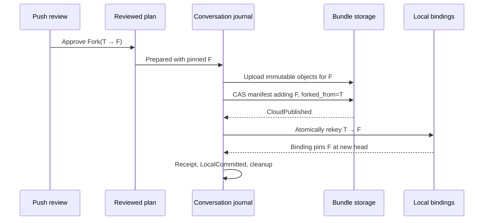
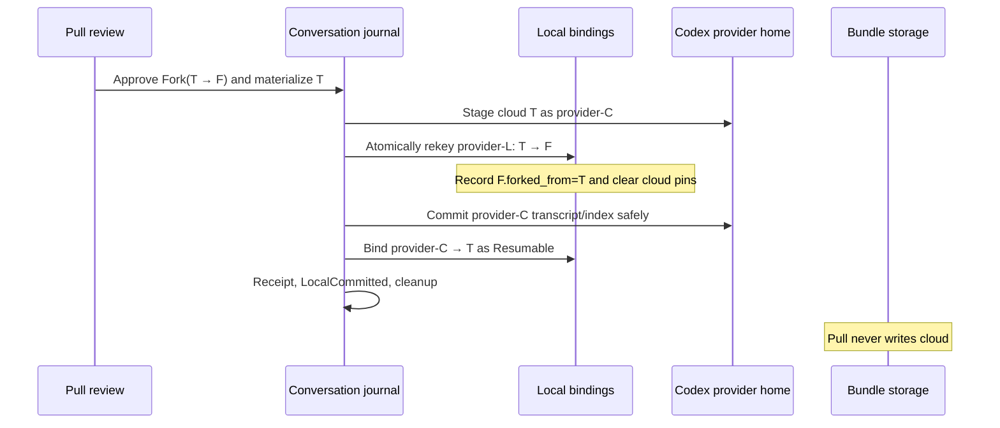

# Design: Fork-safe Codex lineage and bidirectional divergence resolution

- Status: Implemented
- Date: July 27, 2026
- Scope: `ProjectSync`, Codex conversations, Push review, Pull review, and
  conversation materialization
- Production model: the flat, fork-aware conversation model represented by
  `BUNDLE_SCHEMA = 1`

## Implementation status

The fork-safe rollout parser, codec v2, binding recovery, typed directional
decisions, journaled Push/Pull fork operations, and checkbox-free
non-actionable UI are implemented. Push and Pull execute the same typed
conversation plans and use one bundle publisher. Bundle schema 1 is the only
accepted format; there is no migration, compatibility reader, or dual writer.
Fresh local state and empty storage are required after this reset.

## Decision summary

Mallard will make these changes as one coordinated feature:

1. Parse a Codex rollout's first structural `session_meta` as the authoritative
   identity of the current provider thread.
2. Accept repeated metadata from the current thread and copied metadata from
   any bounded, valid transitive `forked_from_id` ancestry. A fork of a fork of
   a fork is therefore valid.
3. Reject mismatched active identity, unrelated copied metadata, conflicting
   parent claims, self-parenting, and ancestry cycles.
4. Use one shared full-rollout structure parser for transcript analysis and
   portable Push/Pull structural rewrite. Bounded discovery and history probes
   follow the same first-authoritative-record rule without scanning every
   transcript in full.
5. Keep provider fork ancestry separate from Mallard's portable logical-thread
   ancestry.
6. Resolve `Diverged` to a non-destructive `Fork` by default in both Push and
   Pull.
7. Mint every logical fork ID once at plan time, persist it in the reviewed
   plan and journal, and reuse it during retries and recovery.
8. Preserve both branches. Divergence never merges or overwrites an existing
   provider transcript by default.
9. Populate and execute typed conversation actions in the production Push and
   Pull paths. Computing a proposed action for display is not sufficient.
10. Render a checkbox only for a real, selectable action in the active
    direction. Non-actionable rows reserve no empty checkbox gutter.

The fixed-point rule is:

> A divergence creates exactly one new logical identity. Once the local
> binding moves to that identity, its local and cloud chains are identical, so
> the next sync is a no-op rather than another fork.

## Why this design is needed

### Valid Codex forks currently look like ownership failures

Codex creates a fork with a new active `session_meta`, sets
`forked_from_id` to the immediate source thread, and copies stored source
history into the new rollout. Copied history contains the source thread's
`session_meta`; nested forks can contain metadata for several ancestors.

A valid three-level provider chain therefore has this shape:

```text
provider-p
└─ provider-p1
   └─ provider-p11
      └─ provider-p111
```

The `provider-p111` rollout can contain metadata records for
`provider-p111`, `provider-p11`, `provider-p1`, and `provider-p`, including
duplicates of those records.

Earlier ownership code scanned every `session_meta` and required every recorded
ID to equal the expected active ID. That rule incorrectly rejected copied
ancestor metadata.

`scan_jsonl_metadata` already has the correct starting behavior: it returns
the first authoritative Codex `session_meta`. The stricter full-file checks
need to use the same active-record rule while still validating copied
ancestry.

### Transcript analysis also rejects valid fork history

The previous `conversation_codec.rs` logic merged all `session_meta` IDs and CWDs as
though the file could contain only one value. A copied ancestor ID becomes
`ConflictingSessionMetadata`, even though the first record still identifies
the active thread unambiguously.

The previous lineage codec also expected explicit parent IDs on records where
modern Codex rollouts commonly provide ordered, stable response-item IDs but
no explicit `parent_id`. A fork-safe structural parser alone removes the
ownership pause, but the conversation may still be classified as
non-resumable or `Unknown`. Both layers must be corrected.

### Previous production gap (resolved)

Before this implementation, the repository contained:

- a pure relation classifier;
- direction-specific default decisions;
- `Fork` plan actions with a pre-minted `result_thread_id`;
- binding rekey helpers;
- journaled cloud publication and provider materialization helpers; and
- integration tests for one-level Push and Pull forks.

The missing production wiring was:

- the normal publisher used the pre-cutover publication path;
- production restore planning set `conversation_actions` to an
  empty vector;
- fork-aware thread comparison could display proposed actions without executing
  those typed actions; and
- the tested Push/Pull fork helpers were not called by the normal Tauri command
  path.

Those gaps are now closed by the registered Push and Pull command paths.

### Direction and selection are currently too loosely coupled

A thread has separate Push and Pull decisions. A union of available actions or
one state-derived `proposed_action` cannot faithfully represent both
directions.

The UI also must not infer actionability from a broad sync state. An
up-to-date, blocked, keep-local, pull-required, cannot-upload, or cannot-pull
row is informational. It must not show a checkbox, and it must not reserve
empty checkbox alignment space.

## Goals

- Accept ordinary Codex roots, one-level forks, and nested forks to a bounded
  depth.
- Fix the reported false ownership blocker without weakening active-thread
  identity validation.
- Make valid nested forks capturable and resumable when their message records
  are supported by the codec.
- Resolve divergence safely in both Push and Pull.
- Support a conflict on any node, including the tip of an existing fork chain.
- Preserve source and losing branches without implicit replacement.
- Make every fork retry-safe, crash-safe, CAS-safe, and loop-free.
- Keep logical matching independent from titles and provider-native IDs.
- Scope a malformed or unsupported conversation to that conversation whenever
  other selected resources can still be handled safely.
- Make the UI reflect the exact reviewed action that the backend will execute.

## Non-goals

- Merging divergent message content.
- Automatically choosing one branch as the winner.
- Automatically opening, focusing, or resuming a provider conversation.
- Treating `forked_from` as a matching key.
- Reconstructing deleted or pruned portable ancestors.
- Making an unsupported transcript resumable by guessing.
- Keeping a permanent pre-cutover/fork-aware dual-writer path.
- Changing Codex's own fork or resume behavior.

## Terminology and identity domains

Three identity domains must not be conflated.

### Provider thread ID

The ID stored in Codex rollout metadata, such as `provider-p111`. It is local
to a provider home and may differ across machines after materialization.

Codex records provider-native fork provenance with `forked_from_id`. It may
also record `parent_thread_id` for spawned/subagent relationships. These
fields describe provider history; they do not identify a Mallard cloud thread.

### Mallard logical `ThreadId`

The portable key of one flat cloud conversation, such as `thread-t111`.
Mallard mints a fresh random `ThreadId` for a conflict fork.

`ConversationThread.forked_from` stores the immediate logical parent. It is
provenance only and is never consulted by the resolver.

### Local conversation binding

A machine-local mapping from:

```text
(host, replica, project, provider profile, logical ThreadId)
```

to a provider thread ID and its last-observed digests.

The binding, not `forked_from`, says which local provider transcript is the
local representation of a logical cloud thread.

### Three operations called "fork"

The implementation must use distinct names internally:

1. **Provider-native fork**: Codex creates a new provider thread and a rollout
   whose `forked_from_id` points to the immediate provider parent.
2. **Logical conflict fork**: Mallard preserves divergent content under a new
   portable `ThreadId`. A Push conflict does not need to rewrite or rename the
   provider transcript.
3. **Materialization copy**: Pull creates a destination-local provider thread
   for an existing logical cloud thread. The provider ID changes, but the
   portable logical `ThreadId` does not.

This design uses `provider fork`, `logical fork`, and `materialization`
respectively.

## Core invariants

### Rollout identity

- The first valid structural `session_meta`, before any conversation item, is
  the authoritative active metadata record.
- `payload.id` is preferred as the active ID. Older supported formats may fall
  back to `thread_id`, `threadId`, `session_id`, or `sessionId` through an
  explicitly versioned adapter.
- The authoritative active ID must equal the expected rollout thread ID, rollout
  filename ID when one is available, and capture resource identity.
- A later metadata record is historical; it cannot replace the active ID or
  active CWD.
- Duplicate metadata records are allowed only when their non-null parent
  claims do not conflict.

### Provider ancestry

- `forked_from_id` is an immediate directed edge from child to parent.
- Following parent edges from the authoritative active ID must never cycle.
- A thread cannot parent itself.
- One provider ID cannot claim two different non-null fork parents.
- Every distinct historical `session_meta` ID in the rollout must be reachable
  from the authoritative active ID through the accepted ancestry edges.
- A referenced terminal parent may be absent from a truncated rollout, but an
  observed unrelated metadata ID is rejected.
- Repeated current and ancestor metadata records are allowed.
- Ordinary user fork ancestry is linear.
- `parent_thread_id` remains a separately typed spawn edge. It may authorize
  inherited subagent history only through a provider-format rule; it must not
  silently substitute for a missing `forked_from_id` on an ordinary user
  thread.
- If `forked_from_id` and `parent_thread_id` create an ambiguous or branching
  history that the codec cannot prove linear, ownership may still be valid,
  but resumability is `StoredOnly`.
- Parsing is bounded by file bytes, line bytes, record count, distinct IDs,
  and a proposed `MAX_CODEX_FORK_DEPTH` of 256.

### Portable ancestry

- Every logical conflict fork gets a random, plan-persisted `ThreadId`.
- `result_thread_id != source thread_id`.
- A new portable fork stores only its immediate logical parent.
- Manifest validation rejects self-parenting and cycles among ancestors that
  are present in the same manifest.
- A missing portable parent remains valid because the parent may have been
  tombstoned or pruned.
- Portable ancestry is display provenance, never resolver input.

### Content preservation

- Default divergence handling never overwrites the existing cloud source
  thread.
- Default divergence handling never rewrites the existing local provider
  transcript.
- Push conflict resolution changes cloud state and a local binding; it does
  not change provider content.
- Pull conflict resolution rekeys the existing local binding and materializes
  the cloud branch into a new provider conversation.
- `ReplaceCloud` and `ReplaceLocal` remain explicit-approval actions and are
  never default-selected.

### Review and concurrency

- The action executed is the action serialized in the reviewed plan.
- Fork result IDs and destination provider IDs are reserved at plan time.
- Plans pin cloud revision, commit, manifest digest, local content digest,
  lineage/semantic digests, profile revision, project binding revision, host
  identity revision, bindings-document revision, binding revision, target
  expectations, codec version, and expiry.
- Push publication uses immutable objects and compare-and-swap on the head.
- Pull provider writes use staging, no-clobber or digest-pinned replacement,
  backups where replacement is allowed, and a durable journal.
- Recovery reuses the planned IDs. It never mints a replacement ID.

## Shared Codex rollout-structure parser

Create a provider-specific structural module, for example:

```text
src-tauri/src/project_sync/codex_rollout.rs
```

The exact file name is not contractual; the single-source-of-truth boundary
is.

Suggested types:

```rust
struct CodexSessionMetaRecord {
    record_index: usize,
    id: String,
    session_id: Option<String>,
    forked_from_id: Option<String>,
    parent_thread_id: Option<String>,
    cwd: String,
    thread_source: Option<String>,
}

struct CodexRolloutStructure {
    current: CodexSessionMetaRecord,
    fork_ancestry: Vec<String>,
    accepted_metadata_ids: BTreeSet<String>,
    structural_cwds: BTreeSet<String>,
    record_count: usize,
}
```

Suggested entry point:

```rust
fn analyze_codex_rollout_structure(
    bytes: &[u8],
    expected_active_id: Option<&str>,
) -> Result<CodexRolloutStructure, CodexStructureError>
```

### Parsing algorithm

1. Enforce the existing bounded file, line, and record limits before retaining
   data.
2. Parse structural `session_meta` and `turn_context` records. Do not search
   arbitrary nested objects for identity after the record type is known.
3. Select the first `session_meta` as authoritative.
4. If an expected active ID is supplied, compare it only with the
   authoritative ID.
5. Collect one optional non-null fork parent claim per distinct metadata ID.
   Identical duplicates are allowed. Two different non-null parents are an
   error.
6. Reject self-parent edges.
7. Follow `forked_from_id` from the authoritative ID, bounded by
   `MAX_CODEX_FORK_DEPTH`, collecting reachable IDs and detecting cycles.
8. Reject every observed historical metadata ID not in that reachable set.
9. Collect every structural CWD from accepted metadata and turn-context
   records.
10. Return the authoritative ID and CWD separately from historical values.

For this valid input:

```text
p111 -> p11
p11  -> p1
p1   -> p
p     -> none
```

repeated records for `p111`, `p11`, `p1`, and `p` are accepted.

These inputs fail closed:

```text
p111 -> p11, plus unrelated metadata x
p111 -> p11 and p111 -> p1
p111 -> p111
p111 -> p11 -> p1 -> p111
authoritative id p111 while the expected rollout id is p11
```

### Callers

The shared result replaces independent identity parsing in:

- `provider_capture::scan_jsonl_metadata`;
- Codex discovery and capture ownership checks;
- `conversation_codec::analyze_codex_transcript`;
- `conversation_codec::rewrite_codex_transcript`.

Discovery may use a streaming first-record fast path to identify a candidate,
but selected capture and ownership approval must run the complete bounded
structural validation.

## Authoritative project ownership

Ownership and resumability are separate decisions. Each rollout has one
authoritative project home: the `cwd` in its active, authoritative
`session_meta` record.

A project owns a rollout only when:

- the rollout resolves inside the bound Codex home;
- exactly one rollout represents the expected active ID;
- the authoritative ID matches the expected rollout thread ID;
- the authoritative home is canonically equal to the bound project root; and
- all observed historical metadata belongs to valid accepted ancestry.

Codex Desktop project lists, thread-project assignments, writable roots, and
workspace hints are not ownership evidence. A Desktop assignment cannot
transfer a rollout to another project. Later `turn_context.cwd` values also do
not change its home.

Mallard never rewrites a local rollout to change its project ownership. If a
project moves, existing rollouts retain their recorded authoritative home.
Portable Push/Pull path mapping remains a transfer-boundary transform and does
not mutate the source rollout.

Message-lineage support is not required to establish ownership. An owned but
unsupported transcript can still be captured as stored-only.

### Failure scope

A fork-valid transcript must not globally pause Push or Pull.

A genuinely unverified conversation becomes a blocked, non-selectable row.
Other conversations, skills, plugins, and eligible project content may
continue when their own plans do not depend on the blocked conversation.
Global pause remains appropriate only for a shared invariant failure, such as
an untrusted provider-home boundary or corrupt bindings document.

## Codex lineage codec v2

Introduce a new codec key, for example:

```text
codex.lineage.v1
```

The codec first consumes `CodexRolloutStructure`. Historical metadata no
longer participates in active-ID or active-CWD merging.

### Canonical item sequence

Modern Codex rollouts provide an ordered append-only stream. Supported
`response_item` records have stable item IDs, while explicit parent IDs may be
absent.

Codec v2 builds a canonical linear sequence as follows:

1. Select provider records that represent durable model-history items and have
   a stable provider item ID.
2. Preserve provider record order.
3. Use an explicit provider parent ID when present and valid.
4. Otherwise assign the previous included canonical item as the implicit
   parent.
5. Hash semantic content after removing structural IDs, CWDs, timestamps, and
   other declared transport-only fields.
6. Reject duplicate item IDs with different content, invalid IDs, impossible
   explicit parents, or a branch inside one rollout.
7. Ignore duplicate presentation events such as `event_msg` rows when the
   durable `response_item` already represents the same user or assistant item.
8. Return `Unknown`, never `Diverged`, when the adapter cannot prove one
   sequence.

This produces prefix and divergence relations for real forked rollouts without
inventing message ancestry from display text.

### Structural rebind

Materializing a cloud thread under a destination-local provider ID is an
identity rebind, not a new logical fork.

The rebind operation:

- rewrites the authoritative active ID and duplicate metadata records that
  represent that same active provider thread;
- preserves accepted ancestor IDs and parent edges;
- maps all accepted structural CWDs to the destination project;
- preserves canonical item IDs and semantic content; and
- requires a successful v2 round trip with identical lineage and semantic
  digests.

### One provider materialization path

A logical conflict fork does not need a second provider-native fork subsystem.
For Push, Mallard preserves the cloud thread and publishes the existing local
branch under the plan's new logical thread ID. For Pull, Mallard rekeys the
existing divergent local binding to the new logical child, then materializes
the unchanged cloud branch under a fresh provider ID and its original logical
thread ID.

That Pull materialization uses the same structural rebind and journaled
transaction as every other Codex materialization. It updates the transcript
and `session_index.jsonl` atomically, proves the rewritten lineage and
semantics, and preserves the pre-existing local transcript. A separate
CLI/codec fallback, SQLite reconstruction path, or provider-fork provenance
field would duplicate this transaction and is intentionally absent.

## Relation classification

Logical matching is based only on the bound local canonical chain and the
cloud canonical chain:

| Relation | Meaning |
| --- | --- |
| `Identical` | Same item IDs, parentage, order, and semantics |
| `CloudPrefixOfLocal` | Local safely continues cloud |
| `LocalPrefixOfCloud` | Cloud safely continues local |
| `Diverged` | A proven common prefix has different continuations |
| `Unknown` | A safe ancestry relation cannot be proven |
| `LocalMissing` | Cloud exists without a bound local representation |
| `CloudMissing` | Bound local representation has no cloud thread |
| `BothMissing` | Neither side has content |

Neither provider `forked_from_id` nor portable `forked_from` changes this
classification.

## Directional decision matrix

The backend produces separate Push and Pull decisions.

| Relation | Push default | Pull default |
| --- | --- | --- |
| `Identical` | `NoOp` | `NoOp` |
| `CloudPrefixOfLocal` | `FastForwardCloud` when safely capturable and bound | `KeepLocal` |
| `LocalPrefixOfCloud` | `RequirePull` | `FastForwardLocal` when readable, resumable, and safe to apply; otherwise `StoreOnly` |
| `Diverged` | `Fork` when safely capturable and bound | `Fork` when readable, resumable, provider targets can be reserved, and provider mutation can be applied safely; otherwise `StoreOnly` |
| `Unknown` | `Fork` only when the local content is safely capturable and the binding is proven | `StoreOnly` |
| `LocalMissing` | `NoOp` | `CreateLocal` when resumable; otherwise `StoreOnly` |
| `CloudMissing` | `CreateCloud` when safely capturable | `KeepLocal` |
| `BothMissing` | `NoOp` | `NoOp` |

`ReplaceCloud`, `ReplaceLocal`, and `TombstoneThread` are explicit-review
actions and are never synthesized by this default matrix.

`StoreOnly` is selectable only when the reviewed plan performs a durable local
metadata action. If it is merely an informational capability result, it is not
selectable.

## Nested logical forks

Assume this portable chain:

```text
thread-t
└─ thread-t1
   └─ thread-t11
      └─ thread-t111
```

If the bound local and cloud representations of `thread-t111` diverge, Mallard
mints a random new `ThreadId`, shown here symbolically as `thread-new`:

```text
thread-t
└─ thread-t1
   └─ thread-t11
      └─ thread-t111
         └─ thread-new
```

The new thread stores:

```text
thread-new.forked_from = thread-t111
```

No resolver rule depends on the depth of `thread-t111`. The same operation
works for a root, a child, or the tip of a long chain.

IDs must be random rather than derived names such as `t1111`; the symbolic
name above only illustrates immediate-parent provenance.

## Push divergence flow

### Precondition

Local provider conversation `provider-L` is bound to logical `thread-T`.
Cloud `thread-T` exists, and the canonical chains are `Diverged`.

### Planned result

The Push plan contains:

- source logical ID `thread-T`;
- random result logical ID `thread-F`;
- immediate logical parent `thread-T`;
- current provider ID `provider-L`;
- pinned local bytes and canonical digests;
- pinned cloud head and manifest;
- expected binding revisions; and
- action `Fork`.

The provider transcript and provider ID remain unchanged.

### Apply sequence



Publication precedes the binding rekey. If publication fails without evidence
that the head committed, the existing binding remains on `thread-T`. If the
head commits and the process crashes, recovery finds the exact planned
`thread-F` and completes the rekey. It never creates `thread-F2`.

The cloud source `thread-T` is unchanged. Other hosts bound to `thread-T` are
unaffected.

### Retry and fixed point

- If CAS reports an ambiguous error, re-inspect the head.
- Treat the operation as published only if `thread-F`, its immediate parent,
  and its pinned content digests match exactly.
- A conflicting use of `thread-F` is a hard recovery error.
- After rekey, local `provider-L` and cloud `thread-F` are `Identical`.
- The next Push proposes `NoOp`.
- Cloud `thread-T` appears as a cloud-only row on this host and may be pulled
  separately.

## Pull divergence flow

### Precondition

Local provider conversation `provider-L` is bound to logical `thread-T`.
Cloud `thread-T` exists with a divergent canonical chain.

### Planned result

The Pull plan reserves:

- random local logical fork ID `thread-F`;
- immediate logical parent `thread-T`;
- a destination-local provider ID `provider-C` for the cloud branch;
- no-clobber transcript and provider-index targets;
- the source and result binding revisions;
- cloud and local content pins; and
- action `Fork`.

### Apply sequence

Pull is one reviewed action implemented as two linked, journaled substeps:



The existing `provider-L` file is untouched. After the action:

```text
provider-L -> logical thread-F -> local divergent branch
provider-C -> logical thread-T -> pulled cloud branch
```

`thread-F` is locally `CloudMissing`. A later Push proposes `CreateCloud` and
publishes it under the already minted ID with:

```text
thread-F.forked_from = thread-T
```

The immediate parent must survive the interval between Pull and the later
Push. Add machine-local pending logical-fork provenance to
`LocalConversationBinding` or an equivalent revisioned local document. A
retired journal entry alone is not sufficient because the next Push must still
know the parent.

### Composite recovery

The two Pull substeps share one plan action and deterministic operation IDs.
Recovery treats them as one state machine:

```text
Prepared
→ IncomingStaged
→ LocalRekeyed
→ ProviderCommitted
→ BindingsCommitted
→ LocalCommitted
```

Safe intermediate behavior:

- Before `LocalRekeyed`, rollback can remove staging without changing the
  existing local branch.
- After `LocalRekeyed`, the local branch remains safe under `thread-F`; recovery
  must finish materializing cloud `thread-T` or report recovery required.
- A retry uses the same `thread-F` and `provider-C`.
- Failure never moves `provider-L` back onto `thread-T` by guessing.
- Pull never publishes `thread-F`.

## Data-model and contract changes

### `LocalConversationBinding`

Persist the logical parent needed by an unpublished local fork:

```rust
#[serde(default, skip_serializing_if = "Option::is_none")]
pub forked_from: Option<ThreadId>,
```

Rules:

- set it when Push or Pull rekeys a binding for a logical conflict fork;
- preserve it after publication as provenance, or clear it only when the
  equivalent portable parent is durably pinned elsewhere;
- reject self-parenting;
- do not use it for matching; and
- bump and migrate the owning machine-local document schema.

### `ConversationThread`

Keep the existing portable `forked_from: Option<ThreadId>`, and add
manifest-level bounded cycle validation across present threads.

### `ConversationPlanAction`

Keep direction, source `thread_id`, and pre-minted `result_thread_id`.
For a Pull fork, the action must also pin the destination provider ID and all
targets needed to materialize cloud `thread_id` after preserving local content
under `result_thread_id`.

The action validator must enforce:

- Push-only and Pull-only action sets;
- a distinct result ID for `Fork`;
- immediate-parent provenance equal to the source logical ID;
- reserved provider ID for Pull materialization;
- no mutation targets for `NoOp`, `KeepLocal`, `RequirePull`, or `Blocked`;
- required digests and revisions for every mutating action; and
- explicit approval for replacement or deletion actions.

### Directional comparison DTO

Replace one ambiguous proposed decision with direction-specific decisions:

```ts
interface ThreadSyncDecision {
  action: ConversationPlanActionType;
  reasonCode: ConversationReasonCode;
  selectable: boolean;
  selectedByDefault: boolean;
  requiresExplicitApproval: boolean;
  blockedReason?: string;
}

interface ThreadSyncEntry {
  // existing identity, state, relation, and display fields
  pushDecision: ThreadSyncDecision;
  pullDecision: ThreadSyncDecision;
}
```

An alternative direction-parameterized command returning one
`decision` is acceptable. A union of Push and Pull actions in
`available_actions` is not.

Rust DTOs and `src/types.ts` must change together.

## Production orchestration

### Push planning

`prepare_push_review` must:

1. run fork-aware ownership validation;
2. capture and analyze selected conversations;
3. compare each bound local thread with the exact cloud logical thread;
4. create typed Push actions from the Push decision;
5. mint and persist result IDs for every `Fork`;
6. pin the complete reviewed state; and
7. expose only those actions to Push selection.

The final Push command must load this immutable plan rather than recomputing
actions from live UI state.

### Push apply

The fork-aware publisher must apply all selected conversation actions in one
reviewed CAS publication where practical:

- `FastForwardCloud` replaces only the selected logical thread's content after
  prefix and digest revalidation.
- `Fork` adds a new logical thread and preserves the source.
- `CreateCloud` publishes an already minted local-only logical thread,
  including pending `forked_from`.
- `NoOp`, `RequirePull`, and `Blocked` produce no mutation.

Per-action journals may share one publication result, but each recovery record
must bind its planned result ID and expected content to the exact committed
manifest.

### Pull planning

`build_restore_plan_lazy` or its production wrapper must populate
`RestorePlan.conversation_actions`. It must not leave the field empty when a
fork-aware conversation requires work.

Generic restore actions must exclude resources handled by typed conversation
actions, preventing duplicate transcript writes.

### Pull apply

`apply_bundle_restore_with_progress` must:

1. resolve approved typed conversation action IDs from the stored plan;
2. revalidate every cloud, local, binding, codec, target, and expiry pin;
3. execute `FastForwardLocal`, `CreateLocal`, `StoreOnly`, or composite Pull
   `Fork` through the conversation journal;
4. combine conversation receipts with ordinary restore receipts; and
5. mark the materialization complete only when all selected typed actions
   reached their terminal safe state.

### Startup recovery

Before a new Push or Pull plan is offered:

- recover or surface incomplete conversation publications;
- recover or surface incomplete provider materializations;
- do not compare a binding whose prior fork action is still in an ambiguous
  phase; and
- never silently discard or regenerate a planned result ID.

## Review UI

### Directional action copy

Examples:

| Direction | Relation/action | Copy |
| --- | --- | --- |
| Push | `Diverged` / `Fork` | “Publish local branch as a new cloud thread” |
| Pull | `Diverged` / `Fork` | “Keep local branch and restore cloud branch as a separate conversation” |
| Push | `LocalPrefixOfCloud` / `RequirePull` | “Pull required before publishing” |
| Pull | `CloudPrefixOfLocal` / `KeepLocal` | “Local branch is ahead; nothing will be replaced” |
| Either | `Identical` / `NoOp` | “Already up to date” |
| Either | `Blocked` | Show the precise blocker |

### Checkbox rule

Render a checkbox if and only if the active directional decision says
`selectable: true`.

Do not render:

- a disabled checkbox;
- an unchecked placeholder checkbox;
- an empty selection slot; or
- CSS padding or a grid column reserved for a missing checkbox.

The title and status content start at the row's normal leading edge when no
checkbox exists. This rule applies consistently to:

- conversation rows;
- up-to-date rows;
- cannot-upload rows;
- cannot-pull rows;
- blocked resources;
- completed Pull rows; and
- the equivalent skills, plugins, and project-file review rows.

The selection set is sanitized whenever comparison or plan data changes, so an
ID that becomes non-selectable cannot remain invisibly selected.

### Defaults

- Safe `FastForwardCloud`, `FastForwardLocal`, `CreateCloud`, `CreateLocal`,
  and `Fork` actions are selected by default.
- `ReplaceCloud`, `ReplaceLocal`, and deletion actions are never selected by
  default and show “Review required.”
- Informational actions are never selected and have no checkbox.

## Error model

Use distinct user-facing classes:

| Class | Example | Effect |
| --- | --- | --- |
| Ownership mismatch | Assigned ID differs from authoritative first metadata ID | Block that conversation |
| Invalid provider ancestry | Cycle, self-parent, conflicting parent, unrelated copied metadata | Block that conversation |
| Foreign authoritative home | Active `session_meta.cwd` differs from the bound project root | Exclude from this project; do not rewrite |
| Unsupported message codec | Ownership valid, canonical item sequence not provable | Store-only; do not claim resumable |
| Ambiguous binding | More than one compatible logical ancestor | Block mutating action |
| Stale reviewed plan | Head, bytes, binding, target, codec, or revision changed | Abort and refresh |
| Recovery required | A journaled commit cannot be proved complete or safely rolled back | Pause affected action and show recovery |

Do not report copied, valid ancestor metadata as an ownership mismatch.

## Security and privacy boundaries

- Continue bounded, no-follow reads and regular-file validation.
- Continue canonical containment checks for Codex homes and project roots.
- Never trust a filename alone for active identity.
- Never accept an arbitrary later metadata ID merely because it appears in the
  same JSONL file.
- Never log transcript content, credentials, complete local paths, or portable
  provider-home details.
- Keep local bindings, journal state, plan pins, target paths,
  and provider index details out of portable manifests.
- Verify immutable upload objects by SHA-256.
- Preserve head compare-and-swap behavior.
- Revalidate local bytes after review and before publication.
- Require exact target expectations for provider files and indexes.
- Do not recursively delete provider content.
- Do not rewrite an active provider transcript during default divergence
  handling.

## Concurrency behavior

### Two hosts fork the same source

If hosts A and B both diverge from logical `thread-T`, each plan mints a random
result:

```text
thread-T
├─ thread-FA
└─ thread-FB
```

After one host wins the CAS, the other rebases against the new head. Because
its planned result ID is unique and the source remains present, it can add its
fork without changing the first fork. It must revalidate that `thread-T` still
matches the reviewed source digest.

### Provider changes during Pull

If Codex changes the destination index or any reviewed target after planning,
target expectation validation fails. The action is replanned; Mallard does not
overwrite the new provider state.

### Local conversation changes during Push

If the transcript changes after review, the captured digest or canonical
digest no longer matches. Push aborts and requires a refreshed review. Mallard
does not publish unreviewed appended turns under the planned fork.

## Schema and rollout

The cutover is destructive by product decision: bundle manifests use
`BUNDLE_SCHEMA = 1`, and all freshly reset local documents use their single
current schema constants. Readers reject every other schema value. There is
no old-head activation, in-place migration, compatibility decoder, or
alternate writer. A displayed selectable `Fork` always corresponds to a
persisted typed plan that the active command path can execute.

## Implementation phases

### Phase 1 — Shared structural parser and ownership fix

- Add the bounded Codex rollout parser.
- Route discovery, capture ownership, and transcript analysis through it.
- Use the authoritative active `session_meta.cwd` as the one project home.
- Accept nested valid fork ancestry.
- Scope true failures to the affected conversation.
- Add realistic JSONL fixtures based on current Codex metadata shapes.

### Phase 2 — Codec v2 and materialization correctness

- Add ordered modern Codex item support.
- Stop merging historical metadata into active identity.
- Add fork-aware structural rebind.
- Prove semantic and lineage round trips.

### Phase 3 — Directional planning contracts

- Build separate Push and Pull decisions.
- Add backend-provided actionability/default flags.
- Persist pending logical-parent provenance in local bindings.
- Add manifest fork-cycle validation.
- Update Rust and TypeScript DTOs together.

### Phase 4 — Production Push execution

- Build and save immutable conversation Push plans.
- Route selected actions through the fork-aware publisher.
- Publish before rekeying a Push fork.
- Join publication, binding, receipt, and recovery state.
- Prove a second Push creates no additional fork.

### Phase 5 — Production Pull execution

- Populate `RestorePlan.conversation_actions`.
- Exclude typed conversations from generic restore writes.
- Implement the linked composite Pull-fork state machine.
- Persist pending fork provenance for the later `CreateCloud`.
- Join conversation and ordinary restore receipts.

### Phase 6 — Review UI

- Consume the active directional decision.
- Remove inference from broad sync states.
- Remove checkboxes and gutters from non-selectable rows.
- Keep safe forks preselected and force actions explicit.
- Add direction-specific status copy.

### Phase 7 — Cutover and recovery validation

- Complete the one-way production schema cutover.
- Run crash tests for every journal boundary.
- Run local-folder and S3/R2 CAS parity tests.
- Verify the complete Tauri application with real nested-fork fixtures.
- Capture Push and Pull review screenshots for release review.

## Regression test plan

### Structural parser and ownership

Add Rust tests for:

1. a root rollout with one active metadata ID;
2. a one-level fork containing current and parent metadata;
3. `p → p1 → p11 → p111`, including repeated metadata at every level;
4. an active metadata record repeated later;
5. a terminal parent referenced but absent from a truncated rollout;
6. an unrelated historical metadata ID;
7. two non-null parents claimed by one ID;
8. self-parenting;
9. an ancestry cycle;
10. active ID versus expected rollout ID mismatch;
11. malformed first metadata;
12. invalid or over-limit IDs;
13. depth and distinct-ID limits;
14. exact canonical equality between authoritative home and project root;
15. a Desktop project assignment cannot transfer rollout ownership; and
16. later turn CWDs cannot transfer rollout ownership.

### Codec

Add Rust tests for:

1. modern ordered response items without explicit parent IDs;
2. explicit valid parent IDs;
3. duplicate item IDs;
4. conflicting item semantics under one ID;
5. non-linear explicit parentage;
6. nested provider-fork metadata with a complete canonical sequence;
7. active identity taken only from the first metadata;
8. materialization rebind preserving ancestor edges;
9. structural rewrite preserving lineage and semantic digests; and
10. unsupported records returning `Unknown`/stored-only instead of
    `Diverged`.

### Resolver matrix

For every relation, test both Push and Pull with:

- all capabilities available;
- unsafe local capture;
- unreadable cloud transcript;
- unsupported destination codec;
- non-quiescent or concurrently changed provider targets;
- missing binding;
- ambiguous binding; and
- unique compatible ancestor recovery.

Assert the exact action, reason code, selectable flag, default-selection flag,
and explicit-approval flag.

### Nested Push conflict

Create portable logical ancestry:

```text
t → t1 → t11 → t111
```

Then:

1. bind local provider content to `t111`;
2. make local and cloud `t111` diverge;
3. plan Push;
4. assert one random result ID is persisted;
5. apply Push;
6. assert the result's `forked_from == t111`;
7. assert `t`, `t1`, `t11`, and `t111` are unchanged;
8. assert the provider ID and transcript are unchanged;
9. reopen and run recovery;
10. run comparison and Push again; and
11. assert `Identical`, `NoOp`, no new object publication, and no second fork.

### Nested Pull conflict

Using the same ancestry:

1. bind a divergent local provider conversation to `t111`;
2. plan Pull;
3. assert the plan reserves one logical result ID and one provider ID;
4. apply the composite Pull fork;
5. assert the original local transcript is unchanged and bound to the result;
6. assert the result records `forked_from == t111` locally;
7. assert cloud `t111` is materialized under a different provider ID;
8. assert Pull did not change cloud revision;
9. simulate a crash after each journal phase and recover twice;
10. Push the local-only result;
11. assert its portable `forked_from == t111`; and
12. run another Push and Pull, asserting no additional fork.

### Concurrent Push forks

- Plan divergence forks on two hosts from the same source revision.
- Apply A.
- Apply/rebase B.
- Assert two distinct children, both with the same immediate source, with no
  overwritten thread and a valid manifest graph.

### Production command integration

Tests must call the same repository functions used by registered Tauri
commands and prove:

- Push review persists typed actions;
- selected Push fork actions execute;
- Pull restore plans contain typed conversation actions;
- selected Pull fork actions execute;
- generic restore does not duplicate their transcript work;
- receipts include the typed actions;
- stale plan pins fail before mutation; and
- the normal production path no longer leaves
  `conversation_actions: Vec::new()` for a divergent fork-aware conversation.

### Frontend

Add mounted frontend integration tests for both Push and Pull:

- `NoOp` has no checkbox and no checkbox gutter.
- `KeepLocal`, `RequirePull`, and `Blocked` have no checkbox.
- cannot-upload and cannot-pull rows have no checkbox.
- `Fork` has one preselected checkbox.
- force and delete actions are unselected and marked review-required.
- switching from selectable to non-selectable removes the ID from selection.
- the title aligns at the normal leading edge when the checkbox is absent.
- Push and Pull show their own decision and copy.
- clicking an informational row never invokes the selection callback.
- another category's non-selectable row follows the same no-placeholder rule.

## Required verification

During implementation, run the smallest focused tests first. Before handoff:

```text
npm run build
npm run test:frontend-integration
cargo test --manifest-path src-tauri/Cargo.toml --lib
npm run test:integration
```

Also run the complete Tauri application against temporary Codex homes
containing root, one-level, and three-level fork fixtures. Do not use a real
provider home as a writable test target.

## Acceptance criteria

This design is complete only when all of the following are true:

1. A valid three-level Codex fork chain no longer pauses Push or Pull.
2. The authoritative active ID still must match the expected rollout thread.
3. Unrelated or cyclic metadata remains blocked.
4. Codex Desktop assignment changes do not transfer ownership or rewrite a
   rollout.
5. Nested fork rollouts can be classified by codec v2 when their canonical
   items are supported.
6. A conflict on `t111` can create a new logical child whose immediate parent
   is `t111`.
7. Push divergence preserves cloud `t111` and does not rewrite the local
   provider transcript.
8. Pull divergence preserves the local transcript, rekeys it, and materializes
   cloud `t111` as a separate provider conversation.
9. A later Push publishes the Pull-preserved local branch with the correct
   immediate parent.
10. Repeating Push and Pull reaches a fixed point and creates no duplicate
    forks.
11. Crash recovery reuses planned logical and provider IDs.
12. Production Push and Pull commands execute typed conversation actions.
13. Non-actionable UI rows show no checkbox and reserve no checkbox space.
14. Safe divergence forks are selected by default in both directions.
15. Force and deletion remain explicit-review actions.

## Source references

Current Mallard implementation:

- `crates/mallard-infrastructure/src/codex_rollout.rs`
  - `analyze_codex_rollout_structure`
- `crates/mallard-infrastructure/src/providers/codex/`
  - authoritative metadata parsing and exact-home discovery
- `crates/mallard-infrastructure/src/conversation_codec.rs`
  - `analyze_codex_transcript`
  - `rewrite_codex_transcript`
- `crates/mallard-infrastructure/src/codex_standalone_builder.rs`
  - `build_standalone_codex_root`
- `crates/mallard-domain/src/conversation_reconciliation.rs`
  - `default_conversation_decision`
- `src-tauri/src/project_sync/conversation_materialization.rs`
  - `apply_conversation_cloud_publication`
  - `apply_conversation_materialization`
- `src-tauri/src/project_sync/bundle_engine.rs`
  - fork-aware publication
  - restore-plan construction
- `src-tauri/src/sync_tests/thread_variants/conflicts.rs`
- `src-tauri/src/project_sync/commands.rs`
  - three-level Push and Pull conflict regressions
- `src/components/project-sync/ThreadVariantReview.tsx`
- `tests/frontend/thread-variants.integration.test.tsx`

Related repository design history:

- `docs/PLAN_FLAT_THREAD_FORKS.md`
- `docs/PLAN_THREAD_VARIANT_CONTINUATION.md`
- `docs/THREAD_VARIANT_SYNC_REQUIREMENTS.md`

Current Codex provider behavior:

- [Codex app-server thread/fork documentation](https://github.com/openai/codex/blob/main/codex-rs/app-server/README.md)
- [Codex rollout recorder](https://github.com/openai/codex/blob/main/codex-rs/rollout/src/recorder.rs)
