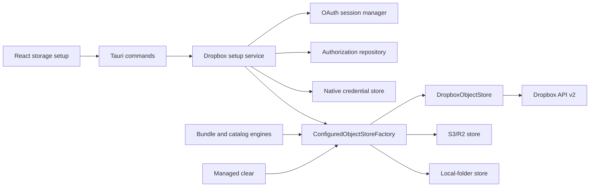

# Design: Dropbox shared and team namespace storage

**Status:** proposed for implementation

**Date:** 2026-09-02

**Scope:** Dropbox storage for project bundles and the storage-scoped Library

**Authority:** implementation design for the first production Dropbox release

## 1. Decision

Mallard will add Dropbox as a third storage destination. The first release will
support these authorization modes:

- **Collaborator:** A collaborator authorizes Mallard as one Dropbox user and
  selects a shared-folder or team-folder namespace that the user can edit.
- **Managed team:** A Dropbox team administrator authorizes Mallard for a team,
  selects one active team member as the file-operation actor, and selects a
  shared-folder or team-folder namespace that this actor can edit.

The selected namespace is the storage root. Mallard will put its current
`.mallard/` object tree directly below that namespace root. Mallard will not
create, share, unshare, archive, rename, move, or delete the selected namespace.

Dropbox will implement the existing revision-based `ObjectStore` contract:

- Dropbox file `rev` is the opaque object revision and Mallard `etag`.
- Dropbox strict add implements create-if-absent.
- Dropbox strict revision update implements compare-and-swap.
- Dropbox revision-pinned file deletion implements exact deletion.
- Mallard SHA-256 remains the content-integrity authority.

One internal contract correction is required. The current key-only list and
unconditional delete cannot bind a clear operation to the revision that it
listed. This design replaces them with revision-bearing list entries and
conditional delete for Local, R2, and Dropbox. This changes no portable schema.

Portable bundle manifests, commits, heads, receipts, storage markers, review
plans, object keys, and apply rules do not change.

### 1.1 Clean cutover

This change is a clean cutover. All schemas affected by this design stay at
`1`.

- Replace the machine-local storage shape in schema 1.
- Replace the machine-local setup-draft shape in schema 1.
- Replace the machine-local project-setup transaction shape in schema 1.
- Replace every schema-1 machine-local journal or snapshot that embeds one of
  these shapes.
- Add new Dropbox authorization and setup-journal documents at schema 1.
- Keep portable bundle schema 1 unchanged.
- Keep the storage marker layout and schema 1 unchanged.
- Add no migration, compatibility reader, alias, default, fallback, dual-write,
  old command, or legacy execution path.
- Reject old flat storage documents and the old persisted `"s3"` kind.
- Persist the current R2 destination as `"r2"` after the cutover.

There are no customers and no retained test data. The user will manually
discard their disposable `~/.mallard` state and disposable cloud data before
the cutover. That manual reset is outside implementation and test automation.
Automated tests must still use an injected temporary home or fixture repository
and must never read, write, or delete a real `~/.mallard` directory. This
design-doc task deletes neither location. The manual pre-cutover reset must
finish before any Dropbox vault entry exists. After Dropbox support creates a
vault entry, use Mallard's credential-aware Reset flow instead of deleting the
directory directly.

## 2. Why this fits Mallard

Mallard already isolates cloud transport behind `ObjectStore`. The contract
uses opaque revisions, immutable writes, compare-and-swap, bounded reads, and
lexical lists. Dropbox exposes the required primitives. Section 14 tightens
the delete side of that internal contract so a listed revision is also the
revision that a provider can delete.

The transport is feasible, but authorization and namespace selection are more
complex than R2:

- A shared folder is a Dropbox namespace, not only a path in one user's home.
- A managed-team token must select a concrete member for user file calls.
- Every file call must use the selected namespace as its path root.
- Dropbox paths are case-insensitive.
- OAuth refresh tokens must use a native credential store.
- Dropbox can report an ambiguous result after a network failure during a
  mutation. Mallard must reconcile state before it retries.

The design contains that work inside a Dropbox authorization service, a
Dropbox `ObjectStore`, and a provider-neutral configured-store factory.

## 3. Goals

- Let independent collaborators use the same shared-folder or team-folder
  namespace as one Mallard storage.
- Let a managed Dropbox team use an authorized shared-folder or team-folder
  namespace.
- Preserve immutable publication and compare-and-swap head updates.
- Preserve explicit Push, Pull, Library, restore, and deletion review.
- Keep Dropbox credentials outside JSON, logs, IPC responses, portable data,
  and project directories.
- Anchor a storage to one stable Dropbox namespace ID, not a display path.
- Survive a rename of the selected shared folder or team folder.
- Reject an unavailable or replaced namespace, stale authorization, stale
  revision, or lost write permission before a normal sync mutation.
- Use the current `.mallard/` object-key layout without a new bundle protocol.
- Keep every remote read, write, list, retry, and OAuth flow bounded.
- Deliver the capability in working layers with focused release gates.

## 4. Non-goals

- Dropbox App Folder access.
- Arbitrary personal Dropbox roots or private member-home storage.
- Dropbox Paper documents or non-downloadable cloud documents.
- Dropbox sharing-policy management.
- Creating, mounting, unmounting, sharing, unsharing, moving, renaming,
  archiving, or deleting the selected namespace.
- Selecting an arbitrary child folder as a second storage root. The selected
  namespace itself is the first-release root.
- Creating a Dropbox team folder or team space.
- Recursive Dropbox folder deletion.
- Dropbox webhooks, long polling, delta synchronization, or a local Dropbox
  cache.
- Upload sessions, batch upload, batch delete, or batch folder creation in the
  first release.
- Anonymous shared links.
- Access-token or refresh-token entry in a UI field.
- Environment-variable, plaintext-file, or in-memory-only credential fallback
  in production.
- A generic plug-in provider framework. The compiled destinations are Local,
  R2, and Dropbox.
- Changes to Mallard's portable schemas or SHA-256 format.
- Automatic migration or recovery of state from the pre-cutover machine-local
  storage shape.

## 5. POC result and remaining proof

The repository POC is under
[`poc/dropbox-shared-team-namespace/`](../poc/dropbox-shared-team-namespace/).
Its result is recorded in
[`DROPBOX_SHARED_TEAM_NAMESPACE_POC_2026-09-02.md`](./DROPBOX_SHARED_TEAM_NAMESPACE_POC_2026-09-02.md).

The POC proves the local model and test harness for:

- explicit namespace rooting;
- opaque Dropbox revisions;
- create-if-absent and revision-match updates;
- stale-revision rejection;
- bounded prefix listing;
- content verification; and
- revision-pinned cleanup of known probe files.

The POC has 18 passing offline tests. It does not prove production readiness.
A live two-actor collaborator run and a live managed-team run are release gates
in section 24.

The POC uses an existing child `probe_root` to isolate test files. Production
does not adopt that path as storage identity. Production uses the selected
namespace root and the reserved `.mallard/` tree. This mapping requires a live
release-gate test.

### 5.1 Proof required before production enablement

The architecture decision is complete. These evidence gates remain:

- prove R2 conditional `DeleteObject If-Match` with the current Cloudflare
  service before the provider-neutral delete cutover merges;
- register the fixed callback and exact scope union on separate development
  and production Dropbox apps, and obtain the required Dropbox production
  status;
- complete the native-vault packaging spike on macOS and Windows;
- pass the namespace-root collaborator and managed-team live gates; and
- set list and managed-clear request limits from measured Dropbox behavior.

Failure of a gate blocks Dropbox production enablement. It does not authorize
a compatibility path, plaintext credential fallback, weaker delete, or
provider-specific engine bypass.

## 6. Product flows

### 6.1 Collaborator flow

1. The user selects **Dropbox collaborator**.
2. Mallard starts OAuth in the system browser.
3. The user grants the minimum user scopes.
4. Mallard verifies the Dropbox account and granted scopes.
5. Mallard lists shared and team folders that the user can access.
6. The user selects one writable namespace.
7. Mallard states that `.mallard/` will be at the namespace root.
8. Mallard runs a recoverable capability probe.
9. The user reviews and saves the storage.

A collaborator on another machine repeats the authorization with their own
Dropbox account. They select the same namespace. Their local authorization
profile can differ. The Dropbox storage identity stays the same.

### 6.2 Managed-team flow

1. The user selects **Dropbox managed team**.
2. Mallard explains that a team administrator must grant broader access.
3. Mallard starts team OAuth in the system browser.
4. Mallard verifies the team and granted scopes.
5. Mallard lists active team members.
6. The user selects one member as the file-operation actor.
7. Mallard lists the team's namespaces.
8. Mallard shows only shared-folder and team-folder namespaces.
9. Mallard states that `.mallard/` will be at the namespace root.
10. Mallard proves that the selected actor can read and write in the namespace.
11. The user reviews and saves the storage.

Every User Authentication endpoint called with a team-linked token uses
`Dropbox-API-Select-User: <team-member-id>`. Team Authentication endpoints use
neither `Dropbox-API-Select-User` nor `Dropbox-API-Select-Admin`. Mallard never
sends both selector headers.

### 6.3 Project setup flow

Project setup can select only an already committed `StorageId`. It cannot
create an unverified inline Local, R2, or Dropbox destination.

If no suitable storage exists, the user leaves project setup, completes the
storage setup, and returns. This rule closes the current path that can save a
pending R2 storage without the focused R2 probe.

## 7. Authorization and namespace matrix

| Property | Collaborator | Managed team |
|---|---|---|
| OAuth subject | One Dropbox user | One Dropbox team |
| Consent authority | Collaborator | Team administrator |
| Namespace discovery | `/sharing/list_folders` | `/team/namespaces/list` |
| File-call actor | Authorized user | Selected active team member |
| File-call selector | None | `Dropbox-API-Select-User` |
| Accepted namespace | Shared folder or team folder | Shared folder or team folder |
| Rejected namespace | Home, app folder, private root | Member home, member root, app folder, unsupported type |
| Path root | Explicit namespace ID | Explicit namespace ID |
| Required access | Read and edit namespace root | Selected actor can read and edit namespace root |

The Dropbox app must have **Full Dropbox** content access. App Folder access
cannot address the selected shared or team namespace.

### 7.1 OAuth scopes

Both modes request exactly these file scopes:

```text
files.metadata.read
files.content.read
files.content.write
```

Collaborator mode also requests:

```text
account_info.read
sharing.read
```

Managed-team mode instead adds:

```text
team_info.read
members.read
team_data.member
```

`files.content.write` covers upload, folder creation, and delete endpoints.
Managed-team namespace discovery does not need `sharing.read`. Mallard does not
request sharing write, member write, group, event-log, or team-folder
administration scopes.

The Dropbox App Console enables the union of both sets. Each authorization URL
sends the selected mode's explicit, space-delimited `scope` value and omits
`include_granted_scopes`. The backend owns the two ordered scope constants. It
requires the returned token scope set to equal the selected mode before it
stores a credential or runs a probe. A missing or unexpected scope is a setup
error, not an implicit upgrade or fallback.

## 8. Architecture



The boundaries are:

- `mallard-domain` owns validated configuration and authorization-reference
  types. It owns no HTTP, Tauri, filesystem, or keychain behavior.
- `storage_core` owns the neutral `ObjectStore` contract and the Dropbox
  transport.
- A configured-store factory resolves machine-local authorization and returns
  the correct transport.
- The Dropbox setup service owns OAuth, namespace selection, probe journaling,
  and verified commit.
- Project sync and the storage catalog consume only `ObjectStore` and stable
  storage summaries.

## 9. Schema-1 machine-local cutover

### 9.1 Storage configuration

Replace the flat `StorageConfig` with one tagged destination:

```rust
#[serde(deny_unknown_fields)]
struct StorageConfig {
    id: StorageId,
    name: DisplayName,
    destination: StorageDestination,
}

#[serde(tag = "kind", rename_all = "snake_case", deny_unknown_fields)]
enum StorageDestination {
    Local {
        directory: PathBuf,
    },
    R2 {
        bucket: BucketName,
        access_key_id: AccessKeyId,
        secret_access_key: SecretAccessKey,
        account_id: R2AccountId,
        endpoint: R2Endpoint,
        region: R2Region,
    },
    Dropbox {
        authorization_id: DropboxAuthorizationId,
        acting_member_id: Option<DropboxTeamMemberId>,
        namespace_id: DropboxNamespaceId,
        namespace_kind: DropboxNamespaceKind,
        last_known_namespace_display_name: DisplayName,
    },
}

#[serde(rename_all = "snake_case")]
enum DropboxNamespaceKind {
    SharedFolder,
    TeamFolder,
}
```

The R2 field wrappers shown above are new validated types introduced by this
cutover; the current fields are raw strings. Reuse the current strict endpoint
and jurisdiction validation behavior while moving those values into the new
types. The serialized destination tag changes from `"s3"` to `"r2"`.

Rules:

- Do not persist both a top-level `kind` and a tagged destination.
- Derive `StorageKind::{Local, R2, Dropbox}` for UI summaries.
- Remove `supports_conditional_writes` from persisted state.
- A successful provider-specific setup proves required capabilities.
- Keep the current R2 access keys in the R2 destination for this change.
  Moving R2 credentials to the native vault is separate work.
- Never put a Dropbox access token or refresh token in `StorageConfig`.
- Require `acting_member_id` for a team authorization and forbid it for a user
  authorization. This cross-document rule is checked by focused setup and
  every configured-store open.
- Apply strict bounds and `deny_unknown_fields` to the new schema-1 shape.

Example Dropbox storage:

```json
{
  "id": "storage-example",
  "name": "Team sync",
  "destination": {
    "kind": "dropbox",
    "authorization_id": "dropbox-auth-example",
    "acting_member_id": "dbmid:example-member",
    "namespace_id": "123456789",
    "namespace_kind": "team_folder",
    "last_known_namespace_display_name": "Engineering"
  }
}
```

The example uses non-production identifiers. Tests must also use synthetic
identifiers.

### 9.2 Storage identity

The Dropbox destination identity is the hash of this canonical tuple:

```text
dropbox-v1 || namespace_id
```

It must not include:

- authorization profile ID;
- credential generation;
- Dropbox account, team, or member ID;
- display name;
- last-known display name; or
- OAuth scopes.

This lets two collaborators use different credentials for the same remote
storage. It also lets a user reconnect without breaking storage continuity.

The Library continuity hash uses the same Dropbox identity tuple. Local and R2
continuity rules do not change.

Reject two configured Dropbox storages with the same namespace ID.
Authorization profile, acting member, name, namespace kind, and last-known
display differences do not make a second destination.

The first release therefore supports one Mallard storage per Dropbox namespace.
Use a different shared-folder or team-folder namespace when a second independent
storage is required.

### 9.3 Authorization document

Add `~/.mallard/dropbox_authorizations.json` with schema 1 and atomic,
revision-checked persistence:

```rust
#[serde(deny_unknown_fields)]
struct DropboxAuthorizationDocument {
    schema: u32, // exactly 1
    revision: u64,
    authorizations: Vec<DropboxAuthorization>,
    pending_credential_deletions: Vec<DropboxCredentialRef>,
}

#[serde(deny_unknown_fields)]
struct DropboxAuthorization {
    id: DropboxAuthorizationId,
    revision: u64,
    label: DisplayName,
    subject: DropboxAuthorizationSubject,
    granted_scopes: BTreeSet<DropboxScope>,
    active_credential_generation: CredentialGeneration,
    status: DropboxAuthorizationStatus,
    created_at: Timestamp,
    updated_at: Timestamp,
}

#[serde(tag = "kind", rename_all = "snake_case", deny_unknown_fields)]
enum DropboxAuthorizationSubject {
    User {
        expected_account_id: DropboxAccountId,
    },
    Team {
        expected_team_id: DropboxTeamId,
    },
}

#[serde(rename_all = "snake_case")]
enum DropboxAuthorizationStatus {
    Active,
    ReconnectRequired,
    DisconnectPending,
}
```

The document contains only stable references and small display labels. It
contains no access token, refresh token, authorization code, PKCE verifier,
OAuth state, callback URL, provider response, or HTTP header.

The authorization profile represents the OAuth grant subject. A user grant is
bound to one account. A team grant is bound to one team, not to one member.
The managed-team storage binding holds the selected acting member. Changing
that actor requires a new capability probe and an explicit revision-checked
storage rebind, but it does not require a new team grant. Reconnect can rotate a
credential only for the same pinned user account or team.

Use the existing machine-local persistence protections:

- canonical no-follow paths under a mode-`0700` Mallard root;
- a mode-`0600` regular file;
- bounded reads and collections;
- atomic replacement and parent-directory synchronization;
- optimistic document revision checks; and
- fixed parse errors that do not echo stored values.

`pending_credential_deletions` is a bounded list of opaque authorization ID and
generation pairs. It closes the transaction gap between JSON and the native
vault. It includes newly allocated credentials until they become active and old
credentials until deletion succeeds. A missing vault entry is idempotent
cleanup success.

Set an initial maximum of 64 authorization profiles, 32 granted scopes per
profile, 128 pending credential deletions, and 1 MiB for the complete document.
Apply existing identifier and display-label bounds or stricter
provider-specific bounds.

### 9.4 Drafts and project transactions

Replace `StorageSetupDraft` with a tagged provider-specific schema-1 draft.
The Dropbox variant can persist only safe setup references:

- authorization profile ID and expected revision;
- selected actor reference for a team flow;
- namespace ID and kind;
- last-known namespace display data;
- step and draft revision; and
- verified-probe reference and expiry.

It must not persist an OAuth state, authorization code, PKCE verifier, access
token, refresh token, or full provider response.

Remove `DraftStorageSelection::Pending` and
`SetupTransaction.storage`. A project setup transaction stores only a committed
`StorageId` and its expected configuration revision.

Remove `list_pending_storage_bundle_snapshots_with_config` and its frontend
request path. No command accepts an uncommitted `StorageConfig` to open remote
storage. Storage setup and Project setup meet only at a committed `StorageId`.

Add `deny_unknown_fields` to every replaced persisted struct and tagged
variant, including `ProjectSetupDraft`, `StorageSetupDraft`, and
`SetupTransaction`. Remove the old R2 journal module, export, filename reader,
and payload decoder when the provider-neutral journal replaces it. Old storage
drafts, pending project-storage selections, setup transactions with an inline
storage, and old R2 journal entries must fail parsing even though their schema
number is `1`.

### 9.5 Cross-document transactions

Extend the existing `LocalStateRepository::acquire_host_operation()` guard. Do
not add a second storage lock. Its `~/.mallard/host_operation.lock` OS
lock is the authoritative interprocess operation lease. Retain its guard from
the first state pin through all provider, browser, vault, and configured-store
work and through the final local commit. A competing Mallard process must fail
fast with the existing busy result. Dropping the guard, including process exit,
releases the lease.

Use that guard for every operation that can create, update, bind, unbind, use,
or remove:

- a storage configuration;
- a Dropbox authorization or credential reference;
- a storage or project setup draft; or
- a storage-probe journal entry; and
- any persisted `StorageId` reference in Project Sync or Library, including
  scope links, materializations, preservation witnesses, review plans, and
  operation journals.

Every mutating `CatalogStateRepository` command and every long Library apply
workflow also uses the host guard. This rule lets Reset exclude all concurrent
catalog writers, including a writer that does not yet hold a `StorageId`.
Bounded read-only catalog commands do not need the guard.

The fixed nested lock order is:

1. host-operation guard;
2. provider-target lock, only when a local provider path is changed;
3. Project Sync persistence lock; and
4. Library catalog-state lock.

Authorization, setup-draft, and provider-neutral probe-journal transactions
use the Project Sync persistence lock. Remove the R2 journal's independent
locking path in the clean cutover. A command must not acquire the host guard
while it holds a catalog, persistence, or provider-target lock. A command must
not call a public repository method that reacquires a lock it already holds.
Add guarded transaction methods for composite operations.

The host-operation guard intentionally remains held during network requests,
the OAuth browser wait, vault calls, and configured-store operations. Do not
hold the provider-target, persistence, or catalog-state lock during a network,
browser, or vault wait. An active OAuth session owns the host guard until the
callback succeeds, fails, expires, or is cancelled. This coarse first-release
rule is safe across processes and does not depend on single-instance
enforcement.

Provider work runs while the host guard is held and before the final state
locks. Under the final state locks, reload every pinned document, verify every
revision and reference set again, and perform the authoritative local commit:

- Dropbox upsert commits `SyncConfig` after it proves that the authorization is
  still active and the actor, namespace, probe, marker, draft, and config pins
  still match.
- Reconnect commits the authorization-generation switch only after it rechecks
  the exact configuration revision and all storages that reference the grant.
- Disconnect first changes the authorization to `DisconnectPending` while it
  atomically proves that no config, draft, journal, or operation references it.
  New references require `Active` and therefore cannot race the revoke step.

The OS-backed host guard, not a process-local lease, protects in-progress work.
Persist the storage, authorization ID, credential generation, actor, and
configuration revision in the applicable bounded draft or recovery journal
before the first remote mutation. A credential-cleanup worker must acquire the
host guard before it reads or deletes a pending generation. It cannot delete a
generation while another process provisions it because that process retains
the same guard. After a crash, the guard is released and the persisted cleanup
reference remains.

Storage removal and Library reference creation use the same guard. Removal
then acquires the persistence lock followed by the catalog-state lock, reloads
the configuration and every bounded Library reference document, verifies the
expected configuration revision, and rejects any reference before it removes
the `StorageConfig`. A Library mutation that will add a `StorageId` reference
acquires the same locks in the same order and revalidates that the storage
still exists before it writes catalog state. Therefore, a link cannot appear
between the removal check and the configuration write.

Refactor the current catalog-first reset and managed-clear orchestration. They
must acquire the host guard first. Managed clear keeps that guard for the
complete remote operation, but it releases the persistence and catalog-state
locks before remote I/O. It reacquires them in the fixed order, revalidates all
pins, and commits the local after-state. A persisted clear operation makes this
split retryable. Reset acquires host, persistence, and catalog in that order
before it removes local state. Reset must not unlink a lock file while it holds
that file's inode. It keeps the restricted root and fixed empty lock scaffold
and deletes only state documents, plans, caches, logs, and non-lock
directories.

Auxiliary draft and journal removal occurs after the authoritative commit and
is idempotent. A stale auxiliary record remains a conservative reference and
can be recovered; it never permits a missing authorization reference. Persist
the commit identity in the journal before remote mutation so restart recovery
can distinguish an uncommitted attempt from an already committed storage.

## 10. Credential storage

### 10.1 Contract

Define a small injected interface:

```rust
trait DropboxCredentialStore: Send + Sync {
    fn put_refresh_token(
        &self,
        authorization_id: &DropboxAuthorizationId,
        generation: CredentialGeneration,
        token: SecretRefreshToken,
    ) -> Result<(), CredentialStoreError>;

    fn get_refresh_token(
        &self,
        authorization_id: &DropboxAuthorizationId,
        generation: CredentialGeneration,
    ) -> Result<SecretRefreshToken, CredentialStoreError>;

    fn delete_refresh_token(
        &self,
        authorization_id: &DropboxAuthorizationId,
        generation: CredentialGeneration,
    ) -> Result<(), CredentialStoreError>;
}
```

Production uses the operating system's native credential service:

- macOS Keychain;
- Windows Credential Manager; and
- Linux Secret Service.

Use a maintained Rust library only after a focused macOS and Windows build
spike confirms packaging and runtime behavior. `keyring` is the initial
candidate. Tests use an injected memory implementation.

There is no production fallback. If the native credential service is missing,
locked, denied, or unavailable, Dropbox setup and use fail closed.

### 10.2 Native-vault key

Use this constant service name:

```text
com.mallard.storage.dropbox
```

Use this opaque account name:

```text
<authorization-id>/<credential-generation>
```

Do not put an email, Dropbox account ID, team ID, member ID, namespace ID,
folder ID, or path in the vault key.

Store only the refresh token. Keep a short-lived access token in memory and
expire it before the provider expiry time. Secret types must not implement
`Debug`, `Serialize`, `Display`, or unrestricted `Clone`. Zeroize owned secret
buffers when they leave use.

Treat access and refresh tokens as opaque. Bound each at 64 KiB and reject an
empty value, controls, or a value above that bound without echoing it. Do not
use a 1 KiB limit; Dropbox tokens can exceed that size. Bound the complete
token response independently before JSON parsing.

### 10.3 Reconnect transaction

Reconnect is copy-on-write:

1. Create a new credential generation.
2. Persist its reference in `pending_credential_deletions`.
3. Put the new refresh token in the vault.
4. Use the bounded access token from the authorization-code exchange.
5. Verify the exact returned scope set, then call the applicable subject
   endpoint and verify its returned identity.
6. Verify every referenced Dropbox storage that uses the profile.
7. Finish safe cleanup for every probe journal that pins the old generation.
   If a journal needs manual cleanup, keep the old credential and stop.
8. While retaining the host-operation guard, acquire the persistence lock and
   recheck the configuration, authorization, draft, journal, and operation
   references. In one state transaction, switch the profile to the new
   generation, remove
   the new reference from the cleanup list, and add the old generation.
9. Clear the old in-memory token.
10. Delete the old vault entry only when no journal, draft, or operation still
    references it.
11. Remove the old reference from the cleanup list only after deletion
    succeeds.

If steps 3 through 6 fail, delete the new vault entry. Remove its cleanup
reference only after that deletion succeeds. Retain the old profile and
credential. Never overwrite the active credential before verification and
never lose the last local reference to a vault entry. The cleanup worker must
acquire the host-operation guard and recheck references under the persistence
lock before it deletes any non-active credential generation.

Initial authorization uses the same cleanup protocol. Persist the new
credential reference in `pending_credential_deletions` before the vault write.
Remove it from that list only in the transaction that creates the active
authorization profile. If profile creation fails, delete the vault entry before
removing its cleanup reference.

## 11. OAuth flow

### 11.1 Protocol

Use OAuth authorization code with PKCE S256 and a refresh token:

- launch the Dropbox authorization page in the system browser;
- use `token_access_type=offline`;
- use a cryptographically random 256-bit state value;
- encode 32 random verifier bytes as 43 characters of unpadded base64url;
- accept only a 43-to-128-character PKCE verifier from
  `[A-Za-z0-9-._~]`;
- send `code_challenge_method=S256` and the unpadded base64url SHA-256
  challenge to Dropbox;
- use one exact registered loopback redirect URI;
- exchange the code with the public `client_id`, redirect URI, and verifier,
  but without a client secret; and
- keep state and the PKCE verifier in memory only.

The Dropbox app key is a public desktop-client identifier. No Dropbox app
secret is packaged in Mallard.

Use a fixed public app key per release channel. It is a build-time value, not a
user setting. Register the exact callback for that channel and enable Full
Dropbox plus only the union of the scopes in section 7.1. Each authorization
request sends the exact selected mode scope set. A public release cannot enable
Dropbox until the Dropbox app has the required production status. Development
users and app-console test access are not a production-release substitute.

### 11.2 Loopback listener

Use one fixed registered `http://127.0.0.1:<port>/<path>` callback. Bind the
listener before opening the browser. If the port is unavailable, show a fixed
error. Do not select an unregistered random port and do not fall back to a
manual token flow.

The callback accepts only:

- a loopback peer;
- the exact method;
- the exact host and port;
- the exact path;
- one bounded query string;
- one `state` value;
- either one `code` or one OAuth error; and
- no body.

Reject duplicate parameters, fragments, malformed percent encoding, an
unexpected content length, an expired operation, an unknown operation, or a
replayed state. Compare state in constant time.

Allow one process-wide OAuth authorization operation at a time. It expires
after five minutes and has one terminal result. A second start returns a fixed
busy result. Cancellation and app shutdown close the one listener and zeroize
in-memory secrets. A later release can multiplex one listener by state, but the
first release has no multi-session path.

### 11.3 UI communication

`start_dropbox_authorization` returns an opaque local operation ID. The UI
polls a bounded status command. Status values are:

```text
waiting_for_browser
exchanging_code
verifying_authorization
succeeded
cancelled
failed
expired
```

The UI never receives the authorization URL after launch, callback query,
code, state, verifier, access token, or refresh token. Events and logs carry
only operation IDs and fixed status values.

### 11.4 Identity verification

For user mode, call `/users/get_current_account` and pin the returned account
ID.

For team mode:

- call `/team/get_info` and pin the team ID;
- list active members with `/team/members/list_v2`;
- let the user select one actor;
- put the selected team member ID in the storage draft and destination; and
- verify a user file call with `Dropbox-API-Select-User` before saving.

The authorization-code exchange that issues the refresh token must return the
exact requested scope set. Pin that set in the authorization document.

A refresh-token response contains no subject or scope evidence. After every
access-token refresh, call `/users/get_current_account` for a user grant or
`/team/get_info` for a team grant and compare the returned ID with the pinned
OAuth subject. Every configured-store open and setup probe also verifies that a
selected team actor remains active and can access the bound namespace. A
subject mismatch is an authorization failure. An actor failure requires actor
rebind, not a silent fallback or a new OAuth subject.

## 12. Namespace selection and object mapping

### 12.1 Namespace discovery

User mode calls `/sharing/list_folders` and treats `shared_folder_id` as the
namespace ID. It maps Dropbox's `is_team_folder` field to the supported
namespace kind. It shows only accessible shared or team folders that survive a
read and write capability check. A folder does not need a stable user-relative
mount path because every file call uses the namespace ID.

Team mode calls `/team/namespaces/list`. Dropbox can return duplicates. Mallard
deduplicates by the case-sensitive namespace ID and accepts only:

- shared-folder namespaces; and
- team-folder namespaces.

Mallard rejects app folders, team-member folders, team-member roots, personal
home namespaces, unknown tags, malformed IDs, and any namespace that the
selected actor cannot access.

All discovery endpoints are fully paginated with a page-count and entry-count
limit. The UI receives Mallard cursors, not raw Dropbox cursors.

### 12.2 Stable namespace root

The selected namespace itself is the storage root. Every file operation uses:

```text
Dropbox-API-Path-Root: {".tag":"namespace_id","namespace_id":"<id>"}
path: /.mallard/...
```

Use the namespace-ID Path-Root mode on every Dropbox file call. Never fall back
to the token's default root, home mode, root mode, a remembered display path,
or a matching namespace name.

At setup and explicit rebind, discovery must return the exact case-sensitive
namespace ID with a supported kind that matches the binding.

Before each high-level Push, Pull, clear, restore, activity, or Library
operation, Mallard requires:

- the authorization subject and team actor still match;
- `/files/list_folder` with the namespace path root and `path: ""` succeeds;
  and
- the storage binding came from the focused, revision-checked setup or rebind
  path. Generic configuration save cannot create or change that binding.

Perform this verification once for the bounded operation lease, not before
each object request. The setup-probe receipt expires before setup commit and is
not a permanent runtime dependency. Every object request still carries the
exact Path-Root and actor context. The actual write remains the authority for
current write permission. A structured Path-Root, actor, or permission error
invalidates the lease immediately and fails the operation without fallback.

Namespace-list refreshes update safe display metadata and detect a kind change,
but they are not inserted before every object call. A kind change requires an
explicit rebind before the next operation.

Dropbox does not support `get_metadata` for a namespace root. Mallard does not
need that call. The explicit Path-Root header anchors the operation, discovery
validates the namespace, and the capability probe validates file behavior.

A shared-folder or team-folder rename keeps its namespace ID and does not
change storage identity. If a namespace is removed and another namespace gets
the same display name, Mallard does not follow it because the new namespace ID
differs.

The first release does not select a second child root. Dropbox folder creation
accepts a write path but not a folder-ID-relative path. Resolving a child folder
ID to a mutable display path before folder creation would add a rename and
replacement race. Namespace-root storage avoids that race and is the simplest
complete mapping.

### 12.3 Path construction

Only validated `ObjectKey` values can reach `DropboxObjectStore`. The transport
adds one leading slash and evaluates the object key relative to the selected
namespace. It never accepts a raw UI path.

Reject before the API call:

- an empty object key;
- `.` or `..` components;
- absolute or backslash-separated paths;
- NUL or control characters;
- an invalid Dropbox path component;
- a component or total path outside the stricter Mallard or Dropbox bound; or
- any normalized path that escapes the selected namespace.

### 12.4 Provider identifiers

Treat all provider identifiers as case-sensitive opaque values.

- A namespace ID follows Dropbox's `NamespaceId` character grammar and a
  Mallard byte bound. Do not require it to be numeric.
- A folder or file ID must have Dropbox's `id:` form and a Mallard byte bound.
- An account, team, and member ID must match the returned Dropbox type and a
  Mallard byte bound.
- A file revision is lowercase hexadecimal with at least nine characters, per
  the Dropbox API specification, and also has a Mallard maximum length.
- Reject empty values, controls, surrounding whitespace, and values that do
  not round-trip exactly through the response parser.

Do not infer an account, namespace kind, owner, or permission from an ID
prefix. Verify those properties with the applicable endpoint.

## 13. Configured-store factory

Add one provider-neutral factory:

```rust
trait ConfiguredObjectStoreFactory: Send + Sync {
    fn open(
        &self,
        config: &StorageConfig,
    ) -> Result<ConfiguredObjectStore, ConfiguredStoreError>;
}
```

Extend the existing concrete runtime-dispatch enum to
`ConfiguredObjectStore::{Local, R2, Dropbox}` and implement exhaustive
delegation for the complete `ObjectStore` contract. This return type satisfies
the current generic engine bounds without a new trait-object forwarding layer.
Unit tests can continue to construct engines over fake concrete stores.

The production implementation receives:

- the Dropbox authorization repository;
- the native credential store;
- one configured `reqwest::Client`;
- the access-token manager;
- the runtime handle used by the synchronous storage contract; and
- existing Local and R2 construction dependencies.

`DropboxObjectStore` receives a pinned, validated authorization context. It
does not read global JSON or the native vault directly.

Replace all direct configured-store construction in:

- project bundle-engine creation;
- project managed clear;
- storage-catalog service creation; and
- project activity storage access.

Do not read machine-local persistence while a persistence update closure is
held. Resolve and pin the authorization context before the transaction or
inject the opened store. This avoids lock reentry during managed clear.

The Tauri application state owns one factory and one bounded access-token
cache. Tests inject deterministic factories and credentials.

## 14. Dropbox object-store implementation

Add:

```text
crates/mallard-infrastructure/src/storage_core/dropbox_store.rs
```

Use Dropbox API v2 over the existing HTTP stack. Dropbox has no official Rust
SDK. Do not add an unmaintained community SDK. Reuse one bounded
`reqwest::Client` with explicit connect, request, body, and idle timeouts.

The client uses only fixed Dropbox HTTPS origins and endpoint paths. It accepts
no user-supplied host, base URL, redirect target, proxy credential, or TLS
override. Disable automatic redirects for API, token, upload, and download
calls. Bound response headers and the decoded response body. Validate a JSON
content type before parsing JSON. Do not use a download MIME type as an object
integrity decision.

The current `ObjectStore` trait is synchronous. Capture the application's
Tokio handle in the transport and bridge at this boundary. Do not create one
runtime or client per request.

### 14.1 Operation mapping

| `ObjectStore` operation | Dropbox operation | Required result |
|---|---|---|
| `get_metadata` | `/files/download` | Bounded bytes, exact metadata, opaque `rev` |
| `stage_verified` | `/files/download` to private temp | Size, Mallard SHA-256, optional Dropbox content hash, `rev` |
| `put_immutable` | `/files/upload`, add, strict conflict, no autorename | New file or verified identical collision |
| `compare_and_swap(Absent)` | `/files/upload`, add, strict conflict, no autorename | Create only when absent |
| `compare_and_swap(Match)` | `/files/upload`, update by expected `rev`, strict conflict, no autorename | Replace only matching file revision |
| `delete` | `/files/delete_v2` with caller-pinned `parent_rev` | Delete only the listed or planned file revision |
| `list` | recursive `/files/list_folder` and continuation | Bounded, validated, lexical object keys and opaque revisions |

`get_metadata` downloads content because the current contract returns bytes
and revision together. This preserves the existing interface for the first
release. A later streamed-metadata redesign must cover all transports and is
not part of Dropbox support.

The current key-only list and unconditional `delete(key)` contract are not
sufficient for collaborator-safe deletion. Replace them in the clean cutover:

```rust
struct StoreListEntry {
    key: ObjectKey,
    etag: String,
}

struct StoreListPage {
    entries: Vec<StoreListEntry>,
    next_cursor: Option<String>,
}

enum DeleteOutcome {
    Deleted,
    Missing,
    Conflict { current_etag: Option<String> },
}

trait ObjectStore {
    fn delete(
        &self,
        key: &ObjectKey,
        expected_etag: &str,
    ) -> Result<DeleteOutcome, String>;
}
```

There is no delete-any variant. Missing is an idempotent success result.
Managed clear deletes each entry with the revision returned by the same bounded
list plan and stops on `Conflict`. Probe recovery uses its journaled revision.
Local storage verifies its SHA-256 revision and removes the file under the
existing store lock. R2 uses S3 `DeleteObject` with `If-Match`; its setup probe
and live integration test must prove this Cloudflare R2 behavior before the
cutover merges. Dropbox uses `parent_rev`. If any supported transport cannot
provide atomic conditional delete, redesign the provider-neutral clear
contract before release; do not weaken Dropbox or add a provider bypass.

### 14.2 Upload rules

The present Mallard object limits are below Dropbox's documented 150 MB
direct-upload limit. Use only `/files/upload` in the first release. Set the
transport cap to 150,000,000 bytes and reject any staged object that exceeds
its existing Mallard object-class limit or this cap, whichever is lower.

Every upload uses:

- `autorename: false`;
- `strict_conflict: true`;
- the exact expected write mode;
- a declared Dropbox content hash when the endpoint supports it; and
- the explicit namespace and actor headers.

For immutable publication, an existing path is successful only when a bounded
download proves the exact expected size and Mallard SHA-256. A same-size or
same Dropbox-hash result alone is insufficient.

For compare-and-swap, a path conflict or revision mismatch returns
`CasOutcome::Conflict`. An immutable collision with different bytes returns a
fixed error. Mallard never converts either result to overwrite mode.

A compare-and-swap returns `CasOutcome::Written` only when Mallard receives and
validates the successful upload response for that attempt. Dropbox has no
caller idempotency key for `/files/upload`. If the response is lost, matching
bytes and a new revision do not prove which concurrent writer committed them.
Return `dropbox_mutation_outcome_unknown` when read-back cannot prove a
definite conflict or unchanged state. The caller must refresh and replan.

Apply the same rule to the current S3/R2 ambiguous-CAS resolver. R2 also has no
Mallard request idempotency key, so matching read-back bytes cannot prove that
the local attempt won. Use a provider-neutral internal indeterminate-mutation
category and map it to provider-specific fixed UI copy. Local storage can
continue to return a definite result because its comparison and write occur
under one local store lock.

### 14.3 Delete rules

Dropbox `/files/delete_v2` can recursively delete a folder. The transport must
prevent this behavior.

For one logical file delete:

1. Receive the exact expected revision from the list, plan, or recovery
   journal. Do not replace it with a fresh metadata revision.
2. Read metadata at the exact logical path and require the same revision.
3. Require `FileMetadata`; reject folders and all other types.
4. Call `/files/delete_v2` with the exact namespace-relative logical path and
   the caller's revision as `parent_rev`.
5. Never use a file ID as the delete path. A Dropbox ID follows a file after a
   rename or move and can leave Mallard's owned prefix.
6. Require returned metadata for the same path, revision, and file ID when the
   response is available.

Missing is always idempotent success. A different current revision returns
`DeleteOutcome::Conflict`. The transport never calls folder delete, batch
delete, permanent delete, or a recursive cleanup endpoint.

After an ambiguous result, read only the exact logical path. If it is absent,
the logical delete succeeded. If the same file ID and expected revision remain
at that path, one bounded retry can use the same path and `parent_rev`. If a
different ID, revision, or type is present, return conflict. Never follow the
original ID after it leaves the logical path.

### 14.4 Folder creation

Mallard can create only required directories below the selected namespace
root:

```text
.mallard
.mallard/v1
closed descendants required by one ObjectKey
```

Create one component at a time with `autorename: false`. If a create call
reports conflict, read metadata and continue only when the exact path is the
expected folder. Reject a file, symlink, unexpected metadata type, or a
case-different name.

Mallard never deletes these folders. Managed clear removes owned files only
and can leave empty `.mallard/` directories.

### 14.5 Listing

Listing uses `recursive: true`, processes every continuation page, and applies
limits to:

- pages;
- entries;
- total encoded metadata bytes;
- total object-key bytes; and
- elapsed time.

For every entry:

1. Require it below the selected namespace root and requested prefix.
2. Strip only the verified namespace-relative prefix.
3. Validate the remaining value as an `ObjectKey`.
4. Accept only regular downloadable files with a valid nonempty `rev`, and
   return that `rev` as the list-entry `etag`.
5. Ignore expected directory metadata.
6. Reject deleted, symlink, non-downloadable, malformed, or unknown entries
   when they can affect the owned prefix.
7. Insert keys in a `BTreeSet` and return lexical order.

Dropbox cursors stay inside one call. The existing `ObjectStore` cursor is a
Mallard lexical key, never a Dropbox cursor.

### 14.6 Case-insensitive paths

Dropbox paths are case-insensitive while Mallard object keys are exact. The
implementation must prove that the closed Dropbox key space has no two keys
that differ only by Dropbox path case rules.

- Add tests for every repository and catalog key constructor.
- Use `path_lower` for normalized containment and duplicate detection.
- Use `Metadata.name` to validate the exact final component. When exact
  ancestor spelling is required, enumerate each ancestor and reconstruct it
  from that ancestor's `Metadata.name`.
- Treat `path_display` as display data only. Do not require full
  `path_display` equality because Dropbox does not guarantee correct case for
  every ancestor component.
- Detect duplicate `path_lower` values during list and fail closed.
- Reject a case-only alias instead of adopting or renaming it.
- Do not lowercase a logical Mallard object key silently.

If the key audit finds a possible case-only collision, Dropbox support remains
disabled until the logical key constructor is made unambiguous for all
transports. Do not add a Dropbox-only object-name encoding without a separate
portable-layout decision.

### 14.7 Content hashes

Dropbox `content_hash` is a block-composite SHA-256 scheme. It is not the
standard whole-file SHA-256 used by Mallard.

While staging an outbound object, compute both hashes in one pass. Supply the
completed Dropbox hash in `UploadArg` before the upload body starts. Upload
then reads the staged file in a second pass. During download, compute both
hashes in one streaming pass.

The Dropbox hash algorithm is:

1. Split content into 4,194,304-byte blocks.
2. SHA-256 each block.
3. Concatenate the binary 32-byte block digests.
4. SHA-256 that concatenation and encode it as lowercase hexadecimal.

For an empty file, hash the empty concatenation. In all cases:

- Mallard SHA-256 remains the manifest, staging, and integrity value.
- A present Dropbox content hash checks provider transport integrity.
- A Dropbox hash never substitutes for Mallard SHA-256.
- A malformed or mismatched Dropbox hash is an error.
- An absent optional Dropbox hash does not block the standard Mallard SHA-256
  check and does not become an integrity claim.

### 14.8 Header encoding

Dropbox content endpoints carry JSON in `Dropbox-API-Arg`. Implement one
tested encoder that escapes every non-ASCII code unit and byte `0x7f` as a JSON
Unicode escape, as required by Dropbox. Reject CR, LF, or any value that cannot
be represented safely in an HTTP header.

Never format a JSON header with string interpolation.

## 15. Revision and ambiguity model

### 15.1 Opaque revision

Treat `FileMetadata.rev` as a bounded opaque string. Validate Dropbox's syntax
at the provider boundary, but do not parse it as an integer, timestamp, or
content hash. Store and compare it byte-for-byte.

### 15.2 Immutable create

```text
Absent + strict add -> create
Existing exact bytes -> adopt as immutable success
Existing different bytes -> conflict
Unknown result -> read and reconcile exact bytes
```

### 15.3 Compare-and-swap

```text
Expected Absent + strict add -> create only if absent
Expected Match(rev) + strict update(rev) -> replace only that revision
Any stale or deleted target -> conflict
Identical bytes at a stale revision -> conflict
Unknown result -> never infer success from read-back
```

`strict_conflict: true` is required because Dropbox can otherwise accept some
stale update cases, including identical contents or a deleted target.

Read-back after an ambiguous CAS can prove a definite conflict or that the
expected revision is unchanged. Proposed bytes at a new revision are still
indeterminate because another writer can have committed the same bytes. Never
convert byte equivalence into `CasOutcome::Written` and never blindly replay
the mutation.

### 15.4 Mutation request identity

Before a mutation, retain an in-memory attempt record:

- logical object key;
- expected prior state;
- proposed size and Mallard SHA-256;
- staged Dropbox content hash;
- selected namespace fingerprint; and
- authorization profile revision and credential generation.

Do not persist raw paths or Dropbox response bodies in the generic operation
receipt. Use the attempt record only for bounded ambiguity reconciliation.

## 16. Setup probe and recovery journal

Generalize the R2 setup journal to a provider-neutral schema-1 storage-probe
journal. Rename the module and persisted document in the clean cutover. Do not
read the old R2 journal shape.

Use a tagged payload:

```rust
#[serde(tag = "kind", content = "state", rename_all = "snake_case")]
enum StorageProbeRecovery {
    R2(R2ProbeRecovery),
    Dropbox(DropboxProbeRecovery),
}
```

The Dropbox recovery entry contains only:

- setup ID;
- authorization profile ID and credential generation;
- exact bounded namespace ID and namespace kind;
- optional exact bounded acting-member ID, required for a team grant;
- destination fingerprint;
- bounded stage;
- deterministic probe object suffixes;
- known probe revisions and hashes;
- timestamps; and
- a fixed sanitized error code.

It contains no token, code, state, verifier, provider body, HTTP header,
account label, namespace label, namespace display path, or raw error
description.

The recovery entry is self-contained for remote addressing before a
`StorageConfig` exists. Recovery reconstructs `Dropbox-API-Path-Root` from its
namespace ID. For a team grant, it reconstructs `Dropbox-API-Select-User` from
its acting-member ID. It loads the referenced authorization profile and exact
credential generation, verifies the pinned user or team subject, and verifies
that the actor remains active before any cleanup call. It does not depend on a
draft or committed storage. The destination fingerprint is a consistency
check, not a substitute for these coordinates. If the authorization,
credential, or exact coordinates are unavailable, recovery marks the entry
`manual_cleanup_required`.

### 16.1 Probe sequence

Use this reserved setup prefix:

```text
.mallard/v1/_setup_probes/<setup-id>/
```

The setup service uses a provider-private validated probe-key type. It does not
widen `ObjectKey`, `ObjectPrefix`, or the repository and Library namespaces.
Normal managed clear does not own this prefix. Only journaled setup recovery
can remove its witnessed probe files.

1. Validate the draft and all expected revisions.
2. Resolve the credential and verify the pinned subject and selected actor.
3. Resolve the namespace by ID.
4. Persist a pre-mutation journal entry.
5. Create required folders one component at a time.
6. Verify that the deterministic probe key is absent.
7. Client A creates it with strict absent mode.
8. Client B proves a second absent create conflicts and creates no conflict
   copy.
9. Both clients read and verify the exact bytes and revision.
10. Client B updates by the exact revision.
11. Client A proves its stale revision conflicts even when the proposed bytes
    equal the current bytes.
12. Delete the object with the exact new revision.
13. Recreate it with absent mode and record the replacement revision.
14. Prove that the pre-delete revision can neither update nor delete the
    replacement.
15. List the prefix and prove it contains only the expected probe object and no
    autorenamed or conflict-copy file.
16. Delete the replacement with its exact revision.
17. Repeat that conditional delete and require idempotent `Missing`.
18. Verify that the probe prefix contains no owned probe file.
19. Create or validate the unchanged schema-1 storage marker with the existing
    `ensure_storage_marker` rules.
20. Persist probe success with an expiry.
21. Commit configuration only if all draft, config, authorization, and probe
    revisions still match.

The two clients use independent access-token refresh and HTTP request state,
but the same selected authorization in the normal setup probe. A separate live
release test uses two independent authorizations.

### 16.2 Cleanup

Cleanup lists only the exact deterministic setup prefix. It deletes only a
known regular file whose expected revision, size, Mallard SHA-256, and probe
bytes all match. It never deletes a folder or an unknown object.

Persist each returned revision before the next mutation. If the process can
have uploaded a file but crashed before it recorded the revision, mark the
entry `manual_cleanup_required`. Do not guess a revision and do not delete the
path automatically.

On startup, recovery retries only the safe, fully witnessed cleanup steps.
Recovery is bounded and idempotent.

`test_dropbox_storage` runs the probe, cleanup, and storage-marker step but does
not write configuration. It can leave a valid schema-1 storage marker and empty
folders. Mallard never deletes those folders or rolls back a valid marker.

`upsert_dropbox_storage` calls the existing `ensure_storage_marker` behavior
after it validates the successful probe receipt and all pins, and before it
commits local configuration. An existing marker must parse and pass the current
format and layout-version validation. A malformed or incompatible marker
blocks the save. If the local configuration becomes stale after a valid marker
is created, the save fails and the valid remote marker can remain; Mallard does
not delete remote data to roll it back.

## 17. Setup commands and DTOs

Add provider-specific Tauri commands:

```text
start_dropbox_authorization
get_dropbox_authorization_status
cancel_dropbox_authorization
list_dropbox_authorizations
list_dropbox_team_members
list_dropbox_namespaces
test_dropbox_storage
upsert_dropbox_storage
disconnect_dropbox_authorization
forget_dropbox_authorization_on_device
```

Command rules:

- Tauri command names are snake case.
- JavaScript argument keys use camel case.
- Serialized Rust fields remain snake case.
- Rust and `src/types.ts` change in the same patch.
- DTOs are provider-specific and bounded.
- Input structs deny unknown fields.
- Provider cursors and raw errors never cross IPC.
- The frontend calls typed `projectSyncApi` helpers.
- Register every command in `src-tauri/src/lib.rs`.

### 17.1 Pagination

Namespace and member commands return one bounded Mallard page:

```rust
struct DropboxPage<T> {
    items: Vec<T>,
    next_page: Option<OpaqueLocalPageToken>,
}
```

The page token is short-lived, process-local, scoped to the authorization,
operation kind, namespace, actor, and query. It is not a raw Dropbox cursor.
Changing any scope value invalidates it.

### 17.2 Revision pins

`test_dropbox_storage` requires:

- expected storage setup-draft revision;
- expected global storage-config revision;
- expected authorization profile revision;
- expected credential generation; and
- selected namespace ID and kind; and
- selected acting member ID for a managed-team binding.

`upsert_dropbox_storage` requires the same pins plus the successful probe ID,
destination fingerprint, digest, and expiry. It checks the global config
revision before the probe, before marker verification, and again inside the
final commit transaction.

A failed pin changes no configuration.

### 17.3 Generic save guard

Replace `require_verified_r2_changes` with a provider-neutral remote-change
guard.

The generic configuration command may:

- rename an existing storage; and
- remove an existing storage after current reference checks.

It may not:

- create R2 or Dropbox storage;
- change one destination kind to another;
- change R2 endpoint or credentials;
- change Dropbox authorization, actor, or namespace; or
- change any remote identity field.

All such changes must use the matching verified setup command.

## 18. UI design

### 18.1 Storage editor

Split the current binary storage editor into exact Local, R2, and Dropbox
editors. Use exhaustive switches. Do not classify every non-local destination
as R2 or every non-R2 destination as Local.

The Dropbox editor contains:

- authorization mode choice;
- Connect or Reconnect action;
- fixed authorization status;
- team actor selector when required;
- namespace selector;
- capability-test result;
- Finish action; and
- explicit consent and permission help.

Before the capability test, state that Mallard can create a schema-1
`.mallard/_storage.json` marker and empty `.mallard/` folders in the selected
namespace. Cancelling setup does not remove that valid marker or delete those
folders.

It contains no access-key, secret-key, account-ID, endpoint, bucket, agent
setup, or token field.

### 18.2 Copy and summaries

Use exact labels:

```text
Local folder
Cloudflare R2
Dropbox collaborator
Dropbox managed team
```

A saved Dropbox storage subtitle is:

```text
Dropbox · <namespace label>
```

Labels are presentation data. Stable IDs remain the identity. If the labels
cannot refresh, show the last-known values with a reconnect or permission
warning. Never show raw provider error text.

Add a Dropbox cloud icon that is distinct from the local drive and R2 icons.
Update storage cards, setup summaries, draft-discard copy, project sidebar,
Library selector, empty states, and error copy with exact three-way handling.

### 18.3 Frontend concurrency

Preserve the existing autosave queue, draft revision, edit version, workflow
epoch, configuration revision watcher, and stale-response suppression.

- OAuth start is single-flight for the complete application process.
- Status polling cannot overwrite a newer flow.
- Member and namespace queries are single-flight per query key.
- Changing actor clears namespace and probe state.
- Changing namespace clears probe state.
- Reconnect completes safe journaled cleanup for the old credential generation
  or remains blocked while that generation is still required.
- Leaving the flow cancels active polling and discards uncommitted page tokens.

### 18.4 Library boundary

The storage-scoped Library receives a neutral `CatalogStorageOption` summary.
It does not import project-sync DTOs, setup models, or Dropbox authorization
types. Its Push/Pull behavior remains transport-neutral.

## 19. Portable data and managed clear

Dropbox stores the same physical logical branches below the selected namespace
root:

```text
.mallard/_storage.json
.mallard/v1/repositories/...
.mallard/v1/library/...
```

The storage marker remains schema 1. Repository bundles and the Library remain
separate. No Dropbox account, team, member, namespace, credential, or display
value enters portable manifests.

Managed clear:

- removes only the selected repository or Library files defined by the closed
  key constructors;
- performs exact revision-pinned file deletion;
- keeps `.mallard/_storage.json` when current semantics require it;
- never removes `.mallard`, the selected namespace, or any folder;
- never removes unrelated Dropbox files; and
- stops on an unknown type, case alias, revision conflict, or permission loss.

## 20. Error model and sanitization

Map provider failures to fixed Mallard error codes:

```text
dropbox_authorization_required
dropbox_authorization_expired
dropbox_scope_missing
dropbox_subject_changed
dropbox_actor_unavailable
dropbox_namespace_unavailable
dropbox_permission_denied
dropbox_conflict
dropbox_mutation_outcome_unknown
dropbox_rate_limited
dropbox_data_transport_limit
dropbox_transport_unavailable
dropbox_response_invalid
dropbox_manual_cleanup_required
dropbox_credential_store_unavailable
```

Each code has fixed user copy and a fixed diagnostic category. Do not include
these values in logs, activity records, error strings, or general status
events:

- OAuth code, state, or verifier;
- access token or refresh token;
- `Authorization`, `Dropbox-API-Arg`, `Dropbox-API-Path-Root`, or
  `Dropbox-API-Select-User` values;
- callback query or authorization URL;
- Dropbox `error_summary`, `error_description`, response body, request ID, or
  rate-limit reason;
- account, team, member, namespace, folder, or file IDs;
- remote display paths; or
- raw `reqwest` debug output.

Narrow setup and storage DTOs can carry the bounded IDs and labels required for
selection and configuration. They cannot carry credentials, callback data,
provider cursors, or complete provider responses.

Parse structured Dropbox errors before sanitization. Log only the Mallard code,
operation class, retry count, duration bucket, status class, and a local
operation ID. Extend the existing sanitizer with Dropbox token and header
markers as defense in depth. Sanitization is not permission to log raw input.

## 21. Retry and concurrency policy

### 21.1 Authentication

- Parse the bounded structured `AuthError` before choosing a response.
- On `expired_access_token` or `invalid_access_token`, invalidate the access
  token, refresh once, revalidate the subject, and retry once.
- On `missing_scope`, report scope missing and require reauthorization. A token
  refresh cannot add scope.
- On `invalid_select_user` or `user_suspended`, report actor unavailable and
  require an explicit actor rebind or account recovery.
- On `route_access_denied`, an invalid team selector, or an unknown auth tag,
  fail closed without refresh.
- A second token-related `401` marks the profile `ReconnectRequired`. Other
  tags keep their typed error and do not relabel the complete grant.
- Do not rapid-retry `403`; map it to scope, actor, namespace, or permission
  state after one bounded verification.
- A Path-Root `422` maps its structured result to namespace unavailable or
  permission denied. Do not fall back to another root.
- A `403 invalid_account_type/feature` data-transport-limit result maps to
  `dropbox_data_transport_limit`. Do not treat it as scope or actor failure.

### 21.2 Rate limits and server failures

- Honor a valid `Retry-After` value on `429`. If it exceeds Mallard's permitted
  wait, return a deferred, retryable failure; never truncate it and retry
  early.
- Apply bounded exponential backoff with jitter.
- Retry bounded read-only calls on transient `429` and `5xx` results. A
  complete `429` response is a definite rejection and can be retried only
  after its required delay.
- Do not blindly retry a mutation after its request body can have reached
  Dropbox.
- A timeout, truncated response, disconnect, or `5xx` after a mutation body can
  have reached Dropbox is ambiguous. Reconcile exact state where possible, but
  apply the stricter CAS rule in section 15.3.

### 21.3 Namespace write locks

Dropbox can return `too_many_write_operations` when writes contend on one
namespace. The first release uses:

- at most four concurrent reads per authorization;
- one write at a time per namespace;
- one create/delete ambiguity reconciliation at a time per logical key; and
- the existing higher-level storage operation lock.

This policy favors correctness. Measure live performance before increasing
write concurrency.

### 21.4 List and clear cost

Dropbox does not return entries in Mallard lexical order. One `list` call can
therefore need to read the complete bounded remote prefix before it returns one
Mallard page. The current managed-clear loop also requests the first page again
after every deletion batch. This can rescan a large Dropbox tree.

Keep the provider-neutral `ObjectStore` cursor for the first release. Before
production enablement:

- measure list and clear at the maximum supported Dropbox object count;
- set a Dropbox request-count, entry-count, memory, and elapsed-time bound that
  the UI states accurately;
- fail before deletion if the complete safe clear cannot fit the bound; and
- do not expose a Dropbox cursor or add a Dropbox-only recursive delete path.

If the measured cost is not acceptable, change the provider-neutral list and
clear contract for all remote stores before release. Do not hide the cost with
an unbounded cache or a provider-specific bypass.

## 22. Reset, remove, and disconnect

### 22.1 Reset local data

Reset must remove native credentials before it removes their local references:

1. Cancel an OAuth session owned by this process and wait a bounded time for
   it to release its host guard.
2. Acquire the existing host-operation guard. Fail busy if another process or
   non-cancellable host operation owns it.
3. Acquire the persistence lock and then the catalog-state lock.
4. Load and validate the schema-1 authorization document.
5. Enumerate every active credential generation and every
   `pending_credential_deletions` entry.
6. Release the state locks, retain the host guard, and delete each native-vault
   entry idempotently.
7. If any delete fails, abort the state wipe and retain the references needed
   to retry.
8. Reacquire persistence and catalog in the fixed order, revalidate their
   revisions and credential references, and clear the caches.
9. Delete the contents of `~/.mallard` through a guarded, bounded reset path,
   except for the restricted root and fixed empty lock scaffold. That form must
   not reacquire a lock that the caller holds.

The fixed scaffold contains only the host-operation, persistence, and
catalog-state lock files and their required directory. It contains no schema
document, credential reference, plan, cache, log, or user data. This preserves
interprocess exclusion for the complete reset. Treat this scaffold-only state
as an empty Mallard home. Do not use recursive root deletion in the in-app
Reset flow.

If the authorization document is present but cannot be read or validated,
abort reset. Do not remove the only local references that can identify native
credentials for later cleanup.

Local reset does not require a network token-revocation call. The UI must warn
that the Dropbox grant can remain in the user's Dropbox connected-apps page.

### 22.2 Remove storage

Removing a Dropbox storage:

- does not delete remote data;
- does not revoke a shared authorization profile;
- acquires host, persistence, and catalog locks in the fixed order;
- refuses while a project, Library scope link, materialization, preservation,
  operation, draft, plan, journal, or other local record references the
  storage; and
- removes only the local storage configuration after review.

### 22.3 Disconnect authorization

Disconnect refuses while a storage, setup draft, probe journal, or active
operation references the profile.

Then it:

1. marks the profile `DisconnectPending`;
2. calls Dropbox token revoke;
3. deletes the native-vault credential;
4. clears caches; and
5. deletes the local profile last.

If revocation has an ambiguous result, retain a disabled, retryable profile.
Offer **Forget on this device** as a separate explicit action. That action
states that it did not prove remote revocation. It deletes the native
credential first and deletes the local profile only after the vault deletion
succeeds. The operation retains the host guard and uses the persistence lock
for the final state change. A failure retains the disabled profile and cleanup
reference for retry.

## 23. Implementation layers

### Layer 0: test-state reset precondition

- User performs the stated manual reset of disposable local and cloud state;
  Mallard code and test scripts do not perform it.
- Use an injected temporary home or fixture repository for every automated
  test. Use a dedicated disposable OS account or isolated supported test home
  for packaged manual runs.
- Confirm no production or retained storage is in the test account.
- Record the exact live test namespaces before implementation testing.

### Layer 1: schema-1 destination cutover

- Replace flat `StorageConfig` with the tagged destination.
- Rename the persisted R2 tag from `s3` to `r2`.
- Remove `supports_conditional_writes`.
- Remove pending inline project storage.
- Replace key-only list and unconditional delete with revision-bearing list
  entries and conditional delete.
- Stop inferring R2 CAS success from matching bytes after an ambiguous
  response; return the common indeterminate-mutation category.
- Prove Local and R2 conditional delete before continuing. Include a live R2
  `DeleteObject If-Match` capability check.
- Add exhaustive Local/R2/Dropbox summary switches.
- Keep Dropbox creation hidden.
- Make all existing Local and R2 tests pass.

### Layer 2: authorization and credentials

- Add schema-1 authorization persistence.
- Add the credential-store interface, memory fake, and native implementation.
- Add OAuth session management and callback hardening.
- Add user and team subject verification.
- Keep Dropbox creation hidden.

### Layer 3: Dropbox transport

- Add the HTTP client, token manager, namespace context, and
  `DropboxObjectStore`.
- Add the configured-store factory.
- Run transport conformance tests with a scripted Dropbox server.
- Keep Dropbox creation hidden.

### Layer 4: verified setup

- Add member and namespace discovery.
- Add the provider-neutral probe journal.
- Add test and upsert commands with revision pins.
- Add the provider-neutral generic-save guard.
- Enable Dropbox only in developer builds.

### Layer 5: UI and product integration

- Add Dropbox setup editors and status copy.
- Add exact three-way storage rendering.
- Route project bundles, managed clear, project activity, and Library through
  the factory.
- Complete frontend and complete-app tests.

### Layer 6: lifecycle and release proof

- Add reset, reconnect, remove, disconnect, and forget flows.
- Pass live two-collaborator and managed-team gates.
- Verify packaged credential-store and callback behavior on macOS and Windows.
- Enable Dropbox in production builds.

Each layer must leave Local and R2 as a working product. Do not merge a layer
with an accepted bypass or disabled invariant.

## 24. Test plan and release gates

### 24.1 Domain and persistence

- Parse and round-trip each new schema-1 destination.
- Reject the old flat storage shape.
- Reject persisted `"s3"`; accept only `"r2"`.
- Reject the old untagged storage draft, a pending project-storage selection,
  a setup transaction with inline storage, and the old R2 setup-journal file
  and payload.
- Reject unknown destination tags and fields.
- Reject token-shaped values in all JSON snapshots.
- Reject Dropbox IDs, paths, labels, and collections outside their bounds.
- Prove storage identity excludes authorization and display data.
- Prove storage identity changes with the namespace ID.
- Prove a project setup can reference only a committed storage.
- Prove the host-operation guard serializes separate processes during upsert,
  reconnect, disconnect, credential cleanup, reset, and every persisted
  `StorageId` reference mutation.
- Prove that process exit releases the host-operation guard and leaves enough
  persisted state for bounded recovery.
- Prove the fixed host, target, persistence, and catalog lock order. Fail a
  nested reacquisition test instead of hanging.
- Prove Reset never unlinks a held lock, blocks every catalog writer, leaves
  only the fixed empty lock scaffold, and treats that scaffold as fresh state.
- Race storage removal against Library link creation. Exactly one operation
  can commit, and no catalog record can reference a missing storage.
- Prove stale auxiliary records remain conservative.

### 24.2 OAuth and vault

- Verify PKCE S256 vectors.
- Verify state entropy, constant-time comparison, expiry, single use, replay
  rejection, and cancellation.
- Reject wrong host, port, path, method, peer, duplicate query, missing query,
  oversized query, body, malformed encoding, and code-plus-error callback.
- Verify exact scopes for both modes.
- Verify each authorization URL sends the exact explicit mode scope and omits
  `include_granted_scopes`.
- Verify one global OAuth operation, busy rejection, expiry, cancellation, and
  listener closure.
- Verify account, team, and member mismatch rejection.
- Verify one refresh on `401` and reconnect after a second `401`.
- Verify copy-on-write credential generation and rollback.
- Verify failed initial authorization and failed reconnect retain a cleanup
  reference until the new vault entry is deleted.
- Run credential provisioning and cleanup in separate processes. Prove cleanup
  cannot delete the generation while provisioning holds the host guard.
- Verify reconnect retains the old generation while any probe journal, draft,
  or operation references it.
- Verify vault unavailable, locked, denied, missing, corrupt, and delete-failed
  cases.
- Scan logs, errors, IPC snapshots, and persisted fixtures with secret
  canaries.

### 24.3 Dropbox transport

Use a scripted local HTTP server to verify:

- exact endpoint, method, content type, and safe header encoding;
- Path-Root on every file call;
- Select-User on every User Authentication endpoint called with a team token;
- no selector on Team Authentication endpoints and no Select-Admin call;
- strict add and strict revision update;
- stale revision conflict with identical bytes;
- stale revision conflict after delete and recreate;
- exact revision-pinned file delete;
- conditional-delete conflict when a listed object is replaced before delete;
- exact logical-path deletion that never follows a moved file ID;
- refusal to delete folders or unknown metadata types;
- ambiguous upload, update, and delete reconciliation;
- two identical concurrent CAS requests with both responses lost; neither
  unproved attempt can report `CasOutcome::Written`;
- namespace rename success and same-name namespace replacement rejection;
- required-folder creation and conflicting-file rejection;
- zero-byte, boundary-size, and over-limit objects;
- Mallard SHA-256 and Dropbox content-hash validation;
- multi-page list, duplicates, deleted entries, malformed metadata, and bounds;
- case-only path aliases and collisions;
- every structured `401` tag, Path-Root `422`, data-transport-limit `403`,
  structured `409`, `429`, oversized `Retry-After`, `5xx`, timeout, truncated
  body, and invalid JSON behavior; and
- no raw provider content in returned or logged errors.

Run one reusable `ObjectStore` conformance suite against Local, R2, and the
scripted Dropbox store.

### 24.4 Engine and command integration

- Run BundleEngine publish, pull, restore, and clear tests on scripted Dropbox.
- Run Library Push, Pull, refresh, and clear tests on scripted Dropbox.
- Prove immutable collision adoption only for exact bytes.
- Prove head compare-and-swap rejects concurrent writers.
- Prove setup commit rejects stale draft, config, authorization, credential,
  probe, digest, and expiry values.
- Prove upsert creates or verifies the unchanged marker before local commit,
  rejects a conflicting marker, and safely leaves a valid marker after a stale
  local commit.
- Cover absent, valid, malformed, wrong-format, and wrong-layout storage
  markers without changing marker schema `1`.
- Prove the generic save command cannot create or rebind remote storage.
- Prove crash recovery deletes only fully witnessed probe files.
- Prove a Dropbox probe journal alone can reconstruct the exact namespace root
  and optional team actor before a storage config exists. Missing coordinates
  must require manual cleanup.
- Prove managed clear never calls a folder-delete endpoint.
- Verify all new commands are registered and typed.

### 24.5 Frontend

- Cover exact Local, R2, and Dropbox branches.
- Cover both Dropbox authorization modes.
- Cover actor and namespace invalidation rules.
- Cover OAuth cancel, expiry, reconnect, permission loss, and vault failure.
- Prove Dropbox never shows R2 fields or agent-assisted R2 setup.
- Prove no token or raw provider error reaches rendered text or frontend state.
- Cover stale-response suppression and revision-conflict recovery.
- Verify Library uses only its neutral storage option.

### 24.6 Packaged application

- Verify the system browser opens the exact registered callback flow.
- Verify a second process occupying the callback port produces a safe error.
- Verify native credential creation, retrieval, rotation, reset, and deletion.
- Verify package signing and sandbox policy do not break the callback or vault.
- Complete macOS and Windows runs before production enablement.
- Treat Linux vault support as required before claiming Linux Dropbox support.

### 24.7 Live collaborator gate

Use two independent Dropbox user authorizations with edit access to one shared
folder:

1. With namespace-ID Path-Root, create folders, upload, read, compare-and-swap,
   list, and delete only under `/.mallard/...` at the namespace root.
2. Machine/profile A creates and saves storage.
3. Machine/profile B selects the same namespace.
4. A publishes a bundle and Library content.
5. B reads and accepts both.
6. A and B race a head update; exactly one wins the CAS.
7. The loser refreshes, replans, and completes normally.
8. Revoke A; B continues and A fails with reconnect-required behavior.
9. Rename the selected shared folder; both still use the same namespace ID.
10. Replace it with a same-name shared folder in a disposable test area;
   Mallard rejects the new namespace ID.
11. Clear one owned branch and prove unrelated files and all folders remain.

### 24.8 Live managed-team gate

Use a team authorization and two eligible actors:

1. Verify team subject and member pagination.
2. Select one active member and one team-folder namespace.
3. Prove every User Authentication call uses Select-User and every file call
   uses Path-Root. Prove team calls use no selector.
4. Prove another inaccessible namespace is rejected.
5. Suspend or remove the actor; the storage binding becomes unusable without
   fallback, while the team authorization remains valid.
6. Select and verify a new actor, then rebind the storage through the same team
   authorization.
7. Repeat CAS and exact-delete tests.

### 24.9 Handoff checks

Run at minimum:

```text
npm run build
npm run test:frontend-integration
cargo test --manifest-path src-tauri/Cargo.toml --lib
npm run test:backend-integration
npm run test:storage-catalog-e2e
```

Run the complete Tauri application for native OAuth, credential, and file
operations. Include screenshots or a recording for the storage setup UI.

## 25. Acceptance criteria

Dropbox support is complete only when all statements are true:

- A collaborator can configure an accessible shared-folder or team-folder
  storage without entering a token.
- A team administrator can configure a shared-folder or team-folder storage
  with one explicit active actor.
- Two independent collaborators see the same storage identity.
- Every Dropbox file call has the exact namespace root.
- Every User Authentication endpoint called with a team grant has the exact
  selected user. Team Authentication endpoints have no selector.
- Immutable create and compare-and-swap pass the reusable conformance suite.
- An ambiguous CAS never reports success from matching read-back bytes.
- A stale revision never overwrites or deletes another writer's file.
- Managed clear deletes only the exact revision returned by its bounded list
  plan, and stops if that object was replaced.
- Mallard never calls Dropbox folder delete.
- Namespace rename works and same-name namespace replacement fails closed.
- Tokens exist only in the native vault or bounded process memory.
- Logs, IPC, local JSON, and portable data contain no credential or raw Dropbox
  error.
- Reset cannot orphan a known credential silently.
- Concurrent storage removal and Library linking cannot leave a dangling
  `StorageId`.
- Every replaced schema-1 machine-local shape and old tag has no reader or
  execution path.
- Bundle and marker schemas remain `1` and unchanged.
- Local and R2 behavior remains green.
- Both live gates and packaged macOS and Windows gates pass.

## 26. Expected code areas

The implementation is expected to touch:

```text
crates/mallard-domain/src/lib.rs
crates/mallard-domain/src/tests.rs
crates/mallard-application/src/dropbox_storage_setup.rs
crates/mallard-application/src/lib.rs
crates/mallard-application/src/storage_setup.rs
crates/mallard-infrastructure/Cargo.toml
crates/mallard-infrastructure/src/dropbox_authorizations.rs
crates/mallard-infrastructure/src/dropbox_credential_store.rs
crates/mallard-infrastructure/src/storage_probe_journal.rs
crates/mallard-infrastructure/src/r2_setup_journal.rs (remove)
crates/mallard-infrastructure/src/persistence.rs
crates/mallard-infrastructure/src/project_activity.rs
crates/mallard-infrastructure/src/storage_core/mod.rs
crates/mallard-infrastructure/src/storage_core/object_store.rs
crates/mallard-infrastructure/src/storage_core/dropbox_store.rs
crates/mallard-cli/src/backend.rs
crates/mallard-cli/tests/cli.rs
src-tauri/src/app_reset.rs
src-tauri/src/project_sync/commands.rs
src-tauri/src/project_sync/service.rs
src-tauri/src/storage_catalog/resource_engine.rs
src-tauri/src/storage_catalog/resource_planning.rs
src-tauri/src/storage_catalog/resource_commands.rs
src-tauri/src/storage_catalog/service.rs
src-tauri/src/storage_catalog/persistence.rs
src-tauri/src/storage_catalog/plan_store.rs
src-tauri/src/lib.rs
src/types.ts
src/components/project-sync/api.ts
src/components/project-sync/ProjectSync.tsx
src/components/project-sync/StorageSettings.tsx
src/components/project-sync/StorageIndexPage.tsx
src/components/project-sync/BundleConnectionDialog.tsx
src/components/project-sync/ProjectPicker.tsx
src/components/project-sync/ProjectLinksWorkspace.tsx
src/components/project-sync/ProjectSetupWorkspace.tsx
src/components/project-sync/ProjectSidebar.tsx
src/components/storage-catalog/StorageCatalogPage.tsx
src/storageError.ts
tests/frontend/
src-tauri/src/sync_tests/
```

Exact module placement can change during implementation. The ownership
boundaries and safety rules in this document cannot. Before implementation,
run exhaustive searches for `StorageConfig`, `StorageKind`,
`DraftStorageSelection`, `StorageSetupDraft`, `SetupTransaction`,
`R2SetupJournal`, `ConfiguredObjectStore::from_config`, and direct
`ObjectStore::delete` implementations and test doubles. The list above is not a
substitute for that cutover inventory.

## 27. Official references

Dropbox route and type claims were checked on 2026-09-02 against official
`dropbox-api-spec` commit
[`33adb3af6ad7199532c03d880f0520619ef17763`](https://github.com/dropbox/dropbox-api-spec/tree/33adb3af6ad7199532c03d880f0520619ef17763).
Recheck that pinned basis and the live documentation before implementation.

- [Dropbox OAuth Guide](https://developers.dropbox.com/oauth-guide)
- [Dropbox app creation and production status](https://www.dropbox.com/developers/reference/getting-started)
- [Dropbox HTTP API documentation](https://www.dropbox.com/developers/documentation/http/documentation)
- [Dropbox Team Files Guide](https://developers.dropbox.com/dbx-team-files-guide)
- [Dropbox Path-Root modes](https://www.dropbox.com/developers/reference/path-root-header-modes)
- [Dropbox File Access Guide](https://developers.dropbox.com/dbx-file-access-guide)
- [Dropbox error handling guide](https://developers.dropbox.com/error-handling-guide)
- [Dropbox performance guide](https://developers.dropbox.com/dbx-performance-guide)
- [Dropbox data transport limit](https://www.dropbox.com/developers/reference/data-transport-limit)
- [Dropbox content hash](https://www.dropbox.com/developers/reference/content-hash)
- [Dropbox authentication types](https://www.dropbox.com/developers/reference/auth-types)
- [Dropbox API specification](https://github.com/dropbox/dropbox-api-spec)
- [Cloudflare R2 S3 API compatibility](https://developers.cloudflare.com/r2/api/s3/api/)
- [Amazon S3 conditional deletes](https://docs.aws.amazon.com/AmazonS3/latest/userguide/conditional-deletes.html)
- [`keyring` project](https://github.com/open-source-cooperative/keyring-rs)
