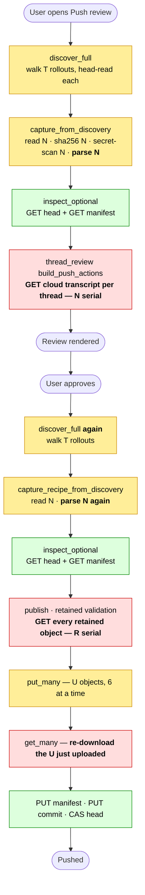
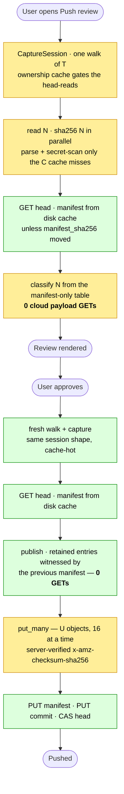
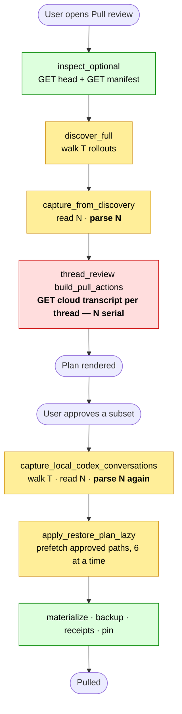
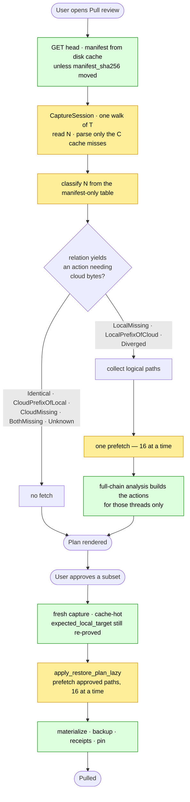
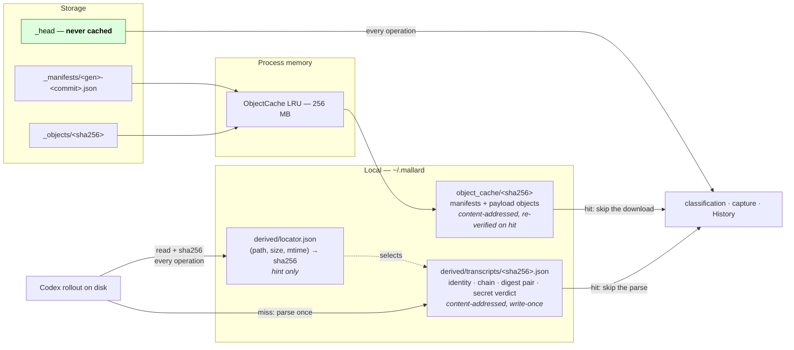

# Design: Fast Push and Pull

- Status: proposed
- Last reviewed: July 31, 2026
- Scope: the Push and Pull data path in `ProjectSync` — provider discovery,
  local capture, cloud payload reads, and publication
- Compatibility: clean cutover; no migration or legacy execution path
- Deployment assumption: no deployed user state must be preserved; the owner
  will clear `~/.mallard` and the test cloud buckets before acceptance testing
- Related:
  [DESIGN_MANIFEST_ONLY_THREAD_REFRESH.md](DESIGN_MANIFEST_ONLY_THREAD_REFRESH.md)
  (this design extends its decision table from refresh into planning);
  [PLAN_PROJECT_LEVEL_REFRESH_PERFORMANCE.md](PLAN_PROJECT_LEVEL_REFRESH_PERFORMANCE.md)
  (shell/tab request scoping — disjoint: that plan decides *when* an operation
  runs, this one decides what an operation costs once it runs)

## Decision

One principle governs every change below:

> Work is admitted only when no content witness already holds its result.
> Every key introduced here is a content digest, or a stat tuple that is
> re-proved by a digest before it decides anything. A cache is never a
> safety witness — exactly the rule the refresh table already follows
> ("file identity is a cache key, never a divergence witness").

Six decisions:

| # | decision | removes |
| - | --- | --- |
| D1 | **Classify first, fetch second.** Planning classifies every thread from the manifest-only table, then downloads cloud transcripts only for threads whose classification yields an action that needs cloud content. Push planning downloads none. | O(threads) cloud GETs per review |
| D2 | **One derivation per byte string.** A content-addressed, on-disk derivation store holds the parse result for a transcript sha256: identity, canonical chain, digest pair, secret-scan verdict. Reads stay live; parses are memoized. | O(threads) JSONL parses per operation, ×2 per Push |
| D3 | **One provider walk per operation; capture holds handles, not bytes.** A `CaptureSession` carries the walk and the derivation lookups; payload bytes materialize only for files an action will publish. | duplicate walks; whole-project byte residency |
| D4 | **Publish stops reading back.** Retained entries are witnessed by the previous manifest; new objects are witnessed by a server-side SHA-256 checksum on the conditional PUT. | O(bundle) GETs per Push and a second GET per uploaded object |
| D5 | **Immutable remote objects cache on disk.** Manifests and payload objects are content-addressed and hash-verified; the cache survives restart. One head GET per operation; a manifest GET only when the head moved. | repeated manifest and payload downloads across review → apply |
| D6 | **No `get()` loop over a known set survives.** Every known-ahead object set goes through `prefetch`/`get_many`; concurrency rises from 6 to 16; local derivation runs across cores. | serialized round trips |

## Goals

- Make the cost of a Push or Pull proportional to **what changed**, not to
  the size of the project's history.
- Keep every existing correctness gate byte-for-byte: pinned generation,
  commit ID, manifest SHA, conditional-write CAS, `expected_local_target`
  digests, and the apply-time re-capture.
- Introduce no new hash construction and no new trust relationship. Every
  cache entry is reproducible from bytes that are still read.
- Keep one thread's, one file's, or one object's failure from failing the
  whole operation where the current code already degrades per row.

## Non-goals

- Change the decision table, the divergence resolution flow, the Push
  non-fast-forward block, or any apply-time verification.
- Change the wire format. `BUNDLE_SCHEMA` stays 1; manifests written before
  and after this change are byte-identical for identical input.
- Cache anything mutable. The bundle head is re-read on every operation,
  always.
- Skip the apply-time local re-capture. Plan and apply remain separate user
  actions with independent freshness proofs.
- Speed up the frontend shell. Request ownership and tab scoping belong to
  [PLAN_PROJECT_LEVEL_REFRESH_PERFORMANCE.md](PLAN_PROJECT_LEVEL_REFRESH_PERFORMANCE.md).

## Current cost

Symbols used throughout: `T` = rollouts under the Codex home (**all**
projects), `N` = threads owned by this project, `C` = threads whose bytes
changed since the last operation (typically 0–2), `U` = objects a Push
actually uploads, `R` = manifest entries a Push retains (`R ≈ N` plus generic
files).

### A Push today

| stage | work | class |
| --- | --- | --- |
| `prepare_push_review` ([commands.rs:5518](../src-tauri/src/project_sync/commands.rs#L5518)) | walk `T` rollouts, bounded head-read each ([provider_capture.rs:1151](../src-tauri/src/project_sync/provider_capture.rs#L1151)) | `T` opens |
| `build_thread_sync_comparison` → `capture_from_discovery` | full `fs::read` of every owned transcript ([provider_capture.rs:324](../src-tauri/src/project_sync/provider_capture.rs#L324)), secret scan ([:327](../src-tauri/src/project_sync/provider_capture.rs#L327)), full JSONL parse ([:408](../src-tauri/src/project_sync/provider_capture.rs#L408)) | `N` reads + `N` parses |
| `thread_review(build_push_actions = true)` | one cloud transcript GET per stored thread, **one object at a time** ([commands.rs:4450](../src-tauri/src/project_sync/commands.rs#L4450)) | `N` serial GETs |
| `push_bundle_reviewed_with_repository` ([commands.rs:6518](../src-tauri/src/project_sync/commands.rs#L6518)) | second walk and second capture of the same tree | `T` opens + `N` reads + `N` parses |
| `publish` retained validation ([bundle_engine.rs:1094–1119](../src-tauri/src/project_sync/bundle_engine.rs#L1094)) | **downloads every retained object**, serially, to re-hash it | `R` serial GETs |
| `publish` upload ([bundle_engine.rs:1213–1214](../src-tauri/src/project_sync/bundle_engine.rs#L1213)) | `put_many`, then `get_many` **re-downloads every object just uploaded** | `U` PUTs + `U` GETs |

Net for a Push that changes one thread in a 500-thread project: two full
provider walks, 1000 JSONL parses, and roughly `500 + 500 + 2` remote object
round trips — to publish one file.

### A Pull today

| stage | work | class |
| --- | --- | --- |
| `plan_bundle_restore_with_progress` ([commands.rs:6959](../src-tauri/src/project_sync/commands.rs#L6959)) | walk + full capture + full parse | `T` opens + `N` reads + `N` parses |
| `thread_review(build_pull_actions = true)` | one cloud transcript GET per stored thread, serially | `N` serial GETs |
| `apply_bundle_restore` → `capture_local_codex_conversations` ([commands.rs:7062](../src-tauri/src/project_sync/commands.rs#L7062)) | walk + full capture + full parse again | `T` opens + `N` reads + `N` parses |
| `apply_restore_plan_lazy` ([bundle_engine.rs:4245](../src-tauri/src/project_sync/bundle_engine.rs#L4245)) | `prefetch` of approved paths — the **only** batched read in the codebase | `A/6` rounds |

### Shared ceilings

- `PREFETCH_BATCH_OBJECTS` and `UPLOAD_BATCH_OBJECTS` are 6
  ([bundle_engine.rs:506](../src-tauri/src/project_sync/bundle_engine.rs#L506));
  `BULK_GET_CONCURRENCY` and `BULK_PUT_CONCURRENCY` are 6
  ([s3_store.rs:35](../src-tauri/src/project_sync/s3_store.rs#L35)). Single
  `get()` calls are fully serial.
- `ObjectCache` is process memory only, 256 MB, keyed
  `(StorageId, BundleId, sha256)`
  ([bundle_engine.rs:503](../src-tauri/src/project_sync/bundle_engine.rs#L503)).
  It is empty at every app start, and the `BundleId` component prevents
  reuse across bundles that share content.
- Manifests are immutable and content-addressed
  (`_manifests/{generation}-{commit_id}.json`, verified against
  `head.manifest_sha256`) but are re-downloaded on every
  `inspect_optional_with_token`
  ([bundle_engine.rs:1395](../src-tauri/src/project_sync/bundle_engine.rs#L1395)),
  which a single Push review calls more than once.
- `detect_secret_material` and `analyze_codex_transcript` are pure functions
  of the file bytes, and neither is memoized.

## Flow

Red = work this design removes. Amber = work it bounds or batches.
Green = work that stays because it is a freshness or safety proof.

### Push — today



### Push — proposed



### Pull — today



### Pull — proposed



### Where the caches sit



## D1 — Classify first, fetch second

`thread_review` gains a third mode. Today it has *manifest-only* (refresh)
and *full-chain* (planning); planning becomes **staged**:

1. Classify every thread with the manifest-only decision table — manifest
   metadata, the local chain, and the binding pin. No cloud payloads.
2. Compute the default Push/Pull decision from that relation, exactly as
   `default_conversation_decision` does now.
3. Collect the logical paths of the cloud transcripts that the surviving
   actions need, and `prefetch` them in one batched call.
4. Build actions. Full-chain analysis remains the authority for every action
   that is built.

The set in step 3 is small and exactly characterized:

| relation | Pull action | needs cloud bytes |
| --- | --- | --- |
| `Identical` | none | no |
| `CloudPrefixOfLocal` | none (Push-side) | no |
| `CloudMissing` | none (Push-side) | no |
| `BothMissing` | none | no |
| `Unknown` | blocked | no |
| `LocalMissing` | `CreateLocal` | yes |
| `LocalPrefixOfCloud` | `FastForwardLocal` | yes |
| `Diverged` | `ResolveDivergence` | yes |

**Push planning needs zero cloud transcript reads.** `cloud_chain` reaches
push-action building through exactly one consumer —
`build_conversation_plan_action`, which uses it only to re-derive the
relation ([conversation_sync.rs:287](../src-tauri/src/project_sync/conversation_sync.rs#L287)).
Supplying the relation directly removes the last reason to open a stored
transcript on the Push path. Every other pinned field a Push action carries
(`pinned_generation`, `pinned_commit_id`, `pinned_manifest_sha256`,
`pinned_lineage_digest`, `pinned_semantic_digest`) comes from the manifest
or from the local capture.

**Soundness.** A skipped fetch is sound because the row that skipped it is
content-witnessed:

- Row 6 (`Identical`) — the local and manifest digest pairs are equal, so
  cloud content equals local content. There is nothing an action could do
  and nothing a payload read could reveal.
- Rows 3 and 7 — the action publishes **local** bytes. Cloud content is an
  input to the relation only, and the relation is already proven.
- Every row that could touch local state is in the "yes" column and still
  reads the payload, so divergence contracts, fork checkpoints, and
  materialization keep the full-chain authority the refresh design assigned
  them.

The snapshot is pinned for the whole planning call, and apply re-checks
generation, commit ID, and manifest SHA. If the head moves between classify
and fetch, apply fails closed exactly as it does today.

**Subagent tripwire is preserved.** Pull planning refuses stored subagent
threads by reading the payload. Under staged planning a stored subagent
thread has no local counterpart, so it classifies `LocalMissing` or
`Diverged` — the "yes" column — and its payload is still read and still
refused. `previously_stored_subagent_tasks_are_hidden_from_pull_but_not_refresh`
holds unchanged and keeps its second job as the tripwire for payload reads
creeping back into the manifest-only path.

## D2 — One derivation per byte string

A **derivation** is everything currently recomputed from a transcript's
bytes on every operation:

```
DerivedTranscript {
  schema: u32,
  file_sha256: String,        // the key; not stored inside the record
  source_thread_id: Option<String>,
  source_cwd: Option<String>,
  is_internal_subagent: bool,
  record_count: usize,
  lineage: CodecLineage,      // includes the canonical chain
  chain_len: u64,
  lineage_digest: String,     // conversation_chain_digests(chain)
  semantic_digest: String,
  secret_scan: SecretScanVerdict,
}
```

Stored under `~/.mallard/derived/transcripts/<file_sha256>.json`, written
once and never rewritten. The key is the digest of the exact bytes the
record describes, so an entry cannot be stale — it can only be absent. A
small `~/.mallard/derived/locator.json` maps
`(codex_home, physical path) → (size, modified_nanos, file_sha256)` so a
lookup can start from a stat instead of a directory scan.

**The read is never cached; only the parse is.** Every operation still
opens each owned transcript, reads it, and hashes it. The stat tuple in the
locator is a hint that shortcuts the *directory* work; the sha256 computed
from the live bytes is what selects the derivation record. Reading and
hashing run at roughly 1 GB/s; JSONL parsing at roughly 50 MB/s. Paying the
2% keeps the freshness posture of the current code exactly — no design here
depends on `modified_nanos` telling the truth.

Two consumers, one store. `chat_history.rs` already maintains a
`(path, size, modified_nanos)`-keyed parse cache at
[`chat_history_cache.json`](../src-tauri/src/project_sync/chat_history.rs#L698)
with its own `ParsedRollout` shape. That file and its two cache maps are
**deleted**; History reads the same derivation store. This is the
no-parallel-paths rule: one derivation of a rollout exists in this app, and
it is content-addressed.

**Ownership scan (Tier 0).** `discover_codex` must decide, for `T` rollouts
across all projects, whether each belongs to this project — from
`(session_id, cwd, is_internal_subagent)` in the bounded head read
([provider_capture.rs:1151](../src-tauri/src/project_sync/provider_capture.rs#L1151)).
These three fields get their own locator-gated cache, validated by
`(size, modified_nanos)` alone, because they are the one place where a stale
answer is self-correcting and harmless: `cwd` changes only when the file is
rewritten, a rewrite moves `modified_nanos`, and the blast radius of a miss
is a session listed under the wrong project until its next write — never a
sync decision. Owned rollouts then proceed to Tier 1 (read + hash +
derivation lookup); unowned ones are never read past their head.

**Bounds.** The derivation store is pruned by total size (default 512 MB)
and by last-access time, oldest first. A pruned entry costs one reparse.
Prune runs at the end of an operation, never inside one.

## D3 — One provider walk per operation; capture holds handles

`CapturedFile` today owns `bytes: Vec<u8>`
([provider_capture.rs:121](../src-tauri/src/project_sync/provider_capture.rs#L121)),
so a capture of a 500-thread project holds the whole project in memory
whether or not anything will be published. It becomes:

```
CapturedFile {
  logical_path, resource_id, source_mtime, mode,
  sha256: String,
  size: u64,
  source: CapturedBytes,   // Resident(Vec<u8>) | OnDisk(PathBuf)
}
```

`CapturedBytes::resolve()` returns the bytes, re-reading and re-verifying
against `sha256` for the `OnDisk` variant. Conversations capture as
`OnDisk`; derived indexes and small generic files stay `Resident`. Only
`build_publish_request` and the divergence/materialization paths resolve,
and they resolve only what an approved action names.

A `CaptureSession` value carries the `Discovery`, the derivation lookups,
and the resolved bytes for one user operation, and is threaded through
`prepare_push_review` → `build_thread_sync_comparison` and
`push_bundle_reviewed_with_repository` rather than each rebuilding its own.
The eight `discover_full` call sites collapse to one per operation.

**What does not change.** `push_bundle_reviewed_with_repository` and
`apply_bundle_restore` still perform their own fresh walk and their own
fresh capture — they are separate user actions from the review, and their
freshness proof is the whole point of the reviewed-token and
`expected_local_target` machinery. With D2 in place, "fresh" costs a read
and a hash instead of a read and a parse.

## D4 — Publish stops reading back

Two loops in `publish_with_progress` go away.

**Retained objects** ([bundle_engine.rs:1094–1119](../src-tauri/src/project_sync/bundle_engine.rs#L1094)).
The loop already establishes the real witness before it downloads anything:
`was_published` requires the entry to match a previous-manifest entry on
`object_key`, `sha256`, and `size`, and that manifest was itself
hash-verified against `head.manifest_sha256` when it was read. Objects are
immutable and content-addressed under `_objects/<sha256>`. The download adds
one fact — "the object is still there and still has those bytes" — which is
a storage-durability audit, not a publication precondition, and it is
performed on every Push at a cost of `R` serial round trips.

Keep `was_published`; delete the `get`. Durability is covered where it
matters: `EngineByteSource::ensure_loaded` re-hashes every object it reads
against the manifest, so a corrupted or missing object fails the *reader*,
loudly, at the moment of use — which is where a fix can be applied. A
separate, explicitly invoked `verify_bundle_objects` maintenance command
performs the exhaustive re-download for owners who want the audit; it is a
named operation, not a fallback inside Push.

**Uploaded objects** ([bundle_engine.rs:1213–1214](../src-tauri/src/project_sync/bundle_engine.rs#L1213)).
`put_immutable_async` already resolves every non-clean outcome by reading
back and byte-comparing
([s3_store.rs:203](../src-tauri/src/project_sync/s3_store.rs#L203)), so
`ImmutablePutOutcome::Written | AlreadyPresent` already means "these exact
bytes are at that key." To make that end-to-end rather than
client-asserted, `conditional_put_async`
([s3_store.rs:161](../src-tauri/src/project_sync/s3_store.rs#L161)) sends
`x-amz-checksum-sha256` with the digest the caller already computed; the
service rejects a body that does not match. `Written` then carries a
server-verified receipt, and the engine's follow-up `get_many` is deleted.

## D5 — Immutable remote objects cache on disk

`ObjectCache` becomes two-tier: the existing in-process LRU in front of
`~/.mallard/object_cache/<sha256>` on disk. Both are keyed by **content
digest alone** — the `StorageId` and `BundleId` components are dropped,
because a sha256 identifies bytes independently of where they were fetched
from, and every read path already re-hashes before use.

Manifests join the same cache under their `manifest_sha256`. The bundle
head stays uncached and is read on every operation; when its
`manifest_sha256` is unchanged, `inspect_optional_with_token` serves the
manifest from disk and issues **zero** remote requests beyond the head.

Cache entries are never authority. `ensure_loaded` and `read_manifest`
re-verify size and digest against the manifest or head on every hit, so a
tampered or truncated cache file fails exactly like a tampered remote
object. The cache is prunable at any time with no correctness effect —
which is the test: delete `~/.mallard/object_cache` mid-suite and every
assertion must still pass.

## D6 — Every known set is batched

- `thread_review` step 3 (D1) calls `prefetch` with the full needed set;
  the per-thread `bytes.get` at
  [commands.rs:4450](../src-tauri/src/project_sync/commands.rs#L4450) is
  removed.
- `PREFETCH_BATCH_OBJECTS`, `UPLOAD_BATCH_OBJECTS`, `BULK_GET_CONCURRENCY`,
  and `BULK_PUT_CONCURRENCY` rise from 6 to 16, and the two engine
  constants become one `TRANSFER_BATCH_OBJECTS`.
- Local derivation (read + hash + parse-on-miss) fans out across
  `min(8, available_parallelism)` threads with `std::thread::scope`. No new
  dependency; the work is already pure per file, and results are collected
  into the existing `BTreeMap`s so output ordering is unchanged.
- Any remaining `for key in keys { store.get(key) }` shape is a review
  failure. The engine keeps exactly one single-object entry point, used for
  the head and for genuinely singleton reads.

## D7 — One parse per record (implemented)

`analyze_codex_transcript` used to JSON-parse every rollout line twice:
once inside `analyze_codex_rollout_structure` (identity, ancestry, cwds)
and once in its own chain-building loop. Measured on a 148 MB corpus with
optimized dependencies, the structure pre-pass was 37% of total analysis
time (0.0045 of 0.0122 s/MB).

The structural semantics now live in one `CodexStructureAccumulator`
(`codex_rollout.rs`): `feed(&Value)` per record, `finalize()` for the
whole-file ancestry checks. `analyze_codex_rollout_structure` remains the
standalone driver for fork verification and rewrite checks;
`analyze_codex_transcript` parses each record once and feeds both the
accumulator and the chain builder — one implementation, two drivers.

Soundness: a transcript that yields `Complete` passes both validators over
every record, so fusion cannot change any chain, digest, or
classification. On unsound transcripts only, the first failure in file
order now wins (previously whole-file structure errors outranked earlier
chain errors) and mid-file failures carry the already-proven thread
identity instead of `None` — every such result is still `Unknown`, which
sync treats uniformly. All pre-existing reason-pinning fixtures pass
unchanged.

This cuts the cost lane D2 cannot reach: first-touch and changed files.
D2 then removes repeat parses of unchanged files on top of it.

Shipped alongside it: `[profile.dev.package."*"] opt-level = 1` in
`Cargo.toml`. The wildcard excludes the app crate, so edits keep opt-level
0 incremental builds while serde_json/sha2/aws-* run optimized — measured
3.9× on transcript analysis in dev builds, for a one-time dependency
rebuild.

## Work budgets

Enforced as **work counts**, not wall-clock. One thread changed in a
500-thread project, both replicas already synced:

| operation | today | after |
| --- | --- | --- |
| Push — provider walks | 2 | 1 |
| Push — transcript parses | 1000 | 1 |
| Push — cloud payload GETs | ~500 (serial) | 0 |
| Push — retained-object GETs | ~500 (serial) | 0 |
| Push — upload round trips | `2U` | `U`, batched 16 |
| Push — manifest GETs | 2 | 0 (head unchanged since review) |
| Pull review — transcript parses | 500 | 1 |
| Pull review — cloud payload GETs | ~500 (serial) | = actionable threads, batched 16 |
| Pull apply — transcript parses | 500 | 1 |
| First-ever Push/Pull (cold cache) | — | unchanged; every byte is new |

The cold-cache row is the honest ceiling: this design removes repeated
work, not first-time work.

## Failure handling

- **Derivation store unreadable or corrupt** — treated as a miss. A
  malformed record is deleted and reparsed. The store is never required for
  an operation to succeed.
- **Locator stat hint wrong** — the sha256 computed from live bytes
  disagrees with the locator, so a different (or absent) derivation record
  is selected. Self-correcting by construction; the locator entry is
  rewritten.
- **Object cache file corrupt** — fails the existing manifest digest check
  in `ensure_loaded`, the entry is evicted, and the object is refetched
  once. A second failure is a real storage error and surfaces as one.
- **Prefetch partial failure** — the batch fails as it does today; the
  operation reports a storage error. Per-thread degradation is unchanged:
  a thread that cannot be classified holds `Unknown` and never errors the
  review (the standing per-row degradation rule).
- **Checksum rejected by the service** — the PUT fails; publication aborts
  before the manifest and commit are written, leaving only unreachable
  immutable objects, exactly as a failed CAS does today.

## Cutover

No migration. `~/.mallard/derived/`, `~/.mallard/object_cache/`, and the
deleted `chat_history_cache.json` are all rebuilt on first use.

1. Add the derivation store and the locator; route
   `analyze_codex_transcript` and `detect_secret_material` through it.
   Delete `chat_history_cache.json`, `ChatHistoryCache`,
   `RolloutCacheEntry`, and `RolloutIdentityCacheEntry`; point History at
   the derivation store.
2. Make `CapturedFile` hold `CapturedBytes`; introduce `CaptureSession`;
   collapse the duplicate `discover_full` calls within each operation.
3. Stage `thread_review` planning: classify from the table, collect the
   needed payload set, `prefetch` once, then build actions. Delete the
   eager per-thread `cached_transcript_analysis` loop and the now-unused
   `cloud_chain` argument on the Push path.
4. Delete the retained-object download loop and the post-upload `get_many`;
   add `x-amz-checksum-sha256` to `conditional_put_async`; add
   `verify_bundle_objects` as its own command.
5. Two-tier `ObjectCache`, digest-only keys, manifest caching.
6. Raise the batch and concurrency constants; parallelize local derivation.
7. Delete every code path the above replaced. No flag, no fallback, no
   "legacy" variant — per the no-parallel-paths policy.

## Test plan

Fixtures follow the existing `sync_tests` harness style. Counting tests use
the `CountingStore` already present in `bundle_engine.rs` tests, extended
with a `gets()` accessor, plus a new counting wrapper over derivation and
file reads.

- **Push reads no cloud payloads.** A Push review and a Push over a bundle
  with `N` stored threads records zero payload-object GETs. This is the D1
  tripwire; it fails the moment a payload read returns to the Push path.
- **Pull fetches only actionable threads.** A bundle with 20 threads of
  which 2 are behind locally records exactly 2 payload GETs during planning.
- **Every relation row still gets its action.** The eleven-row fixture set
  from the refresh design is replayed through *planning* and must produce
  the same `ConversationPlanActionType` per row as full-chain planning does
  today. This is the guard against staged planning silently narrowing what
  gets offered.
- **Retained-object publish is read-free.** A Push that changes one file in
  a 50-file bundle records exactly one payload PUT and zero payload GETs.
- **Corrupted retained object fails the reader, not the writer.** Publish
  succeeds; a subsequent Pull of that object fails with the existing
  manifest-mismatch error; `verify_bundle_objects` reports it.
- **Checksum enforcement.** A stub store that mutates a body in flight
  causes the PUT to fail and publication to abort before the head CAS.
- **Derivation store is optional.** The whole `sync_tests` suite passes
  with the store deleted before every operation, and again with the store
  populated but `~/.mallard/object_cache` deleted before every operation.
  Identical results, different counts.
- **Derivation store is content-keyed.** Two rollouts with identical bytes
  at different paths produce one record and one parse. A rollout rewritten
  to different bytes with `modified_nanos` forced backwards still produces
  a fresh derivation, because the key is the live digest.
- **Restamp immunity survives memoization.** The restamp fixture from the
  refresh design still classifies `Identical` when the pre-restamp
  derivation is in the store — the new bytes hash differently, miss, and
  reparse to the same canonical chain.
- **Ownership cache staleness is bounded.** A rollout whose `cwd` is
  rewritten is re-attributed on the next operation; a fixture that forces a
  stale ownership entry proves the misattribution cannot reach a sync
  decision (the thread is either not captured, or captured and then
  classified from live bytes).
- **Parallel derivation is order-stable.** Capture output over 200 rollouts
  is byte-identical across 1-thread and 8-thread runs.
- **Budgets.** The work-count table above, asserted directly.

## Considered and deferred

- **Prefix-anchored incremental parsing.** Codex rollouts are append-only in
  the common case, so a cached `(prefix_len, prefix_sha256, carried codec
  state, chain)` would let a grown transcript parse only its tail. Deferred:
  the threads that miss the derivation cache are exactly the one or two the
  user just touched, so the saving is ~1 parse per operation, and the price
  is persisting `analyze_codex_transcript`'s intermediate fold state
  (`seen`, `idless_turn_ordinals`) as a cache-format commitment. Revisit
  only if single-thread parse latency becomes the visible cost.
- **Stat-only derivation keys** (skip the read; trust
  `(size, modified_nanos, inode)`). This is the one change that would remove
  the remaining O(project) local I/O. Rejected for now: a rewrite that
  preserves size and nanosecond mtime would make a stale chain decide a
  divergence, and the design's whole safety argument is that no cache
  decides anything. The 2% read-and-hash cost buys that argument outright.
- **Cloud-side prefix digest tables.** Already rejected in the refresh
  design (O(n) manifest growth for no safety the pin does not already
  provide); staged planning does not change that calculus.
- **Delta-encoded transcript objects.** Uploading only appended bytes would
  shrink `U`, but content-addressed immutable objects are what make retained
  entries verifiable without a download (D4) and what make the object cache
  immortal-correct (D5). Not worth trading those for bandwidth on a path
  that is already round-trip-bound rather than byte-bound.
- **Caching the bundle head.** Rejected outright. The head is the one
  mutable object in the protocol and every CAS depends on reading it live.
