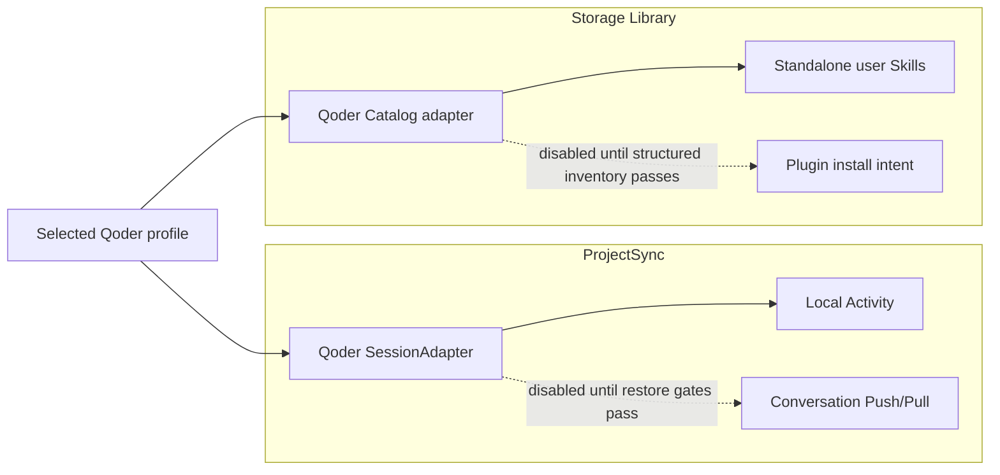
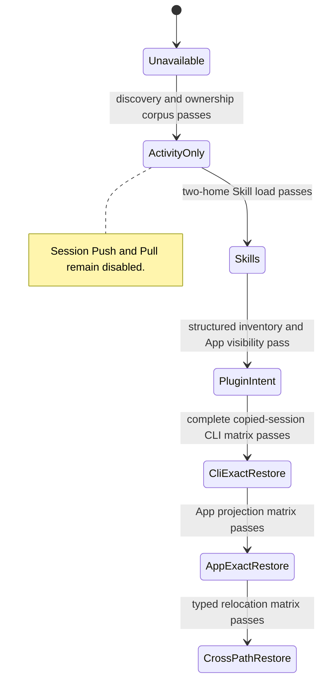
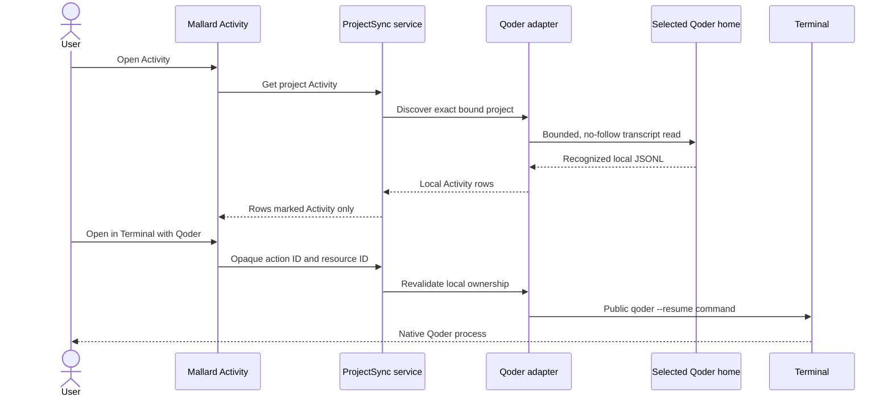

# Design: Qoder support in Mallard

**Status:** proposed; implementation-ready for the minimum release only

**Date:** 2026-09-02

**Audience:** Mallard maintainers, reviewers, and release owners

**Scope:** a minimum Qoder release, plus explicit gates for later plugins and
session portability

**Explicit exclusion:** Qoder pet support

**Current session-restore decision:** no-go

**Current custom-provider decision:** no-go

**Current fork decision:** no-go

**Supersedes for production design:**
[Qoder support feasibility research](QODER_SUPPORT_FEASIBILITY_RESEARCH_2026-09-01.md).
The feasibility report and the four PoC reports remain evidence records.

## 1. Decision

Mallard will add Qoder as a built-in provider through separate capability
gates. Mallard will not use one global `qoder_supported` switch.

The implementation must stay small. The first production change will add only:

1. A Qoder profile and first-place Qoder choice in agent-provider selectors.
2. Read-only local Qoder CLI session Activity.
3. An exact-session **Open in Terminal** action through the public Qoder CLI.
4. Standalone Qoder user Skills in the Library.

The first change will not add Qoder conversation resources to Push or Pull. It
will not add a portable-session codec, sidecar materializer, App database
adapter, plugin command, fork command, custom provider, or pet type.

The release sequence is:

1. Ship the minimum release: profile, read-only Activity, exact native CLI
   resume, and standalone user Skills.
2. Add Qoder plugin install intent only after Qoder supplies, or Mallard proves,
   a supported machine-readable inventory contract.
3. Complete the provider-neutral session foundation.
4. Enable exact-path Qoder CLI session portability only after all session gates
   pass.
5. Enable Qoder App task portability only after the App rebuilds the required
   projections without a database copy or edit.
6. Consider cross-path restore, history fork, and custom-model integration as
   separate later products.

Qoder is the product-preferred agent provider. The backend returns Qoder first,
and the setup UI focuses or selects that first entry for a new setup. This is a
presentation and setup-default rule. It does not auto-bind an unreviewed home,
enable Qoder session Push or Pull, or change an existing project binding.

The current capability state is:

| Capability | Product state | Decision |
| --- | --- | --- |
| Qoder profile registration | Ready to design and implement | Add a built-in `qoder` descriptor, return it first, and require explicit profile binding. |
| Local task discovery | Conditional | Enable only for positively identified, tested transcript dialects. |
| Local Activity summary and detail | Conditional | Enable after ownership, bounds, malformed-input, and branch-warning tests pass. |
| Active-branch Activity | Blocked | Do not identify a current branch until the applicable Qoder surface proves its rule. |
| Open local session in Qoder CLI | Conditional minimum feature | Use the public CLI only, after command, version, ownership, and logging gates pass. This resumes an existing local session and does not copy it. |
| Open an exact task in Qoder App | Blocked | The reviewed public deep links create tasks; they do not open an existing task by ID. |
| Qoder session Push and Pull | Disabled | Copied-session continuation, complete membership, and App projection rebuild are not proved. |
| Standalone user Skills | Conditional first portable resource | Ship after an exact two-home load test for the named Qoder surface. |
| Plugin install intent | Conditional later resource | The public commands exist, but current public docs do not define machine-readable list output. |
| Qoder custom provider or Tuzi | Disabled | Direct Tuzi access passed, but Qoder-to-Tuzi execution did not. The direct provider settings shape is not public. |
| Qoder history fork | Disabled | The PoC proves a transcript transform, not a complete task fork. |
| Qoder pets | Excluded | Add no Qoder pet type, capability, scanner, preview, or UI. |

The backend must enforce every disabled state. Hiding a frontend control is not
a safety boundary.

## 2. Product outcome

### 2.1 Minimum-release user outcome

A user sees Qoder first in each agent-provider choice. The user can bind a
Qoder profile to a Mallard project. Mallard can show local, project-owned Qoder
CLI sessions in Activity when their format is supported. Each row states that
Qoder session sync is unavailable. The Push and Pull reviews do not offer Qoder
session rows.

If a supported public Qoder CLI is present, Activity offers an explicit **Open
in Terminal with Qoder** action. The action resumes the exact selected local
session. It does not copy, fork, or prove that the session is portable.

In the Library, a user can bind a Qoder profile and synchronize standalone user
Skills after the two-home gate passes. Qoder is the first provider choice.
Qoder plugins remain unavailable until the plugin inventory and apply gates
pass. The Library never offers Qoder pets.

### 2.2 Later user outcome

Future Qoder session support must have a narrow, truthful label:

- **Qoder CLI session** when only the CLI round trip passes.
- **Qoder task** only when Qoder App list, open, continue, restart, and recapture
  pass.
- **Same-path restore only** until structural relocation passes independently.

Mallard must not call a captured but non-restorable task a portable session.
Mallard must not relabel a fork as restore.

## 3. Goals and non-goals

### 3.1 Goals

- Add Qoder without changing Codex or Claude behavior.
- Keep ProjectSync provider registration compile-time and typed.
- Keep the Storage Catalog independent from ProjectSync.
- Discover only Qoder sessions that belong to the exact bound project.
- Keep Qoder Activity useful when session portability is disabled.
- Synchronize only standalone user Skills from a proved user root.
- Represent plugins as install intent. Never copy plugin payloads.
- Preserve immutable publication, SHA-256 verification, reviewed plans,
  compare-and-swap heads, backups, journals, and stale-plan checks.
- Build the common session primitives that a safe third provider needs.
- Fail closed for unknown Qoder versions, dialects, sidecars, paths, and native
  command output.

### 3.2 Non-goals for the first Qoder release

- Qoder session Push, Pull, restore, or backup.
- Qoder App database import, copy, repair, or mutation.
- Cross-path Qoder session restore.
- Qoder task or history fork.
- Qoder custom-provider configuration or Tuzi credential management.
- Qoder memory, rules, commands, Hooks, connectors, agents, or subagents as
  independent portable resources.
- Project-level `.qoder` configuration or project Skills as provider-home
  state.
- Qoder cloud sessions, Remote Control, Teleport, or Cloud Agent state.
- Qoder pet support.
- A dynamic Mallard provider plug-in ABI.
- Use of an executable hidden inside the Qoder App bundle.
- Compatibility readers, dual writes, or migrations for old Mallard schemas.

## 4. Terms and evidence rules

### 4.1 Product terms

Qoder uses different terms on different surfaces. Mallard uses these terms
consistently:

| Term | Meaning in this design |
| --- | --- |
| Qoder App | The desktop Qoder product and its application state. |
| Qoder IDE | The earlier or separate Editor and Quest documentation surface. |
| Qoder CLI | The public `qoder` command-line product. |
| Qoder Agent SDK | The TypeScript or Python SDK and its paired CLI runtime. |
| Session | Mallard's provider-neutral persisted conversation. |
| Qoder task | User-facing Qoder App term for a conversation. |
| Transcript | The main JSONL history file. |
| Sidecar | Session-owned state outside the main transcript. |
| Projection | Qoder App state derived into its separate application database. |
| Exact restore | Restore with the same Qoder UUID and no semantic change. |
| Fork | Create a new Qoder UUID from selected source history. |

A result for Qoder CLI does not prove Qoder App behavior. A result for the
Agent SDK does not prove Qoder CLI or App behavior.

### 4.2 Evidence labels

Every compatibility entry, test record, and release note must use one of these
labels:

| Label | Meaning | Production use |
| --- | --- | --- |
| `documented` | Current official Qoder documentation defines the behavior. | Candidate contract after a product test. |
| `product_proved` | A pinned Qoder product completed the stated isolated test. | Valid only for the tested version, surface, operating system, and fixture. |
| `package_observed` | Static package inspection found the behavior. | Diagnostic only. It cannot enable a capability. |
| `synthetic` | A Mallard-controlled harness proved Mallard mechanics. | It does not prove Qoder consumption. |
| `unproved` | No applicable contract or completed test exists. | Fail closed. |

Do not combine two partial results into one stronger result. For example,
direct Tuzi success plus native Qoder resume does not prove Qoder resume through
Tuzi.

### 4.3 Tested evidence baseline

The current PoCs used these versions:

- Qoder App `0.1.4` for installed-product and local-layout observations.
- Qoder runtime metadata `1.1.35` in observed App task records.
- `@qoder-ai/qodercli` `1.1.40`.
- `@qoder-ai/qoder-agent-sdk` `1.0.32`.
- macOS ARM64.

Qoder's release notes identify CLI `1.1.40` as the 2026-09-01 release. These
versions are evidence baselines. They are not broad compatibility ranges.

## 5. Current PoC result

The PoCs prove useful mechanics. They do not make production restore ready.

| Gate | Result | Design consequence |
| --- | --- | --- |
| Synthetic sandbox boundary | Pass | Keep the marker and canonical-boundary controls in every destructive fixture. |
| Stable multi-file capture | Pass, synthetic | Move the two-pass group protocol into production Rust before session portability. |
| Six-member sidecar materialization | Pass, synthetic | Keep as a fixture only. File-history and other state make the real membership larger. |
| Source UUID preservation | Pass, synthetic | Exact restore must preserve the source UUID. |
| New UUID collision detection | Partial | Add destination-wide serialization and every reachable Qoder namespace. |
| Existing mapped update | Pass, synthetic | Keep identity, size, digest, member-set, profile, and project pins. |
| `active-leaf` candidate discovery | Pass, synthetic | Candidate discovery is not branch authority. |
| SDK active-leaf projection | Pass, limited | It defines SDK `1.0.32` behavior only. It is not the App rule. |
| Structural-only path mapping | Partial, synthetic | Do not enable cross-path restore. Real Qoder fields and integrity rules remain unproved. |
| Integrity-field protection | Pass, synthetic | Keep the blocker. The tested field list is not a complete Qoder schema. |
| SDK transcript import | Pass, limited | It can mirror main and subagent history. It is not full task import. |
| SDK sidecar import | Does not pass | The public external store holds history only. |
| Clean Qoder CLI discovery | Pass, limited | CLI `1.1.40` listed one restored synthetic transcript. Human output is not an inventory API. |
| Authenticated native CLI resume | Pass, limited | A fresh native session resumed with the same UUID, recovered a marker, and grew its transcript. No copied restore occurred. |
| Corrected no-Keychain command run | Unproved | The first run used the wrong file-storage value. Do not make a production no-Keychain claim. |
| Clean copied-session CLI resume | Unproved | This remains a release blocker. |
| Clean Qoder App discovery and continue | Blocked | No supported App-home selector or disposable App environment was available. |
| Qoder App projection rebuild | Unproved | Do not copy or edit the application database. |
| Direct Tuzi model request | Pass, live, limited | This proves Tuzi only. It does not prove Qoder integration. |
| Qoder-to-Tuzi request | Unproved | Keep custom-provider support disabled. |
| SDK standalone history fork | Pass, transcript-only | Keep fork separate and disabled. |
| Production Qoder session restore | No-go | Keep backend capability disabled. |

The test count is not a production-readiness metric. The current suite mixes
synthetic, mocked, package-pinned, and narrow product tests.

## 6. Architecture

Qoder crosses two independent Mallard subsystems:



ProjectSync and the Library must not share provider profiles, provider enums,
plans, or persistence records. They can share only neutral validated primitives
and the registered default-profile description where an existing boundary
allows it.

### 6.1 ProjectSync extension point

ProjectSync already has:

- An open validated `mallard_domain::ProviderKey`.
- A compiled `ProviderRegistry`.
- A `SessionAdapter` boundary for discovery, codecs, Activity, targets, and
  safe actions.
- Provider-driven setup and Activity descriptors.
- Generic remote preservation for unknown provider slices.

The production registry currently contains Codex and Claude. Qoder must be a
built-in adapter and one registry entry. Mallard must not load provider code
from a bundle or user manifest.

Full session sync is not fully provider-neutral. The ProjectSync service still
contains Codex or Claude policy for wire transforms, cursors, ID allocation,
cloud-only eligibility, path mapping, indexes, materialization, post-Pull
behavior, and launch flows. The session watcher also has fixed provider roots.

Do not add a third set of Qoder branches. Complete the provider-neutral
foundation before Qoder session portability.

### 6.2 Storage Catalog extension point

The Library intentionally has a separate closed provider type. It currently
contains only Codex and Claude. It also has a closed Skill scope and a closed
capability matrix.

The Library already provides the correct core controls:

- Bounded, deterministic, no-follow Skill tree capture.
- SHA-256 content identities.
- Plugin install intent without plugin payload transport.
- Reviewed Push and Pull plans.
- Revision, digest, expiry, and trust checks.
- Journaled apply, backups, and post-apply verification.
- Structured native command arguments, timeouts, and bounded output.

Qoder extends this closed domain. It does not reuse ProjectSync provider types.

### 6.3 Capability state flow



This diagram shows release order. Each capability remains independently
disableable. A failure in a later capability does not disable a safe earlier
capability.

## 7. Minimum-release design

### 7.1 Release contents

The minimum release has four user-visible functions:

| Function | Included behavior | Explicit boundary |
| --- | --- | --- |
| Provider choice | Show Qoder first in Project setup and Library setup. | Do not change an existing project. Do not bind a home without review. |
| Local Activity | List, summarize, and inspect exact-project Qoder CLI sessions from a selected profile. | Do not publish, download, restore, or edit a Qoder session. |
| Terminal resume | Resume the selected local UUID with the selected Qoder home and exact project path. | Do not authenticate, copy, fork, or open an App task. |
| User Skills | Push and Pull reviewed standalone Skills under the selected Qoder user Skill root. | Do not include project Skills, plugin payloads, plugin state, settings, or pets. |

The release must not change:

- The bundle schema for conversations.
- Conversation wire codecs.
- Conversation sidecar materialization.
- Local-folder or S3/R2 transport.
- Qoder application databases.
- Codex or Claude provider behavior.

### 7.2 Small ProjectSync capability

Do not add a general capability framework for the first release. Add one
serialized mode to `ProviderDescriptor`:

```rust
#[derive(Serialize, Deserialize, Clone, Copy, Debug, PartialEq, Eq)]
#[serde(rename_all = "snake_case")]
pub enum ConversationMode {
    ActivityOnly,
    Portable,
}

pub struct ProviderDescriptor {
    // Existing fields.
    pub conversation_mode: ConversationMode,
}
```

Set the values as follows:

| Provider | `conversation_mode` |
| --- | --- |
| Qoder | `activity_only` |
| Codex | `portable` |
| Claude | `portable` |
| Test provider | Set explicitly for each test. Use `activity_only` by default. |

Registration means that the adapter can supply local Activity. The existing
`available_actions` result continues to define native actions. The existing
Library capability matrix continues to define portable Library resource kinds.
Therefore, the first release does not need a second capability object.

Add one backend helper:

```rust
fn require_portable_conversations(
    registry: &ProviderRegistry,
    provider: &ProviderKey,
) -> Result<(), String>;
```

The helper returns the typed product error
`qoder_session_sync_unavailable` for Qoder. Call it before Qoder data can enter
any of these paths:

- Push candidate capture.
- Push plan construction.
- Immutable object publication.
- Remote-only conversation eligibility.
- Pull plan construction.
- Target selection.
- Conversation materialization.
- Provider index or cursor update.

The gate must run before a transcript read for a portable operation. A second
gate must remain at apply time. This protects saved plans and direct command
calls. The frontend also reads `conversation_mode`, but the frontend is not the
security boundary.

Remote bundles from a future Mallard version can contain a Qoder provider
slice. The current release can preserve and display the unknown slice through
existing generic behavior. It must not offer a Pull action for it.

### 7.3 Preferred provider order

Qoder is the first agent-provider choice. Do not depend on `BTreeMap` key
order. It currently produces lexical order.

Keep the policy in the two compiled output boundaries:

```rust
fn provider_display_rank(key: &str) -> u8 {
    match key {
        "qoder" => 0,
        "codex" => 10,
        "claude" => 20,
        _ => 100,
    }
}
```

`ProviderRegistry::descriptors()` sorts by this rank and then by provider key.
The Library capability matrix returns `Qoder`, `Codex`, and `Claude` in that
order. Set Qoder `setup_default` to `true`. The setup UI uses the first enabled
choice as the initial focus or selection.

This order is product policy. It is not a claim that Qoder has more enabled
capabilities than Codex or Claude. Existing project bindings remain unchanged.

### 7.4 Qoder descriptor

The first descriptor is:

```rust
ProviderDescriptor {
    key: ProviderKey::parse("qoder")?,
    display_name: "Qoder".to_string(),
    profile_label: ".qoder profile".to_string(),
    default_profile_directory: Some(".qoder".to_string()),
    setup_default: true,
    cli_launcher: None,
    conversation_mode: ConversationMode::ActivityOnly,
}
```

Keep `cli_launcher` empty in the first patch. That field starts a provider with
a new prompt during setup. The minimum release needs only the session action,
which resumes an existing local session. This avoids an extra authentication
and prompt-launch contract.

The selected profile home is equivalent to the Qoder CLI configuration
directory. The default is `$HOME/.qoder`. Mallard stores the selected profile
path only in machine-local state. Mallard does not place it in a portable
manifest.

## 8. Local Qoder CLI Activity

### 8.1 Supported surface

The first adapter supports Qoder CLI only. It does not claim Qoder App task
support. Use a product name of **Qoder CLI session** in warnings and details.

Support one exact transcript dialect at a time. The first candidate is the
fixture-proved dialect created by Qoder CLI `1.1.40` on macOS ARM64. Do not
combine these layouts in one tolerant parser:

- A CLI or IDE layout with a positive `session_meta` discriminator.
- An observed App-style layout with `workspace-directories` and
  `runtime-config` discriminators.

Add a second dialect only after it has a separate fixture, ownership rule,
version entry, and parser tests. A mixed or unidentified record set is blocked
with `qoder_unknown_dialect`.

### 8.2 Discovery boundary

Scan only this selected-home subtree:

```text
<QODER_CONFIG_DIR>/projects/
```

Do not scan the operating-system user home, a project `.qoder` directory, the
Qoder App data root, or a second Qoder profile.

The adapter must:

1. Canonicalize the selected profile and bound project.
2. Walk with the existing file-count, directory-count, depth, and byte limits.
3. Reject symbolic links and special files.
4. Accept only the exact transcript path grammar for the selected dialect.
5. Parse a bounded head before it reads a complete transcript.
6. Require a canonical lowercase UUID file name.
7. Require every recognized session identity in the file to equal that UUID.
8. Read the authoritative project field for that dialect.
9. Canonicalize that field and require an exact match to the bound project.
10. Report a blocked row when the dialect, identity, or ownership is unclear.

The encoded project directory name is only a search hint. It is not ownership
evidence. A per-turn working directory is Activity context. It is not immutable
project ownership. A multi-root session is blocked with
`qoder_multi_root_unproved` until Qoder defines its ownership rule.

### 8.3 Activity data model

Reuse the existing provider-neutral Activity DTOs and resource ID grammar:

```text
state/conversations/qoder/<mallard-thread-id>/transcript.jsonl
```

This string is a Mallard logical identity only. The minimum release never
publishes an object at that path.

For each accepted local session, expose:

- Provider `qoder` and display name `Qoder`.
- The validated local Qoder UUID.
- The bounded title or last-prompt summary when the dialect defines it.
- Created and modified time from recognized records, with file metadata as a
  presentation fallback only.
- The authoritative project path through the existing sanitized display
  contract.
- A fixed `sync_blocked_reason`: Qoder session Push and Pull are not available.
- Available local actions from the Qoder adapter.

Do not read `state.json`, compression state, subagent state, or file-history
objects for the minimum Activity view. Those files are required for a future
portable consistency group, but they are not needed to inspect the main local
conversation. The Activity adapter must not present transcript-only inspection
as backup coverage.

### 8.4 Timeline and branch behavior

The first Activity parser can show supported user, assistant, and tool events
in file order. It must label the view **Recorded history**. It must not label a
record as the active branch.

If the transcript contains branching, compaction, replacement, sidechain,
team, or multiple active-leaf evidence that the parser cannot prove, the
adapter must:

- Keep a bounded metadata summary.
- Add `qoder_branch_selection_unproved`.
- Avoid a fabricated active branch.
- Disable any action that depends on a selected leaf.

The local terminal resume action can still select the whole exact session UUID.
Qoder then applies its own native branch rule. Mallard must not promise which
leaf Qoder will select.

### 8.5 Parser limits

Use the existing application settings where they already define conversation
limits. Add Qoder-specific constants only for a Qoder grammar limit that has no
shared equivalent.

At minimum, enforce:

- Maximum transcript bytes.
- Maximum JSONL line bytes.
- Maximum record count.
- Maximum JSON nesting depth.
- Maximum string bytes retained for a summary or detail.
- Maximum normalized events per page.
- Maximum tool input and output detail.

Invalid UTF-8, an over-limit line, duplicate structural identity, or malformed
required metadata blocks that session. One malformed session must not hide an
unrelated safe session.

Unknown fields can be ignored for read-only display only when they cannot
change identity, project ownership, lineage, or limits. An unknown record type
that can affect these properties blocks the session.

### 8.6 Watch behavior

The current watcher has roots only for Codex and Claude. For an unknown root
set, it already takes the bounded uncached path. Keep Qoder on that uncached
path in the minimum release. Do not add Qoder-specific watcher code.

Add provider-declared watcher roots only if measured performance requires it.
This keeps the first change small and keeps watcher state out of the Qoder
correctness boundary.

## 9. Exact local CLI resume

### 9.1 Action contract

The Qoder adapter offers one action:

| Field | Value |
| --- | --- |
| ID | `open_in_terminal` |
| Kind | `open_in_terminal` |
| Label | `Open in Terminal with Qoder` |
| Local requirement | Yes |
| Session ID | Canonical UUID only |
| Project requirement | Exact current project binding |
| Profile requirement | Exact current Qoder profile binding |

Before launch, the generic action command must reload the project binding,
profile revision, local transcript, UUID, and authoritative ownership. If any
value changed after Activity loaded, return `qoder_session_changed`.

The command shape is:

```text
cd <shell-quoted-project> &&
qoder --config-dir <shell-quoted-qoder-home>
      --cwd <shell-quoted-project>
      --resume <shell-quoted-canonical-uuid>
```

Build the command from validated arguments. Do not accept command text from a
transcript, remote object, manifest, frontend, or user-supplied provider key.
Do not use:

- `--continue`.
- A numeric list index.
- A session name.
- `--session-id` as the source selector.
- `--fork-session`.
- An executable inside the Qoder App bundle.
- A Qoder App deep link.

The action resumes the existing local session. It can append new records after
Qoder starts. This is normal native behavior and is not a Mallard restore.

### 9.2 Authentication and Keychain boundary

Mallard must not:

- Start `qoder login` in the background.
- Read, copy, print, or persist Qoder credentials.
- Pass a PAT or provider API key.
- Inspect Qoder authentication files to decide whether to launch.
- Reset or modify macOS Keychain.
- Set the package-observed `QODER_FORCE_FILE_STORAGE` variable in production.

The terminal process uses the already selected Qoder profile. Qoder owns its
authentication prompt and credential storage. Mallard does not claim that the
Qoder process will avoid Keychain. If a no-Keychain guarantee is a release
requirement, keep the action disabled until Qoder documents a public control
and the product test passes it. The PoC's private environment control is not a
production contract.

### 9.3 Sanitized launch audit

The current `SessionActionRequest::before_launch` callback receives the exact
shell command. That command contains the provider home, project path, and
session UUID. Fix this before Qoder actions ship.

Replace the callback payload with a fixed typed event:

```rust
pub enum SessionLaunchAudit {
    OpenInApp,
    OpenInTerminal,
}
```

The service already knows the validated provider key. The activity log records
only the provider, fixed action kind, outcome, and generated operation ID. It
must not record command text, paths, UUIDs, titles, prompts, or CLI output.

Update Codex and Claude to use the same typed callback. Their command behavior
does not change.

## 10. Qoder user Skills

### 10.1 Portable root

The minimum Library support includes only direct child directories of:

```text
<QODER_CONFIG_DIR>/skills/<skill-name>/
```

Each Skill requires:

```text
<QODER_CONFIG_DIR>/skills/<skill-name>/SKILL.md
```

Exclude:

- `<project>/.qoder/skills/**`.
- Any project-relative Skill root.
- Plugin package directories and plugin-contributed Skills.
- Cache, data, settings, log, memory, and authentication paths.
- Symbolic links and special files.

Use the existing bounded Skill tree capture, content identity, warning,
review, reconciliation, journal, backup, apply, and verification code.

### 10.2 Catalog domain extension

Extend only the existing closed types:

```rust
pub enum ProviderKey {
    Qoder,
    Codex,
    Claude,
}

pub enum AgentSkillScope {
    QoderUser,
    CodexHome,
    CodexSharedUser,
    ClaudeUser,
}
```

Use this stable root-class token:

```text
provider/qoder
```

Set `QoderUser.provider()` to `ProviderKey::Qoder`. Use `Qoder` as the scope
label. Do not add a resource kind. Qoder Skills use the existing
`AgentSkill` kind.

Change the ownership rule to:

| Provider | Agent Skill | Plugin intent | Pet v1 | Pet v2 |
| --- | ---: | ---: | ---: | ---: |
| Qoder | Yes | No | No | No |
| Codex | Yes | Yes | Yes | Yes |
| Claude | Yes | Yes | No | No |

This table is the first-release Library capability matrix. The backend derives
the UI choices from it.

### 10.3 Skill and plugin separation

The current Skill inventory calls plugin discovery first. A missing or
unsupported Qoder plugin command must not block user Skills.

Use the current profile only. Call plugin discovery before Skill scanning only
when that provider owns `PluginInstallIntent`. Qoder does not own that kind in
the minimum release. Therefore, Qoder Skill inventory performs no native CLI
call.

Add a `QoderCatalogAdapter` only to satisfy the closed adapter registry. Its
plugin methods return the typed blocker `qoder_plugin_support_unavailable`.
No first-release path calls these methods.

This is smaller than making every plugin method optional. Revisit the trait
only when Qoder plugin intent becomes eligible.

### 10.4 Qoder Skill validation

The Qoder Skills documentation defines YAML front matter with required `name`
and `description` fields. Apply these checks after the generic safe-tree scan:

- `name` contains only lowercase letters, digits, and hyphens.
- `name` is at most 64 characters.
- `description` is at most 1024 characters.
- The directory name equals `name`.
- `SKILL.md` is a regular file inside the captured root.

Keep valid bytes unchanged. Do not normalize or rewrite YAML or Markdown.
Unknown front-matter fields remain part of the reviewed content.

The existing executable-content and credential-shaped warnings still apply.
A warning needs the existing explicit acknowledgement. It is not a proof that
the content is safe.

### 10.5 Two-home acceptance gate

Before release, use two disposable Qoder CLI profiles:

1. Create a synthetic Skill in profile A.
2. Confirm that the supported Qoder CLI loads it.
3. Push it through the Library.
4. Review and Pull it into empty profile B.
5. Confirm exact reviewed files, modes, and digest.
6. Confirm that the same supported Qoder CLI loads it from profile B.
7. Change one destination file after review and confirm that apply blocks.
8. Remove only the disposable roots after marker and boundary checks pass.

The test must not use `~/.qoder`.

## 11. Minimum-release data flow

### 11.1 Activity and resume



No remote storage, bundle, or materializer participates in this flow.

### 11.2 Skill Push and Pull


The only new data values are the Qoder Catalog provider and the `QoderUser`
Skill scope. The Skill payload format and storage transport do not change.

## 12. Minimum-release failure behavior

| Condition | Result |
| --- | --- |
| Qoder home does not exist | Profile setup blocks. No directory is created during discovery. |
| Qoder project tree does not exist | Activity returns no Qoder sessions. Other providers remain available. |
| Unknown transcript dialect | Show a blocked local candidate without content. |
| Project ownership is absent or mismatched | Do not show it as a session for this project. Record a sanitized blocker count. |
| Duplicate UUID in reachable Qoder buckets | Disable resume for all duplicates. Do not choose newest. |
| Branch authority is unclear | Show recorded history with a branch warning. Do not claim an active leaf. |
| CLI is missing | Terminal shows a non-secret launch failure, or the action is disabled when a reliable probe exists. Activity remains available. |
| Qoder asks for authentication | The user handles or cancels the native prompt. Mallard stores nothing. |
| User requests Qoder session Push or Pull | Backend returns `qoder_session_sync_unavailable` before transcript capture. |
| User opens Qoder plugin scope | Qoder plugin scope is absent. A direct command returns `qoder_plugin_support_unavailable`. |
| Qoder Skill root is absent | Show an empty scope. Create it only during an approved Pull. |
| Qoder Skill changes after review | Existing digest and revision checks block apply. |
| Qoder pet resource is encountered | Treat it as unsupported. Never map it to a Qoder target. |

## 13. Qoder plugin install intent: later design

### 13.1 Current decision

Do not include Qoder plugins in the minimum release.

Qoder documents plugin list, install, update, and marketplace commands. The
reviewed public documentation does not define a machine-readable schema for
plugin or marketplace inventory. Human terminal output is not a production
data contract.

Mallard must not scrape columns or terminal formatting. Mallard also must not
inspect private Qoder cache files as an inventory API.

### 13.2 Required external contract

Enable Qoder plugin intent only when one of these conditions is true:

1. Qoder documents a stable JSON inventory command and schema.
2. A supported Qoder SDK exposes the same inventory with stable typed fields.
3. Qoder provides another public machine-readable interface that completes the
   same contract.

The contract must return:

- Canonical plugin ID.
- Marketplace or source namespace.
- User scope.
- Installed state.
- Enabled state when it affects use.
- Observed version or immutable source revision.
- Stable Git source identity for portable resolution.
- Enough data to distinguish built-in, bundled, local, project, and user
  plugins.

The contract must also define exact install, update, and source-registration
arguments. It must define success independently from process exit status.

### 13.3 Portable representation

Reuse `PluginInstallIntentResource`. Store only semantic install intent:

- Provider `qoder`.
- Source-qualified canonical plugin ID.
- Public Git marketplace source and revision when allowed.
- Provider resolution policy.
- Content digest over the canonical intent document.

Never store:

- Plugin payload files.
- Plugin cache or data.
- Hooks or generated MCP configuration.
- Credentials, tokens, or credential-bearing URLs.
- Local source directories.
- Settings or enablement state.
- App database rows.

Initially accept only installed, user-scope, user-visible, Git-backed
marketplace plugins. Exclude built-in, App-bundled, project, local, local-path,
and unknown-source entries.

### 13.4 Native apply

When the external contract exists, a Qoder adapter must:

1. Pin the exact public CLI path, version, and supported contract version.
2. Read bounded JSON with `MAX_CLI_BYTES + 1` bytes.
3. Reject output when the extra byte is present.
4. Parse with a versioned typed schema.
5. Re-inventory immediately before launch.
6. Compare the result with the reviewed expected state.
7. Run the exact native command with structured arguments and a timeout.
8. Re-inventory after exit.
9. Require the resulting semantic intent to equal the reviewed intent.

The current output reader uses `.take(MAX_CLI_BYTES)` and then checks the
captured length. That check cannot detect truncated output. Fix it before any
Qoder native plugin integration.

A timeout or parse failure after launch can follow a native side effect. Return
`ReconciliationRequired`, preserve the journal, and request a fresh inventory.
Do not automatically uninstall or roll back a plugin.

## 14. Qoder session portability: future design

### 14.1 Why it remains disabled

The authenticated PoC proves that a second Qoder CLI `1.1.40` process can use
`--resume <same-uuid>` for a session that the first process created in the same
isolated profile. It does not copy a session between homes.

Production restore still lacks proof for:

- Complete session membership.
- Stable multi-file capture against the real Qoder writer.
- Sidecar and checkpoint consumption.
- Authoritative active-leaf behavior.
- Destination-wide UUID collision protection.
- Exact copied-session continuation in a clean home.
- App projection rebuild.
- Cross-path structural mapping.
- Crash-safe group materialization.

Therefore, `conversation_mode` remains `activity_only`.

### 14.2 Future adapter boundary

Do not extend the minimum `SessionAdapter` with many unused mutation methods.
When the restore gates pass, add a companion interface:

```rust
pub trait PortableSessionAdapter: Send + Sync {
    fn provider(&self) -> ProviderKey;
    fn portable_codec(&self) -> PortableCodecDescriptor;
    fn capture_group(&self, request: &CaptureGroupRequest)
        -> Result<CapturedSessionGroup, SessionPortabilityBlocker>;
    fn encode_portable_group(&self, group: &CapturedSessionGroup)
        -> Result<PortableSessionGroup, SessionPortabilityBlocker>;
    fn plan_materialization(&self, request: &MaterializationRequest)
        -> Result<MaterializationPlan, SessionPortabilityBlocker>;
    fn verify_materialized_group(&self, request: &VerificationRequest)
        -> Result<(), SessionPortabilityBlocker>;
}
```

Register this interface only for providers with `conversation_mode = portable`.
It must own:

- Layout and version detection.
- Required and optional member grammar.
- Source UUID policy.
- Active-leaf and compaction policy.
- Tail and cursor behavior.
- Portable wire encode and decode.
- Structural path mapping.
- Collision namespaces.
- Index merge behavior.
- Materialization target mapping.
- Post-apply product verification.
- Provider refresh or projection behavior.

This removes the current Codex-or-Claude fallthrough from future Qoder work.
Do not add `else { /* Qoder */ }` branches beside the existing `is_codex`
branches.

### 14.3 Candidate consistency group

Observed and package-inspected Qoder versions use a group similar to:

```text
projects/<project-key>/<session-uuid>.jsonl
projects/<project-key>/<session-uuid>/state.json
projects/<project-key>/<session-uuid>/compression-v2/state.json
projects/<project-key>/<session-uuid>/subagents/agent-<id>.jsonl
projects/<project-key>/<session-uuid>/subagents/agent-<id>.meta.json
projects/<project-key>/<session-uuid>/subagents/task-<id>.json
file-history/<session-uuid>/<checkpoint-object>
```

These names are candidates, not a public stable schema. A production codec
needs one closed, versioned member grammar. A recognized session with an
unknown session-owned member must block as a complete group.

Do not assume that the six files from the synthetic PoC are complete.
File-history references can add checkpoint objects outside the task directory.

### 14.4 Stable group capture

Require Qoder to be stopped for the selected profile. A Mallard lock alone is
not sufficient because Qoder does not honor it.

For one session group:

1. Resolve the exact supported layout.
2. Enumerate all required and referenced members from an allowlist.
3. Reject unknown members, links, special files, excessive hard links, and
   out-of-root references.
4. Open each member without following symbolic links.
5. Record device, inode, mode, link count, size, modification time, change
   time, and SHA-256 digest.
6. Read every member through its retained handle under per-file and aggregate
   limits.
7. Restat every retained handle.
8. Re-enumerate all participating directories.
9. Repeat the complete pass.
10. Compare names, roles, identities, sizes, times, link counts, and digests.
11. Parse only the retained stable buffers.
12. Check again that no Qoder process started for this profile.

Any addition, removal, rename, replacement, in-place change, hard-link change,
or symbolic-link substitution blocks the whole session. Do not silently retry
until a quiet interval appears. That could combine different logical states.

Compute one group digest over an ordered, domain-separated tuple for every
member:

```text
(role, validated-relative-path, size, sha256)
```

The member name and role must affect the digest. Two groups with equal bytes at
different logical paths must not have the same group identity.

### 14.5 UUID rules and collision scope

Exact restore preserves the source Qoder UUID. It does not allocate a new UUID.

Before new materialization, scan or reserve the UUID across every supported
destination namespace:

- All Qoder project buckets for the selected profile.
- Main transcript names.
- Task directories.
- Root state and compression state.
- Subagent and task sidecars.
- File-history checkpoint roots.
- Pending Mallard plans and journals.
- Mallard conversation bindings and receipts.
- External SDK store keys when that mode is used.
- Qoder App projections only through a supported public inventory API.

A match that is not the exact reviewed existing mapping is a hard collision.
Do not overwrite, remap, choose the newest file, choose a list index, or use
fork as collision recovery.

Use a provider-home-wide lock or UUID reservation while planning and applying.
Recheck the full collision set immediately before commit.

For an existing mapped update, require exact equality for:

- Cloud task identity.
- Provider and source UUID.
- Destination UUID.
- Profile and project binding revisions.
- Complete member names and roles.
- Expected file identities, sizes, and digests.
- Expected absence of every new target.

### 14.6 Restore transaction

An approved Qoder restore must use one group transaction:

1. Revalidate plan revision, expiry, storage head, project binding, profile,
   Qoder compatibility, stopped-Qoder state, and UUID collision set.
2. Fetch and SHA-256 verify all immutable objects.
3. Stage all members under a validated Mallard staging directory.
4. Validate each member codec and the complete group digest.
5. Write a recovery journal before target mutation.
6. Back up only exact existing targets named in the reviewed plan.
7. Install sidecars, state, and checkpoints first.
8. Install the main transcript last.
9. Flush files and required parent directories.
10. Delete only an exact obsolete file with its reviewed digest, or an exact
    empty directory. Never delete recursively.
11. Recapture the complete destination group.
12. Require group equality with the approved result.
13. Save the binding and receipt.
14. Mark the journal complete.

After a crash, recovery must produce one of three results:

- The complete approved group.
- The complete original group.
- `RecoveryRequired`, with backups and uncertain members preserved.

A mixed group is never success.

### 14.7 Exact path before cross path

The first possible portable mode is **same exact project path**. The source and
destination canonical project spelling must match.

Cross-path restore is a separate later capability. It needs a versioned typed
map of path-bearing JSON value tokens. The mapper must preserve all unselected
bytes, including whitespace, escaping, keys, and free-form history. It must not
use global string replacement or parse-and-reserialize the transcript.

An unknown signature, integrity, hash, or authenticated field that covers a
mapped token blocks relocation. A cross-path release needs clean-home resume,
restart, App behavior when claimed, and exact recapture tests.

### 14.8 Qoder App boundary

Do not copy or edit Qoder App databases, write-ahead logs, or shared-memory
files. They are projections with no reviewed import contract.

Qoder App support remains disabled until a supported interface can:

- Select an isolated App home or disposable environment.
- Discover the restored task.
- Rebuild required projections.
- Detect UUID collisions.
- Open an existing task by stable ID.
- Continue it.
- Survive App restart.
- Recapture a coherent task.

Current public deep links create new Chat or Quest work. They do not document
an open-existing-task-by-ID operation.

### 14.9 SDK store boundary

The Qoder Agent SDK external `SessionStore` can mirror main and subagent
history. The public contract remains history-focused and best-effort. Local
writes continue, and a missing external entry can fall back to local storage.

Treat this SDK path as a history mirror only. It does not prove:

- Root task state.
- Compression state.
- Task sidecars.
- File checkpoints.
- Authentication or provider settings.
- App projections.
- Complete retention or deletion.

Do not use the SDK store as the session portability implementation.

## 15. Qoder fork: later product

Resume and fork have different identity rules:

- Resume keeps the existing Qoder UUID.
- Fork creates a new Qoder UUID and selected history.

The SDK fork PoC proves a standalone transcript transform. It does not prove a
complete Qoder task fork. It omits or has unproved behavior for state,
compression, checkpoints, task sidecars, application projections, and crash
rollback.

Do not use fork to resolve an exact-restore collision. Do not call copied or
rewritten history a restored session.

A future **Fork Qoder history** product needs all of these gates:

- Public and versioned Qoder fork API or command contract.
- Exact cut-record and selected-leaf semantics.
- Complete parent, replacement, compaction, team, and subagent graph rules.
- Defined state, plan, checkpoint, and file-history policy.
- Atomic target UUID claim.
- Target collision rejection.
- Source immutability under concurrent append.
- Crash-safe transaction and recovery.
- Authenticated marker recovery in the new UUID.
- Restart and recapture.
- Qoder App tests if App compatibility is claimed.

Until those gates pass, expose no fork control in Mallard.

## 16. Qoder custom providers and Tuzi: later product

The Tuzi PoC proves two separate facts:

1. A direct request to the Tuzi model and chat endpoints can succeed with a
   disposable key.
2. Qoder CLI can resume a native Qoder session with Qoder-managed model access.

It does not prove a Qoder-to-Tuzi request. Combining two independent passes
does not prove the combined path.

Qoder documents custom models through its current BYOK catalog and wizard. It
warns users not to configure them manually in settings. The SDK can resolve a
custom model object with provider, model, API key, URL, and style, but the
provider must match Qoder's supported catalog and the account needs permission.

The direct top-level `providers` settings shape accepted by the inspected CLI
package is `package_observed`. Do not use it in production.

The minimum release adds no custom-provider data type. A future design must
keep these values machine-local:

- Provider endpoint.
- Account or organization identity.
- Secret reference.
- API key or token.
- TLS and proxy settings.
- Model entitlement and model name when they expose account state.

Portable data can contain a non-secret intent only after Qoder documents the
contract. Mallard must never put a Tuzi key in a bundle, command line, log,
error, receipt, or test fixture.

## 17. Security and privacy design

### 17.1 Allowlist first

The minimum release has two independent filesystem allowlists:

| Function | Allowed root | Allowed content |
| --- | --- | --- |
| Activity | `<QODER_CONFIG_DIR>/projects` | Recognized main transcript JSONL files for the selected dialect |
| Skills | `<QODER_CONFIG_DIR>/skills/<name>` | The reviewed regular-file Skill tree rooted at a valid `SKILL.md` |

Everything outside these allowlists is excluded. A denylist is a second check.
It is not permission to capture another path.

### 17.2 Provider-home exclusions

Never capture or publish these Qoder-home paths as profile state:

```text
.auth/**
mcp-router.json
.qoder-app-status.json
installation_id
ipc/**
logs/**
shell-snapshots/**
tmp/**
.cache/**
.models/**
memory/**
settings.json
plugins/installed_plugins_v2.json
plugins/cache/**
plugins/data/**
```

Also exclude every unknown top-level path. A new Qoder file stays excluded
until it receives an explicit resource owner, safety review, and test.

### 17.3 Qoder App exclusions

Never copy or edit these application-state classes:

```text
auth.v1.dat
auth.machine-id
Cookies*
Local State
Network Persistent State
Local Storage/**
Session Storage/**
main.sqlite
main.sqlite-wal
main.sqlite-shm
```

Do not discover an App root by walking broad Library directories. A future App
feature needs an explicit supported root and public import or projection
contract.

### 17.4 Filesystem rules

Use the current Mallard safety invariants for every selected Qoder root:

- Require an absolute configured path.
- Resolve and pin the canonical root.
- Reject `..`, empty path components, NUL, and alternate separators in
  logical paths.
- Reject symbolic links and special files.
- Use no-follow opens for content.
- Enforce file, directory, depth, line, and aggregate byte limits.
- Keep discovery under the exact canonical root.
- Recheck target identity and digest after user review.
- Use atomic persistence for Mallard state.
- Use journaled apply for Skill changes.
- Delete only an exact reviewed file with its expected digest or an exact
  empty directory.

The Activity path is read-only. It must never repair, rename, normalize, or
truncate a Qoder transcript.

### 17.5 Content and secret rules

Conversation transcripts and Skills can contain secrets. Keep the current
review warnings and storage trust controls. Do not describe best-effort secret
detection as proof of safety.

For a future resumable opaque Qoder sidecar, choose one of two results:

1. Preserve the exact bytes under an approved sensitive-content policy.
2. Block the session when policy does not permit those bytes.

Do not redact an opaque sidecar and call it resumable. A byte change can break
unknown state or integrity fields.

### 17.6 Threat controls

| Threat | Required control |
| --- | --- |
| Transcript in the wrong encoded project bucket | Authoritative in-file ownership and exact canonical project match |
| Duplicate UUID selects the wrong session | Scan all reachable supported buckets; disable action on any duplicate |
| Malicious JSONL injects a command | Fixed action IDs; command built only from validated profile, project, and UUID |
| Frontend enables hidden sync | Backend `conversation_mode` check before read, plan, publish, and apply |
| Symlink escapes the Qoder home | No-follow traversal and canonical-root containment |
| Session mutates during Activity read | Bounded read, stat checks, and stale Activity result only; revalidate before action |
| Skill changes after review | Existing profile, target, tree, and digest pins |
| Older Mallard reads a Qoder Catalog record | Fail closed; document the minimum compatible Mallard version |
| Raw Qoder output leaks data | Do not capture CLI output for resume; bound and discard future plugin output after parsing |
| Qoder auth leaks into Mallard | No login automation, token input, auth-file read, or credential logging |

## 18. Logging and diagnostics

Use fixed event names and typed blocker codes. Do not place provider content in
a message string.

Minimum-release events:

```text
qoder.discovery.completed
qoder.discovery.blocked
qoder.native_action.started
qoder.native_action.failed
qoder.skill.inventory.completed
qoder.skill.inventory.blocked
qoder.skill.apply.completed
qoder.skill.apply.failed
```

Allowed fields:

- Generated Mallard operation ID.
- Literal provider key `qoder`.
- Supported dialect category.
- Count of accepted and blocked sessions.
- Count of Skills and files.
- Aggregate bounded byte count.
- Duration.
- Fixed action kind.
- Typed blocker code.
- Success or failure.

Forbidden fields:

- Project or profile path.
- Session or record UUID.
- Task title.
- Prompt or response text.
- Tool input or output.
- Skill body.
- Shell command.
- Qoder stdout or stderr.
- PAT, provider API key, authorization value, or environment.
- Endpoint query string.
- File or group digest in normal activity logs.

Use these blocker codes where applicable:

```text
qoder_unknown_dialect
qoder_unsupported_version
qoder_project_ownership_unproved
qoder_multi_root_unproved
qoder_duplicate_session_id
qoder_branch_selection_unproved
qoder_session_changed
qoder_session_sync_unavailable
qoder_plugin_support_unavailable
qoder_cli_contract_unverified
qoder_cli_output_truncated
qoder_app_projection_unavailable
qoder_unknown_session_member
qoder_unstable_session_group
qoder_running
qoder_session_id_collision
qoder_target_changed_after_review
qoder_integrity_field_unproved
qoder_cross_path_unsupported
qoder_recovery_required
```

The last group is reserved for future portability. The minimum release must
not emit a restore-success event for Qoder.

## 19. Compatibility and schema policy

### 19.1 Product compatibility record

Keep one compile-time, fixture-backed record for each enabled Qoder surface:

| Field | Purpose |
| --- | --- |
| Surface | CLI, SDK, App, or IDE |
| Product version | Exact supported version for the first entry |
| Operating system and architecture | Scope of the product proof |
| Transcript dialect | Parser discriminator and version |
| Member-set version | Future portable group contract |
| Codec key and version | Parser and wire behavior |
| Allowed operations | Activity, resume, Skill load, plugin intent, or restore |
| Fixture corpus ID | Exact sanitized test corpus |
| Evidence ID | Documented or product-proved result |

The initial candidate is Qoder CLI `1.1.40` on macOS ARM64 for local Activity
and native resume. Qoder App `0.1.4`, SDK `1.0.32`, and observed App runtime
`1.1.35` are research evidence only unless a specific capability test names
them.

Do not claim a semantic version range after one version passes. Add a range
only after the complete corpus passes at the lower bound, upper bound, and all
known format transitions.

An unknown transcript version can produce a metadata-only blocked row. It
cannot enable resume when identity or ownership is unclear. An unknown native
CLI version can fail visibly in Terminal, but it cannot enable a future plugin
or restore mutation.

The Qoder App database `user_version` is diagnostic information only. It must
not select a parser or migration.

### 19.2 ProjectSync schema

ProjectSync already uses an open validated `ProviderKey`. Adding `qoder` does
not add a new serialized enum. The minimum release does not create portable
Qoder conversation rows. Therefore, the bundle manifest schema remains 1.

`ProviderDescriptor.conversation_mode` changes the Tauri response shape. Update
Rust, `src/types.ts`, fixtures, mocks, and frontend integration tests in one
change. Do not add an optional frontend fallback. This repository does not keep
an old command contract in parallel.

### 19.3 Storage Catalog schema

The Library has a closed serialized provider enum and Skill-scope enum. Add
`qoder` and `qoder_user` to the current schema-1 contract. Update Rust,
TypeScript, persisted-document fixtures, remote Catalog fixtures, and tests in
one clean cut.

Do not add a schema-2 reader, dual write, migration, or alias. The document
shape and resource semantics do not change. The accepted enum domain changes.
An older Mallard build can reject a schema-1 Catalog document that contains a
Qoder resource. State the minimum compatible Mallard version in release notes
and storage-connection help.

Never silently drop an unknown Qoder resource during a downgrade. Fail closed
and leave remote immutable objects unchanged.

### 19.4 Portable identity

Use these minimum-release identity components for a Qoder Skill:

```text
resource kind = agent_skill
provider = qoder
scope = qoder_user
root class = provider/qoder
declared Skill name
directory name
content digest
```

Do not add Qoder pets, a Qoder plugin resource, or a Qoder conversation object
to schema 1 in the minimum release.

## 20. API and UI contract

### 20.1 Provider response

`list_agent_providers` returns Qoder first:

```json
[
  {
    "key": "qoder",
    "display_name": "Qoder",
    "profile_label": ".qoder profile",
    "default_profile_directory": ".qoder",
    "setup_default": true,
    "conversation_mode": "activity_only"
  },
  {
    "key": "codex",
    "conversation_mode": "portable"
  },
  {
    "key": "claude",
    "conversation_mode": "portable"
  }
]
```

The example omits unchanged Codex and Claude fields.

### 20.2 Project setup

The setup UI must:

- Show Qoder first.
- Use Qoder as the initial focus or selection for a new agent-provider setup.
- Show the proposed default `~/.qoder` profile path.
- Require the same explicit profile review as other providers.
- Label the initial support as **Activity and local resume**.
- State **Session Push and Pull are not available**.
- Leave existing projects and bindings unchanged.

### 20.3 Project Activity

The Activity UI reuses current generic rows, detail pages, and provider marks.
The Qoder monogram fallback is sufficient. Do not add unlicensed brand art.

For a Qoder row:

- Use display name `Qoder`.
- Show an `Activity only` status.
- Keep Push and Pull controls absent or disabled with a fixed reason.
- Offer `Open in Terminal with Qoder` only for a validated local session.
- Show the branch warning when selection is unproved.
- Never show an App-open action.

The Pull and Push review models must use `conversation_mode`. They must not
infer sync support from the presence of a profile or Activity row.

### 20.4 Library

`list_catalog_capabilities` returns Qoder first with only `agent_skill`.

The Library UI must:

- Show Qoder first in provider selection.
- Offer a Qoder user Skill scope.
- Use the existing Skill review and outcome UI.
- Omit Qoder plugin scope.
- Omit all Qoder pet choices.
- Use an exhaustive provider label map. Do not label every non-Codex provider
  as Claude.

No new Tauri command is required. Use the existing generic ProjectSync and
Library commands.

## 21. Repository change plan

### 21.1 ProjectSync backend

| File | Minimum-release change |
| --- | --- |
| `crates/mallard-infrastructure/src/providers/traits.rs` | Add `ConversationMode`, add it to `ProviderDescriptor`, and replace exact-command launch audit with `SessionLaunchAudit`. |
| `crates/mallard-infrastructure/src/providers/mod.rs` | Export the Qoder module and the two new shared types. |
| `crates/mallard-infrastructure/src/providers/registry.rs` | Register `QoderAdapter`; return descriptors in Qoder, Codex, Claude order. |
| `crates/mallard-infrastructure/src/providers/qoder/mod.rs` | Add the descriptor and `SessionAdapter` implementation. Return a hard error from materialization and provider-state methods. |
| `crates/mallard-infrastructure/src/providers/qoder/discovery.rs` | Add bounded dialect detection, transcript discovery, UUID checks, and authoritative exact-project ownership. |
| `crates/mallard-infrastructure/src/providers/qoder/codec.rs` | Parse only the accepted Qoder CLI dialect and normalize bounded Activity records. Do not implement a portable wire codec. |
| `crates/mallard-infrastructure/src/providers/qoder/history.rs` | Build summary, metadata-only timeline index, page, and detail results. Keep branch status unproved when applicable. |
| `crates/mallard-infrastructure/src/providers/qoder/actions.rs` | Validate and launch only exact local `--resume <uuid>` in Terminal. Emit a typed audit event. |
| `crates/mallard-infrastructure/src/providers/codex/actions.rs` | Replace command-string audit with the typed audit event. Do not change commands. |
| `crates/mallard-infrastructure/src/providers/claude/actions.rs` | Replace command-string audit with the typed audit event. Do not change commands. |
| `crates/mallard-infrastructure/src/project_activity.rs` | Carry the typed launch callback through the existing generic action flow. |
| `src-tauri/src/project_sync/service.rs` | Add the early and apply-time `conversation_mode` guards. Log typed launch events. Do not add Qoder to Codex-or-Claude portable branches. |
| `src-tauri/src/sync_tests/provider_extensibility.rs` | Prove Qoder registration, ordering, Activity-only behavior, and portable-operation rejection. |

Do not change these files for the minimum release:

| File or subsystem | Reason |
| --- | --- |
| `crates/mallard-infrastructure/src/provider_capture.rs` portable capture path | Qoder conversations do not enter Push. |
| `crates/mallard-infrastructure/src/conversation_materialization.rs` | Qoder conversations do not enter Pull. |
| `crates/mallard-infrastructure/src/session_path_map.rs` | Cross-path Qoder restore is disabled. |
| `crates/mallard-infrastructure/src/bundle_engine.rs` | Bundle publication and restore formats do not change. |
| `src-tauri/src/project_sync/session_watch_service.rs` | Qoder uses the existing bounded uncached path. |
| `src-tauri/src/lib.rs` | Existing generic commands are sufficient. |
| `crates/mallard-infrastructure/src/storage_core/` | Storage transport does not change. |
| Any Qoder App database | It is outside Mallard's supported write boundary. |

### 21.2 ProjectSync frontend

| File | Minimum-release change |
| --- | --- |
| `src/types.ts` | Add the exact `conversation_mode` union to `ProviderDescriptor`. |
| `src/components/project-sync/ProjectSetupWorkspace.tsx` | Keep backend order, focus Qoder first, and show the Activity-only support text. |
| `src/components/project-sync/ProjectBindingEditor.tsx` | Show Qoder profile binding and the session-sync boundary. |
| `src/components/project-sync/ProjectLinksWorkspace.tsx` | Derive conversation Push and Pull availability from `conversation_mode`. Do not let profile presence imply portability. |
| `src/components/project-sync/ProjectActivityPage.tsx` | Reuse the generic Qoder row, status, warning, and terminal action. |
| `src/components/project-sync/pullReviewModel.ts` | Remove binary Codex-or-Claude labels where Qoder data can be displayed. |

`src/components/sync-review/ProviderMark.tsx` already has a generic monogram
fallback. No Qoder artwork is required.

### 21.3 Storage Catalog backend

| File | Minimum-release change |
| --- | --- |
| `src-tauri/src/storage_catalog/domain.rs` | Add `ProviderKey::Qoder` and `AgentSkillScope::QoderUser`. Allow Qoder to own only `AgentSkill`. Add no pet kind. |
| `src-tauri/src/storage_catalog/profiles.rs` | Resolve a selected Qoder home and its canonical `skills` child. Add the default `.qoder` profile description. |
| `src-tauri/src/storage_catalog/adapters.rs` | Put Qoder first in the served matrix. Add a Qoder adapter whose plugin methods fail closed. Fix output truncation before later plugin work. |
| `src-tauri/src/storage_catalog/inventory.rs` | Skip native plugin discovery when the selected provider has no plugin-intent capability. Reuse the Skill scanner for `QoderUser`. |
| `src-tauri/src/storage_catalog/service.rs` | Remove fixed two-provider iteration and preserve backend Qoder-first order. Keep kind support server-authoritative. |
| `src-tauri/src/storage_catalog/persistence.rs` | Update schema-1 enum fixtures and round-trip tests. Do not add a migration. |
| `src-tauri/tests/storage_catalog_e2e.rs` | Add the Qoder Skill two-profile flow with stub or disposable roots. |

Keep stable schema ownership separate from runtime enablement:

```rust
fn provider_owns_kind(provider: ProviderKey, kind: CatalogResourceKindTag) -> bool;
fn provider_enabled_kinds(provider: ProviderKey) -> &'static [CatalogResourceKindTag];
```

`provider_owns_kind` validates stored Qoder Skills even after an operational
rollback. `provider_enabled_kinds` controls new inventory, plan, apply, and UI
choices. Initially both permit Qoder `AgentSkill`. A rollback can disable new
Qoder Skill operations without making stored resources invalid.

### 21.4 Storage Catalog frontend

| File | Minimum-release change |
| --- | --- |
| `src/components/storage-catalog/types.ts` | Extend `CatalogProviderKey` with `qoder`. Do not change the resource-kind union. |
| `src/components/storage-catalog/model.ts` | Add an exhaustive `Qoder` label and remove the binary provider conditional. |
| `src/components/storage-catalog/AddCatalogScopeWorkspace.tsx` | Preserve Qoder-first backend order and show only enabled Qoder kinds. |
| `src/components/storage-catalog/StorageCatalogPage.tsx` | Reuse generic Skill UI. Keep pet rendering selected only by Codex pet kinds. |
| `tests/frontend/storage-catalog.integration.test.tsx` | Prove order, Skill scope, and the absence of plugin and pet choices. |

### 21.5 Documentation and fixtures

Add sanitized fixtures below a new Qoder provider test-fixture directory. Each
fixture must include a machine-readable evidence file with:

- Qoder surface and exact version.
- Operating system and architecture.
- Transcript dialect ID.
- Generation procedure.
- Sanitization procedure.
- Expected ownership, UUID, timestamps, and warnings.
- SHA-256 manifest of fixture files.

Do not commit an authentication file, provider response, private path, user
prompt, user Skill, App database, or captured `~/.qoder` tree.

After implementation, update `README.md` with the supported Qoder surface and
the explicit session-sync limitation.

## 22. Test plan

### 22.1 Unit tests: ProjectSync

| Area | Required cases |
| --- | --- |
| Descriptor | Qoder key, label, `.qoder` default, `setup_default = true`, `activity_only`, and first display rank |
| Registry | Qoder, Codex, and Claude registered; test provider remains deterministic |
| Dialect | Accepted exact dialect, missing discriminator, mixed dialect, unknown version |
| UUID | Canonical UUID, uppercase, filename mismatch, record mismatch, duplicate UUID, numeric selector, malformed and overlong input |
| Ownership | Exact canonical match, sibling prefix, symlink alias, relative path, absent field, changed field, multi-root record |
| JSONL | Invalid UTF-8, malformed JSON, overlong line, too many records, excessive nesting, duplicate identity field |
| History | User, assistant, tool, unknown event, bounded detail, truncation, file-order view, branch warning |
| Action | Exact public arguments, shell quoting, absolute roots, stale binding, wrong project, duplicate UUID, fixed action ID |
| Audit | No command, path, UUID, title, prompt, or output reaches the log callback |
| Portable guard | Qoder blocks before capture, remote read, plan, publication, target selection, and apply |

### 22.2 Integration tests: local Activity and resume

Use a temporary Mallard root, Qoder profile, and project.

Required cases:

1. A supported exact-project Qoder session appears in Activity.
2. A session for another project does not appear.
3. A malformed session produces a bounded blocked item and does not hide a
   valid session.
4. A duplicate UUID disables resume for every duplicate.
5. A branched transcript shows recorded history and the unproved-branch
   warning.
6. The generic action command rejects a remote-only Qoder row.
7. The terminal command contains exact quoted arguments and no auth variable.
8. No Qoder App action appears.
9. Push review contains no Qoder conversation candidate.
10. Pull review cannot select a remote Qoder conversation.
11. A direct apply call fails before any target or Qoder home mutation.
12. Codex and Claude Activity and actions remain unchanged except for sanitized
    audit content.

The command-builder test must assert absence of:

```text
QODER_FORCE_FILE_STORAGE
QODER_PAT
--continue
--fork-session
--session-id
```

### 22.3 Unit and integration tests: Skills

Required cases:

- Qoder provider and `qoder_user` serialize and round-trip.
- Root-class token is exactly `provider/qoder`.
- Profile resolves only `<QODER_CONFIG_DIR>/skills`.
- Project `.qoder/skills` is excluded.
- A valid Skill is captured without running the Qoder CLI.
- Missing or malformed `SKILL.md` blocks the candidate.
- Name grammar, length, and directory-name equality are enforced.
- Description length is enforced.
- A symbolic link or special file blocks the candidate.
- File-count, size, depth, and aggregate limits apply.
- Executable and credential-shaped content needs acknowledgement.
- A destination change after review blocks apply.
- Journal recovery never leaves a partial accepted Skill directory.
- Stored Qoder Skills remain readable when runtime enablement is off.
- Qoder cannot own plugin or pet resources.
- Qoder appears first in the capability response.

### 22.4 Frontend tests

Extend the current integration suites to prove:

- Qoder is the first new-project agent-provider choice.
- Qoder is the first Library provider choice.
- Qoder shows the `.qoder` profile proposal.
- Qoder shows `Activity only` and the session-sync explanation.
- Qoder Activity rows use the correct label and generic provider mark.
- Qoder Push and Pull controls are unavailable.
- The exact terminal action appears only for safe local rows.
- Qoder Skill scope is available.
- Qoder plugin scope is absent.
- Qoder pet choices are absent.
- Codex-specific path repair and restart controls do not appear for Qoder.
- Existing Codex and Claude setup, Activity, reviews, and Library scopes still
  pass.

### 22.5 Product tests

The release needs two disposable product tests.

#### Activity and native resume

1. Create a disposable Qoder CLI profile and synthetic project.
2. Authenticate outside Mallard with a disposable account. Do not give the
   credential to Mallard.
3. Create one marker session through Qoder CLI.
4. Open Mallard with a temporary Mallard root.
5. Bind the disposable profile and project.
6. Confirm Activity discovery, exact UUID, title, and ownership.
7. Use **Open in Terminal with Qoder**.
8. Confirm that Qoder resumes the same UUID and recovers the marker.
9. Confirm transcript growth after a second bounded prompt.
10. Confirm that Mallard logs contain no path, UUID, marker, prompt, or output.
11. Delete only the validated disposable roots after cleanup checks.

This test proves native local resume. It does not prove copied restore.

#### Skill round trip

Run the two-home procedure in section 10.5. Confirm that Qoder CLI loads the
Skill in both profiles. If product support is labeled as App support, repeat
the test in two disposable App environments. Otherwise, label it **Qoder CLI
Skills**.

### 22.6 Future portability tests

Before `conversation_mode` changes to `portable`, add:

- Addition, removal, rename, replacement, in-place mutation, same-size
  mutation, hard-link mutation, and symbolic-link substitution during capture.
- Required, optional, unknown, and missing consistency-group members.
- Whole-group count and byte limits.
- Collision in every namespace from section 14.5.
- Collision introduced after review.
- Source UUID preservation.
- Exact existing-mapping pins.
- Crash injection at every journal, stage, backup, install, flush, verify,
  binding, receipt, and cleanup boundary.
- Branch, compaction, replacement, subagent, and checkpoint corpus.
- Clean-home same-path create, capture, restore, resume, restart, and recapture.
- Separate cross-path corpus before relocation is enabled.
- App list, open, continue, restart, and projection rebuild before App support
  is claimed.

### 22.7 Required commands

Run the smallest relevant test while editing. Before handoff, run:

```text
cargo test --manifest-path src-tauri/Cargo.toml --lib
cargo test --manifest-path src-tauri/Cargo.toml --test storage_catalog_e2e
npm run build
npm run test:frontend-integration
npm run test:integration
```

All tests must use temporary homes and fixture trees. Never run a test against
the user's real `~/.qoder`, Qoder App database, `~/.codex`, `~/.claude`, or
`~/.mallard`.

## 23. Acceptance criteria

The minimum release is complete only when every row passes:

| ID | Criterion |
| --- | --- |
| `QOD-MIN-01` | Qoder is first in Project setup and Library provider choices. |
| `QOD-MIN-02` | A new setup proposes `.qoder` and requires explicit binding review. |
| `QOD-MIN-03` | Only supported, exact-project Qoder CLI sessions appear in Activity. |
| `QOD-MIN-04` | Activity does not assert an unproved active branch. |
| `QOD-MIN-05` | Exact local terminal resume passes with the same UUID and marker. |
| `QOD-MIN-06` | Mallard performs no login, credential read, credential write, or Keychain change. |
| `QOD-MIN-07` | Qoder conversation Push and Pull fail before capture or remote access. |
| `QOD-MIN-08` | A Qoder user Skill completes the two-home reviewed round trip. |
| `QOD-MIN-09` | Qoder Skill inventory works when no Qoder CLI is on Mallard's process path. |
| `QOD-MIN-10` | Qoder plugin and pet resource choices are absent. |
| `QOD-MIN-11` | Logs contain no Qoder path, UUID, title, prompt, response, command, output, or secret. |
| `QOD-MIN-12` | All committed Rust, frontend, integration, and storage tests pass. |
| `QOD-MIN-13` | Existing Codex and Claude behavior remains correct. |
| `QOD-MIN-14` | Release notes state Activity-only session support and the Catalog downgrade boundary. |

Passing `QOD-MIN-05` does not change the session portability decision. That
criterion resumes a session already in the same local Qoder home.

## 24. Rollout and rollback

### 24.1 Change 1: safe provider contract

Land first:

- `conversation_mode`.
- Early and apply-time portable-operation guards.
- Typed launch audit.
- Qoder-first ordering policy.
- Tests with a synthetic Activity-only provider.

Do not register Qoder until these tests pass. This change has no Qoder data and
does not alter Codex or Claude behavior.

### 24.2 Change 2: Qoder Activity and local resume

Land:

- Qoder descriptor and adapter.
- One fixture-proved CLI transcript dialect.
- Read-only Activity.
- Exact local Terminal resume.
- UI status and action.

Rollback:

- Keep the `qoder` parser and schema code.
- Disable Qoder Activity registration or the resume action.
- Do not edit or delete local Qoder files.
- Keep the portable-operation guard.

### 24.3 Change 3: Qoder user Skills

Land:

- Qoder Catalog provider and user Skill scope.
- Stable ownership versus runtime enablement.
- Skill-only capability.
- Two-home test.
- Qoder-first Library order.

Rollback:

- Disable new Qoder Skill inventory, plans, and apply through runtime
  enablement.
- Keep `ProviderKey::Qoder`, `QoderUser`, and schema ownership readable.
- Do not remove already restored Skills.
- Keep remote immutable resources available for inspection.

### 24.4 Later changes

Plugin intent, exact-path CLI session portability, App session portability,
cross-path restore, fork, and custom providers each require a separate design
review and release gate. Do not enable them with the minimum-release patch.

### 24.5 Emergency rule

A backend capability disable must stop new native or filesystem mutations. It
must not delete local or remote data. The frontend can hide the operation after
the backend has disabled it, but a frontend-only flag is not sufficient.

## 25. Risks

| Risk | Impact | Minimum-release control | Release effect |
| --- | --- | --- | --- |
| Qoder changes its local transcript format | Wrong or missing Activity data | Positive dialect and version detection; exact fixtures; fail closed | Disable affected dialect; Skills continue |
| Encoded project buckets collide | A session appears in the wrong project | Require authoritative in-file ownership and canonical exact match | Block candidate |
| Qoder uses duplicate UUIDs across buckets | Resume opens another session | Destination-wide read-only duplicate scan before action | Disable resume for duplicates |
| Branch rules differ from package observations | Activity shows wrong active history | Show file-order recorded history; do not claim active leaf | Activity remains limited |
| Native CLI changes resume arguments | Terminal action fails or behaves differently | Use only public arguments and canonical UUID; versioned product test | Disable action; Activity remains |
| Qoder manages credentials through Keychain | User sees an unexpected native prompt | Mallard does no auth and makes no no-Keychain claim | User cancels; disable action if strict guarantee is required |
| Catalog enum expansion breaks downgrade | Older Mallard rejects Qoder resources | Clean-cut schema policy and minimum-version notice | Fail closed; do not delete data |
| Qoder plugins contribute Skills | A plugin-owned Skill is misclassified | Scan only the documented user root; reject links; product test; no plugin path scan | Block ambiguous candidate or delay Skills |
| Existing Codex-or-Claude fallthrough reaches Qoder | Qoder data uses the wrong codec or target path | Early `conversation_mode` guard and negative route tests | Release blocker |
| Sensitive content reaches logs | Privacy breach | Typed events and log scanning | Release blocker |
| User interprets Activity as backup | False safety expectation | Persistent `Activity only` and `Session Push and Pull are not available` text | Release blocker if missing |
| Future restore copies an incomplete group | Data loss or corrupted continuation | Separate portable adapter, complete membership, stable group capture, crash tests | Keep restore disabled |
| Qoder App database is treated as source state | Corruption or credential leakage | Absolute App database exclusion | Keep App support disabled |

## 26. Open questions and external dependencies

The minimum implementation can start after questions `Q1` through `Q4` have
fixture-backed answers. The other questions block only later phases.

| ID | Question | Blocks |
| --- | --- | --- |
| `Q1` | Which exact Qoder CLI `1.1.40` transcript discriminator and ownership field did a disposable native session write? | Activity parser |
| `Q2` | Does the native transcript contain one canonical UUID in every identity location used by the first parser? | Activity and resume |
| `Q3` | Does Qoder CLI load a reviewed Skill from `<QODER_CONFIG_DIR>/skills` in two isolated profiles? | Skills |
| `Q4` | Can a plugin-installed Skill appear as a plain direct child of the user Skill root without provenance? | Safe standalone Skill classification |
| `Q5` | Does Qoder offer a documented no-Keychain control? | A strict no-Keychain resume guarantee, not basic Activity |
| `Q6` | Does Qoder expose stable machine-readable plugin and marketplace inventory? | Plugin intent |
| `Q7` | What is the complete versioned task, sidecar, checkpoint, and plan member schema? | Session portability |
| `Q8` | What is the authoritative active-leaf and compaction rule for CLI and App? | Active-branch display and restore |
| `Q9` | What is the supported raw-file import, registration, export, or projection rebuild interface? | Copied-session restore |
| `Q10` | What is the UUID uniqueness scope, and is there an atomic target reservation operation? | Restore and fork |
| `Q11` | Which path-bearing fields can change, and which integrity fields cover them? | Cross-path restore |
| `Q12` | Can Qoder App use a disposable home and open an existing task by stable ID? | App support |
| `Q13` | Does Qoder authorize third-party capture and restore of user-owned local task data? | Production session portability approval |
| `Q14` | Does Qoder support Tuzi through its documented BYOK catalog for the intended account? | Custom-provider integration |

Do not answer these questions from one user's production home. Use official
contracts and disposable, sanitized product tests.

## 27. Decision record

| ID | Decision | Reason |
| --- | --- | --- |
| `D1` | Qoder is the first agent-provider choice. | Product requirement. Order does not imply session portability. |
| `D2` | The minimum release contains Activity, exact local CLI resume, and user Skills. | It gives useful Qoder support without touching portable session formats. |
| `D3` | Use one `ConversationMode` field now. | It adds the smallest safe backend and UI boundary. |
| `D4` | Do not add a broad shared provider-capability framework now. | ProjectSync and the Library have separate domains and existing capability mechanisms. |
| `D5` | Keep Qoder on the uncached discovery path. | The current watcher already supports this safe fallback. |
| `D6` | Do not add a Qoder portable-session adapter now. | Copied restore and complete session membership are unproved. |
| `D7` | Do not change conversation bundle or transport schemas. | No Qoder conversation enters Push or Pull. |
| `D8` | Add Qoder to the existing Catalog schema-1 enum domain. | Skill shape and semantics remain unchanged; the repository uses a clean cut, not compatibility readers. |
| `D9` | Separate Catalog schema ownership from runtime enablement. | Rollback must not invalidate stored Qoder Skills. |
| `D10` | Use the existing Skill resource and apply engine. | Qoder user Skills have the same reviewed directory-tree need. |
| `D11` | Defer Qoder plugins. | No supported machine-readable inventory schema is established. |
| `D12` | Defer Qoder App support. | No supported profile isolation, task-open, import, or projection rebuild contract is established. |
| `D13` | Defer cross-path restore. | Structural path and integrity rules are unproved. |
| `D14` | Keep fork separate from restore. | Fork creates a new identity; restore preserves one. |
| `D15` | Add no custom-provider or Tuzi schema. | The combined Qoder-to-Tuzi path is unproved, and secrets are machine-local. |
| `D16` | Add no Qoder pet support. | Explicit product scope. |
| `D17` | Do not use `QODER_FORCE_FILE_STORAGE` in production. | It is package-observed, not a public Qoder contract. |
| `D18` | Replace exact-command action logs with typed events. | Command text contains private paths and session identity. |

## 28. Evidence and source ledger

### 28.1 Local research artifacts

| Evidence | Scope | Use in this design | Limitation |
| --- | --- | --- | --- |
| [Qoder support feasibility research](QODER_SUPPORT_FEASIBILITY_RESEARCH_2026-09-01.md) | Qoder surfaces, local layouts, Mallard extension points | Baseline architecture and risk inventory | Some local behavior is package-observed, not public contract |
| [Qoder session restore PoC](QODER_SESSION_RESTORE_POC_2026-09-02.md) | Synthetic stable capture, sidecars, collision, mapping, SDK store | Future restore gates | Synthetic filesystem success does not prove Qoder consumption |
| [Qoder CLI resume PoC](QODER_CLI_RESUME_POC_2026-09-02.md) | CLI discovery, resume, active leaf, isolation | Native local resume design | Same-home native resume does not prove copied restore or App behavior |
| [Authenticated resume result](../poc/qoder-cli-resume/AUTHENTICATED_RESUME.md) | User-authorized Qoder CLI `1.1.40` run | Confirms same-UUID marker recovery in a second process | Initial no-Keychain run used the wrong private environment value; no public no-Keychain guarantee |
| [Qoder custom-provider PoC](QODER_CUSTOM_PROVIDER_POC_2026-09-02.md) | Direct Tuzi endpoints and Qoder provider settings research | Custom-provider no-go decision | No combined Qoder-to-Tuzi success |
| [Qoder fork mechanisms research](QODER_FORK_MECHANISMS_RESEARCH_2026-09-02.md) | CLI and SDK fork behavior | Fork separation and gates | Transcript-only transform does not prove complete task fork |

The executable PoCs under `poc/qoder-*` are research tools. They are not
production dependencies and must not be called by the Mallard application.

### 28.2 Official Qoder sources

The following public pages were checked on 2026-09-02:

| Source | Supported claim |
| --- | --- |
| [Qoder CLI reference](https://docs.qoder.com/cli/cli-reference) | Public `--resume`, `--cwd`, `--config-dir`, session-list, and fork options |
| [Qoder CLI settings reference](https://docs.qoder.com/cli/settings-reference) | CLI configuration directory and documented settings surface |
| [Qoder CLI configuration scope](https://docs.qoder.com/cli/config-scope) | User and project configuration scope |
| [Qoder CLI sessions](https://docs.qoder.com/cli/sessions) | Public session management concepts |
| [Qoder CLI authentication](https://docs.qoder.com/cli/authentication) | Supported authentication flows; Mallard does not own them |
| [Qoder CLI Skills](https://docs.qoder.com/cli/Skills) | User and project Skill roots and front-matter constraints |
| [Qoder CLI plugins reference](https://docs.qoder.com/cli/plugins-reference) | Public plugin and marketplace commands; no relied-on JSON inventory schema |
| [Qoder SDK session control](https://docs.qoder.com/cli/sdk/session-control) | SDK resume and fork concepts |
| [Qoder SDK session storage](https://docs.qoder.com/cli/sdk/session-storage) | External history store, local mirror, best-effort behavior, and fallback |
| [Qoder CLI custom models](https://docs.qoder.com/cli/custom-models) | Current BYOK custom-model workflow |
| [Qoder SDK model policy](https://docs.qoder.com/cli/sdk/model-policy) | SDK custom-model resolution fields and restrictions |
| [Qoder CLI release notes](https://docs.qoder.com/release-notes/qoder-cli) | CLI version and release baseline |
| [Qoder App task management](https://docs.qoder.com/qoder/task-management) | App task terminology and user flow |
| [Qoder App settings](https://docs.qoder.com/qoder/settings) | App settings surface; not a portable task-import contract |
| [Qoder deep links](https://docs.qoder.com/user-guide/deeplink) | Public task-creation links; no relied-on open-existing-task ID link |
| [Qoder App Skills](https://docs.qoder.com/qoder/skills) | App Skill behavior that needs a separate product test before an App claim |
| [Qoder IDE plugins](https://docs.qoder.com/extensions/plugins) | IDE plugin concepts; not a CLI JSON inventory contract |

### 28.3 Claim-to-evidence matrix

| Claim | Evidence class | Release use |
| --- | --- | --- |
| Qoder supports public exact-ID CLI resume | `documented` and `product_proved` for CLI `1.1.40` | Minimum local action after ownership tests |
| A second native process can continue the same local UUID | `product_proved`, limited | Minimum local action only |
| Qoder user Skills use a profile `skills` root | `documented` | Candidate for two-home product proof |
| Mallard can capture a stable synthetic six-file group | `synthetic` | Future implementation technique only |
| Six members are a complete Qoder session | `unproved` and contradicted by checkpoint observations | Never use as production completeness rule |
| SDK external storage restores full Qoder state | Does not pass | Do not use for portability |
| Qoder App rebuilds task projections from copied files | `unproved` | App restore disabled |
| Current package active-leaf logic is the stable App rule | `package_observed` | Do not claim active branch |
| Qoder exposes stable plugin JSON inventory | `unproved` in reviewed public docs | Plugin support disabled |
| Qoder can use Tuzi through the tested account and supported settings | `unproved` | Custom provider disabled |
| SDK transcript transform is a complete fork | Does not pass | Fork disabled |
| Qoder avoids Keychain when Mallard launches it | `unproved` as a public contract | Mallard makes no guarantee and does no auth |

## 29. Final recommendation

Approve the minimum Qoder release with this exact scope:

```text
Qoder first in provider choices
+ explicit .qoder profile binding
+ read-only exact-project Qoder CLI Activity
+ exact local CLI resume in Terminal
+ standalone Qoder user Skills
- Qoder session Push and Pull
- Qoder App task open or restore
- Qoder plugins
- cross-path restore
- fork
- custom providers and Tuzi configuration
- pets
```

This is the smallest end-to-end change that gives useful Qoder support without
claiming unproved portability. It reuses the current Activity and Skill paths,
adds one ProjectSync mode, adds one Catalog provider and Skill scope, and keeps
all future mutation work behind explicit evidence gates.
