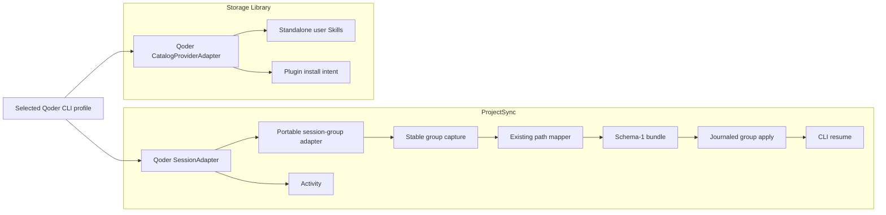

# Design: Qoder CLI support in Mallard

**Status:** proposed. Implementation can start. Production enablement is
blocked until all mandatory release gates pass.

**Date:** 2026-09-02

**Product scope:** cross-path Qoder CLI sessions, standalone user Skills, and
native plugin install intent.

**Provider order:** Qoder is the first agent-provider choice.

**Compatibility:** clean schema-1 cutover. There is no migration, legacy
execution path, dual writer, alias, or downgrade support.

**Excluded:** Qoder pets, Qoder App task restore, session fork,
custom-provider configuration, and Tuzi credentials.

## 1. Decision

Qoder is not inherently non-portable. The earlier design used too broad a
definition of portability. It required Qoder App database projection rebuild
and arbitrary path relocation before it would support Qoder sessions. Neither
feature is necessary for Qoder CLI session resume.

Mallard will implement this contract:

> Mallard captures one complete and stable Qoder CLI session group, maps
> project-root paths with the existing portable path token, pushes it through
> the schema-1 bundle model, pulls it into a different and independently
> authenticated Qoder CLI profile at the selected destination project path,
> preserves the Qoder session UUID, and resumes the same session through the
> public Qoder CLI.

The first production Qoder release has five mandatory functions:

1. Show Qoder first in agent-provider choices.
2. Show exact-project Qoder CLI sessions in Activity.
3. Push, Pull, and resume eligible Qoder CLI sessions.
4. Push and Pull standalone Qoder user Skills.
5. Push and Pull Qoder plugin install intent. Pull uses the native Qoder CLI
   and verifies the result with new JSON inventory.

Qoder pets are not supported. Mallard adds no Qoder pet enum value, resource
kind, scanner, storage object, preview, or UI row.

Development changes can land in stages with Qoder disabled. Register Qoder in
the production UI only after sessions, Skills, plugins, and the credential
boundary pass their complete release gates.

## 2. Why the current PoC did not prove portability

The authenticated native-resume PoC proved this flow:

```text
Qoder CLI process 1 creates session S in profile A
  -> Qoder CLI process 2 resumes session S in profile A
```

It did not prove this flow:

```text
Qoder CLI profile A on source machine
  -> Mallard stable capture
  -> project-root path encoding
  -> Mallard Push
  -> schema-1 storage
  -> Mallard Pull
  -> project-root path decoding and destination-bucket materialization
  -> clean Qoder CLI profile B on destination machine
  -> qoder --resume S
```

The difference is material:

- Native resume proves that Qoder can continue its own existing local state.
- Portable restore proves that Mallard captured every required member, kept a
  coherent snapshot, mapped only valid project-root path occurrences,
  rejected UUID collisions, materialized it safely, and produced state that
  Qoder consumes.
- Qoder App discovery is a separate claim. It depends on App projections.
  Mallard does not make that claim in this release.

The current Mallard code also has concrete gaps:

- `provider_capture.rs` checks a file and later reads it by path. It does not
  prove that the transcript and sidecars form one stable snapshot.
- Push supports sidecar objects, but generic sidecar redaction can change
  bytes. Qoder resume needs provider re-analysis after every path-map and
  redaction transformation.
- Pull preparation fetches the transcript but carries only sidecar names.
- Pull apply computes transcript and optional provider-index targets, not a
  complete Qoder session group.
- `conversation_materialization.rs` validates every sidecar as one JSON
  value. Qoder can have JSON, JSONL, and opaque members.
- `service.rs` has Codex-versus-Claude branches. A third provider can enter
  the Claude branch by mistake.
- new local conversation materialization normally mints a provider UUID.
  Qoder exact restore must preserve the source UUID.
- current conversation comparison does not make sidecar-only changes part of
  Qoder session identity.

These are implementation gaps. They are not proof that Qoder sessions cannot
be portable.

## 3. Product boundary

### 3.1 Included

| Surface | First-release behavior |
| --- | --- |
| Provider setup | Show Qoder first and require explicit review of the selected Qoder profile. |
| Activity | Discover and inspect only exact-project, supported Qoder CLI sessions. |
| Session Push | Capture and publish one eligible, stable, complete Qoder CLI session group. |
| Session Pull | Restore the complete group into the selected Qoder CLI profile and map it to the reviewed destination project path. |
| Session resume | Resume the restored source UUID with the public Qoder CLI. |
| User Skills | Review, Push, Pull, and verify standalone Skills below the selected Qoder user Skill root. |
| Plugins | Review and transport semantic plugin install intent; use the native CLI for destination install or update. |

### 3.2 Initial session limits

- Qoder CLI only.
- One exact supported Qoder CLI version at first.
- Exact source UUID preservation.
- POSIX source and destination project roots accepted by the existing Mallard
  path-map grammar.
- The existing `mallard.pathmap.v1` wire token maps source project-root paths
  to the destination root. UUIDs are not rewritten.
- JSON and JSONL members use bounded structural transforms. Unchanged lines
  and members remain byte-identical.
- Qoder is stopped for session capture and apply.
- Only a closed, versioned, product-proved member grammar is eligible.
- Ambiguous branches and unproved advanced state are visibly ineligible.
- Divergence blocks. The first release does not use Keep Both or create a
  Qoder fork.
- Destination authentication is independent. It never travels in Mallard.

### 3.3 Not included

- Qoder App task discovery, import, open, resume, sidebar rebuild, or
  projection rebuild.
- Any read or write of Qoder App databases, WAL, shared-memory files, cookies,
  local storage, or login state.
- Qoder `--fork-session`, App branch creation, SDK transcript fork, or a
  Mallard fork action.
- Project-level `.qoder/skills` as provider-home state.
- Plugin payload, cache, repository, runtime data, or private registry copy.
- Plugin uninstall, disable, or enable-state synchronization.
- Qoder memory, rules, commands, Hooks, MCP configuration, agents, or
  subagents as independent portable resources.
- Qoder custom-model or custom-provider configuration.
- Tuzi endpoint, key, model, or credential synchronization.
- Qoder pets.
- A dynamic Mallard provider plugin ABI.
- An executable hidden inside `Qoder.app`.

## 4. Evidence baseline

### 4.1 Authenticated CLI resume

The supplied PoC used `@qoder-ai/qodercli` `1.1.40` with bundle SHA-256:

```text
a5b9d9f116c16c512fd3000a62cb87e6d7e72ff4edbb196e24773834cef13eba
```

| Check | Result | Meaning |
| --- | --- | --- |
| Source command | Pass | The first process created a persistent marker session. |
| Resume command | Pass | A second process resumed the same session ID. |
| Marker recovery | Pass | The resumed model recovered prior semantic context. |
| Transcript growth | Pass | Continuation wrote new history. |
| Isolated Qoder home | Pass | The runner selected an isolated profile. |
| Exact working directory | Pass | Both processes used one project directory. |
| Tools, MCP, built-in Skills | Disabled | The test isolated native continuation. |
| Mallard copy | Not proved | The session stayed in profile A. |
| Sidecar consumption | Not proved | No profile-to-profile restore ran. |
| Cross-path destination-bucket resume | Pass, limited | A later PoC resumed one simple native session at path B after byte-exact bucket relocation within the same profile. |
| Qoder App resume | Not proved | The App was outside the test. |

Correct conclusion:

```text
native same-profile Qoder CLI resume: proved for the tested build
Mallard copied-session Qoder CLI resume: mandatory release gate
```

### 4.2 Synthetic session restore

| Gate | Result | Production use |
| --- | --- | --- |
| Sandbox boundary | Pass | Keep marker and canonical-boundary checks. |
| Multi-file mutation detection | Pass, synthetic | Port the algorithm to Rust and test real Qoder output. |
| Six-member materialization | Pass, synthetic | Do not assume that six members are complete. |
| Source UUID preservation | Pass, synthetic | Make UUID preservation a provider rule. |
| New UUID collision detection | Partial | Add destination-wide locking and recheck. |
| Existing mapped update pins | Pass, synthetic | Reuse identity, size, digest, and revision pins. |
| `active-leaf` candidate discovery | Pass, synthetic | Candidate discovery is not branch authority. |
| Structural path mapping | Partial, synthetic | Reuse Mallard's proved mapper, then prove Qoder member and integrity semantics in a product test. |
| SDK transcript import | Pass, limited | It does not import complete Qoder task state. |
| SDK sidecar import | Does not pass | Do not use the SDK store as the restore engine. |
| Clean CLI discovery | Pass, limited | Listing does not prove semantic continuation. |
| Clean CLI copied-session resume | Not proved | This is the decisive session release test. |

A later version-pinned PoC proved one narrower cross-path mechanism. Qoder CLI
`1.1.40` did not find a source-bucket session from an unrelated project path.
It did resume the same UUID and recover prior context after the unchanged
simple session group was placed in the destination path's Qoder project
bucket. This proves that destination-bucket materialization is viable for the
tested session. It does not prove Mallard's path-map transform, a clean profile
B, the complete member grammar, or production restore.

### 4.3 Plugin contract check

Qoder documents JSON output for `plugins list` and `plugins marketplace list`.
It also documents user, project, and local scopes and native plugin and
marketplace commands. See [Qoder CLI Plugins](https://docs.qoder.com/cli/plugins)
and [Qoder CLI Plugin Reference](https://docs.qoder.com/cli/plugins-reference).

A local check of Qoder CLI `1.1.40` used a fresh temporary profile:

- both JSON inventory commands returned `[]` for an empty profile;
- a user-scoped local fixture reported ID, name, source, version, scope,
  enabled state, install path, time, description, and resource summaries;
- a marketplace reported name, typed source, install location, update time,
  and automatic-update state;
- a marketplace plugin used `name@marketplace-name` and reported user scope.

This is `package_observed` evidence for one version. It supports the adapter
design. A committed sanitized fixture and product test remain the release
authority.

### 4.4 Evidence labels

| Label | Meaning |
| --- | --- |
| `documented` | Current official Qoder documentation states the behavior. |
| `product_proved` | A disposable installed product passed an end-to-end test. |
| `package_observed` | A pinned package showed the behavior, but it is not a published stable contract. |
| `synthetic` | Mallard-owned fixtures proved mechanics only. |
| `unproved` | No sufficient contract or product test exists. |

Do not promote `package_observed` or `synthetic` evidence to a public
compatibility claim without the named product gate.

## 5. User flow

### 5.1 Source machine

The user binds a reviewed Qoder CLI profile to a project. Qoder is the first
provider shown. Mallard inventories Qoder sessions and classifies each one as
eligible, ineligible, or invalid.

For an eligible session, Push review shows:

- provider `Qoder`;
- bounded user-visible name;
- session state;
- `Project-root paths will map to the destination project`;
- file and byte totals for the complete group;
- warnings for executable or credential-shaped content;
- the normal immutable-publication review.

Mallard requires Qoder to be stopped. It captures the complete group twice and
publishes only when group membership and every file remain stable.

### 5.2 Destination machine

The user binds another Qoder CLI profile and selects the destination checkout
for the same project. Its absolute path can differ from the source path. The
destination profile is authenticated independently with file-backed
credential storage and has no object that owns the source UUID.

Pull review shows `/__mallard_root__ -> <reviewed destination project>` and the
complete target group. The source absolute root is machine-local and does not
travel in the bundle. A source-side review can show its own physical project
root mapping to `/__mallard_root__`; a clean destination cannot show that
source path. Apply decodes the portable path token, stages and validates all
members, rechecks collisions, installs sidecars before the transcript,
recaptures the group, and saves the binding only after verification.

The user selects **Open in Terminal with Qoder**. Mallard starts the public CLI
with the selected profile, project, and restored UUID. Qoder resumes the
transported session.

### 5.3 Library

- Skills shows standalone user Skills only.
- Plugins shows portable user-scope marketplace plugin intent.
- Pulling a Skill writes the reviewed directory tree.
- Pulling plugin intent invokes Qoder's native manager and verifies the result
  with new JSON inventory.
- No Qoder pet choice exists.

## 6. Architecture and minimum common changes

Qoder crosses two independent Mallard subsystems:



ProjectSync owns project bindings, conversations, Activity, Push/Pull, and
resume. The Library owns provider-global Skills and plugin intent. They do not
share provider enums, profiles, plans, or persistence documents.

### 6.1 Reused ProjectSync parts

- open validated conversation `ProviderKey`;
- compile-time `ProviderRegistry` and `SessionAdapter`;
- schema-1 `ConversationThread`;
- one `Transcript` plus typed `Sidecar` roles;
- individual immutable objects and SHA-256 entries;
- compare-and-swap storage heads;
- reviewed Push and Pull plans;
- bindings, checkpoints, receipts, revisions, and expiry checks;
- journaled multi-target materialization;
- Activity and generic native-action UI.

### 6.2 Reused Library parts

- bounded no-follow Skill-tree capture;
- Skill content identities;
- `PluginInstallIntentResource`;
- provider-native plugin adapters;
- reviewed plans and warnings;
- target locks, journals, backups, and post-apply checks;
- local-folder and S3/R2 storage through one catalog model.

### 6.3 Unavoidable common conversation changes

1. Capture one session as a stable multi-file group.
2. Apply the existing project-root wire mapping to every supported JSON and
   JSONL group member.
3. Publish Qoder transcript and sidecars under a provider-owned group codec.
4. Fetch, validate, and materialize all Pull members, not only the transcript.
5. Preserve the source Qoder UUID and enforce destination-wide collision
   protection.
6. Require a proved complete-group successor relation before a higher message
   count becomes Local Outstanding or Cloud Outstanding.

The Library needs a third closed provider adapter and profile/scope values. It
does not need a new resource type or storage protocol.

### 6.4 Qoder delta from Codex and Claude

Use the current Codex/Claude behavior unless this table names a Qoder-specific
difference.

| Concern | Qoder design |
| --- | --- |
| Setup and profile binding | Reuse the same reviewed project/provider binding. Show Qoder first. |
| Discovery and Activity | Reuse the provider registry, generic DTOs, filters, detail views, and action route. |
| Push and Pull review | Reuse current plans, revisions, expiry, selections, outcomes, and single-flight rules. |
| Portable path form | Reuse `SessionPathMapper`, `mallard.pathmap.v1`, the wire/local checkpoint pair, and first-contact wire comparison. |
| Storage | Reuse schema-1 manifests, immutable objects, heads, local-folder storage, and S3/R2. |
| Restore | Reuse staging, target locks, journals, backups, rollback, receipts, and recovery. |
| Conflict handling | Reuse normal classifications. Hide only Keep Both because Qoder UUID rewriting is not proved. |
| Session payload | Qoder adds a complete multi-file session group; current Codex is transcript-centric and Claude has a smaller sidecar grammar. |
| Native identity | Preserve the source Qoder UUID on Create Local and scan the full Qoder CLI profile for collisions. |
| Destination layout | Compute the Qoder project bucket from the reviewed destination root. |
| Resume | Reuse the generic session-action route, but Qoder supplies pinned arguments and file-backed credential environment. |
| Library | Reuse current Skill and plugin-intent resource flows. Add only Qoder provider/scope and native JSON commands. |

Do not create a parallel Qoder review screen, persistence document, storage
namespace, reconciliation engine, or Tauri command family.

## 7. Provider registration and order

Qoder is a built-in provider. Mallard does not load provider code from a
bundle or user manifest.

Qoder uses the same portable-conversation product path as Codex and Claude.
Do not add a Qoder-only Tauri command, frontend mode, or alternate review
flow. Provider-specific eligibility and codecs stay behind the adapter.

```rust
ProviderDescriptor {
    key: ProviderKey::parse("qoder")?,
    display_name: "Qoder".to_string(),
    profile_label: ".qoder profile".to_string(),
    default_profile_directory: Some(".qoder".to_string()),
    setup_default: true,
    cli_launcher: None,
}
```

Keep the generic setup launcher disabled for Qoder. It cannot pin the selected
`--config-dir`, reviewed `--cwd`, or `QODER_FORCE_FILE_STORAGE=true` and would
violate the profile and no-Keychain boundary. Resuming a reviewed session uses
the existing generic session-action route, with Qoder constructing the
provider-specific command and environment in the backend.

Do not depend on map key order:

```rust
fn provider_display_rank(key: &str) -> u8 {
    match key {
        // Product policy: Qoder is the first agent-provider choice.
        "qoder" => 0,
        "codex" => 10,
        "claude" => 20,
        _ => 100,
    }
}
```

Use the same explicit order in the Library capability response. Qoder-first
ordering does not change an existing binding, make Qoder exclusive, bind an
unreviewed profile, or disable another provider.

## 8. Portable Qoder CLI sessions

### 8.1 Identity

| Identity | Purpose |
| --- | --- |
| Mallard cloud thread ID | Portable object identity across storages and machines. |
| Mallard local thread ID | Machine-local binding identity. |
| Qoder session UUID | Native identity embedded in the restored session group. |

Exact restore preserves the Qoder UUID. The Mallard cloud ID does not replace
it.

### 8.2 Candidate local layout

Observed Qoder versions use a group similar to:

```text
projects/<project-key>/<session-uuid>.jsonl
projects/<project-key>/<session-uuid>/state.json
projects/<project-key>/<session-uuid>/compression-v2/state.json
projects/<project-key>/<session-uuid>/subagents/agent-<id>.jsonl
projects/<project-key>/<session-uuid>/subagents/agent-<id>.meta.json
projects/<project-key>/<session-uuid>/subagents/task-<id>.json
file-history/<session-uuid>/<checkpoint-object>
tasks/<session-uuid>/**
```

This is not the production allowlist. A product-generated corpus must classify
every possible session-owned member for the supported version as:

- required persistent;
- optional persistent;
- referenced persistent;
- excluded ephemeral; or
- unsupported.

Locks, leases, heartbeats, queues, sockets, and temporary files are not copied
unless a product test proves that continuation requires a specific regular
file. An unknown member blocks the session.

### 8.3 First eligible subset

The first release can use a product-proved subset. All other sessions remain
visible with an ineligible reason.

Candidate minimum:

- one supported Qoder CLI version and transcript dialect;
- exact project ownership;
- one unambiguous effective leaf;
- complete recognized transcript and required state set;
- no unresolved subagent, compression, file-history, checkpoint, task, or
  coordination member;
- no unknown integrity field;
- every path-bearing JSON or JSONL member covered by the proved path-map
  codec;
- no opaque member that can contain a project-root path.

If a normal Qoder-created session always requires an excluded member, that
member becomes required in the v1 grammar. It is not silently omitted.

Advanced forms can be added under schema 1 after their member and continuation
corpus passes. Each incompatible grammar gets a new provider member-set or
codec identifier.

### 8.4 Eligibility results

Every session is eligible, ineligible, or invalid. Do not hide unsupported
sessions.

Representative reason codes:

```text
qoder_session_active
qoder_unsupported_cli_version
qoder_unknown_transcript_dialect
qoder_project_ownership_unproved
qoder_session_member_set_unknown
qoder_session_member_missing
qoder_active_leaf_ambiguous
qoder_subagent_unsupported
qoder_compression_unsupported
qoder_checkpoint_unsupported
qoder_task_state_unsupported
qoder_path_map_unsupported
qoder_path_map_collision
qoder_path_integrity_unproved
qoder_target_bucket_unproved
qoder_non_posix_project_root
qoder_session_uuid_collision
qoder_session_special_file
qoder_session_symlink
qoder_session_too_large
```

Push and Pull are unavailable for an ineligible session.

### 8.5 Schema-1 file mapping

No new bundle resource kind is necessary.

| Qoder member | Schema-1 role |
| --- | --- |
| main JSONL | `Transcript` |
| root state | `Sidecar { sidecar_kind: "session-state" }` |
| compression state | `Sidecar { sidecar_kind: "compression" }` |
| subagent files | `Sidecar { sidecar_kind: "subagents" }` |
| file-history objects | `Sidecar { sidecar_kind: "file-history" }` |
| top-level task state | `Sidecar { sidecar_kind: "task-state" }` |

Each sidecar keeps a safe kind-relative path below:

```text
state/conversations/qoder/<cloud-thread-id>/sidecars/<kind>/<relative-path>
```

Source profile and project-bucket paths do not become cloud object paths.

### 8.6 Complete group identity

Transcript-only comparison misses sidecar drift. Compute the same normalized
member manifest in two forms:

```text
SHA-256(
  domain = <local-v1 or wire-v1>
  for each member sorted by role, sidecar kind, and relative path:
    length-prefixed role
    length-prefixed sidecar kind or empty
    length-prefixed validated relative path
    unsigned byte size
    raw 32-byte content SHA-256
)
```

Use these domain values:

```text
mallard-qoder-session-group-local-v1
mallard-qoder-session-group-wire-v1
```

The local digest uses captured or materialized Qoder bytes. The wire digest
uses path-encoded and redacted portable bytes. Do not include physical paths,
project buckets, Mallard IDs, times, device, or inode values.

Carry each group identity in the current `PortableConversationTail` shape:

```text
codec                     = mallard-qoder-session-group-<local|wire>-v1
partition_kind            = whole_thread
start_record_count        = 0
accepted_end_record_count = canonical active-lineage message count
accepted_tail_state       = complete group digest
```

Keep transcript evidence separate:

```text
lineage_codec   = qoder-lineage-v1
lineage_digest  = canonical transcript lineage digest
semantic_digest = canonical transcript semantic digest
cloud portable tail state = complete mapped-wire group digest
checkpoint accepted_local_tail = complete installed-local group digest
```

Mirror the current Claude two-column checkpoint contract:

- `ConversationThread.portable_tail` and
  `ConversationCheckpoint.accepted.portable_tail` hold the wire tail;
- `ConversationCheckpoint.accepted_local_tail` holds the corresponding local
  tail at the source or destination root;
- `ConversationCheckpoint.observed_tail` is the current local tail;
- Pull verifies the wire tail before decoding, computes the installed local
  tail after materialization, and saves both;
- a later Push re-encodes the complete local group and must reproduce the
  accepted wire form at the accepted message boundary.

First-contact adoption uses the same proof. Mallard may bind an unbound local
Qoder UUID to a cloud thread only when the complete local group re-encodes to
the cloud wire group and all provider, project, member, and collision checks
pass. UUID equality alone is not adoption authority.

Qoder is cursor-less. It recomputes both tails from complete stable groups and
does not pass a group digest to the generic incremental `TailAccumulator`.
A sidecar-only change at the same message count becomes a conservative
divergence, not a false match.

Keep `compare_conversation_tail` as the only relation table, but do not let its
count comparison stand in for Qoder successor proof. During review, load the
complete accepted wire group from the exact immutable historical manifest
pinned by the checkpoint. Encode a current local candidate to wire form; a
current cloud candidate is already in wire form. Compare accepted and
candidate groups through the Qoder adapter.

`mallard-domain::conversation_tail_relation` owns and exports the comparison
result. The infrastructure adapter imports this type; the domain crate never
depends on infrastructure:

```rust
pub enum SessionGroupRelation {
    Equal,
    StrictSuccessor,
    Divergent,
}
```

`StrictSuccessor` requires the same Qoder UUID, an exact accepted active-lineage
prefix, a larger accepted message boundary, and only product-proved
state/compression/member-set transitions. It compares old and new sidecar
content and references, not only their digests. A transcript rewrite plus one
new record is `Divergent`, not a successor.

The same domain module also owns a non-serialized `TailSuccessorEvidence`
value used to construct `VerifiedTailEvidence`. Existing providers select the
current count-monotonic policy. Qoder supplies the adapter-produced local and
cloud `SessionGroupRelation` values. Require `StrictSuccessor` before the
central classifier can return Local Outstanding or Cloud Outstanding for a
Qoder group codec. `Equal` supports Current and first-contact adoption.
`Divergent` produces the normal divergent result. A missing accepted object,
unavailable storage, unknown transition, or failed proof supplies invalid
evidence and produces Unknown. Do not manufacture a lower message count to
force a result.

```rust
pub enum TailSuccessorEvidence {
    CountMonotonic,
    CertifiedGroups {
        accepted_to_local: SessionGroupRelation,
        accepted_to_cloud: SessionGroupRelation,
        local_to_cloud: SessionGroupRelation,
    },
}
```

For Qoder, the service computes all three relations from certified wire
groups before it constructs `VerifiedTailEvidence`. A caller cannot supply
independent Boolean proof flags.

When both sides advanced, Qoder is `Advanced` only when the re-encoded local
candidate and cloud candidate are the exact same certified wire group and
both are strict successors of the accepted group. Otherwise, the result is
`Divergent`.

This needs no schema-number change. The current accepted-version record does
not contain all coordinates that `BundleEngine::inspect_manifest_version`
requires. Extend the schema-1 machine-local `AcceptedConversationVersion`:

```rust
pub struct AcceptedConversationVersion {
    pub artifact_sha256: String,
    pub accepted_at_revision: u64,
    pub accepted_at_commit_id: String,
    pub accepted_at_manifest_size: u64,
    pub accepted_at_manifest_sha256: String,
    pub portable_tail: PortableConversationTail,
}
```

The revision, commit ID, manifest size, and manifest digest identify the exact
historical manifest. The service passes those four values to
`inspect_manifest_version`, then fetches and verifies every accepted Qoder
group member from that manifest. The artifact and member digests still prove
the payload objects.

`ConversationCloudPublication` must carry the published revision and manifest
size with its current commit ID and manifest digest. The fused publication and
recovery path patches all four accepted historical-manifest coordinates into
the journaled after-state atomically. It must not leave reviewed-anchor
placeholders after a successful or recovered publication.

Both new fields are required. Validation rejects revision zero and manifest
size zero. The clean cutover has no optional-field fallback, inferred
coordinate, or migration for an older schema-1 checkpoint.

### 8.7 Wire path mapping and redaction

Require the existing `wire_path_map` stamp with codec `mallard.pathmap.v1` and
the existing `wire_redaction` stamp. Qoder must use the same portable
project-root token as Codex and Claude:

```text
/__mallard_root__
```

Reuse `SessionPathMapper`. Do not create a second token grammar. The Qoder
wrapper applies it according to the closed member grammar:

- main and subagent JSONL: use the bounded line-level JSONL facade;
- JSON sidecars: parse one bounded JSON value, call the gated record mapper,
  and serialize only when a path changed;
- opaque members: require a proved path-free format and preserve exact bytes;
- unknown member types: block.

The mapper walks JSON string values and object keys. It changes only
boundary-valid occurrences of the source project root, its approved canonical
alias, tilde spelling, or file-URI spelling. It preserves out-of-root paths.
An unmatched JSONL line or JSON member remains byte-identical. Reserved-token
input, object-key collision, malformed JSON, non-POSIX roots, or failed
encode/decode/re-encode proof blocks the complete group.

Path mapping can invalidate a provider checksum or signature. The Qoder codec
must identify every integrity field in the supported member grammar. It may
recompute a field only when the exact Qoder rule is product-proved. Otherwise,
any affected integrity field makes the session ineligible.

Apply the existing credential-redaction transform after path encoding, as the
Codex and Claude wire builders do. Reparse and validate the redacted Qoder wire
group. Require identity, graph, member references, active leaf, and provider
state semantics to remain valid. A member with opaque, signed, or
integrity-sensitive content must be a redaction fixpoint unless the exact
transformation rule is product-proved. Block when the Qoder codec cannot prove
that the transformed group remains resumable.

Compute member digests and the complete group digest from canonical wire
bytes. On Pull, verify wire bytes first, decode paths to the reviewed
destination project root, validate the resulting Qoder group, and then stage
local bytes.

### 8.8 Minimal adapter extension

Do not add Qoder branches throughout `service.rs`. Add one narrow companion
interface:

```rust
pub trait PortableSessionGroupAdapter: Send + Sync {
    fn rediscover_members(
        &self,
        context: &SessionDiscoveryContext<'_>,
        session_id: &str,
    ) -> Result<Vec<DiscoveredSessionMember>, String>;

    fn classify_eligibility(
        &self,
        group: &CapturedSessionGroup,
    ) -> Result<EligibleSessionGroup, SessionPortabilityBlocker>;

    fn compute_local_group_tail(
        &self,
        group: &EligibleSessionGroup,
    ) -> Result<PortableConversationTail, String>;

    fn encode_portable_wire(
        &self,
        group: &EligibleSessionGroup,
        path_mapper: &SessionPathMapper,
    ) -> Result<CertifiedPortableGroup, SessionPortabilityBlocker>;

    fn compute_wire_group_tail(
        &self,
        group: &CertifiedPortableGroup,
    ) -> Result<PortableConversationTail, String>;

    fn compare_wire_groups(
        &self,
        accepted: &CertifiedPortableGroup,
        candidate: &CertifiedPortableGroup,
    ) -> Result<SessionGroupRelation, SessionPortabilityBlocker>;

    fn decode_portable_wire(
        &self,
        group: &CertifiedPortableGroup,
        path_mapper: &SessionPathMapper,
    ) -> Result<DecodedSessionGroup, SessionPortabilityBlocker>;

    fn destination_session_id(
        &self,
        source_session_id: &str,
    ) -> Result<String, String>;

    fn check_destination_collision(
        &self,
        provider_home: &Path,
        project_root: &Path,
        session_id: &str,
    ) -> Result<(), SessionPortabilityBlocker>;

    fn verify_member(
        &self,
        request: &SessionMemberVerificationRequest<'_>,
    ) -> Result<(), String>;

    fn verify_group(
        &self,
        request: &SessionGroupVerificationRequest<'_>,
    ) -> Result<(), String>;
}
```

Expose it through `SessionAdapter` with a default `None`. Codex and Claude
remain unchanged. Qoder returns its session-group adapter.

The Qoder adapter owns format, membership, UUID, ownership, active-leaf,
target-layout, collision-namespace, member-validation, and group-verification
rules. The common core owns safe I/O, bounds, stable capture, object digests,
review, storage, locks, journals, backups, rollback, bindings, and receipts.

### 8.9 Qoder provider module

```text
crates/mallard-infrastructure/src/providers/qoder/
  mod.rs
  compatibility.rs
  discovery.rs
  codec.rs
  portable.rs
  materialization.rs
  history.rs
  actions.rs
```

`discovery.rs`:

- searches only supported CLI roots below the selected profile;
- treats an encoded project bucket as a location hint, not ownership proof;
- proves exact project ownership from supported content;
- validates filename and embedded UUIDs;
- enumerates the complete allowed group;
- rejects links, special files, unsafe components, excessive depth, count,
  and bytes;
- never enters Qoder App data.

`codec.rs`:

- parses one exact transcript dialect;
- bounds lines, records, depth, strings, and total bytes;
- validates session IDs, message UUIDs, parents, logical parents, and record
  types;
- preserves original bytes;
- produces Activity data and transcript digests;
- applies only a product-proved active-leaf rule;
- marks ambiguity ineligible.

`portable.rs` classifies membership, rejects unknown members, applies the
existing path-map and redaction gates, computes the wire-group digest,
preserves UUID, and blocks Keep Both.

`materialization.rs` computes the Qoder project bucket from the reviewed
destination root, derives targets, checks all CLI collision namespaces,
validates mapped members and references, orders commits, and verifies the
installed group.

`history.rs` uses generic Activity DTOs and exposes only proved metrics.

`actions.rs` builds exact public CLI resume.

### 8.10 Stable group capture

Require Qoder to be stopped. A Mallard lock is not sufficient because Qoder
does not honor it.

1. Resolve the supported layout.
2. Ask the adapter for complete membership.
3. Reject unknown members before content parsing.
4. Open every member without following links.
5. Require a regular file and allowed link count.
6. Record handle identity, mode, link count, size, modification time, and
   change time.
7. Read through the retained handle under all limits and hash it.
8. Restat the retained handle.
9. Re-enumerate all participating directories.
10. Repeat the complete pass.
11. Require equal names, roles, identities, modes, link counts, sizes, times,
    and digests.
12. Parse only retained stable buffers.
13. Confirm that no Qoder process started for the selected profile.

Addition, removal, rename, replacement, in-place change, same-size change,
hard-link change, parent substitution, or symlink substitution blocks the
whole group. Do not retry until a quiet interval appears. The user closes
Qoder and retries explicitly.

### 8.11 Push

Generalize provider publication preparation:

```rust
struct PreparedConversationPublication {
    wire_members: Vec<PreparedPortableMember>,
    wire_tail: PortableConversationTail,
    accepted_local_tail: PortableConversationTail,
    head_message_id: MessageId,
    message_count: u64,
    lineage_digest: String,
    semantic_digest: String,
    wire_redaction: ConversationWireRedaction,
    wire_path_map: Option<ConversationWirePathMap>,
}
```

Qoder returns the canonical mapped wire transcript and sidecars, the normal
path-map and redaction stamps, and the wire/local session-group tail pair.
Before publication, verify the closed grammar, ownership, UUID, active-leaf
eligibility, every mapped member, redacted-wire re-analysis, each digest, both
group digests, exactly one transcript, and every required sidecar.

Publish through the existing immutable object and head transaction. Add no
Qoder-specific storage key or transport.

### 8.12 Pull and materialization

Change Pull preparation from transcript bytes plus sidecar names to a complete
member vector.

For every approved Qoder action:

1. enumerate all `ConversationThread.files` entries;
2. require exactly one transcript;
3. enforce file, count, and aggregate limits before transfer;
4. fetch and SHA-256 verify every member;
5. reconstruct the canonical member inventory;
6. match `mallard-qoder-session-group-wire-v1`;
7. require the supported `mallard.pathmap.v1` and redaction stamps;
8. verify the wire group, decode it to the reviewed destination project root,
   and run Qoder member and cross-member validation;
9. derive the destination Qoder project bucket from that root;
10. fail the whole action for a missing, extra, truncated, invalid, or
   inconsistent member.

Apply through the existing conversation materializer:

1. acquire a lock for the canonical Qoder profile;
2. revalidate plan, head, binding, profile, version, path, stopped-Qoder state,
   and collisions;
3. stage and validate all members;
4. write the recovery journal before mutation;
5. back up exact reviewed targets;
6. install state, compression, subagent, file-history, and task members;
7. install the main transcript last;
8. flush files and required parent directories;
9. delete an obsolete file only with its reviewed path and digest, and delete
   only an exact empty directory;
10. recapture the complete installed local group and compute its local tail;
11. re-encode that group and require the approved wire group and wire tail;
12. save binding, the wire/local checkpoint pair, and receipt;
13. mark the journal complete.

After a crash, recovery must produce the complete approved group, the complete
original group, or `RecoveryRequired` with backups preserved. A mixed group is
never success.

### 8.13 UUID and collisions

For Qoder `CreateLocal`:

```text
destination Qoder UUID = source Qoder UUID
```

Do not call generic provider UUID minting.

Before mutation, scan the supported Qoder CLI profile for the UUID across:

- all supported project buckets;
- transcript names;
- state and compression;
- subagent and task sidecars;
- file-history roots and proved references;
- top-level task state;
- pending Mallard plans and journals;
- Mallard bindings and receipts.

Do not scan or write Qoder App projections. Any unbound match is a collision.
Do not overwrite, choose the newest, remap, or fork.

Hold the provider-home lock through install and binding commit. Recheck target
expectations immediately before each commit.

An existing mapped update must match cloud ID, source and destination UUID,
profile and binding revisions, reviewed project mapping, full member names and
roles, target identity, size, digest, new-target absence, and accepted group
tail.

If local and cloud groups both changed, block as divergent. Qoder Keep Both is
not available because it needs a new UUID and a proved reference rewrite.

### 8.14 Project-path and target-bucket mapping

Use the same wire lifecycle as current Codex and Claude conversations:

```text
source local group
  -> encode source project root as /__mallard_root__
  -> redact and validate canonical wire group
  -> immutable schema-1 bundle
  -> verify wire group
  -> decode /__mallard_root__ as destination project root
  -> compute destination Qoder project bucket
  -> materialize local group
  -> qoder --cwd <destination-root> --resume <source-uuid>
```

Source discovery still proves that the native source session belongs to the
bound source project. Pull does not require equal source and destination path
spellings. It requires a reviewed destination root that passes the existing
canonical-boundary and path-map checks.

The target bucket is a Qoder layout concern, not a cloud identity. Derive it
inside `qoder/materialization.rs` from the destination root and the pinned CLI
compatibility rule. Do not copy the source bucket name, search every bucket as
a substitute, or expose the bucket key in the manifest.

The version-pinned cross-path PoC proved destination-bucket relocation for one
simple session without content mapping. The production gate is stronger. It
must prove the complete mapped wire lifecycle with different source and
destination profiles and paths. It must also prove that Qoder recognizes the
mapped group, recovers prior context, writes new records with destination
paths, restarts, and remains recapturable.

## 9. Activity, resume, and credentials

### 9.1 Activity

Activity uses the same parser and eligibility rules as Push. It is not a
second interpretation of Qoder state.

- selected profile only;
- supported Qoder CLI roots only;
- exact project ownership;
- no App database;
- bounded metadata scan before full parse;
- duplicate UUIDs blocked;
- malformed sessions isolated;
- prompts and tool content absent from the cache.

Rows show provider, bounded title, proved metrics, eligibility, project
ownership, path-map blockers, and branch only when proved. The minimal release
can use uncached Qoder discovery. Push always performs a fresh stable capture.

### 9.2 Resume action

For the pinned CLI `1.1.40` contract, use only:

```text
QODER_FORCE_FILE_STORAGE=true \
  qoder --config-dir <selected-home> --cwd <destination-project> --resume <uuid>
```

Qoder documents these flags in the
[CLI reference](https://docs.qoder.com/cli/cli-reference).

Do not use `--continue`, a numeric selector, `--session-id`, `--fork-session`,
an App deep link, or an App-internal executable.

Before launch, re-resolve the profile, executable, version, project ownership,
UUID uniqueness, installed group, and journal state. The frontend sends an
opaque action ID. The backend constructs and shell-quotes every argument.

### 9.3 No-Keychain contract

Mallard and the Qoder process that Mallard starts must not read from or write
to macOS Keychain.

Session capture and materialization need no Qoder model credential. The user
authenticates the destination profile separately. The independent login and
each Qoder process that Mallard starts, including a version probe, must use
`QODER_FORCE_FILE_STORAGE=true` with the exact pinned CLI `1.1.40` bundle.
Package inspection shows that the value must be the exact string `true`;
values such as `1` do not select this branch. This mode stores the encrypted
credential file below the selected Qoder profile and bypasses the observed
native `security` command probe.

This variable is package-observed behavior, not a published cross-version
contract. Pin it to the tested CLI version and bundle digest. Block login and
resume if the compatibility record does not authorize the exact executable.
The release test must intercept the observed `security` command and perform an
OS-level Keychain access audit. A changed credential implementation requires a
new compatibility record and audit.

The encrypted credential file is machine-local provider authentication. The
session and Library allowlists exclude it. Mallard does not open, copy, hash,
log, back up, or delete it.

The no-Keychain rule also applies to every Library subprocess: plugin and
marketplace inventory, add, refresh, install, update, post-inventory, and the
plugin-load product test. The Qoder Catalog adapter sets the same file-storage
environment and selected `--config-dir` for every invocation.

Mallard never captures or transports:

- access or refresh tokens;
- API keys;
- cookies;
- login databases;
- Keychain records;
- machine or installation IDs;
- custom-provider or Tuzi credentials.

The terminal resume action is mandatory. Before release, a disposable account
test must prove that the pinned file-backed mode does not read or write
Keychain during login, source creation, Pull verification, resume, restart, or
cleanup. The environment variable alone is not proof.

The earlier Keychain error was an authentication-storage problem, not session
corruption. Keep credential handling separate from session transport.

### 9.4 Logging

Do not persist the exact Qoder shell command. The current launch callback
accepts the exact command and `commands.rs` records it. Passing a safe label
through that callback would create a false command record.

Replace the internal callback value with a typed launch-audit value:

```rust
pub enum SessionLaunchAudit {
    ExactCommand(String),
    QoderResume,
}
```

Codex and Claude wrap their current command value in `ExactCommand`. The Qoder
adapter emits `QoderResume` immediately before it starts the separately built,
validated, and quoted command. The Tauri command boundary maps only that typed
variant to this fixed event:

```text
qoder_session_resume_started
```

The enum is internal and does not change a serialized DTO or command
signature. Do not log the Qoder home, project path, UUID, marker, prompt,
output, credential mode, environment, or exact command.

## 10. Standalone Qoder user Skills

### 10.1 Root and scope

Qoder documents user Skills at:

```text
<QODER_CONFIG_DIR>/skills/<skill-name>/SKILL.md
```

The default profile uses `~/.qoder/skills`. Project Skills live under
`.qoder/skills` and are outside provider-home scope. See
[Qoder CLI Skills](https://docs.qoder.com/cli/Skills).

Capture only direct Skill directories under the selected profile's `skills`
root. Exclude project Skills, plugin-owned Skills, settings, auth, MCP, Hooks,
plugin state, logs, memory, models, temporary files, links, and special files.

### 10.2 Schema-1 extension

```rust
pub enum ProviderKey {
    Qoder,
    Codex,
    Claude,
}

pub enum AgentSkillScope {
    QoderUser,
    CodexHome,
    CodexSharedUser,
    ClaudeUser,
}
```

Use:

```text
provider = qoder
scope = qoder_user
root class = provider/qoder
resource kind = agent_skill
```

Reuse the existing Skill resource and transport.

### 10.3 Validation and apply

Reuse safe tree capture, content identity, warnings, review, publication,
reconciliation, journal, backup, apply, and verification.

After generic validation, validate Qoder front matter without rewriting bytes:

- required `name`;
- required `description`;
- lowercase letters, numbers, and hyphens only in `name`;
- `name` at most 64 characters;
- `description` at most 1024 characters;
- directory name equals declared name;
- regular `SKILL.md` inside the captured root.

Qoder documents these metadata limits. Unknown fields remain reviewed content.

### 10.4 Plugin ownership

Run native plugin inventory before Skill inventory. Use canonical plugin
install roots from typed output to exclude Skills within plugin-owned trees.
Do not classify by name. Do not read private Qoder registry files.

If plugin ownership inventory is unavailable, truncated, malformed, or from an
unsupported version, block Qoder Skill inventory. This prevents export of one
part of a plugin as a standalone Skill.

### 10.5 Skill release test

1. Create disposable profiles A and B.
2. Put one valid standalone Skill in A.
3. Confirm that Qoder CLI loads it.
4. Install a fixture plugin that contributes a Skill.
5. Confirm that Mallard excludes the plugin Skill.
6. Push the standalone Skill.
7. Pull it into B.
8. Verify exact files, modes, and digest.
9. Confirm that Qoder CLI loads it from B.
10. Mutate B after review and confirm apply blocks.

## 11. Qoder plugin install intent

### 11.1 Portable model

Reuse `PluginInstallIntentResource`. It describes how Qoder should install a
plugin. It does not contain plugin code.

Store only provider, source-qualified canonical plugin ID, marketplace
namespace, credential-free portable Git source and immutable ref when proved,
resolution policy, and semantic intent digest.

Never store payload files, cache, runtime data, marketplace clones,
plugin-owned Skills, generated MCP or Hook configuration, enablement state,
local paths, credentials, settings, or App projections.

Only installed, user-scope, source-qualified marketplace plugins are eligible
for automatic portability. Local, project, bundled, App-owned, unqualified,
and local-path sources are ineligible or manual-only.

### 11.2 Capability matrix

| Provider | Agent Skill | Plugin intent | Pet v1 | Pet v2 |
| --- | ---: | ---: | ---: | ---: |
| Qoder | Yes | Yes | No | No |
| Codex | Yes | Yes | Yes | Yes |
| Claude | Yes | Yes | No | No |

The backend derives UI choices from this table.

### 11.3 Native adapter and JSON

Add `QoderCatalogAdapter` to the required adapter registry. Use the public
executable, selected profile, structured arguments, null stdin, bounded
output, and timeout.

```text
QODER_FORCE_FILE_STORAGE=true \
  qoder --config-dir <home> plugins marketplace list --json
QODER_FORCE_FILE_STORAGE=true \
  qoder --config-dir <home> plugins list --json
```

The exact compatibility fixture parses marketplace name and source, installed
qualified ID, namespace, scope, enabled state for presentation, version,
install root for ownership, and resource summaries. Local paths and times do
not enter portable intent.

### 11.4 Output truncation fix

The current reader uses `take(MAX_CLI_BYTES)` and cannot detect truncation.
Read one extra byte:

```rust
struct BoundedOutput {
    bytes: Vec<u8>,
    truncated: bool,
}

struct CmdOutput {
    success: bool,
    stdout: BoundedOutput,
    stderr: BoundedOutput,
}
```

Do not parse truncated stdout. Bound and sanitize stderr. Do not save raw
output.

### 11.5 Native apply

Pin profile revision, exact CLI contract, qualified ID, namespace, source,
resolution policy, reviewed state, action, user scope, plan revision, and
expiry.

1. Acquire the profile target lock.
2. Re-resolve the profile and executable.
3. Verify the supported CLI version.
4. Run fresh JSON inventory.
5. Match the reviewed current semantic state.
6. Add or refresh the reviewed portable marketplace when required.
7. Install a missing qualified plugin with user scope, or update an existing
   one when planned.
8. Ignore human success text as proof.
9. Run fresh JSON inventory.
10. Require the resulting semantic intent to match the reviewed intent.
11. Save a typed sanitized result.

Use native commands for state changes. Do not edit Qoder settings or registry
files. Do not automatically uninstall, disable, or repeat an install.

A timeout, crash, malformed result, or truncated result can occur after a
native side effect. Run fresh inventory when safe. Return
`ReconciliationRequired` when the result is still ambiguous.

### 11.6 Plugin release test

Use two disposable profiles and a disposable public Git marketplace:

1. Inventory A through JSON.
2. Capture one installed user-scope qualified plugin as intent.
3. Confirm no payload or local path enters the bundle.
4. Pull into empty B.
5. Add the reviewed marketplace when absent.
6. Install the exact qualified plugin with user scope.
7. Re-inventory and match semantic intent.
8. Confirm Qoder loads a plugin resource in a new CLI session.
9. Test update and post-update verification.
10. Inject uncertain post-side-effect results and require reconciliation.
11. Confirm plugin-owned Skills are excluded from standalone Skills.
12. Confirm no invocation reads or writes Keychain.

## 12. Security and privacy

### 12.1 Allowlist

Only three Qoder classes enter portable storage:

1. proved eligible Qoder CLI session members;
2. reviewed standalone user Skill trees;
3. semantic plugin install intent.

Everything else is denied by default.

### 12.2 Defense-in-depth exclusions

Never capture entries equivalent to:

```text
.qoder/.auth/**
.qoder/mcp-router.json
.qoder/.qoder-app-status.json
.qoder/installation_id
.qoder/ipc/**
.qoder/logs/**
.qoder/shell-snapshots/**
.qoder/tmp/**
.qoder/.cache/**
.qoder/.models/**
.qoder/memory/**
.qoder/settings.json
.qoder/plugins/**
```

Also deny App and Chromium/Electron state:

```text
Cookies
Cookies-journal
Local State
Network/**
Local Storage/**
Session Storage/**
main.sqlite
main.sqlite-wal
main.sqlite-shm
*.db
*.db-wal
*.db-shm
```

The denylist does not expand the allowlist.

### 12.3 Threat controls

| Threat | Control |
| --- | --- |
| path escape | canonical root validation and handle-relative traversal where available |
| symlink substitution | no-follow open, retained handle, and pre/post identity checks |
| special file | regular files and exact directories only |
| capture race | two-pass group capture and membership rescan |
| oversized input | line, file, group, count, depth, stdout, and stderr limits |
| hostile JSON or JSONL | exact versioned parsers and cross-member validation |
| human-output drift | parse JSON inventory only |
| credential leak | strict allowlist, redaction fixpoint, URL user-info rejection, sanitized logs |
| plugin-owned Skill export | native ownership inventory before Skill scan |
| UUID collision | profile-wide scan under a lock |
| stale review | identity, size, digest, revision, expiry, executable, and profile pins |
| partial restore | stage, journal, ordered commit, exact backup, recapture, recovery |
| ambiguous plugin side effect | post-inventory and `ReconciliationRequired` |
| branch ambiguity | ineligible session; Mallard does not choose |
| App corruption | never read or write App databases |
| provider drift | exact compatibility entry and fail closed |

Conversation and Skill content can contain secrets or executable instructions.
Keep explicit warning acknowledgement. Secret detection is best-effort, not
proof of safety.

## 13. Compatibility and schema policy

### 13.1 Clean cutover

There are no customers and no customer data to migrate. Keep all schema
numbers at `1` and extend current value domains in place.

Do not add a migration, schema-2 reader, dual writer, legacy Qoder path, enum
alias, optional DTO fallback, automatic cleanup command, or downgrade path.

Before retesting, the tester will manually remove test `~/.mallard` state and
configured cloud test data. Mallard initializes new schema-1 documents. The
Qoder implementation does not delete either location.

### 13.2 Schema-1 changes

ProjectSync:

- reuse the open conversation provider key;
- reuse `ConversationThread`, `Transcript`, and `Sidecar`;
- add Qoder provider and group-codec validation;
- extend schema-1 machine-local `AcceptedConversationVersion` with required
  `accepted_at_revision` and `accepted_at_manifest_size` coordinates;
- require Qoder redaction evidence;
- require the existing `mallard.pathmap.v1` stamp for Qoder;
- keep the current Tauri provider descriptor shape.

The two accepted-version fields complete the existing immutable-manifest pin.
They do not travel in the portable bundle manifest. There is no fallback for a
checkpoint that does not contain them.

Expand the schema-1 `ConversationWirePathMap` provider rule from Claude-only
to Claude-or-Qoder. Keep the codec value and object shape unchanged. Codex
continues to declare the same mapping in-band; no provider gets a new path-map
schema.

Library:

- add `ProviderKey::Qoder`;
- add `AgentSkillScope::QoderUser`;
- reuse `AgentSkill` and `PluginInstallIntent`;
- keep pet kinds Codex-only.

Older Mallard versions can reject Qoder-containing schema-1 documents. This
downgrade is unsupported.

### 13.3 Runtime compatibility

Maintain one compile-time, fixture-backed record with:

- Qoder CLI surface and exact version;
- tested OS and architecture;
- public executable discovery rule;
- transcript dialect and member-set version;
- lineage and session-group codecs;
- source and destination project-bucket rules;
- supported path-bearing member grammar and integrity behavior;
- plugin JSON contract version;
- Skill root and metadata contract;
- supported no-Keychain authentication mode;
- sanitized fixture IDs and evidence dates.

Candidate first version is CLI `1.1.40`. Do not infer a semver range from one
passing version.

An unsupported version blocks session Push/Pull, resume, plugin inventory, and
plugin apply. It also blocks Skills when plugin ownership cannot be proved. No
fallback parses human output or private Qoder registries.

## 14. API and UI

### 14.1 ProjectSync response

`list_agent_providers` returns Qoder first:

```json
[
  {
    "key": "qoder",
    "display_name": "Qoder",
    "profile_label": ".qoder profile",
    "default_profile_directory": ".qoder",
    "setup_default": true
  },
  { "key": "codex" },
  { "key": "claude" }
]
```

The example omits unchanged fields.

Setup shows Qoder first, proposes `~/.qoder`, requires explicit review,
preserves multi-provider pre-enable behavior, and displays:

```text
Portable Qoder CLI sessions. Project paths map to the reviewed destination.
```

Activity and review:

- show eligible, ineligible, and invalid session states;
- on Push, show the selected local project root mapping to
  `/__mallard_root__`;
- on Pull, show `/__mallard_root__` mapping to the reviewed destination
  project; never claim that a clean destination knows the source absolute
  root;
- offer Push/Pull only for eligible groups;
- offer CLI resume only for verified local state;
- omit Keep Both, Fork, and App actions;
- never show a current branch when authority is unproved.

### 14.2 Library response

```json
[
  {
    "provider": "qoder",
    "kinds": ["agent_skill", "plugin_install_intent"]
  },
  {
    "provider": "codex",
    "kinds": [
      "agent_skill",
      "plugin_install_intent",
      "codex_pet_v1",
      "codex_pet_v2"
    ]
  },
  {
    "provider": "claude",
    "kinds": ["agent_skill", "plugin_install_intent"]
  }
]
```

The Library shows Qoder first with Skills and Plugins. It warns that plugins
can add commands, agents, Skills, Hooks, executables, and MCP servers. It shows
manual state for non-portable sources. It has no Qoder pet choice.

The Library does not show **Open in App** for a Qoder profile. The backend
`open_profile_in_app` match fails closed for Qoder because this release has no
safe App profile launcher. **Open in Terminal** uses the selected
`--config-dir` and `QODER_FORCE_FILE_STORAGE=true`; it does not start an App
executable or use the default profile implicitly.

### 14.3 Typed errors

Important codes:

```text
qoder_unsupported_version
qoder_unknown_dialect
qoder_project_ownership_unproved
qoder_session_member_set_unknown
qoder_session_unstable
qoder_session_uuid_collision
qoder_active_leaf_ambiguous
qoder_path_map_unsupported
qoder_path_map_collision
qoder_path_integrity_unproved
qoder_target_bucket_unproved
qoder_group_digest_mismatch
qoder_recovery_required
qoder_plugin_inventory_unavailable
qoder_plugin_inventory_truncated
qoder_plugin_contract_mismatch
qoder_plugin_reconciliation_required
qoder_skill_ownership_unproved
qoder_keychain_boundary_unproved
```

Messages are bounded and do not contain paths, UUIDs, prompts, native output,
or secrets.

## 15. Repository change map

### 15.1 ProjectSync backend

| File | Minimum change |
| --- | --- |
| `crates/mallard-infrastructure/src/providers/traits.rs` | Add session-group DTOs, optional `PortableSessionGroupAdapter`, member/group verification, and typed launch-audit values. |
| `crates/mallard-infrastructure/src/providers/mod.rs` | Export Qoder and session-group types. |
| `crates/mallard-infrastructure/src/providers/registry.rs` | Register Qoder and use explicit Qoder, Codex, Claude order. |
| `crates/mallard-infrastructure/src/providers/qoder/*` | Add descriptor, discovery, codec, eligibility, group and path-map wrapper, target-bucket mapping, Activity, and resume. |
| `crates/mallard-infrastructure/src/providers/codex/actions.rs` | Wrap the existing launch command in the typed exact-command audit variant. |
| `crates/mallard-infrastructure/src/providers/claude/actions.rs` | Wrap the existing launch command in the typed exact-command audit variant. |
| `crates/mallard-infrastructure/src/provider_capture.rs` | Add two-pass stable group capture. |
| `crates/mallard-infrastructure/src/conversation_materialization.rs` | Delegate member validation; validate groups; order commit; verify recapture; support exact obsolete-member deletion; carry published revision and manifest size; and patch all accepted historical-manifest coordinates atomically during publication and recovery. |
| `crates/mallard-infrastructure/src/project_activity.rs` | Preserve bounded provider eligibility blockers as visible local rows through the existing `sync_blocked_reason`, and pass the typed launch-audit callback through the generic action route. |
| `crates/mallard-domain/src/conversation_tail.rs` | Add Qoder session-group codec validation and the two required historical-manifest coordinates under schema 1. |
| `crates/mallard-domain/src/conversation_tail_relation.rs` | Own and export `SessionGroupRelation` plus non-serialized `TailSuccessorEvidence`; require typed group-successor evidence for higher-count Qoder local or cloud tails while keeping one central relation table. Infrastructure imports these domain types. |
| `crates/mallard-domain/src/lib.rs` | Require Qoder group tail, redaction stamp, and `mallard.pathmap.v1` stamp. |
| `crates/mallard-domain/src/tests.rs` | Cover Qoder path-map provider validation, accepted historical-manifest coordinates, and typed successor evidence. |
| `src-tauri/src/project_sync/service.rs` | Remove provider fallthroughs; write, pin, and revalidate accepted historical-manifest coordinates; reconstruct accepted groups; prepare group publication; fetch all Pull members; preserve Qoder UUID; block Keep Both; and bind after verification. |
| `src-tauri/src/project_sync/commands.rs` | Map the typed Qoder resume audit value to a fixed event without persisting the command. |
| `src-tauri/src/sync_tests/provider_extensibility.rs` | Prove registration, order, standard provider flow, and provider dispatch. |
| `src-tauri/src/sync_tests/qoder_portability.rs` | Add fixture-backed Qoder parser, group, path-map, collision, historical-manifest, materialization, and recovery tests. |
| `src-tauri/src/sync_tests/mod.rs` | Register the Qoder portability test module. |
| `src-tauri/testdata/qoder/1.1.40/**` | Store the sanitized product-generated session/member corpus, expected local and mapped-wire manifests, and plugin/marketplace JSON fixtures. |
| `src-tauri/tests/qoder_live_release_gate.rs` | Add the ignored disposable-account production-path test for clean-profile cross-path resume and the no-Keychain audit. |

### 15.2 ProjectSync frontend

| File | Minimum change |
| --- | --- |
| `src/components/project-sync/ProjectSetupWorkspace.tsx` | Keep backend order, show Qoder first, and explain portable path mapping. |
| `tests/frontend/project-sync-cutover.integration.test.tsx` | Cover Qoder-first setup and the path-mapping explanation. |
| `tests/frontend/project-activity.integration.test.tsx` | Cover Qoder Activity and backend-supplied blockers. |
| `tests/frontend/pull-review.integration.test.tsx` | Cover generic reviewed Qoder Pull and path-map outcomes. |
| `tests/frontend/session-detail.integration.test.tsx` | Cover backend-supplied resume and the absence of Keep Both, Fork, and App actions. |

The binding editor, links workspace, Activity page, and session-detail page
already iterate backend descriptors and actions. Do not add Qoder-specific
production branches to them.

### 15.3 Library backend

| File | Minimum change |
| --- | --- |
| `src-tauri/src/storage_catalog/domain.rs` | Add Qoder provider and Skill scope, Skill/plugin ownership, labels, and serialization. Keep pets Codex-only. |
| `src-tauri/src/storage_catalog/profiles.rs` | Resolve selected Qoder home and `<home>/skills`; reject unsafe or overlapping roots. |
| `src-tauri/src/storage_catalog/adapters.rs` | Add `QoderCatalogAdapter`, typed JSON, exact version checks, selected-home invocation, truncation detection, and explicit Qoder-first capability order. |
| `src-tauri/src/storage_catalog/inventory.rs` | Discover Qoder plugins first, derive ownership, then scan standalone Skills. |
| `src-tauri/src/storage_catalog/skill_tree.rs` | Enforce the Qoder-only required `name` and `description`, metadata lengths and characters, and directory-name match during capture and post-materialization verification. |
| `src-tauri/src/storage_catalog/resource_planning.rs` | Reuse plugin planning and pin Qoder contract, source, profile, state, and scope. |
| `src-tauri/src/storage_catalog/apply.rs` | Reuse native apply, add Qoder commands, post-inventory proof, and reconciliation behavior. |
| `src-tauri/src/storage_catalog/service.rs` | Add closed Qoder matches for profile terminal launch and storage-repository enumeration; fail closed for App launch; keep capability mapping provider-driven. |
| `src-tauri/tests/storage_catalog_e2e.rs` | Add two-profile Skill and plugin-intent flows. |
| `src-tauri/tests/support/catalog_flow.rs` | Generalize the injected two-replica flow and runner from Codex-only to Qoder Skill and plugin-intent cases. |

### 15.4 Library frontend

| File | Minimum change |
| --- | --- |
| `src/components/storage-catalog/types.ts` | Add `qoder` to the closed provider union. Reuse resource kinds. |
| `src/components/storage-catalog/model.ts` | Add exhaustive Qoder labels and capability-driven choices. |
| `src/components/storage-catalog/AddCatalogScopeWorkspace.tsx` | Show Qoder first with Skills and Plugins. |
| `src/components/storage-catalog/StorageCatalogPage.tsx` | Reuse Skill/plugin UI, never select pet rendering for Qoder, and omit the Qoder App control. |
| `tests/frontend/storage-catalog.integration.test.tsx` | Cover order, both Qoder scopes, warnings, outcomes, and no pets. |

### 15.5 No production change required

- `crates/mallard-infrastructure/src/storage_core/`;
- local-folder and S3/R2 implementations;
- storage key layout;
- `bundle_engine.rs` publication model;
- `session_path_map.rs`; Qoder reuses its existing token and gated record
  facades;
- the Tauri command list;
- Qoder App databases;
- pet code.

## 16. Test plan

Use disposable homes, projects, conversations, marketplaces, and accounts.
Never run tests against the user's real `~/.qoder`, Qoder App database,
`~/.codex`, `~/.claude`, or `~/.mallard`.

### 16.1 Provider and schema

- Qoder descriptor through the existing provider DTO.
- explicit Qoder-first order independent of map order.
- schema-1 Qoder conversation acceptance.
- required accepted manifest revision and size serialize and validate under
  schema 1.
- a missing coordinate, revision zero, or manifest size zero fails closed; no
  legacy checkpoint fallback is used.
- missing or wrong group codec rejection.
- missing redaction stamp rejection.
- missing or foreign Qoder path-map stamp rejection.
- eligible, ineligible, and invalid Qoder discoveries remain visible; a
  bounded provider blocker reaches the existing Activity
  `sync_blocked_reason` field.
- Qoder Catalog provider and Skill scope serialization.
- Qoder owns Skills and plugin intent, but no pet kind.
- unknown values fail closed.

### 16.2 Parser and group

- canonical and malformed UUIDs;
- invalid UTF-8, empty or oversized line;
- excessive records, depth, strings, files, and bytes;
- duplicate UUID, self-parent, missing parent, cycle, foreign session;
- unknown record type or dialect;
- unambiguous and ambiguous active leaf;
- required, optional, unknown, missing, and duplicate members;
- invalid JSON, JSONL, and cross-member references;
- digest changes on add, remove, rename, role, bytes, or size;
- digest independence from physical home and cloud ID;
- source-root path encoding in JSON values, object keys, nested JSON strings,
  tilde forms, and file URIs;
- destination-root decoding, wire re-encoding, reserved-token rejection, and
  target-root collision rejection;
- out-of-root path preservation and byte preservation for unchanged members;
- affected integrity field rejection or product-proved recomputation;
- equal complete groups;
- path-remapped equality proved from wire groups, never by comparing local
  bytes across roots;
- same message-count sidecar change as divergent;
- disallowed member addition, removal, rename, or role change as divergent;
- valid transcript growth with product-proved state/compression changes as a
  strict successor;
- transcript rewrite plus a new record as divergent;
- unknown member or state transition as invalid evidence and Unknown;
- both local and cloud strict successors as Advanced only for the same exact
  certified wire group, and otherwise as divergent;
- unavailable accepted group as unknown, never outstanding;
- accepted historical manifest lookup by exact revision, commit ID, size, and
  digest;
- wrong revision, wrong manifest size, wrong manifest digest, missing
  historical manifest, missing member object, and changed member object all
  fail closed before successor classification;
- a valid pushed successor as Cloud Outstanding on another destination.

### 16.3 Capture races

- addition, removal, rename, replacement, and in-place change;
- same-size and same-time change with new digest;
- file-identity replacement;
- symlink and parent substitution;
- hard-linked checkpoint change;
- Qoder start during capture;
- count and byte overflow.

Every case blocks the group and publishes nothing.

### 16.4 Collision and planning

- UUID in the target or another project bucket;
- transcript-only, state-only, subagent-only, file-history-only, and
  task-state-only collisions;
- pending journal, binding, and receipt collisions;
- collision after review;
- changed identity, size, digest, profile, or project revision;
- same-path and different-path mappings;
- source canonical-alias mapping;
- destination project-bucket derivation;
- unsupported non-POSIX root rejection;
- target path-map collision after review;
- Qoder Keep Both rejection.

No collision case can overwrite or remove the conflict.

### 16.5 Materialization and recovery

Inject failure before and after journal write, each fetch, each staged member,
each backup, commit decision, each sidecar install, transcript install, flush,
obsolete-member deletion, recapture, binding save, receipt save, and cleanup.

After restart, require the approved group, original group, or
`RecoveryRequired`. Never accept a mixed group.

### 16.6 Session semantic corpus

- linear session;
- interrupted response;
- multiple, missing, invalid, sidechain, team, and metadata active leaves;
- compaction before and after selected leaf;
- content replacements;
- complete and interrupted subagent;
- file checkpoint and an earlier branch cut;
- worktree or relocation metadata;
- restart and second continuation.

The eligible subset passes applicable cases. Every excluded case reports its
exact ineligible code.

### 16.7 Skills

- valid user Skill;
- missing or malformed `SKILL.md`;
- invalid or overlong name and description;
- directory/name mismatch;
- auxiliary files and scripts;
- links, special files, nested VCS, executable and credential warnings;
- plugin-owned Skill exclusion;
- missing ownership inventory blocks;
- two-home round trip;
- target change after review;
- crash during directory replace.

### 16.8 Plugins

- supported and unsupported CLI versions;
- missing or changed executable;
- empty and populated JSON forms;
- marketplace source variants and duplicate names;
- qualified ID and all scopes;
- local plugin and local marketplace ineligible;
- credential-bearing source rejection;
- malformed, oversized, truncated, or changed-contract JSON;
- nonzero exit and timeout;
- source change after review;
- install and update with post-inventory match;
- zero exit with missing or mismatched post-state;
- uncertain side effect returns reconciliation;
- no raw output in logs or receipts.

### 16.9 Frontend

- Qoder first in Project and Library setup;
- `.qoder` profile proposal;
- reviewed local-root-to-token text on Push and token-to-destination text on
  Pull;
- visible Qoder ineligible and invalid rows with bounded backend-supplied
  blocker text;
- eligible Push/Pull and ineligible reasons;
- no Keep Both, Fork, or App action;
- resume only for verified local state;
- Qoder Skills and Plugins scopes;
- plugin execution warning;
- Qoder profile has Terminal but no App action;
- no Qoder pets;
- unchanged Codex and Claude behavior.

### 16.10 Copied-session product test

1. Start with manually reset test Mallard and cloud state.
2. Create source profile A and destination profile B under disposable roots.
3. Set `QODER_FORCE_FILE_STORAGE=true` and authenticate both independently;
   confirm that each credential file stays in its selected disposable profile.
4. Use one exact supported Qoder CLI build.
5. Create a persistent session in A with a random semantic marker.
6. Record its UUID and source project path A.
7. Stop all Qoder processes that use A.
8. Capture through production Rust group capture.
9. Push through the production schema-1 bundle path.
10. Verify that B has no object that owns the UUID.
11. Select a different absolute destination project path B.
12. Pull through the production mapper and group materializer.
13. Verify each wire member, local member, and group digest; require the
    source root to be absent from mapped in-project fields and require the
    destination root in those fields.
14. Make profile A and normal `~/.qoder` unavailable to the runner.
15. Start Qoder with profile B, project path B, and `--resume <uuid>`.
16. Ask Qoder to return the source-only marker.
17. Require the same UUID, marker, transcript growth, and destination path in
    new structural records.
18. Stop Qoder and recapture B as a coherent supported group.
19. Re-encode B and require the same portable path token and valid group
    semantics.
20. Restart Qoder and resume again.
21. Intercept the observed `security` command and audit reads and writes to
    Keychain, A, normal `~/.qoder`, and App data.
22. Run a collision variant and require zero destination writes.

### 16.11 Repository checks

Routine checks include the fixture-backed Qoder test:

```text
cargo test --manifest-path src-tauri/Cargo.toml --lib sync_tests::qoder_portability
cargo test --manifest-path src-tauri/Cargo.toml --lib
cargo test --manifest-path src-tauri/Cargo.toml --test storage_catalog_e2e
npm run build
npm run test:frontend-integration
npm run test:integration
```

The live disposable-account gate is an ignored test because it needs Qoder
authentication, model access, the exact pinned bundle, and OS audit controls:

```text
MALLARD_QODER_CLI_BUNDLE=/absolute/path/to/qodercli.js \
cargo test --manifest-path src-tauri/Cargo.toml \
  --test qoder_live_release_gate -- --ignored --nocapture
```

The harness creates two disposable Qoder profiles and two different project
roots. Its session phase runs production capture, path encoding, publication,
Pull decoding, destination-bucket materialization, and resume. It verifies the
UUID, private marker, transcript growth, recapture, and portable wire
re-encoding.

Its Library phase uses the production adapter routes to:

1. run the version and profile-terminal probes;
2. load a transported standalone Skill in a new Qoder process;
3. inventory plugins and marketplaces;
4. add and refresh the disposable public test marketplace;
5. install and update its user-scope fixture plugin;
6. run post-change inventories; and
7. load one fixture plugin resource in a new Qoder process.

The harness audits every spawned Qoder process in both phases for Keychain
reads and writes. It accepts no credential in an environment variable or
command argument. This command supplies the live product evidence for
`QOD-010`, `QOD-011`, `QOD-012`, `QOD-013`, and `QOD-015`. Fixture and fault
tests supply the remaining evidence for `QOD-014` and `QOD-016`.

The live gate is mandatory before a release. A passing routine
`npm run test:integration` does not replace it.

## 17. Release gate and rollout

### 17.1 Mandatory production criteria

| ID | Criterion |
| --- | --- |
| `QOD-001` | Qoder is first in ProjectSync and Library choices. |
| `QOD-002` | One exact CLI version and compatibility record are approved. |
| `QOD-003` | Activity discovers only exact-project supported sessions. |
| `QOD-004` | The closed v1 member grammar is product-proved. |
| `QOD-005` | Stable real-product multi-file capture passes all race tests. |
| `QOD-006` | Path encoding, redaction, Qoder re-analysis, Pull decoding, and wire re-encoding pass for every eligible member. |
| `QOD-007` | UUID preservation and profile-wide collision protection pass. |
| `QOD-008` | Active-leaf behavior is proved for the eligible subset. |
| `QOD-009` | Cross-path Push, Pull, target-bucket mapping, exact historical-manifest reconstruction, local/cloud strict-successor proof, group verification, and recovery pass. |
| `QOD-010` | A clean independent profile at a different project path resumes the copied UUID and marker, grows, restarts, recaptures, and reproduces the portable wire form. |
| `QOD-011` | Login and every Qoder subprocess do not read or write Keychain. |
| `QOD-012` | A standalone Skill completes a reviewed two-home round trip. |
| `QOD-013` | Plugin-owned Skills are excluded by typed native inventory. |
| `QOD-014` | Plugin and marketplace JSON contracts are typed, bounded, versioned, and fixture-backed. |
| `QOD-015` | User-scope marketplace install and update pass post-inventory verification. |
| `QOD-016` | Ambiguous plugin side effects return `ReconciliationRequired`. |
| `QOD-017` | No App data, credential, private path, raw output, or secret leaks through metadata or logs. |
| `QOD-018` | No pet, custom-provider, Tuzi, fork, or App restore execution route exists. |
| `QOD-019` | Schema stays 1 with no migration or legacy path. |
| `QOD-020` | Codex, Claude, local-folder, S3/R2, frontend, backend, and release regressions pass. |
| `QOD-021` | Product and legal review confirms that Mallard can capture, transport, restore, and resume user-owned Qoder CLI session files. |

If one criterion fails, keep Qoder disabled in production.

### 17.2 Internal implementation stages

These stages are not separate public products.

1. Add session-group types, accepted historical-manifest coordinates, stable
   capture, all-member Pull, and provider dispatch.
2. Add the Qoder ProjectSync adapter, Activity, mapped wire group, collision
   checks, destination-bucket materialization, typed sanitized launch audit,
   and resume.
3. Add Library provider/scope values, Qoder plugin adapter, Skill ownership,
   and truncation-safe output.
4. Run session, Skill, plugin, privacy, Keychain, and regression gates.
5. Enable Qoder in both production registries.

### 17.3 Rollback

Backend disable stops new Qoder operations. It does not delete restored
sessions or Skills, uninstall plugins, delete immutable remote resources, edit
App data, or run a migration.

Preserve incomplete journals and backups. A compatible build resolves them.
Do not use a frontend-only flag as the safety control.

## 18. Observability

Use typed events:

```text
qoder_profile_resolved
qoder_runtime_supported
qoder_runtime_blocked
qoder_session_capture_started
qoder_session_capture_unstable
qoder_session_ineligible
qoder_session_plan_created
qoder_session_apply_started
qoder_session_apply_rolled_back
qoder_session_apply_verified
qoder_session_resume_started
qoder_uuid_collision
qoder_skill_inventory_started
qoder_skill_inventory_completed
qoder_skill_ownership_blocked
qoder_plugin_inventory_started
qoder_plugin_inventory_completed
qoder_plugin_plan_created
qoder_plugin_apply_started
qoder_plugin_apply_verified
qoder_plugin_reconciliation_required
```

Allowed fields are generated operation ID, provider, compatibility contract,
counts, aggregate bytes, duration, phase, typed blocker, and outcome.

Do not log prompt, response, tool content, Skill body, raw stdout/stderr,
session or record UUID, project or profile path, plugin path, credential URL,
auth value, secret, marker, or exact command.

Portable payload objects intentionally contain reviewed session or Skill
content. Privacy tests check the allowlist and metadata boundary, not absence
of user content from the protected object store.

## 19. Deferred features

### 19.1 Qoder App

Mallard restores the Qoder CLI source store only. It does not capture,
register, rebuild, or verify Qoder App database projections. A restored CLI
session is not promised to appear in Qoder App.

App support needs separate profile-isolation, import/rebuild, open-by-ID,
collision, continuation, restart, and recapture proof.

### 19.2 Additional path formats

The first release supports cross-path restore for POSIX roots and the closed
Qoder member grammar. Windows drive paths, UNC paths, unknown member formats,
and unproved integrity fields remain ineligible. Add them only with a
versioned codec and product continuation corpus. Do not add global byte-string
replacement.

### 19.3 Fork

Qoder CLI, App, and SDK have different fork or branch mechanisms. They create
a new identity and do not replace exact restore. Current evidence does not
prove complete checkpoint, state, plan, sidecar, collision, rollback, and
restart behavior.

Do not use fork to resolve an exact-restore collision. See
[Qoder fork mechanisms research](QODER_FORK_MECHANISMS_RESEARCH_2026-09-02.md).

### 19.4 Custom providers and Tuzi

Direct Tuzi API access passed in isolation. Qoder-to-Tuzi execution did not.
The observed provider settings shape is not a supported portable contract.
Credentials remain machine-local.

Add no custom-provider or Tuzi schema, UI, import, or fallback. See
[Qoder custom-provider PoC](QODER_CUSTOM_PROVIDER_POC_2026-09-02.md).

## 20. Open implementation questions

| ID | Question | Blocks |
| --- | --- | --- |
| `Q1` | Which exact field proves project ownership in the supported dialect? | session discovery |
| `Q2` | What is the complete persistent member grammar for each eligible form? | Push and Pull |
| `Q3` | What is the authoritative active-leaf rule for the eligible subset? | eligibility and resume proof |
| `Q4` | Which lock, lease, heartbeat, queue, and temporary members are safely excluded? | complete capture |
| `Q5` | What target bucket rule is stable for the supported CLI version? | materialization |
| `Q6` | Does `QODER_FORCE_FILE_STORAGE=true` avoid all Keychain access for the exact pinned bundle under the product and OS audit? | resume and release |
| `Q7` | What exact JSON schemas are emitted for Git marketplaces and installed plugins? | plugin inventory |
| `Q8` | Does `plugin@marketplace` select one source in duplicate-name install/update cases? | automatic plugin apply |
| `Q9` | Which native roots authoritatively prove plugin-owned Skills? | safe Skill inventory |
| `Q10` | Does Qoder authorize third-party capture, path mapping, transport, restore, and resume of user-owned CLI sessions? | release approval |

Answer these through current official contracts and disposable sanitized
product tests. Do not use the user's production Qoder home as a fixture.

## 21. Decision record

| ID | Decision | Reason |
| --- | --- | --- |
| `D1` | Qoder is the first provider choice. | Explicit product requirement. |
| `D2` | Qoder support includes sessions, Skills, and plugin intent. | Explicit product requirement. |
| `D3` | The session claim includes cross-path Qoder CLI portability. | Users can resume after moving a project checkout. |
| `D4` | Register Qoder only when all required surfaces are ready. | Partial support does not meet the requested outcome. |
| `D5` | Keep the existing provider DTO and add one optional session-group adapter. | Qoder stays on the Codex/Claude product flow with the smallest common change. |
| `D6` | Reuse schema-1 conversation and sidecar roles. | They already represent a multi-file group. |
| `D7` | Preserve the source Qoder UUID. | Resume must reopen the same native session. |
| `D8` | Reuse `mallard.pathmap.v1` and map Qoder JSON/JSONL members through a proved wrapper. | Qoder follows the existing Codex/Claude portable wire contract. |
| `D9` | Include every member in the group digest. | Transcript-only identity misses sidecar drift. |
| `D10` | Block Keep Both and automatic fork. | A new UUID needs a separate reference-rewrite contract. |
| `D11` | Reuse existing Skill transport. | Qoder user Skills are reviewed directory trees. |
| `D12` | Discover plugin ownership before Skills. | Plugin content must not become standalone Skill content. |
| `D13` | Reuse plugin intent and post-inventory proof. | Payload and credentials remain Qoder-managed. |
| `D14` | Qoder owns no pet kind. | Explicit exclusion. |
| `D15` | Qoder App is not a CLI release gate. | CLI continuation is a narrower product. |
| `D16` | Defer custom provider, Tuzi, and fork. | Their contracts do not meet this scope. |
| `D17` | Keep schema 1 and make a clean cut. | There are no customers and test state will be reset. |
| `D18` | Add no compatibility or legacy path. | Explicit policy and repository rule. |
| `D19` | Enable production Qoder only after all gates pass. | The public provider must have one coherent promise. |

## 22. Sources

### 22.1 Local evidence

- [Qoder support feasibility research](QODER_SUPPORT_FEASIBILITY_RESEARCH_2026-09-01.md)
- [Qoder session restore PoC](QODER_SESSION_RESTORE_POC_2026-09-02.md)
- [Qoder CLI resume PoC](QODER_CLI_RESUME_POC_2026-09-02.md)
- [Qoder cross-path CLI and App resume PoC](QODER_CROSS_PATH_AND_APP_RESUME_POC_2026-09-02.md)
- [Qoder fork mechanisms research](QODER_FORK_MECHANISMS_RESEARCH_2026-09-02.md)
- [Qoder custom-provider PoC](QODER_CUSTOM_PROVIDER_POC_2026-09-02.md)

These artifacts record evidence. This document defines the production boundary
when an older recommendation differs.

### 22.2 Official Qoder sources

- [Qoder CLI commands and parameters](https://docs.qoder.com/cli/cli-reference)
- [Qoder CLI Skills](https://docs.qoder.com/cli/Skills)
- [Qoder CLI Plugins](https://docs.qoder.com/cli/plugins)
- [Qoder CLI Plugin Reference](https://docs.qoder.com/cli/plugins-reference)
- [Qoder external session storage](https://docs.qoder.com/cli/sdk/session-storage)
- [Qoder custom models](https://docs.qoder.com/cli/custom-models)
- [Qoder App task management](https://docs.qoder.com/qoder/task-management)
- [Qoder deep links](https://docs.qoder.com/user-guide/deeplink)

## 23. Final recommendation

Implement this exact first-release scope:

```text
+ Qoder first in provider choices
+ explicit selected .qoder profile
+ project-owned Qoder CLI Activity
+ schema-1 cross-path Qoder CLI session Push and Pull
+ existing project-root wire mapping and destination-bucket mapping
+ source-UUID-preserving clean-profile CLI resume at the destination path
+ standalone Qoder user Skills
+ native Qoder plugin install intent with JSON post-verification
+ schema 1 clean cutover; no migration or legacy path
- Qoder App task or database support
- Keep Both or fork
- custom provider or Tuzi integration
- pets
```

This is the smallest design that meets the requested Qoder outcome. It reuses
the existing conversation, sidecar, Skill, plugin-intent, storage, review,
journal, path-map, and UI models. It adds the provider-specific group contract
and the common multi-file correctness work required for Qoder CLI resume.
