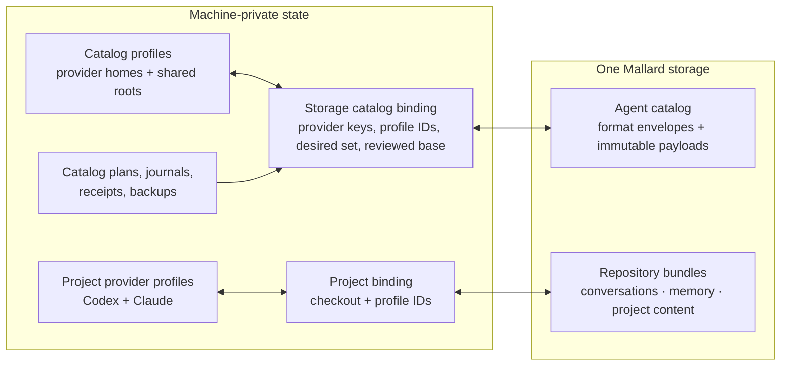

# Design: Storage-scoped agent catalog

**Status:** proposed clean-break design

**Date:** 2026-08-06

**Product scope:** portable, user-global agent customizations

**Portable scope:** one catalog per configured Mallard storage

**Supersedes:** the repository-scoped capability model in
[`PLAN_PROJECT_SCOPED_SYNC.md`](./PLAN_PROJECT_SCOPED_SYNC.md) and
[`PLAN_V3_GLOBAL_PLUGINS_AND_SKILLS.md`](./PLAN_V3_GLOBAL_PLUGINS_AND_SKILLS.md)

## 1. Decision

User-global agent customizations are properties of an agent environment, not
of a source repository. Mallard will therefore sync them through one
independently versioned **agent catalog** at the storage root.

The first delivery supports six provider adapters:

```text
claude
cursor
codex
opencode
pi
gemini
```

“Pi” is the product name; `pie` is not used as a provider key.

The first delivery registers three portable resource formats:

```text
agentskills.io/skill @ version 1
mallard/extension-install-intent @ version 1
openai/codex-pet @ version 2
```

The catalog envelope and adapter registry are intentionally broader than those
three formats. Adding another provider that consumes a registered format does
not require a catalog-schema change. Adding a format with semantics that fit
the existing envelope also does not require a catalog-schema change. A change
to integrity, identity, or safety semantics does require an explicit new
catalog schema; it is never hidden behind permissive parsing.

Project repositories keep their existing bundle histories for conversations,
provider memory, and reviewed non-Git project content. They do not contain
global skills, extension install intent, pets, storage-catalog selections, or
storage-catalog receipts.

This is a clean implementation, not a relocation of the removed
repository-scoped feature:

- no project `ResourceKind` variants for catalog customizations;
- no `BundleKind::Catalog`;
- no capability entries in project recipes or manifests;
- no project ID, repository fingerprint, checkout path, or project binding in
  a catalog document or catalog command;
- no reader, migration, or import path for the removed repository-scoped
  capability representation; and
- no resurrection of the archived dependency-plan layer.

The current project bundle format remains supported unchanged. “No backward
compatibility” applies to the removed skill/plugin design and to the new
catalog schemas; it does not discard working project registrations, storage
credentials, repository histories, or provider-profile records.

## 2. User outcome

Selecting a storage in Mallard exposes an **Agent Catalog** containing:

- user-global Agent Skills from explicitly paired standard or provider roots;
- provider plugins, extensions, or packages as reinstallable intent, never
  copied installed payloads; and
- validated Codex v2 custom pets.

The user can:

1. choose which locally discovered items belong in that storage;
2. review and publish changes to the storage catalog;
3. inspect the catalog from another machine;
4. explicitly restore selected skills and pets or install selected extensions
   into locally paired catalog profiles; and
5. see whether local items match, differ from, or are missing from the
   storage catalog.

Project Push and Pull never trigger these operations. A project can be removed,
renamed, rebound, or linked to another storage without adding, removing, or
installing a catalog item.

### 2.1 Initial provider matrix

The matrix describes user-global discovery only. Project-local customizations
remain repository content or provider behavior and are never scanned by the
agent catalog.

| Provider key | Owned user-global skill root | Accepted skill audiences | Extension intent | Initial provider-only asset |
|---|---|---|---|---|
| `codex` | none | shared | Codex plugin identity/source | v2 pets |
| `claude` | `~/.claude/skills` | Claude | Claude plugin marketplace/source | none |
| `cursor` | `~/.cursor/skills` | Cursor, shared | Cursor plugin identity/source after Phase 0 contract proof | none |
| `opencode` | `~/.config/opencode/skills` | OpenCode, Claude, shared | portable configured plugin/package source | none |
| `pi` | `~/.pi/agent/skills` | Pi, shared | Pi package source; loose TypeScript extensions are blocked | none |
| `gemini` | `~/.gemini/skills` | Gemini | Gemini extension Git source/ref | none |

Tildes in this table describe provider defaults, not serialized paths.
Implementations resolve them through explicit local profiles and never put the
expanded absolute path in a portable document.

Plugin-owned or extension-owned skills appear under their owning extension and
are not independently captured. A skill in the shared Agent Skills root is one
catalog resource with the `agentskills.io/shared` audience, not one duplicate
resource per provider. Accepted audiences do not authorize extra filesystem
scans: OpenCode sees a Claude-audience skill only when the Claude catalog
profile that owns that root is also explicitly paired.

### 2.2 What else belongs in the catalog

The following formats are worth adding after the three initial formats, in
this order:

1. **Custom agent definitions** — portable Markdown definitions with tools,
   model hints, and provider-specific unsupported fields called out during
   review.
2. **Prompt/command templates** — user-global reusable prompts. Deprecated
   Codex custom prompts are not imported; Codex users express the workflow as
   an Agent Skill.
3. **Global instruction profiles** — user-level `AGENTS.md`, `CLAUDE.md`,
   `GEMINI.md`, or provider rules only when the provider exposes a stable,
   bounded file contract.
4. **MCP server install intent** — transport, package or URL, argument
   structure, and environment-variable names only. Secret values, local
   authentication, approval, enablement, and trust remain machine-local.
5. **Themes and other validated UI assets** — for example Pi or Gemini CLI
   themes.

Hooks, policy files, loose executable extensions, model/provider settings,
credentials, trust decisions, permissions, and session state do not belong in
the initial catalog. Hooks and policies can change execution or weaken a
safety boundary merely by being present; they require a separate design with
disabled-by-default activation.

GitHub Copilot CLI is the strongest next provider adapter because it exposes
machine-readable inventory and uses the shared Agent Skills convention.
Goose is the next candidate because its recipes and MCP extensions map cleanly
to command and extension-intent formats. Neither is required for the first
six-provider delivery.

## 3. Why repository scope is the wrong boundary

The removed design discovered global resources through a project's provider
binding and then copied their description into that project's bundle. That
creates four structural problems:

1. The same agent customization is duplicated in every project that uses the
   same provider home.
2. Two project recipes can make conflicting claims about one global install
   target.
3. Removing or moving a project can appear to remove the backup authority for
   an unrelated global tool.
4. A new machine must choose a project before it can restore environment-level
   resources.

Storage scope gives these resources one visible authority and one history per
destination. Repository bundles and the storage catalog still share the same
object-store transport and integrity rules, but not identities, schemas,
manifests, plans, or UI flows.

## 4. Boundary map



The two portable branches are independent:

```text
.mallard/v1/catalog/...
.mallard/v1/repositories/<bundle-id>/...
```

Advancing a catalog head does not advance a repository head, and advancing a
repository head does not advance the catalog head.

## 5. Terminology and ownership

| Term | Meaning | Portable |
|---|---|---|
| Agent catalog | The singleton agent-customization collection in one storage | Yes |
| Catalog resource | One adapter-validated portable resource envelope | Yes |
| Provider adapter | Local discovery, target, installer, and verification behavior for one agent | No |
| Format adapter | Identity, descriptor, payload, claims, and safety rules for one portable format | No |
| Catalog profile | This machine's root for one catalog provider key | No |
| Catalog binding | This machine's storage-to-catalog-profile mapping | No |
| Desired set | Resource IDs this machine intends the next catalog revision to contain | No |
| Reviewed base | Exact catalog head this machine last accepted or published | No |
| Catalog plan | Immutable Push or Pull review pinned to remote and local state | No |
| Materialization receipt | Evidence that a resource digest was applied to one local profile | No |
| Project bundle | Existing repository-scoped conversations/memory/content history | Yes, separately |

The storage catalog is the only portable authority for this feature. A local
provider home remains the runtime authority for what is actually installed.
Mallard reports differences between them; it does not pretend the two are
always identical.

## 6. Local binding model

Each storage may be paired with at most one local profile per provider key and
at most one explicit shared Agent Skills root:

```rust
struct LocalCatalogProfile {
    profile_id: LocalCatalogProfileId,
    provider_key: ProviderKey,
    display_name: String,
    configured_home: PathBuf,
    revision: u64,
}

struct LocalCapabilityRoot {
    root_id: LocalCapabilityRootId,
    root_key: SharedRootKey,
    configured_path: PathBuf,
    revision: u64,
}

struct StorageCatalogState {
    schema_version: u32, // 1
    revision: u64,
    bindings: BTreeMap<StorageId, StorageCatalogBinding>,
}

struct StorageCatalogBinding {
    storage_id: StorageId,
    profile_ids: BTreeMap<ProviderKey, LocalCatalogProfileId>,
    shared_root_ids: BTreeMap<SharedRootKey, LocalCapabilityRootId>,
    desired_resource_ids: BTreeSet<CatalogResourceId>,
    base: Option<CatalogBase>,
    revision: u64,
    updated_at: u64,
}

struct CatalogBase {
    catalog_id: CatalogId,
    revision: u64,
    commit_id: CommitId,
    manifest_sha256: Sha256Digest,
    manifest_size: u64,
    storage_identity_sha256: Sha256Digest,
}
```

Rules:

- A binding must select at least one catalog profile or shared root.
- Catalog profiles are a new machine-local domain. They do not widen or reuse
  the project-sync `Provider` enum, whose supported conversation providers
  remain Codex and Claude.
- Codex and Claude catalog profiles may point at the same canonical homes as
  existing project provider profiles, but neither record owns or embeds the
  other. The canonical-path lock coordinates mutations.
- `ProviderKey`, `SharedRootKey`, `CatalogAudienceKey`, and format keys are
  validated, bounded, lowercase identifiers. They are not closed Rust enums.
- The executable adapter registry is closed at build time. An arbitrary
  provider key in storage can never select a binary or filesystem target.
- Creating or editing a local catalog profile requires a provider key present
  in that registry.
- A shared `agent-skills` root can supply a single skill to every paired
  provider adapter that declares compatibility with that format.
- Catalog profiles supply only roots and native operations explicitly
  declared by their registered adapter.
- A catalog profile may be paired with several storages. This supports
  deliberate backup fan-out; each storage still has an independent catalog
  head and reviewed base.
- Pairing is explicit. Mallard never infers a catalog profile from whichever
  project happens to use a storage.
- Changing a paired profile invalidates inventory caches and pending plans,
  but does not delete provider files or mutate the remote catalog.
- Changing the connection identity behind an existing `storage_id` clears the
  catalog base and pending catalog work. The selected local profiles may stay
  paired, but the new destination starts as unreviewed.
- Removing a storage deletes its machine-local catalog binding, plans,
  receipts, and caches. It does not delete remote objects or local provider
  content.
- Removing a catalog profile or shared root is blocked while a storage catalog
  binding still references it. Existing project-profile deletion rules remain
  unchanged.

This state lives in a new bounded, revision-checked local document. It is not
added to portable storage configuration and is not nested under a project.

## 7. Portable catalog model

The catalog uses a strict generic envelope plus versioned format adapters
rather than a closed `Skill | Plugin | Pet` enum or the generic project
resource descriptor:

```rust
#[serde(deny_unknown_fields)]
struct CatalogManifest {
    schema_version: u32, // 1
    catalog_id: CatalogId,
    revision: u64,
    commit_id: CommitId,
    updated_at: u64,
    captured_with: CatalogCapturedWith,
    published_by_origin: PortableCatalogOrigin,
    resources: BTreeMap<CatalogResourceId, CatalogResourceEnvelope>,
    tombstones: BTreeMap<CatalogResourceId, CatalogTombstone>,
}

#[serde(deny_unknown_fields)]
struct CatalogResourceEnvelope {
    resource_id: CatalogResourceId,
    family_key: CatalogFamilyKey,
    format_key: CatalogFormatKey,
    format_version: u32,
    display_name: CatalogDisplayName,
    audiences: BTreeSet<CatalogAudienceKey>,
    portable_claims: BTreeSet<PortableCatalogClaim>,
    descriptor: CatalogObjectRef,
    files: BTreeMap<ResourceRelativePath, CatalogFileEntry>,
    content_sha256: Sha256Digest,
}
```

Audience keys separate portable intent from the providers paired on one
machine:

```text
agentskills.io/shared
provider/claude
provider/codex
provider/cursor
provider/gemini
provider/opencode
provider/pi
```

A provider adapter declares the audiences it accepts. A future provider can
consume an existing shared Agent Skill by accepting
`agentskills.io/shared`; the stored resource and its digest do not change
merely because that provider was added to Mallard.

There is deliberately no portable `CatalogRecipe`. The live
`manifest.resources` map is the selected storage collection. The editable
desired set is machine-local and reconciles against a reviewed base before
publication. This removes the project manifest's duplicated
“recipe IDs must equal resource IDs” representation.

The envelope is format-neutral but not permissive:

- its fields, keys, sizes, digests, relative paths, and claims are validated by
  catalog core;
- a registered format adapter must additionally decode and validate the
  descriptor, recompute identity and claims, and validate every payload before
  a local item can be published or applied;
- an unregistered provider or format is displayed as `unsupported` and carried
  forward byte-for-byte only from the exact reviewed base;
- an unsupported resource cannot be added, changed, removed, materialized, or
  used to launch a process by that client; and
- Push may change supported resources while retaining unsupported envelopes
  only when their descriptor and file references are unchanged from the exact
  reviewed base.

This is forward-safe preservation, not a legacy reader or migration path.
There is still exactly one current catalog schema and no fallback
interpretation of old data.

The manifest and descriptors have no:

- project or bundle ID;
- repository fingerprint;
- relative working directory;
- conversation metadata;
- checkout path;
- local catalog-profile or shared-root ID;
- storage ID; or
- executable command line.

Installer arguments are derived locally by a versioned provider adapter from a
known, validated extension-intent descriptor.

### 7.1 Adapter contracts

Provider and format extension points are separate:

```rust
trait CatalogProviderAdapter {
    fn key(&self) -> ProviderKey;
    fn accepted_audiences(&self) -> BTreeSet<CatalogAudienceKey>;
    fn supported_formats(&self)
        -> BTreeMap<CatalogFormatKey, ProviderFormatSupport>;
    fn resolve_roots(&self, format: &CatalogFormatKey,
        profile: &ResolvedCatalogProfile)
        -> Result<Vec<ProviderRoot>, CatalogBlocker>;
    fn discover_native(&self, format: &CatalogFormatKey,
        profile: &ResolvedCatalogProfile)
        -> Result<Vec<NativeResourceObservation>, CatalogBlocker>;
    fn plan_native_apply(&self, resource: &ValidatedCatalogResource,
        profile: &ResolvedCatalogProfile)
        -> Result<NativeApplyPlan, CatalogBlocker>;
    fn verify_native_apply(&self, expected: &ValidatedCatalogResource,
        profile: &ResolvedCatalogProfile)
        -> Result<VerificationResult, CatalogBlocker>;
}

trait CatalogFormatAdapter {
    fn key(&self) -> (CatalogFamilyKey, CatalogFormatKey, u32);
    fn validate_descriptor(&self, bytes: &[u8])
        -> Result<ValidatedDescriptor, CatalogBlocker>;
    fn derive_identity(&self, descriptor: &ValidatedDescriptor)
        -> CatalogIdentity;
    fn derive_claims(&self, descriptor: &ValidatedDescriptor)
        -> BTreeSet<PortableCatalogClaim>;
    fn validate_payload(&self, descriptor: &ValidatedDescriptor,
        files: &CatalogFiles) -> Result<(), CatalogBlocker>;
    fn plan_materialization(&self, resource: &ValidatedCatalogResource,
        target: &ResolvedCatalogTarget)
        -> Result<MaterializationPlan, CatalogBlocker>;
}
```

Adapter code is Tauri-free. Registry construction is explicit in production
and tests; there is no dynamic-library loading, executable plugin hook, or
portable command dispatch.

Adding a provider consists of a provider key, local-profile resolver, discovery
contract, supported-format declarations, native-operation fixtures, and UI
label. Adding a format consists of a format adapter, canonical descriptor
schema, identity and claim rules, payload limits, review copy, and round-trip
fixtures.

### 7.2 Catalog and resource identities

`CatalogId` is a random 128-bit portable ID created with the first catalog
publication. Because the catalog path is a singleton, the first successful
head CAS establishes the ID. A concurrent first publisher that loses CAS must
discard its unpublished ID, fetch the winning head, and replan.

Resource identity is stable across content updates and is derived by the
registered format adapter from a canonical identity:

```text
shared Agent Skill = ("agentskills.io/skill", 1, "shared", effective name)
provider Agent Skill = ("agentskills.io/skill", 1, provider, effective name)
extension intent = ("mallard/extension-install-intent", 1,
                    provider, adapter-canonical extension ID)
Codex pet        = ("openai/codex-pet", 2, "codex", validated pet ID)
```

`CatalogResourceId` is the lowercase SHA-256 of the length-delimited tuple with
the format key as a domain separator, prefixed uniformly as
`resource-<64 lowercase hex>`. Display names, source paths, content digests,
and observed versions are not identity.

Provider target directories are local placement, not portable identity. A
rename of a canonical effective name is an explicit remove/add operation.
Portable claims carry canonical capability names and provider audiences so
all clients can detect exact claim collisions even when they do not implement
the resource format.

Every resource has a content digest over:

1. the exact descriptor object reference and verified descriptor bytes;
2. the family, format, format version, audiences, and claims;
3. every owned relative path in sorted order;
4. each file hash and size; and
5. each portable safe mode.

Changing bytes or portable metadata changes the content digest without
changing the resource ID.

### 7.3 Logical paths

Catalog paths use a validator distinct from project `LogicalPath`:

```text
resources/<catalog-resource-id>/descriptor.json
resources/<catalog-resource-id>/files/<resource-relative-path>
```

Extension-intent resources own a descriptor and no payload files. Catalog
paths can never begin with `project/`, `state/`, `dependencies/`, or
`requirements/`. Repository manifests cannot reference catalog object keys.

## 8. Storage layout and consistency protocol

Both local-folder and S3/R2 storage use:

```text
<storage root>/
`-- .mallard/
    |-- _storage.json
    `-- v1/
        |-- catalog/
        |   |-- _head.json
        |   |-- _objects/
        |   |   `-- <payload-sha256>
        |   |-- _manifests/
        |   |   `-- <revision>-<commit-id>.json
        |   `-- _commits/
        |       `-- <revision>-<commit-id>.json
        `-- repositories/
            `-- <bundle-id>/...
```

The existing storage marker remains layout version 1. The catalog is a new
strict namespace within that layout, not an alternate reader for any old
repository object. A storage with no catalog head is simply a fresh catalog.
Every new portable catalog document uses `deny_unknown_fields`; an unsupported
field or schema version is an error, not an inferred compatibility mode.

The catalog protocol mirrors the proven repository publication properties:

1. exact bounded metadata reads;
2. immutable content-addressed payloads;
3. immutable manifests and commit records;
4. exact manifest byte length and SHA-256 in the head;
5. compare-and-swap of the single mutable `_head.json`;
6. read-back resolution after an ambiguous S3 response; and
7. unreachable immutable objects are harmless when head CAS fails.

There is one head for all resource formats and provider audiences. Splitting
skills, extensions, assets, or providers into independent heads would make one
storage selection only partially publishable and would require cross-head
review bases. The singleton head gives the storage one coherent desired agent
catalog.

The catalog head contains:

```text
schema_version
catalog_id
revision
commit_id
manifest_key
manifest_sha256
manifest_size
updated_at
```

There is no catalog `_tag.json`; the fixed location is directly discoverable.
Catalog objects are not deduplicated against repository bundle objects. That
keeps authorization, retention, validation, and garbage-collection boundaries
independent.

Opening a malformed or unsupported catalog blocks only catalog operations.
Repository listing and project sync for the same storage remain available.

## 9. Inventory contracts

Inventory is read-only. It performs bounded, no-follow discovery from the
catalog profiles paired with the selected storage and returns local resources,
blocked candidates, warnings, ownership evidence, and a deterministic source
stamp.

It never scans:

- a project checkout;
- a repository bundle;
- plugin caches, marketplace clones, package-manager databases, or temporary
  download trees;
- project-local `.agents`, `.claude`, `.cursor`, `.opencode`, `.pi`,
  `.gemini`, or equivalent trees;
- system/admin skill roots; or
- another catalog profile not explicitly paired with this storage.

The explicitly paired shared Agent Skills root is scanned once. The default is
`~/.agents/skills`; its expanded path stays machine-local. Provider-specific
global roots are scanned only through the matching registered provider
adapter. Extra search paths from arbitrary provider settings are blocked in
the first delivery because their ownership and portable target may be
ambiguous.

### 9.1 Agent Skills

Mallard inventories the configured shared root and the default user-global
roots supported by the six adapters:

```text
~/.agents/skills/
<CLAUDE_CONFIG_DIR>/skills/
<CURSOR_HOME>/skills/
<OPENCODE_CONFIG_HOME>/skills/
<PI_AGENT_HOME>/skills/
<GEMINI_HOME>/skills/
```

Codex user-global Agent Skills come from the shared `~/.agents/skills` root;
the catalog does not invent `<CODEX_HOME>/skills` as a Codex-owned root.
OpenCode additionally recognizes the Claude and shared roots, but Mallard
scans them only when their owning Claude profile or shared root is explicitly
paired, and scans each physical root once. A provider adapter declares which
portable audiences it accepts; pairing another compatible provider does not
change the stored resource.

Discovery order is ownership-sensitive for every provider:

1. inventory provider extensions;
2. build an ownership index from native inventory, validated extension
   manifests,
   install roots, and manager-owned links;
3. enumerate candidate skill directories; and
4. classify each candidate as standalone, extension-provided, or blocked.

Only a regular safe directory not proven to be extension-owned is snapshot
eligible. Symlinks are never dereferenced. An extension-provided skill is
displayed beneath its extension but is not a separately selectable resource.

A shared Agent Skills format adapter parses bounded `SKILL.md` metadata and
produces:

```rust
struct AgentSkillDescriptor {
    audience: SkillAudience, // shared or one ProviderKey
    declared_name: String,
    effective_name: String,
    format_version: u32,
    content_sha256: Sha256Digest,
}
```

The portability baseline is the current Agent Skills specification. Mallard
preserves the exact bounded skill tree and never translates frontmatter
between providers. A provider adapter reports whether provider-specific fields
are supported, ignored with a warning, or blocking for that target. A skill
must satisfy the standard baseline before it can use the shared audience;
provider-only extensions can instead use a provider audience.

The declared runtime name and local physical directory are validated
independently. Two resources with overlapping effective provider audiences
that claim the same name, or two resources that target the same case-folded
local install path, are blocked. The same name may coexist only when audiences
are disjoint. Name or content equality alone never proves extension ownership.

Capture treats one skill directory as one transaction unit. It:

- rejects symlinks, special files, unsafe path components, case collisions,
  nested VCS metadata, and unstable reads;
- uses per-file, per-resource, file-count, and aggregate byte limits;
- performs best-effort secret detection;
- highlights executable files and executable-looking content; and
- requires acknowledgement of the exact warning digest before publication.

### 9.2 Provider extensions

Provider terms differ: Codex, Claude, and Cursor expose plugins; OpenCode
exposes configured plugins; Pi exposes packages and extensions; Gemini CLI
exposes extensions. The portable resource is uniformly typed install intent:

```rust
struct ExtensionInstallIntentDescriptor {
    provider: ProviderKey,
    extension_id: String,
    source: PortableExtensionSource,
    observed_version: Option<String>,
    observed_ref: Option<String>,
    resolution: ExtensionResolutionPolicy,
    provided_skills: Vec<ProvidedSkillClaim>,
    adapter_version: u32,
}
```

Portable source variants are closed:

- a provider-managed marketplace or registry identity;
- a credential-free immutable npm package identity when the provider's native
  package flow supports it;
- a credential-free normalized Git repository plus an immutable ref when the
  provider supports one; or
- a reviewed public marketplace identity with a portable source descriptor.

Absolute paths, embedded credentials, shell fragments, environment values, and
opaque manager records are rejected. Local-path and authentication-dependent
sources are `manual_only` and cannot be published as automatically installable
intent.

Mallard never uploads:

- installed extension, plugin, or package payloads;
- plugin caches;
- marketplace or repository clones;
- package-manager state;
- connector credentials;
- provider authentication;
- enable/disable state;
- trust or approval state; or
- project-scoped plugin configuration.

Loose local TypeScript/JavaScript extensions, linked development extensions,
and local-path packages are executable source snapshots, not reinstallable
intent. They are `manual_only` in the first delivery and cannot be published
as another source variant.

Observed versions are diagnostic unless the provider's supported native
installer can enforce the exact version or ref. The Pull plan must state
whether it can reproduce the observed version or will resolve the provider's
current version.

Target-local explicit disablement wins. Mallard may install a missing selected
extension, but it does not silently re-enable an extension disabled on the
target.

### 9.3 Codex pets

The initial Codex-pet format supports only custom v2 packages under:

```text
<CODEX_HOME>/pets/<pet-id>/
|-- pet.json
`-- <referenced PNG or WebP atlas>
```

The supported manifest contract is strict:

```json
{
  "id": "pet-id",
  "displayName": "Pet Name",
  "description": "One short sentence.",
  "spriteVersionNumber": 2,
  "spritesheetPath": "spritesheet.webp"
}
```

Validation requires:

- the directory name, manifest `id`, and target ID to match;
- a bounded provider-safe ID;
- `spriteVersionNumber` exactly `2`;
- a single relative atlas basename with no traversal;
- PNG or WebP bytes whose decoded dimensions are exactly `1536x2288`;
- an `8 x 11` layout of `192x208` cells by contract;
- no symlink or special file;
- bounded JSON and atlas sizes; and
- no unrecognized manifest fields.

Mallard stores the typed pet metadata and exact atlas bytes. It regenerates
canonical `pet.json` on restore. Extra files in a pet directory are not
captured and produce a warning so QA artifacts are not silently transported.

Pet v1 packages are shown as unsupported and remain local. There is no v1
conversion or compatibility path.

### 9.4 Admission of another format

A new catalog format is not admitted merely by adding another string key. Its
change must include:

- canonical descriptor bytes and a current format version;
- stable identity and portable claim rules;
- exact supported provider audiences;
- source and target ownership rules;
- bounded payload, path, mode, and secret handling;
- review and warning behavior;
- apply, rollback, and verification semantics;
- unknown-adapter carry-forward fixtures; and
- at least one provider adapter with authoritative discovery/apply fixtures.

Custom agents, prompt templates, instruction profiles, sanitized MCP intent,
and themes can satisfy this contract without changing catalog core. Hooks,
policies, and loose executable extensions require a separate activation model
before they qualify.

## 10. Reconciliation model

Inventory compares three states:

1. the current local catalog profiles;
2. the exact reviewed catalog base; and
3. the current remote catalog head.

Each resource is classified as one of:

```text
local_only
storage_only
matching
local_changed
storage_changed
changed_both
unavailable_locally
blocked
```

Rules:

- A remote head that differs from the reviewed base must be accepted through
  Pull before Push can publish.
- A selected resource missing locally is carried forward from the exact base;
  absence never implies removal.
- A resource is removed from the next catalog only when the user explicitly
  removes it from the desired set in Push review.
- Explicit removal creates a resource tombstone in the next manifest but does
  not delete or uninstall local content on any machine.
- Re-adding the same resource ID removes its live tombstone; immutable commit
  history still records the earlier removal.
- Local-only discoveries start unchecked.
- Accepting a remote catalog adopts its complete live resource-ID set as the
  local desired set, even when the user chooses not to install every resource.
  This prevents a later Push from deleting skipped remote items.
- `changed_both` is never resolved from mtimes. The user chooses which
  resource version the next catalog revision should contain.
- Fan-out to several storages is sequential and independent. Mallard does not
  claim a distributed transaction across storage heads.

## 11. Push flow

1. Resolve the selected storage and its catalog binding.
2. Revalidate the paired catalog profiles and storage identity.
3. Read and verify the current catalog head and manifest.
4. Compare the head with the reviewed base; block unreviewed remote changes.
5. Run one ownership-ordered local inventory.
6. Build a `CatalogPushPlan` with statuses, selected resources, retained
   remote-only resources, explicit removals, warnings, and exact head
   coordinates.
7. Let the user edit the desired set and acknowledge exact warning digests.
8. Revalidate the plan, storage head, binding/profile revisions, inventory
   source stamp, and selected content immediately before capture.
9. Snapshot selected skills and pets; generate typed extension intent; reuse
   unchanged remote objects and descriptors.
10. Write immutable objects, manifest, and commit, then CAS the catalog head.
11. Only after CAS succeeds, persist the new desired set and reviewed base.

A semantic no-op writes nothing. A CAS conflict leaves local state unchanged
and requires a new Pull/Push review.

## 12. Pull and apply flow

Pull has one catalog plan, not a project restore plan plus a second dependency
plan.

1. Fetch and verify the current catalog head, manifest, and chosen payload
   objects.
2. Revalidate the storage catalog binding and paired catalog profiles.
3. Inventory the exact local targets.
4. Build a `CatalogPullPlan` containing:
   - the complete remote resource set to accept;
   - typed skill, extension, and pet actions keyed by resource and local
     target;
   - local target digests and ownership evidence;
   - source/version limitations;
   - cross-storage claim conflicts;
   - exact remote head and local revision pins; and
   - an expiry time.
5. Present every mutating action unchecked. Matching resources are no-ops.
6. On confirmation, first persist the accepted remote desired set and base.
   This records what storage contains independently of local install success.
7. Apply only approved actions and record one result per resource/target
   action.
8. Re-inventory affected targets and record receipts for verified outcomes.

The result distinguishes:

- `catalog_accepted`;
- `installed`;
- `updated`;
- `already_matching`;
- `kept_local`;
- `manual`;
- `partial`; and
- `failed`.

Accepting the catalog does not imply every item was installed. A failed
extension install does not roll back the accepted storage snapshot or unrelated
successful skill/pet actions.

A portable resource can have zero, one, or several local materializations.
Pull offers only targets whose registered provider adapter accepts the
resource audience. A shared-root skill action can satisfy every paired provider
that reads that root; the UI does not also preselect redundant provider-root
copies. Target choices and receipts are machine-local and never change the
portable resource digest.

## 13. Target mutation rules

### 13.1 Shared provider-home lock

All catalog mutations acquire an app-owned lock keyed by the canonical provider
profile path. The lock lives below `~/.mallard`, not inside the provider home.
Every plan is revalidated after acquiring it.

### 13.2 Skills and pets

Skills and pets are whole-directory units:

1. compute the target tree digest during planning;
2. recheck target type and digest at apply time;
3. materialize the complete resource into a same-filesystem staging directory;
4. verify paths, hashes, sizes, modes, and final content digest;
5. journal the operation;
6. place an existing target in a permission-restricted recoverable backup;
7. rename the staged directory into place;
8. verify the final target; and
9. restore the backup on a Mallard-managed failure when safe.

Target states:

| Target state | Result |
|---|---|
| Missing | Offer Install |
| Exact content match | Already matching; optionally adopt with a receipt |
| Prior receipt matches target, storage is newer | Offer Update |
| Same target identity, different or unknown content | Default Keep; offer explicit Overwrite |
| Target changed after review | Abort and require a new plan |
| Symlink, special file, unsafe tree, or path collision | Block |

There is no per-file merge for skill or pet packages. Overwrite removes files
not present in the selected package, but only after backup and explicit
digest-pinned approval.

### 13.3 Extensions

Extensions are mutated only through a provider adapter's proven native
operation:

- a structured process invocation using the selected profile environment; or
- a bounded, schema-aware, digest-pinned transaction on an official
  user-global declarative config file.

Mallard never uses a shell command assembled from portable strings. A config
transaction preserves unrelated fields and comments, makes a recoverable
backup, writes atomically, and verifies provider inventory afterward. If the
adapter cannot prove those properties for the installed provider version, the
intent is `manual`.

Before native mutation, the adapter rechecks:

- extension identity and source;
- target marketplace availability;
- target-local authentication prerequisites;
- installed version/ref when observable;
- exported skill ownership;
- effective capability collisions; and
- explicit local disablement.

After the native operation, Mallard re-inventories and verifies the result.
Provider installers are not falsely described as transactional: a successful
process with failed verification is `partial`, keeps a truthful receipt, and
offers a fresh Repair plan. Declarative config transactions use the same
journal/backup recovery contract as other local file mutations.

Catalog removal never uninstalls an extension.

## 14. Cross-storage and ownership conflicts

A machine-local claim index is keyed by canonical provider/shared-root profile
and target claim:

```text
(profile, "agent-skill", effective name) -> storage/catalog/resource/digest
(profile, "extension", extension ID)      -> storage/catalog/source
(profile, "codex-pet", pet ID)            -> storage/catalog/resource/digest
```

It is derived from verified receipts plus fresh inventory; it is not portable.

Rules:

- The same extension ID and source across several storages coalesces into one
  idempotent target installation.
- The same extension ID with different sources is blocked before process
  launch.
- The same skill or pet ID and digest across several storages can share a
  target receipt.
- A different skill or pet digest from another storage requires an explicit
  overwrite decision and names every claiming storage.
- An extension-provided skill and a standalone skill with the same effective
  capability cannot both be activated unless the target adapter proves they
  are namespaced.
- The same effective skill name is a collision whenever effective provider
  audiences overlap. Disjoint provider-specific audiences may reuse the name.
- A shared Agent Skill materialized once in the shared root can satisfy several
  compatible providers without duplicate target claims.
- Detaching a storage removes its local claim edge but never uninstalls or
  deletes the target.

## 15. Privacy and safety invariants

Portable catalog documents may contain skill source, pet imagery, public or
reviewed extension source identifiers, resource display names, and file
metadata.
They can therefore be sensitive even without conversations.

They must never contain:

- credentials, bearer tokens, cookies, private keys, or environment values;
- local absolute paths;
- `StorageId`, `LocalCatalogProfileId`, host ID, or project ID;
- storage endpoint credentials;
- provider login or connector state;
- extension payloads, caches, clones, manager databases, or generated lock
  state;
- local trust/approval decisions;
- local backups, receipts, journals, or claim graphs; or
- arbitrary shell fragments or unvalidated executable command lines.

All catalog reads and writes preserve the existing storage safety properties:

- validated bounded keys;
- exact-size and SHA-256 verification before parsing;
- immutable publication;
- no-follow traversal;
- special-file and case-collision rejection;
- bounded files, counts, and aggregate bytes;
- safe portable permission bits only;
- explicit review for executable or credential-shaped skill content;
- plan digest, revision, expiry, and target-state checks; and
- local backups excluded from every inventory and Push.

Suggested schema-1 limits are:

```text
resources                 5,000
files                    50,000
one skill file           16 MiB
one skill tree          128 MiB
pet.json                 16 KiB
one pet atlas            32 MiB
total payload per revision 512 MiB
```

Exact constants must be enforced in domain validation, capture, storage reads,
and tests rather than only documented in the UI.

## 16. UI design

Selecting a storage in the existing sidebar opens its storage workspace.
Connection settings remain available, but they are not the default content
once the storage is configured.

The workspace contains:

- **Catalog overview** — paired profiles, catalog revision, last accepted
  state, counts, blockers, and Push/Pull actions;
- **Skills** — standalone and extension-provided ownership rows;
- **Extensions** — provider-native terminology, intent, source, observed
  version, target status, and version reproducibility;
- **Pets** — thumbnail, manifest metadata, v2 validation, and target status;
  and
- **Settings** — storage connection and explicit catalog-profile pairing.

Tabs are driven by registered catalog families, not a hard-coded
`Skill | Plugin | Pet` UI enum. Unsupported forward resources remain visible
in an **Unsupported** section with their family, format, audiences, display
name, digest, and a requirement to update Mallard before managing them.

Status language is storage-specific:

```text
Only on this Mac
Only in Personal R2
Matches Personal R2
Changed on this Mac
Changed in Personal R2
Changed in both places
Blocked
```

Project History, Project Files, project Push review, and project Pull review do
not show catalog tabs, “Finish setup,” or capability counts.

The UI must state the mutation scope before apply:

> This changes one or more selected catalog profiles or the shared Agent Skills
> root and may affect every project that uses them.

Extension actions additionally state that native installation can download and
execute provider-managed code.

## 17. Command and DTO boundary

Use a separate Tauri command family:

```text
list_storage_catalog_capabilities
list_catalog_profiles
save_catalog_profile
delete_catalog_profile
list_catalog_shared_roots
save_catalog_shared_root
delete_catalog_shared_root
get_storage_catalog_binding
save_storage_catalog_binding
inspect_storage_catalog
prepare_storage_catalog_push
publish_storage_catalog
prepare_storage_catalog_pull
get_storage_catalog_plan
apply_storage_catalog_pull
get_storage_catalog_status
```

Every command takes `storage_id` or a generated plan ID, never
`local_project_id` or `bundle_id`.

Frontend calls live behind a typed `storageCatalogApi`; raw `invoke` calls are
not scattered through components. Rust request/response types and
`src/types.ts` change together.

Project command signatures stay unchanged. In particular, do not add catalog
arguments to:

```text
get_bundle_inventory
prepare_push_review
push_bundle
plan_bundle_restore
apply_bundle_restore
get_bundle_readiness
```

## 18. Failure and recovery model

- Remote corruption or an unsupported catalog schema blocks catalog work and
  reports the exact key; project repositories remain usable.
- A failed Push before catalog head CAS publishes no visible revision.
- A failed CAS persists no new local base.
- A stale or expired plan performs no target mutation.
- Skill/pet journal recovery runs during existing startup recovery and either
  completes verification, restores the backup, or presents a recoverable
  manual state.
- Extension recovery starts with fresh native inventory. It never replays stale
  arguments merely because a prior attempt lacked a receipt.
- Failure of one Pull action does not mark other actions successful or roll
  back unrelated verified actions.
- Removing a storage or profile is blocked while an active apply journal
  references it.

## 19. Clean-break rules

The implementation must include negative tests for these rules:

1. Project manifests containing the removed standalone-skill or plugin
   resource variants remain unsupported.
2. Catalog code never enumerates `.mallard/v1/repositories/` looking for agent
   customizations.
3. Project capture never enumerates provider-global customization roots.
4. No old dependency plan, dependency receipt, plugin lock, or archived
   capability-status document is read or migrated.
5. The new local and portable catalog schemas accept only their exact current
   version. No serde aliases or fallback interpretations are added.
6. Pet v1 remains unsupported; it is not rewritten as v2.
7. Existing storage with repository bundles but no catalog starts with an
   empty catalog; repository data is not copied, rewritten, or deleted.
8. Archived code under `docs/archive/skill-plugin-sync/` may supply test cases
   and provider-adapter lessons, but production files are not copied back
   wholesale.
9. Format dispatch matches an exact `(format_key, format_version)` pair. There
   are no version ranges, aliases, converters, or legacy format readers.

## 20. Acceptance criteria

The feature is complete when:

1. A supported catalog resource can be published once to a storage with no
   project registered or selected.
2. Two projects linked to that storage do not duplicate or own catalog
   resources.
3. Local-folder and stub-S3 backends produce equivalent catalog behavior.
4. A second machine can accept the catalog and selectively install resources
   into explicitly paired catalog profiles.
5. Skipping a Pull install does not remove the item on a later Push.
6. Missing local selected resources are retained from the reviewed base.
7. Explicit catalog removal creates history but never deletes or uninstalls a
   local target.
8. Skill and pet overwrite is digest-pinned, explicitly approved, backed up,
   and recoverable.
9. Extensions restore through native adapters without payload, cache,
   credential, trust, or enablement transfer.
10. Codex v2 pets validate and restore as canonical two-file packages; v1 is
    blocked.
11. CAS, corruption, stale-plan, profile-change, and storage-identity-change
    tests fail closed.
12. Project bundle schemas, commands, tests, and UI remain free of catalog
    resource types.
13. All six initial provider keys inventory their proven user-global roots,
    and unsupported provider capabilities fail as typed blockers rather than
    guessed behavior.
14. An unregistered future provider or format remains visible and is retained
    byte-for-byte from the reviewed base, but cannot be modified or applied.
15. Adding a provider that consumes an existing format requires no portable
    catalog-schema change.
16. Provider selectors and family tabs are driven by the compiled capability
    registry; adding a provider does not require another frontend provider
    enum.

## 21. Provider contract references

These primary references were reviewed on 2026-08-06. They establish design
direction, not a substitute for the bounded command/filesystem fixtures
required by Phase 0:

- Cross-provider format:
  [Agent Skills specification](https://agentskills.io/specification).
- Codex: [Agent Skills](https://learn.chatgpt.com/docs/build-skills),
  [plugins](https://learn.chatgpt.com/docs/plugins), and
  [pets](https://learn.chatgpt.com/docs/pets).
- Claude Code:
  [Skills](https://code.claude.com/docs/en/slash-commands),
  [feature overview](https://code.claude.com/docs/en/features-overview), and
  [plugin reference](https://code.claude.com/docs/en/plugins-reference).
- Cursor: [Agent Skills](https://cursor.com/docs/skills) and
  [plugins](https://cursor.com/docs/plugins).
- OpenCode: [Agent Skills](https://opencode.ai/docs/skills/),
  [plugins](https://opencode.ai/docs/plugins/),
  [agents](https://opencode.ai/docs/agents/), and
  [commands](https://opencode.ai/docs/commands/).
- Pi: [Skills](https://pi.dev/docs/latest/skills),
  [extensions](https://pi.dev/docs/latest/extensions),
  [packages](https://pi.dev/docs/latest/packages), and
  [prompt templates](https://pi.dev/docs/latest/prompt-templates).
- Gemini CLI:
  [extension reference](https://github.com/google-gemini/gemini-cli/blob/main/docs/extensions/reference.md)
  and
  [custom commands](https://github.com/google-gemini/gemini-cli/blob/main/docs/cli/custom-commands.md).
- Next-provider evidence:
  [GitHub Copilot CLI reference](https://docs.github.com/en/copilot/reference/copilot-cli-reference/cli-command-reference)
  and [Goose](https://block.github.io/goose/).
