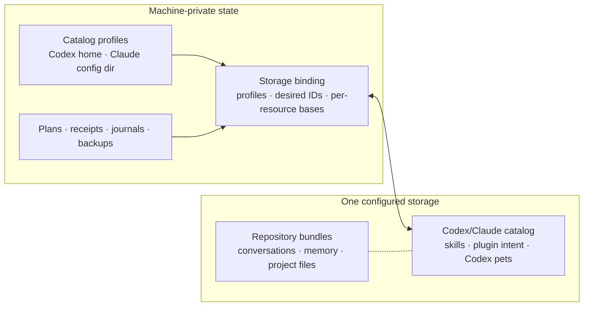

# Design: Storage-scoped Codex and Claude catalog

**Status:** historical; superseded by
[`PLAN_DRAFT_LINKED_CATALOG_RESOURCES.md`](./PLAN_DRAFT_LINKED_CATALOG_RESOURCES.md)

**Date:** 2026-08-07

**Scope:** Codex and Claude global skills and plugins, plus Codex v1 and v2 pets

**Authority:** historical reference only; do not implement

## 1. Decision

Mallard will synchronize global Codex and Claude customizations through one
catalog owned by a configured storage. The catalog is independent of every
project and repository bundle.

The first implementation supports exactly this matrix:

| Resource | Codex | Claude |
|---|---|---|
| Standalone Agent Skills | Yes | Yes |
| Plugin install intent | Yes | Yes |
| Custom pets | v1 and v2 | No |

No other provider is part of this design. In particular, the implementation
does not create adapters, profiles, selectors, filesystem probes, or command
paths for Cursor, OpenCode, Pi, Gemini CLI, Copilot, Goose, or a generic custom
provider.

The portable catalog uses schema 1 only. There is no migration from the
removed repository-scoped skill/plugin implementation and no compatibility
reader for old Mallard catalog, dependency, plugin-lock, or pet documents.

This is a hard cutover:

- **No backward compatibility support.** Only the contracts defined in this
  document are accepted; there are no legacy readers, aliases, fallbacks,
  dual-write paths, or old command surfaces.
- **No migration.** Existing repository-scoped capability data and older
  catalog formats are neither detected nor converted. Users start with a new
  storage-scoped catalog.
- **No dead code.** Superseded types, commands, adapters, parsers, feature
  flags, UI paths, tests, fixtures, and documentation are removed rather than
  retained behind unused branches.

Conflict policy is also fixed for this delivery:

- Push compares against the current storage head, holds storage-newer or
  divergent resources for Pull, and still publishes selected non-conflicting
  resources while carrying held storage bytes forward unchanged.
- A head change after review makes the plan stale and performs no mutation.
- Catalog continuity replacement or loss blocks the complete Push and routes
  to Pull or unlink.
- Pull preserves a divergent local skill or pet under a reviewed generated
  name, then overwrites the original with storage by default.
- A v1 pet and a v2 pet are different, independently selectable catalog
  resources. Storage may contain both for the same pet ID. Push and Pull show
  their formats explicitly; Pull permits at most one selected format for a
  shared local target.
- Pull handles a divergent plugin only through native provider overwrite or
  skip. Plugins are never copied or renamed.

## 2. Goals and non-goals

### 2.1 Goals

- Publish selected global Codex and Claude skills once per storage.
- Publish reproducible Codex and Claude plugin installation intent without
  copying installed plugin payloads.
- Publish validated Codex v1 and v2 pet packages.
- Let the user explicitly select each v1 or v2 pet resource for Push and choose
  which stored format, if any, to materialize during Pull.
- Review every catalog change independently from project Push and Pull.
- Restore selected resources into explicit machine-local targets.
- Preserve immutable publication, SHA-256 verification, compare-and-swap
  heads, revision checks, expiry checks, backups, and explicit approval.
- Keep the catalog substrate narrow enough to implement cleanly while leaving
  provider dispatch behind a compiled adapter registry.

### 2.2 Non-goals

- Project-local skills, plugins, commands, hooks, rules, or MCP configuration,
  regardless of directory spelling or provider convention. Examples that are
  deliberately ignored include `<project>/.skill/`,
  `<project>/.skills/`, `<project>/.agent/ssd`,
  `<project>/.agents/skills/`, and `<project>/.claude/skills/`.
- Provider sessions, conversations, memory, or project content.
- Credentials, login state, tokens, environment values, trust, permissions,
  enablement, or model settings.
- Installed plugin payloads, caches, clones, package-manager databases, or
  lockfiles.
- Plugin uninstall or local resource deletion when an item leaves the remote
  catalog.
- Skill conversion between Codex and Claude.
- Conversion between Codex pet formats.
- Dynamic, user-supplied, or remotely loaded provider adapter code.
- Support for providers other than Codex and Claude.

## 3. User outcome

Selecting a storage opens a **Library** with three sections:

- **Skills** — standalone Codex and Claude Agent Skills;
- **Plugins** — Codex and Claude native plugin installation intent; and
- **Pets** — Codex v1 and v2 pet packages.

The user explicitly pairs local targets with the storage, reviews a local and
remote comparison, and then performs Library Push or Library Pull.

Library browse mode also provides **Refresh** for the complete local/storage
comparison. Each eligible local skill or pet row provides **Fork**, which asks
for a new name and creates a validated local copy. Plugins and storage-only
resources never expose Fork.

The catalog operation contract is:

| Operation | Catalog resources | Required interaction behavior |
|---|---|---|
| Push | Skills, plugins, v1 pets, and v2 pets | Match thread Push: inline review, row selection, per-resource Pull holds, selected safe rows still Push, one progress state, and truthful outcomes |
| Pull | Skills, plugins, v1 pets, and v2 pets | Match thread Pull: inline row decisions, safe default preservation where supported, explicit approval, one progress state, and truthful outcomes |
| Refresh | The complete bound catalog | Match thread Refresh: browse-only affordance, forced local and storage reload as one lifecycle, one busy/error state, stale-response suppression, and feedback timing |
| Fork | One local standalone skill or v1/v2 pet | Reuse the browse-row interaction and post-action Refresh shape, but create a catalog-specific named local copy; plugins do not support Fork |

Push, Pull, and Refresh parity is observable product behavior, not shared
domain code. Catalog DTOs, plans, persistence, commands, and executors remain
independent from project/thread sync. Fork deliberately has different
mechanics and never invokes the native thread-fork executor.

Project Push and Pull never invoke Library operations. Registering, removing,
renaming, or rebinding a project does not add, remove, install, or own a
Library resource.

## 4. Ownership boundary



The portable branches are independent:

```text
.mallard/v1/catalog/...
.mallard/v1/repositories/<bundle-id>/...
```

Catalog documents contain no project ID, bundle ID, repository fingerprint,
checkout path, relative working directory, or project binding.

## 5. Machine-local profiles and binding

Catalog profiles are a new machine-local domain. They do not widen or reuse
the project-sync `Provider` enum.

`StorageId` and SHA-256 primitives come from the neutral storage layer. Every
other type below is catalog-owned; none is imported through project sync.

```rust
struct LocalCatalogProfile {
    profile_id: LocalCatalogProfileId,
    provider_key: ProviderKey, // only "codex" or "claude"
    display_name: String,
    configured_home: PathBuf,
    revision: u64,
}

struct StorageCatalogBinding {
    storage_id: StorageId,
    codex_profile_id: Option<LocalCatalogProfileId>,
    claude_profile_id: Option<LocalCatalogProfileId>,
    desired_resource_ids: BTreeSet<CatalogResourceId>,
    known_head: Option<CatalogHeadCoordinate>,
    resource_bases: BTreeMap<CatalogResourceId, CatalogResourceBase>,
    revision: u64,
    updated_at: u64,
}

struct CatalogHeadCoordinate {
    catalog_id: CatalogId,
    revision: u64,
    commit_id: CatalogCommitId,
    manifest_sha256: Sha256Digest,
    manifest_size: u64,
    storage_identity_sha256: Sha256Digest,
}

struct CatalogResourceBase {
    accepted_at: Option<CatalogHeadCoordinate>,
    state: CatalogResourceBaseState,
}

#[serde(tag = "kind", rename_all = "snake_case")]
enum CatalogResourceBaseState {
    Absent,
    Live { content_sha256: Sha256Digest },
    Tombstone { tombstone_sha256: Sha256Digest },
}

struct CatalogPreservationWitness {
    storage_id: StorageId,
    source_resource_id: CatalogResourceId,
    source_target: LocalCatalogTargetId,
    local_source_sha256: Sha256Digest,
    storage_source_sha256: Sha256Digest,
    preserved_resource_id: CatalogResourceId,
    preserved_target: LocalCatalogTargetId,
    preserved_content_sha256: Sha256Digest,
    operation_id: CatalogOperationId,
    created_at: u64,
}
```

`known_head` is the last catalog head this binding accepted or successfully
published and is used for storage continuity and CAS. A resource base is the
last state accepted for that one resource and may point to an older head after
another safe resource Pushes. `accepted_at: None` is valid only with `Absent`
and means this binding has never accepted that resource; a later explicit
absent observation can pin `Absent` to a concrete accepted head. Held state is
derived from the base, current remote state, and local inventory; it is not
persisted in a second set.

Rules:

- A storage binding selects at least one catalog profile.
- A profile's provider key must exist in the compiled registry. The first
  registry contains exactly `codex` and `claude`.
- A Codex profile resolves `CODEX_HOME` for plugins, pets, and Codex-home
  skills.
- Codex skills come from exactly two provider-global roots:
  `<CODEX_HOME>/skills` and the OS user's `$HOME/.agents/skills`.
- The shared-user root is active only when the binding selects a Codex
  profile. A Claude-only binding never scans it.
- Those roots are fixed contracts, not configurable targets or
  project-relative searches. Supporting both current roots is provider
  behavior, not a Mallard compatibility or migration path.
- A Claude profile resolves `CLAUDE_CONFIG_DIR` for skills and plugins.
- A profile can be paired with several storages.
- Changing a selected profile, canonical path, resolved OS user home, or
  storage connection identity invalidates pending plans and inventory caches.
- Removing a storage deletes only its local binding, plans, receipts, caches,
  and completed-operation metadata.
- Removing a profile is blocked while a catalog binding or active operation
  references it.
- Canonical paths can coincide with existing project provider homes, but the
  records remain independent. A canonical-path lock coordinates mutation.
- The active skill roots must be pairwise disjoint after canonicalization. If
  two roots are equal, or one is an ancestor of another, profile resolution
  returns `overlapping_skill_roots` and catalog inventory and mutation remain
  blocked. One physical directory can never acquire two portable root-class
  identities.
- Preservation witnesses are machine-local recovery records. They are valid
  only while the exact generated copy still exists at its pinned target with
  its recorded digest; they never become portable fork lineage.

## 6. Provider registry

Provider behavior is compiled, explicit, and Tauri-free:

```rust
enum PluginApplyMode {
    InstallMissing,
    OverwriteExisting,
}

trait CatalogProviderAdapter {
    fn key(&self) -> ProviderKey;
    fn discover_plugins(
        &self,
        profile: &ResolvedCatalogProfile,
    ) -> Result<Vec<PluginObservation>, CatalogBlocker>;
    fn canonical_plugin_id(
        &self,
        observation: &PluginObservation,
    ) -> Result<CanonicalPluginId, CatalogBlocker>;
    fn plan_plugin_apply(
        &self,
        intent: &ValidatedPluginIntent,
        current: Option<&PluginObservation>,
        mode: PluginApplyMode,
        profile: &ResolvedCatalogProfile,
    ) -> Result<NativePluginPlan, CatalogBlocker>;
    fn verify_plugin_apply(
        &self,
        intent: &ValidatedPluginIntent,
        profile: &ResolvedCatalogProfile,
    ) -> Result<VerificationResult, CatalogBlocker>;
}
```

The registry is:

```text
codex  -> CodexCatalogAdapter
claude -> ClaudeCatalogAdapter
```

A portable provider key never selects an executable by itself. Unknown keys
block catalog management before filesystem mutation or process launch.

Adding another provider later is a new reviewed feature. It requires an
adapter, profile resolver, fixtures, UI capability metadata, and verification
tests. This design does not implement or simulate that future work.

## 7. Portable catalog

The catalog uses dedicated strict schema-1 types:

```rust
#[serde(deny_unknown_fields)]
struct CatalogManifest {
    schema_version: u32, // exactly 1
    catalog_id: CatalogId,
    revision: u64,
    commit_id: CatalogCommitId,
    updated_at: u64,
    captured_with: CatalogCapturedWith,
    published_by_origin: PortableCatalogOrigin,
    resources: BTreeMap<CatalogResourceId, CatalogResource>,
    tombstones: BTreeMap<CatalogResourceId, CatalogTombstone>,
}

#[serde(tag = "kind", rename_all = "snake_case")]
enum CatalogResource {
    AgentSkill(AgentSkillResource),
    PluginInstallIntent(PluginInstallIntentResource),
    CodexPetV1(CodexPetResource),
    CodexPetV2(CodexPetResource),
}
```

The enum is closed. Unknown kinds, fields, or schema versions block catalog
operations. This is intentional: executable and restorable content must never
gain semantics through permissive fallback parsing.

Every payload file is represented by a bounded relative path, exact byte
length, SHA-256 digest, immutable object reference, and safe portable mode.
All descriptors use canonical serialization for digest calculation.

### 7.1 Resource identity

Resource identity is stable across content updates:

```text
Codex-home skill =
  ("agent_skill", "provider/codex/codex_home", effective_name,
   install_directory)

shared-user Codex skill =
  ("agent_skill", "agentskills/shared", effective_name, install_directory)

Claude skill =
  ("agent_skill", "provider/claude", effective_name, install_directory)

plugin =
  ("plugin_install_intent", provider_key, provider_native_namespace,
   canonical_plugin_id)

Codex v1 pet =
  ("codex_pet_v1", validated_pet_id)

Codex v2 pet =
  ("codex_pet_v2", validated_pet_id)
```

`CatalogResourceId` is `resource-` plus the lowercase SHA-256 of the
length-delimited identity tuple.

The content digest covers:

1. the canonical typed descriptor;
2. every owned relative path in sorted order;
3. each file hash and size; and
4. each portable safe mode.

Changing bytes or portable metadata changes the content digest without
changing the resource ID. Changing an effective name, install directory,
provider-native plugin namespace, canonical plugin ID, provider, pet ID, or
pet format is an explicit remove/add operation.

The two Codex skill root classes are part of identity. Skills with the same
effective name in `<CODEX_HOME>/skills` and `$HOME/.agents/skills` remain two
resources because Codex does not merge duplicate names across discovery
roots. Collision checks are target-root-local, while review labels show
**Codex home** or **Shared user**.

A plugin's namespace is the provider-native marketplace or source namespace
that participates in installation identity. Two plugins with the same
unqualified display name but different provider-native namespaces are
different resources. Phase 0 must prove each provider's qualification rules;
Mallard does not guess or collapse them.

The two pet resource kinds may both be live in one manifest, including when
they have the same validated pet ID. They remain independently selectable and
removable. Local materialization maps both kinds to the target key
`(Codex profile, validated pet ID)`, so Pull permits at most one selected
resource for that target. Storage coexistence does not imply local coexistence.

### 7.2 Logical paths

Catalog logical paths are separate from project `LogicalPath`:

```text
resources/<resource-id>/skill/<relative-path>
resources/<resource-id>/pet/<atlas-basename>
```

Plugin intent owns no payload files. Catalog paths cannot begin with
`project/`, `state/`, `dependencies/`, or `requirements/`.

## 8. Storage protocol

Both local-folder and S3-compatible storage use:

```text
<storage root>/
`-- .mallard/
    |-- _storage.json
    `-- v1/
        |-- catalog/
        |   |-- _head.json
        |   |-- _objects/<sha256>
        |   |-- _manifests/<revision>-<commit-id>.json
        |   `-- _commits/<revision>-<commit-id>.json
        `-- repositories/<bundle-id>/...
```

There is one catalog head for all three resource families. Publication uses:

1. bounded exact reads;
2. immutable content-addressed objects;
3. immutable manifest and commit records;
4. exact manifest size and SHA-256 in the head;
5. one compare-and-swap update of `_head.json`;
6. read-back resolution after ambiguous S3 responses; and
7. harmless unreachable immutable objects after a failed CAS.

A storage with no catalog head has an empty catalog. Repository objects are
not scanned, imported, rewritten, or deleted.

Catalog corruption blocks only catalog operations. Repository listing and
project sync for the same storage remain usable.

## 9. Inventory

Inventory is read-only and ownership-ordered. Its roots come only from the
selected machine-global profiles and fixed provider contracts. It returns
discovered resources, blocked candidates, warnings, ownership evidence, and a
deterministic source stamp.

It never uses any of these as a discovery input:

- a project checkout;
- a repository bundle;
- the current working directory or a Git root;
- project-local `.skill`, `.skills`, `.agent`, `.agents`, `.claude`, or
  `skills` directories, including `.agent/ssd`, `.agents/skills`, and
  `.claude/skills`;
- provider roots not selected by the storage binding;
- system or administrator skill roots;
- plugin caches, marketplace clones, package-manager databases, or temporary
  download directories; or
- Cursor, OpenCode, Pi, Gemini CLI, or another provider home.

### 9.1 Standalone Agent Skills

Portable skill scope is closed:

```rust
enum AgentSkillScope {
    CodexHome,
    CodexSharedUser,
    ClaudeUser,
}
```

The only skill roots are:

```text
<CODEX_HOME>/skills/
<resolved OS user home>/.agents/skills/
<CLAUDE_CONFIG_DIR>/skills/
```

No root is discovered from a project, repository, current working directory,
Git root, or project binding. Similar names elsewhere are ignored.
The catalog does not offer an import, attach, or “include project skills”
control. An explicitly selected provider home remains a machine-global profile
for this feature even if some other Mallard feature associates that same path
with a project.

Codex `skills.config` enablement is machine-local state, not another discovery
root. Mallard does not follow arbitrary `skills.config.path` entries outside
the two Codex roots or transfer their enabled/disabled values.

The public Codex skill-location table explicitly lists
`$HOME/.agents/skills`, while the public `CODEX_HOME` contract says that home
contains skills. Phase 0 must verify `<CODEX_HOME>/skills` against every
supported Codex surface/version and record the native evidence. This is a
current-provider contract gate, not permissive discovery: Mallard never scans
another possible skill path when that proof is absent.

Discovery order:

1. inventory Codex and Claude plugins;
2. build plugin ownership from native inventory, validated manifests, install
   roots, manager-owned links, and exported-skill claims;
3. enumerate immediate skill directories with no-follow metadata;
4. parse bounded `SKILL.md` metadata;
5. classify each directory as standalone, plugin-owned, or blocked; and
6. compute names, collisions, warnings, and a source stamp.

Plugin-owned skills are displayed under their plugin but are not separately
selectable payload resources. Name or content equality alone does not prove
ownership.

Within `<CODEX_HOME>/skills`, provider-managed hidden namespaces such as
`.system`, bundled skills, and plugin-owned entries are excluded. Only an
immediate validated standalone skill directory can become a skill resource.

Codex-home and shared-user skills are inventoried as separate root classes.
Equal names across those roots are reported, not collapsed or treated as a
filesystem collision. Exact-name and case-folded collisions within one target
root remain blocking.

The skill adapter validates the current Agent Skills baseline and preserves the
exact bounded directory tree during capture and ordinary restore. It never
rewrites frontmatter to convert a skill between Codex and Claude. The one
deliberate transform is a reviewed conflict-preservation copy: Mallard changes
the copied directory name and the `SKILL.md` frontmatter `name` together so
the copy remains a valid, independently addressable Agent Skill.

Restore preserves root class: a Codex-home skill targets
`<target CODEX_HOME>/skills`, while a shared-user skill targets the target OS
user's `$HOME/.agents/skills`. Mallard never moves a skill between them as
part of Pull.

Capture:

- rejects symlinks, special files, unsafe components, nested VCS metadata,
  case collisions, and unstable reads;
- enforces per-file, per-tree, file-count, and aggregate limits;
- performs best-effort secret detection;
- highlights executable files and executable-looking content; and
- requires acknowledgement of the exact warning digest before publication.

### 9.2 Plugin install intent

Plugin resources are portable intent, not installed files:

```rust
struct PluginInstallIntentDescriptor {
    provider: ProviderKey, // "codex" or "claude"
    provider_native_namespace: PluginNamespace,
    plugin_id: CanonicalPluginId,
    source: PortablePluginSource,
    requirement: Option<PortablePluginRequirement>,
    resolution: PluginResolutionPolicy,
}
```

Allowed source forms are closed:

- a provider-managed marketplace identity;
- a credential-free normalized public Git repository plus an immutable ref
  when the native provider supports it; or
- another provider-native public identity proven by Phase 0 fixtures.

Absolute paths, embedded credentials, query tokens, shell fragments,
environment values, opaque manager records, and authentication-dependent
sources are rejected or marked `manual_only`.

Plugin scope is also closed: the catalog represents only the provider's
user-owned, machine-global installation scope. The scope is implicit in the
resource kind and is not a portable option:

- Claude `user` scope is eligible; `project`, `local`, and managed scope are
  excluded.
- Codex user-installed marketplace entries are eligible only when Phase 0
  proves their user-global ownership; workspace-provided, administrator,
  default, and otherwise non-user-owned entries are excluded.
- Inventory and apply never derive plugin scope from the current working
  directory. Where the provider has a scope flag, the adapter pins the
  user-global value explicitly.

Mallard never uploads plugin payloads, caches, clones, manager databases,
credentials, login state, enablement, disablement, or trust decisions.

Observed version/ref, install root, exported skills, enablement, and other
native inventory facts live in machine-local `PluginObservation` records.
They do not participate in portable install-intent equality or its semantic
digest. An exact version or immutable ref appears in `requirement` only when
the native provider operation can enforce it. Pull review states whether the
operation is exact, provider-resolved, or manual. Consequently, a provider
auto-update does not create a catalog conflict unless it changes enforceable
installation intent.

Target-local disablement wins. Mallard can install a missing approved plugin,
but it does not silently re-enable one disabled on that machine.

### 9.3 Codex v1 and v2 pets

The only pet source is:

```text
<CODEX_HOME>/pets/<pet-id>/
|-- pet.json
`-- <referenced PNG or WebP atlas>
```

Codex has two supported local formats:

| Format | Local version marker | Atlas | Layout |
|---|---|---|---|
| v1 | `spriteVersionNumber` absent | `1536x1872` | `8 x 9` cells |
| v2 | `spriteVersionNumber: 2` | `1536x2288` | `8 x 11` cells |

Each cell is `192x208`. The portable `CodexPetV1` or `CodexPetV2` resource
variant records the format explicitly, even though the canonical local v1
manifest omits the version field. Treating an absent field as v1 is part of the
declared v1 contract; it is not a compatibility fallback.

```rust
struct CodexPetDescriptor {
    pet_id: ValidatedPetId,
    display_name: String,
    description: String,
    atlas: CatalogFileEntry,
}
```

The canonical local v1 manifest is:

```json
{
  "id": "pet-id",
  "displayName": "Pet Name",
  "description": "One short sentence.",
  "spritesheetPath": "spritesheet.webp"
}
```

The canonical local v2 manifest is:

```json
{
  "id": "pet-id",
  "displayName": "Pet Name",
  "description": "One short sentence.",
  "spriteVersionNumber": 2,
  "spritesheetPath": "spritesheet.webp"
}
```

Validation requires:

- directory name, manifest ID, and target ID equality;
- a bounded provider-safe ID;
- `CodexPetV1` with the exact v1 marker shape, or `CodexPetV2` with
  `spriteVersionNumber` exactly `2`;
- one relative atlas basename with no traversal;
- PNG or WebP bytes whose decoded dimensions exactly match the declared
  format;
- the v1 `8 x 9` or v2 `8 x 11` layout of `192x208` cells;
- no symlink or special file;
- bounded JSON, encoded image, and decoded allocation; and
- no unknown manifest fields.

Mallard stores the exact pet format, typed metadata, and exact atlas bytes.
Restore regenerates canonical `pet.json` for that same format. It never
upgrades, downgrades, or otherwise converts a pet. A v1 and v2 package with the
same pet ID have different catalog resource IDs and may coexist in storage.
Publishing or removing one never implicitly publishes or removes the other.
Changing content from one resource kind to the other is add/remove, not an
in-place content update or conversion. Extra files are excluded and produce a
warning.

Reconciliation compares `CodexPetV1` only with the same v1 resource ID and
`CodexPetV2` only with the same v2 resource ID. It never treats v1 and v2 as
`changed_both` versions of one resource. After resource comparison, the planner
groups Pull candidates by local target key. The user can select v1, v2, or
neither for each shared target, but never both. If the chosen incoming format
differs from the installed local format, the ordinary pet target conflict
offers preserve-copy-and-overwrite, direct overwrite, or skip. Format-specific
parsing, copy transformation, materialization, and verification remain inside
the pet adapter.

Phase 0 must verify the canonical v1 marker behavior against supported Codex
versions. If Codex also emits an explicit v1 marker, the accepted native shape
must be added to the v1 contract before implementation. It must not be
accepted through permissive defaulting or a legacy fallback. Unknown version
markers are blocked.

## 10. Reconciliation

Mallard compares:

1. current selected local targets;
2. each resource's exact accepted base; and
3. the current remote catalog head.

The binding tracks a current head coordinate for continuity and CAS, plus an
independent accepted base per known resource. This is required for thread-like
Push behavior: publishing a safe local resource on top of a newer head must not
silently accept or rebase a different resource that remains held for Pull.

Each resource is classified as:

```text
local_only
storage_only
matching
local_changed
storage_changed
changed_both
unavailable_locally
blocked
```

The comparison is digest-based and three-way. It never uses mtime. A conflict
can occur at four distinct layers:

1. **Catalog-head race.** The storage head no longer matches the plan. The
   plan becomes stale and performs no mutation.
2. **Resource divergence.** The local and storage versions both differ from
   the exact accepted base.
3. **Target identity collision.** An incoming v1 or v2 pet targets a local pet
   of the other resource kind at the same pet ID, or a request attempts to
   materialize both stored formats at that one target.
4. **Preserved-name race.** A generated skill or pet copy target becomes
   occupied after review. The action fails closed without replacing that
   target.

Direction is intentional:

| Relation | Push | Pull skill or pet | Pull plugin |
|---|---|---|---|
| `matching` | No-op | No-op | No-op |
| `local_only` / `local_changed` | Offer publication | Keep local | Keep local |
| `storage_only` / `storage_changed` | Hold this row for Pull; selected non-conflicting rows still push | Offer install/update | Offer native overwrite/update |
| `changed_both` for the same resource ID | Hold this row for Pull; selected non-conflicting rows still push | Default to preserve local as a named copy, then overwrite the original; also allow direct overwrite or skip | Offer native overwrite with storage intent or skip; never copy or rename |
| v1 and v2 pet resources share a local target | Select each local format explicitly; retain the other stored format unless explicitly removed | Select v1, v2, or neither; never both. Choosing the format different from the local occupant uses preserve-copy-and-overwrite, direct overwrite, or skip | Not applicable |

The catalog presents the same high-level user journey as thread sync:
storage-newer or divergent rows are held for Pull while selected safe rows can
still Push, and Pull resolves the held rows. The complete catalog policy is
defined in this document and has no runtime dependency on thread sync. It does
**not** reuse thread DTOs, thread IDs, fork metadata, conversation codecs,
Codex history/comparison loaders, or the native thread-fork executor. The
user-facing **Fork and overwrite** choice and standalone **Fork** action use
catalog-specific named-copy plans; the internal conflict action remains
`preserve_as_copy`.

```rust
enum DirectoryTargetConflictResolution {
    PreserveLocalAsCopyAndOverwrite(PinnedPreservationTarget),
    OverwriteWithStorage,
    Skip,
}

enum PluginConflictResolution {
    OverwritePluginWithStorage,
    Skip,
}

enum PetTargetMaterializationChoice {
    DoNotInstall,
    MaterializeV1 {
        resource_id: CatalogResourceId,
        action_id: Option<CatalogPlanActionId>,
    },
    MaterializeV2 {
        resource_id: CatalogResourceId,
        action_id: Option<CatalogPlanActionId>,
    },
}
```

Each Pull plan contains one `PetTargetMaterializationChoice` group per local
pet target. A `MaterializeV1` ID must reference the exact planned
`CodexPetV1`; `MaterializeV2` must reference the exact planned `CodexPetV2`.
The optional action ID is absent only for an already-matching target; otherwise
it selects one exact planned install, update, preserve-copy-and-overwrite, or
direct-overwrite action. `DoNotInstall` is the only skip representation. This
makes selecting both formats for one local target unrepresentable at the apply
boundary. For pet review, the user-facing **Skip** conflict choice serializes
as `DoNotInstall`; it never creates a `Skip` executor action.

Additional rules:

- Push planning reads the current remote head and carries every held or
  unselected remote resource forward byte-for-byte. It never merges resource
  content.
- A resource classified `storage_changed` or `changed_both` remains pinned to
  its older accepted base after a safe Push of other rows. The next comparison
  derives the same held state from that base; no duplicate pending-Pull set is
  persisted. That resource cannot be pushed until Pull explicitly accepts or
  resolves it.
- A safe Push changes desired membership only for the selected published
  resources and approved safe removals. A held resource keeps its prior desired
  membership; a newly seen unreviewed remote resource is carried forward
  without becoming desired.
- A remote-head change after plan creation invalidates the complete plan. Apply
  performs no mutation and requires Refresh and review again.
- Catalog ID replacement, disappearance after an accepted head, or storage
  identity change blocks the complete Push and requires Pull or unlink.
- Local absence never implies remote deletion.
- A missing selected local resource is carried forward from the exact current
  remote manifest.
- Removal from the next catalog requires an explicit Push-review action.
- Remote removal creates a tombstone but never deletes or uninstalls a local
  target.
- Selecting a v1 or v2 pet for Push publishes only that resource. A stored pet
  of the other format is retained unless the user selects its explicit removal.
- A catalog may contain both formats for one pet ID. Pull action selection for
  their shared local target is mutually exclusive and may also select neither.
- Pulling one format does not delete the installed other format as a remote
  removal side effect. If the selected format differs from the local occupant,
  the reviewed pet target-conflict resolution applies.
- Accepting Pull adopts the complete remote live-resource set as the local
  desired set, including resources the user chooses not to materialize.
- A newly preserved copy is local-only. It becomes a catalog resource only
  when the user selects it in a later Push.
- Fan-out to several storages is sequential and independent.

### 10.1 Skill divergence and pet target conflicts

For a `changed_both` skill or same-format pet, and for an incoming pet whose
target is occupied by the other pet format, the default Pull resolution is
`preserve_local_as_copy_and_overwrite`:

1. preserve the exact reviewed local version under a new valid identity; then
2. materialize the storage version at the original local target.

Mallard proposes a provider-valid name such as `<name>-local-copy`, adding a
bounded numeric suffix when necessary. The proposal excludes names and
case-folded targets present in local inventory, the accepted remote catalog,
tombstones, active claims, and pending plans. It contains no hostname,
profile path, or other machine-private value.

The user can accept or edit the proposal during review. Editing the name
creates a new immutable Pull plan and supersedes the prior plan. The plan pins
the normalized name, generated resource ID, target path, expected target
absence, transformed copy digest, original local digest, storage digest,
revisions, head, and expiry. Apply never chooses or changes the name.

This is not a raw filesystem `cp`:

- a skill copy changes both its directory and `SKILL.md` frontmatter `name`,
  preserves all other validated bytes, and is revalidated as an independent
  Agent Skill;
- a pet copy changes both its directory and `pet.json.id`, proposes a matching
  display name, preserves its source `CodexPetV1` or `CodexPetV2` kind and
  exact atlas bytes, and is revalidated as an independent pet resource; and
- neither transform converts providers or pet formats.

The alternative `overwrite_with_storage` discards the divergent local version
only after explicit digest-pinned approval and backup. `skip` accepts the
current remote state as the resource's new base without mutating that target,
leaving the local version as a reviewable local change.

### 10.2 Plugin divergence

Plugins never use preservation copies. For the same qualified canonical
plugin identity, the only mutating Pull resolution is
`overwrite_plugin_with_storage`: the provider adapter applies the approved
storage install intent using its native install/update operation and verifies
the resulting intent. The user can instead skip.

Mallard does not rename a plugin, copy its payload or cache, or uninstall it
first. If the provider cannot safely replace the current source or enforce a
required version/ref, the action is `manual` or blocked. Local authentication,
enablement, disablement, and trust remain unchanged.

## 11. Push

1. Resolve the selected storage, binding, profiles, and fixed global skill
   roots.
2. Verify storage identity and the current head.
3. Block continuity replacement or loss; compare the current head with each
   resource's accepted base.
4. Run one ownership-ordered local inventory.
5. Build a digest-pinned Push plan with exact revisions, source stamp,
   retained current-remote resources, held resource IDs, explicit removals,
   warnings, and expiry.
6. Let the user select resources and acknowledge exact warning digests.
7. Revalidate every pin immediately before capture.
8. Snapshot selected skills and pets and generate typed plugin intent.
9. Reuse unchanged immutable objects.
10. Publish objects, manifest, and commit, then CAS the head.
11. After CAS success, persist the desired set and new known head, update bases
    only for resolved resources, and retain the older bases for held resources.

Push review labels every pet row **v1** or **v2** and selects its exact
`CatalogResourceId`. Selecting a local v1 or v2 resource never removes a stored
resource of the other kind. Removing either stored format is a separate,
explicit resource-removal selection.

A semantic no-op writes nothing. A CAS conflict mutates no local head or
resource base and requires Refresh and a fresh review.

## 12. Pull and apply

Pull uses one immutable catalog plan:

1. Fetch and verify the current head, manifest, descriptors, and required
   payload objects.
2. Resolve and revalidate selected local targets.
3. Inventory exact target state.
4. Build typed, unexecuted mutation actions with target digests, source
   limitations, claim conflicts, remote coordinates, revisions, expiry, and
   any pinned preservation-copy identity.
5. Present every mutation for explicit selection.
6. On confirmation, first persist the accepted desired set, known head, and
   current live/tombstone state as every resource's accepted base.
7. Acquire canonical-path locks and revalidate target state.
8. Execute only approved actions.
9. Re-inventory and record a truthful result and receipt for every action.

Acceptance of the catalog is separate from local materialization. A skipped or
failed install remains selected remotely and cannot become an accidental
deletion on the next Push.

Results distinguish:

```text
catalog_accepted
installed
updated
preserved_and_updated
forked
already_matching
kept_local
skipped
manual
partial
failed
```

`catalog_accepted` is the overall remote-acceptance result.
`already_matching`, `kept_local`, `manual`, and `blocked` plan items do not
create executable mutation variants. `skip` is a review choice recorded as
`skipped`, not an executor action. This keeps the apply registry limited to
operations it can actually run.

Conflict resolutions are closed, resource-typed plan variants. The type system
must make it impossible to select a skill/pet preservation action for a plugin
or a plugin overwrite action for a directory resource.

## 13. Local mutation

### 13.1 Skills and pets

An ordinary skill or pet overwrite is a whole-directory transaction:

1. pin the current target digest;
2. stage on the target filesystem;
3. verify all paths, hashes, sizes, modes, and the resource digest;
4. journal the operation;
5. move an existing target to a permission-restricted backup;
6. atomically rename the stage into place;
7. verify the final target; and
8. restore the backup after a Mallard-managed failure when safe.

There is no per-file merge. An overwrite removes target files absent from the
selected package only after explicit digest-pinned approval and backup.

Conflict preservation is one composite journaled transaction:

1. revalidate the original local digest, storage digest, generated identity,
   copy target absence, head, revisions, and expiry;
2. stage and validate the semantically renamed local copy;
3. stage and validate the storage version for the original target;
4. prove space for both stages, the preserved copy, and the original backup;
5. journal the pinned operation and chosen name;
6. create the preserved directory with no-clobber semantics and verify it;
7. persist its preservation witness before changing the original;
8. back up the original, activate the storage version, and verify it; and
9. complete the operation journal, action result, and receipt.

If the copy succeeds but overwrite fails, recovery retains the verified copy
and resumes or rolls back the original from the same journal. A retry uses the
same operation and name. A later plan reuses a preservation witness only when
the exact source digests and exact generated copy still match, preventing
`copy-2`, `copy-3`, and similar duplicate preservation loops. A missing or
modified copy invalidates the witness and requires a fresh review.

Standalone catalog Fork reuses the same semantic rename, staging, no-clobber,
verification, journal, and recovery primitive, but ends after activating the
verified named copy. It records a terminal Fork receipt rather than a Pull
preservation witness and never overwrites the source or another target. The
copy remains local-only until a later explicit Push. Its immutable plan rejects
exact and case-folded identity or target collisions across local inventory,
the current remote manifest and tombstones, active claim targets, and active
plan reservations.

Symlinks, special files, unsafe trees, case collisions, insufficient space,
or target changes after review block the action.

### 13.2 Plugins

Plugins are changed only through the selected provider adapter using structured
arguments and explicit environment configuration. Portable strings never
become a shell command.

Before launch, the adapter rechecks qualified plugin identity, semantic
install intent, source, authentication prerequisites, installed version/ref,
exported skills, capability collisions, and local disablement.

For a divergence, the adapter uses only its proven native overwrite/update
path. There is no renamed plugin copy, payload copy, cache copy, pre-emptive
uninstall, or filesystem replacement. If native overwrite is unsupported, the
action remains manual or blocked.

After exit, Mallard re-inventories and verifies. A zero exit code with failed
verification is `partial`, not success. Native plugin installers are not
described as transactional.

Catalog removal never invokes uninstall.

## 14. Cross-storage claims

A machine-local claim index uses canonical target identity:

```text
(Codex profile, CODEX_HOME skill install path) -> storage/resource/digest claims
(fixed shared-user Agent Skills root, skill install path) -> storage/resource/digest claims
(Claude profile, skill install path) -> storage/resource/digest claims
(provider profile, plugin namespace, canonical plugin ID) -> storage/intent claims
(Codex profile, pet ID) -> storage/resource/digest claims
```

The same target and digest can share receipts across storages. A different
digest or plugin source requires explicit conflict resolution naming every
claiming storage. Detaching a storage removes its claim edge but never mutates
the target.

## 15. Privacy and safety

Portable catalog data may contain skill source, pet imagery, plugin source
identifiers, names, and file metadata. It must never contain:

- credentials, bearer tokens, cookies, keys, or environment values;
- local absolute paths;
- storage, profile, root, host, project, or bundle IDs;
- provider login or connector state;
- plugin payloads, caches, clones, manager databases, or lock state;
- trust, approval, enablement, disablement, or permission decisions;
- backups, receipts, journals, or claim graphs; or
- arbitrary shell fragments or unvalidated executable command lines.

All operations preserve bounded reads, exact-size and SHA-256 verification,
immutable publication, no-follow traversal, special-file rejection, safe
portable modes, explicit warnings, plan digests, revisions, expiry, backups,
and target-state checks.

Initial enforced limits must cover:

```text
catalog resources
files per catalog and per skill
one skill file
one skill tree
pet manifest
pet atlas encoded bytes
pet atlas decoded allocation
total payload per revision
```

The implementation chooses exact constants once and applies them consistently
in validation, capture, storage reads, and tests.

## 16. UI and commands

The storage workspace contains:

- **Library overview**;
- **Skills**;
- **Plugins**;
- **Pets**; and
- **Settings** for Codex profile, Claude profile, and storage connection.

No project screen shows Library tabs, counts, or setup.

### 16.1 Reuse the current review flow

The Library reuses Mallard's current storage-card Push/Pull journey wherever
the behavior is resource-neutral:

1. select a storage and open an inline review;
2. show category tabs, selected/total count, recommended selection, and clear;
3. render one review row per resource, selectable only when the plan permits,
   with status and expandable details;
4. keep plan-derived warnings above the list and selection-derived blockers
   beside the primary action;
5. hold storage-newer or divergent rows for **Open Pull review** while selected
   safe rows still Push;
6. keep the storage-card primary action and the review footer under identical
   gating;
7. show in-place busy/progress state while applying; and
8. close into a compact, expandable outcome with truthful per-resource
   results and an appropriate retry or review action.

Reuse is implemented through shared presentational primitives and catalog
view models, not by passing catalog data through project-sync types. Existing
project components may be extracted into a neutral `sync-review` component
layer when their props and behavior are genuinely generic. The project flow
and the Library then consume the same primitive.

The Library never imports a component from `components/project-sync`, calls a
project command, or requires a project binding to render. Its only permitted
UI dependency shared with project sync is the neutral presentational layer:

```text
project-sync UI  --> sync-review <--  storage-catalog UI
storage-catalog UI -X-> project-sync UI or domain
```

| Current interaction | Library reuse |
|---|---|
| Inline Push/Pull review shell | Reuse interaction contract and shared styling |
| Accessible category tabs and keyboard behavior | Reuse with Skills, Plugins, and Pets definitions |
| Selected count, recommended selection, and clear | Reuse |
| Expandable review rows and status treatment | Reuse the interaction contract; render catalog-owned rows |
| Warning callouts and exact acknowledgement | Reuse interaction contract and shared styling |
| **Storage has newer versions. Selected resources still push.** and **Open Pull review** | Reuse for per-resource Push holds |
| Row-local divergence choice and destructive confirmation | Reuse the interaction pattern with catalog-specific choices |
| Compact expandable operation outcome | Reuse with catalog result rows |
| Browse Refresh lifecycle | Reuse behavior with forced catalog inventory and storage comparison |
| Browse-row Fork affordance and feedback | Reuse interaction shape with catalog named-copy mechanics |
| Conversation history, thread IDs, native fork checkpoints, and Codex loaders | Do not reuse |
| Project-file eligibility and directory dependency behavior | Do not reuse |

The initial shared layer owns only the generic tabs, selection bar, and
outcome renderer. Catalog and project view models supply their text, statuses,
counts, and callbacks. Inline workspace composition, resource rows, warnings,
primary-action gating, and progress follow the same interaction contract and
shared styling but remain feature-owned unless two live callers prove an
identical component contract.

The shared layer does not own `ProjectBinding`, `RestorePlan`, conversation
resolution, project-file dependencies, `CatalogPullPlan`, provider commands,
or persistence. When a current component is extracted, migrate the project
screen to it and delete the superseded file in the same change. Create a
shared primitive only when both project sync and the Library use it in
production. Otherwise, keep the behavior in its owning feature; do not add
placeholder components, unused extension hooks, pass-through wrappers,
compatibility re-exports, or a speculative design system.

### 16.2 Catalog-specific review behavior

Push review renders storage-newer and divergent resources as held,
unselectable rows. One plan-derived callout says **Storage has newer versions.
Selected resources still push.** and offers **Open Pull review**. It does not
appear or move in response to checkbox changes. If at least one safe row is
selected and no unrelated blocker exists, the primary Push remains enabled;
the exact current remote versions of held rows are retained. A head race after
review closes the stale plan without mutation, while catalog continuity loss
blocks the complete Push. A completed Push closes review into a compact
Library outcome and refreshes the comparison without hiding that outcome.

The apply screen states:

> This changes the selected Codex or Claude environment and may affect every
> project that uses it.

Plugin actions additionally disclose that native installation can download
and execute provider-managed code.

For a divergent skill or pet, Pull review defaults to **Fork and overwrite**
and shows the proposed copy name as an editable field. The alternatives are
**Overwrite** and **Skip**. Editing the name requests a newly pinned plan; the
client never mutates a signed plan in place. Review shows both resulting
identities and explains that the Fork is a validated local copy that remains
local until a later Push.

For a divergent plugin, Pull review offers **Overwrite plugin** and **Skip**
only. It never displays copy, rename, merge, or uninstall controls.

Once Pull returns an apply result, the inline review closes into the compact
Library outcome and reloads catalog data. Any retry or **Open Pull review**
action creates a fresh plan from current state; no completed review model stays
live behind the outcome.

Pet rows always display a **v1** or **v2** badge. Push uses an independent
selection control for every locally available pet resource. Pull uses one
single-choice control per resolved pet target containing every stored format
for that target plus **Do not install**. When both formats exist, the choices
are v1, v2, or neither. Selecting the non-local format then reveals the ordinary
pet conflict choices. The UI never calls this an upgrade, downgrade, or
conversion.

The current row-local conflict radiogroup and destructive-confirmation pattern
is reused. Catalog semantics and labels remain catalog-specific: skill/pet
rows use **Fork and overwrite**, **Overwrite**, and **Skip**; plugin rows use
**Overwrite plugin** and **Skip**. The generated skill/pet name editor appears
in that row and regenerates the plan when committed.

Library browse mode reuses the thread Refresh behavior: one refresh affordance
starts forced local-inventory and storage-comparison loads as one lifecycle,
enters one busy/error state, suppresses stale responses after context changes,
and performs no mutation. The catalog may return the two views in one coherent
inspection response; it does not need thread loaders to match the observable
behavior. Refresh is absent inside Push/Pull selection mode. A user Refresh
dismisses prior transient Fork feedback only after both views refresh
successfully; the automatic Refresh after Fork preserves the new Fork outcome.
The refreshed context supersedes older catalog plans, which cannot be applied
through stale selections.

Fork appears in browse mode only for a local standalone skill or pet. It first
collects and validates the new name, then applies one immutable named-copy plan.
The row shows the same busy and completion-feedback shape as thread Fork, but
the backend never calls a thread command or native fork executor.

The operation summary reports `catalog_accepted` separately from local action
results. Catalog outcome rows use resource names and the statuses `installed`,
`updated`, `preserved_and_updated`, `forked`, `already_matching`, `kept_local`,
`manual`, `skipped`, `partial`, and `failed`. They do not display conversation
IDs, thread-fork counts, or Codex-app recovery controls.

### 16.3 Commands

The dedicated Tauri command family is:

```text
list_catalog_capabilities
list_catalog_profiles
save_catalog_profile
delete_catalog_profile
get_storage_catalog_binding
save_storage_catalog_binding
inspect_storage_catalog
prepare_storage_catalog_push
publish_storage_catalog
prepare_storage_catalog_pull
get_storage_catalog_plan
apply_storage_catalog_pull
prepare_catalog_resource_fork
apply_catalog_resource_fork
get_storage_catalog_status
```

| Library operation | Command path |
|---|---|
| Push | `prepare_storage_catalog_push` → `publish_storage_catalog` |
| Pull | `prepare_storage_catalog_pull` → `apply_storage_catalog_pull` |
| Refresh | `inspect_storage_catalog(force_revalidate: true)` |
| Fork | `prepare_catalog_resource_fork` → `apply_catalog_resource_fork` |

Capability/profile commands serve Library setup and Settings; binding commands
serve profile pairing; `get_storage_catalog_plan` reloads an exact still-valid
plan referenced by restart recovery; and `get_storage_catalog_status` serves
Library startup, in-flight progress, and recovery affordances. A command with
no concrete production caller is removed before delivery.

Commands accept a storage ID, profile ID, resource ID, or generated plan ID as
appropriate. They never accept a project or bundle identity.

`inspect_storage_catalog` accepts a typed `force_revalidate` flag. Library
Refresh calls it with `true`; ordinary loading may use `false`. There is no
second refresh command or compatibility alias.

The capability response is exactly:

```text
codex  -> skills, plugins, pets
claude -> skills, plugins
```

Frontend calls live behind one typed API boundary. Catalog TypeScript DTOs
live with `components/storage-catalog` and change with their Rust contracts;
project DTOs gain no catalog variants or fields.

## 17. Failure and clean-break behavior

- Unsupported catalog schema, resource kind, provider key, or format version
  blocks catalog work only.
- Failure before head CAS publishes no visible revision.
- Failed or ambiguous CAS does not advance the known head or any resource base
  without verified read-back.
- Stale, expired, or digest-mismatched plans perform no mutation.
- Startup recovery verifies, rolls back, or reports every unfinished
  skill/pet journal.
- A preserved-name collision or case collision after review performs no
  overwrite and requires a fresh plan.
- Recovery from a partially completed preservation action reuses its journal,
  name, and valid witness; it never silently creates another copy.
- Plugin recovery starts with fresh native inventory and never replays stale
  arguments automatically.
- One failed Pull action does not falsify another action's result.
- Removing a referenced storage or profile is blocked during an active
  operation.

The implementation includes no:

- repository-scoped skill, plugin, or pet resource variant;
- `BundleKind::Catalog`;
- migration or import of removed capability resources;
- old dependency plan, plugin-lock, or receipt reader;
- removed Mallard pet-document reader or pet-format converter;
- a path that collapses v1 and v2 into one resource ID or treats a format
  change as an in-place content update;
- duplicate v1/v2 conflict executors or Library screens instead of the shared
  pet target-conflict action and Pets tab;
- serde alias or version fallback; or
- provider adapter other than Codex and Claude.

The cutover is incomplete if an obsolete implementation remains compiled,
registered, reachable, or retained as commented-out or feature-gated dead
code. It is also incomplete if a new catalog or shared-UI module has no
production caller, exists only for a possible future provider, or merely
forwards to an old implementation.

## 18. Acceptance criteria

The design is satisfied when:

1. The capability registry contains exactly Codex skills/plugins/pets and
   Claude skills/plugins.
2. The catalog backend and Library UI work with zero projects registered and
   without loading a project binding or project-sync DTO.
3. Local-folder and stub-S3 storage have equivalent catalog behavior.
4. Codex skills are discovered only from `<CODEX_HOME>/skills` and the fixed
   machine-global `$HOME/.agents/skills`; their root classes remain distinct
   and no project-derived or independently selected skill root is scanned.
5. Claude skills are discovered only from the selected machine-global
   `<CLAUDE_CONFIG_DIR>/skills` root; project-local lookalikes are ignored.
6. Plugin-owned skills are never duplicated as standalone payload resources.
7. Codex and Claude plugin intent restores through verified native adapters
   at user-global scope without payload, credential, cache, trust, or
   enablement transfer; project, local, managed, workspace, administrator, and
   default plugin installations are not catalog resources.
8. Codex v1 and v2 pets validate and restore canonically without conversion;
   they have different resource IDs, are independently selectable for Push and
   Pull, and unknown versions are blocked.
9. A second machine can accept the catalog and selectively materialize
   resources.
10. Skipped, failed, or locally missing selected resources are retained from
    their accepted resource bases or the exact current remote manifest.
11. Explicit remote removal never deletes or uninstalls local content.
12. A `changed_both` skill or same-format pet, or a cross-format pet target
    conflict, defaults to a user-reviewable named local copy followed by
    storage overwrite of the original target.
13. Skill copies rewrite directory and frontmatter name together; pet copies
    rewrite directory and manifest ID while preserving the source pet resource
    kind and atlas.
14. Preservation is digest-pinned, no-clobber, journaled, backed up,
    recoverable, and does not create repeated copies after partial failure.
15. A `changed_both` plugin can only use verified native overwrite/update or
    skip; Mallard never copies, renames, or uninstalls it.
16. Plugin comparison uses qualified semantic install intent and ignores
    non-enforceable observed version/ref changes.
17. CAS, corruption, stale-plan, profile-change, storage-change, target, and
    generated-name race tests fail closed.
18. Project schemas, commands, tests, and UI contain no catalog resource type.
19. Catalog conflict policy does not import thread types, codecs, fork
    metadata, or the native thread-fork executor.
20. Project and Library Push/Pull screens share the neutral tabs, selection
    bar, and outcome renderer and follow the same review interaction contract
    without sharing domain models.
21. Shared review primitives contain no project/catalog DTOs or domain
    decisions, each has live project and Library callers, and the existing
    project flow remains behaviorally unchanged.
22. No unsupported provider profile, selector, filesystem root, or process
    path exists.
23. No backward compatibility reader, alias, fallback, or dual-write path
    exists.
24. No migration command, importer, detector, or converter exists.
25. No superseded, duplicated, speculative, pass-through, or unreachable
    implementation remains as dead code.
26. Every registered catalog command, exported frontend API method, and
    compiled adapter has a production caller through the exact support matrix.
27. Canonically equal or nested active skill roots block before inventory, so
    one physical target can never be represented by two root-class identities.
28. A manifest may contain live v1 and v2 pets for the same pet ID, while Pull
    permits at most one selected materialization for their shared local target
    and uses the reviewed generic pet target-conflict path when formats differ.
29. Library Push, Pull, and Refresh match the frozen observable thread
    interaction and lifecycle behavior without importing project/thread domain
    types or commands. In particular, a storage-newer or divergent resource
    holds only itself for Pull, its current remote bytes remain unchanged, and
    selected safe resources can still Push.
30. Local skill and pet rows support a named, no-clobber, recoverable Fork that
    reuses the catalog copy primitive, remains local-only, and automatically
    Refreshes; plugin and storage-only rows never expose Fork.
31. Catalog Fork never invokes the native thread-fork executor, and catalog
    Refresh has one force-revalidation path with no alias or duplicate loader;
    browse Refresh reloads local inventory and storage comparison as one
    busy/error lifecycle and discards stale responses.

## 19. Contract references

The implementation must re-verify current provider behavior against primary
sources and bounded fixtures before enabling mutation:

- [Agent Skills specification](https://agentskills.io/specification)
- [Codex Agent Skills](https://learn.chatgpt.com/docs/build-skills)
- [Codex environment variables](https://learn.chatgpt.com/docs/config-file/environment-variables)
- [Codex plugins](https://learn.chatgpt.com/docs/plugins)
- [Codex pets](https://learn.chatgpt.com/docs/pets)
- [Claude Code Skills](https://code.claude.com/docs/en/slash-commands)
- [Claude Code plugins](https://code.claude.com/docs/en/plugins-reference)
