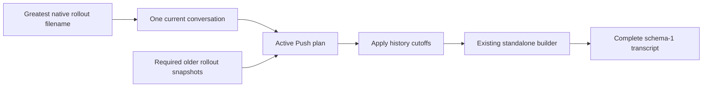

# Codex current and historical rollouts

Date: 2026-09-13. Schema: 1.

Mallard exposes one resource per logical Codex thread. It selects the greatest
native rollout filename, resolves the required history, and emits one complete
standalone transcript through the existing Push builder.

This rule follows the explicit user decision to trust filenames. Mallard does
not read Codex SQLite state. It does not select by file modification time,
file size, or directory traversal order. There is no migration or alternate
execution path.

## Selection rule

The supported native filenames are:

```text
Initial:  rollout-<timestamp>-<thread-id>.jsonl
Reverted: rollout-<timestamp>-<thread-id>_<rollout-id>.jsonl
```

Compare the complete filenames in lexical order. Their fixed-width timestamps
sort first. The suffix breaks a same-second tie. Search both `sessions` and
`archived_sessions`. A duplicate filename in two locations is ambiguous and
blocks that thread. A single installed transcript with a non-native filename
remains valid; multiple non-native filenames cannot establish a selection.

Validate a native filename's logical thread ID against its header. Apply
project ownership and subagent filters to the selected file. Keep the shared
resource-ID uniqueness guard. Unselected rollouts remain available as history
sources and do not create additional resources.

The assumption is deliberate: the greatest filename can differ from the file
Codex selected internally after a failed operation, a manual copy, or clock
changes. Mallard accepts filename order as its selection authority.

## Identity rules

| Identity | Use |
| --- | --- |
| Logical thread ID | Resource ID, conversation binding, metadata checks |
| Physical rollout ID | History lookup, graph cycles, per-file path origins |
| Selected physical path | Current-source capture and freshness checks |

For an initial rollout, the rollout ID equals the thread ID. For a reverted
rollout, the suffix supplies the rollout ID. Preserve the serialized
`history_base.thread_id` field; interpret its value as a physical rollout ID.
Several rollouts can share one logical ID without forming a graph cycle.

## Capture and publication



1. Read the selected current file and required historical files with the
   existing bounded, no-follow snapshot reader.
2. Resolve history with the existing depth, byte, ordinal, and record-boundary
   checks. Capture whole historical files; consume only their referenced
   ranges. Discarded turns after a cutoff stay excluded.
3. Retain resolved roots and source bytes only in the active Push plan.
   Move them into selected publication jobs. Preserve aggregate capture bounds.
4. Use those bytes during encoding. Do not reread historical files or verify
   their live stamps after capture. A later edit or deletion cannot change
   the artifact produced by that plan.
5. Recheck current filename selection and current source stamps. Compare the
   current captured source digest with the reviewed snapshot. Apply current
   selection and stamp checks to current subagents too.
6. Preserve path restoration checks, credential redaction, projection checks,
   publication integrity, stored tail-layout checks, and prefix witnesses.
   Emit paginated standalone metadata with `history_base: null`.

A file can be historical for one conversation and current for another. Its
current role still requires freshness checks.

## Observation cache

Do not put resolved graphs or transcript snapshots in observation evidence or
its disk cache. Cached observations must still match current rollout selection.
Warm child review checks filenames without reading unchanged child bodies.

The existing file-stamp proof remains conservative before active capture:
Observe evidence has no retained historical bytes. Once the Push plan captures
those bytes, publication uses snapshots and checks live stamps only for current
roles. A later plan can read historical files again.

## Schema and trust boundary

Keep machine-local schema 1 and portable schema 1. Do not add manifest fields,
change resource IDs, or change the subagent bundle format. Physical rollout
identity and retained graphs are internal execution state. Existing path-origin
maps use physical source keys so records from different rollouts do not collide.

Historical files are assumed immutable after capture. Mallard deliberately
stops detecting changes to those files during the active plan. This assumption
does not permit incomplete history, bypassed redaction, or publication of bytes
that differ from the verified artifact.

Stored tail partitions and prefix witnesses remain authoritative. A revert
that conflicts with an existing accepted partition must use the existing
blocked/divergence behavior; do not silently reset its checkpoint.

## Verification

Use temporary provider homes and synthetic transcripts. Cover:

- Filename order selects one current resource despite later writes to old files.
- Exact lookup resolves initial and suffixed historical sources.
- Duplicate filenames and filename/header identity conflicts are blocked.
- Several physical rollouts with one logical ID resolve without a false cycle.
- Cutoffs exclude discarded turns; invalid or missing required sources fail.
- Historical edits and deletion after capture leave output bytes unchanged.
- Path-origin reuse across same-thread rollouts preserves output bytes.
- Current source edits and newer current filenames invalidate publication.
- Active Push plans publish from retained history after the old file is removed.
- Existing schema-1 Push, Pull, redaction, and restore tests continue to pass.

Run the infrastructure and backend Rust library suites. No frontend contract
changes or live provider-home tests are required.
