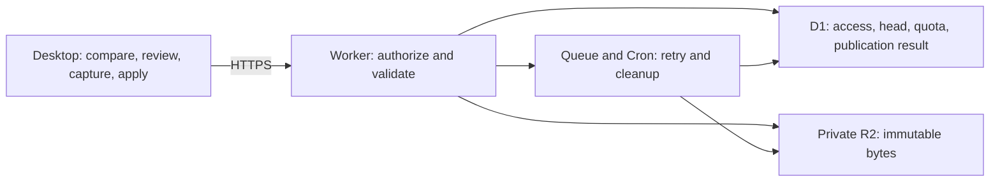

# Managed Cloud plan review

Date: September 8, 2026. Status: Recommendations for review.

Scope: The full [Managed Cloud V1 plan](CLOUDFLARE_R2_MANAGED_CLOUD_ARCHITECTURE_V2.md),
dated September 1. The filename contains V2; the document defines product V1.
This review proposes changes. It does not replace the plan's fixed decisions.

**Recommendation.** Keep the Cloudflare architecture and the full product scope.
Update the contracts, resolve retention and privacy policy, and change the delivery
order before implementation.

The code review used the current working tree, which contains uncommitted changes.
These findings do not establish the state of a released build. The production
[storage registry](../crates/mallard-infrastructure/src/storage_providers/registry.rs)
registers Local, R2, and Dropbox. It has no managed-service adapter.

| Keep | Reason |
| --- | --- |
| Worker API, D1 metadata, private R2 objects | Clear ownership of access, current heads, and stored bytes. |
| Git projects and independent Catalog items | Matches the two product uses. |
| One access boundary per Project or Catalog item | Keeps membership and disclosure explicit. |
| Admin and Member roles | Sufficient for the stated collaboration scope. |
| One current head, immutable history, conditional publication | Prevents a stale writer from replacing a newer publication. |
| Local review and verified Pull | Protects local files and provider state. |
| Git source through Git | Keeps ordinary source-file transport outside managed sync. |
| Public reads limited to the current snapshot | Matches the stated public disclosure boundary. |

The proposed service boundary remains:

**Required plan corrections.**

1. **Use the current portable contracts.** Sections 3.4, 4.3, and 5.5 describe
   approximate formats. Current [project DTOs](../crates/mallard-domain/src/lib.rs)
   use integer timestamps and typed scopes, conversation metadata, wire rules, and
   resource references. The plan specifies RFC 3339 times. Create representative
   serialization fixtures from the Rust types. Make service validators accept and
   reject the same fixtures. Keep service IDs and access metadata in service
   envelopes, outside portable content.

2. **Define the Catalog item projection.** The current
   [Library manifest](../src-tauri/src/storage_catalog/domain.rs) holds a resource
   map under one provider/kind/format coordinate. The managed plan permits exactly
   one item per service repository. Reuse item capture, validators, and local apply
   behavior. Build the managed manifest from the selected item and its referenced
   objects. Uploading the complete Library manifest would cross the planned access
   boundary. Test two local items with different cloud memberships and visibility.

3. **Match the current Compare and Apply flow.** Section 4.4 captures candidates
   during review. Current [project service code](../src-tauri/src/project_sync/service.rs)
   compares first and builds current actions during Apply. Define the managed
   publication context at that boundary. Send approved portable content, head and
   repository revisions, expiry, and acknowledgements. Keep local targets and
   executable apply actions on the machine. Changes outside the approved action or
   warning scope require another review. Public disclosure must cover the exact
   resulting snapshot, including retained content. A server record can bind a
   request to these values; it cannot prove that a person inspected the UI.

4. **Specify the managed publication operation.** The existing
   [ObjectStore contract](../crates/mallard-infrastructure/src/storage_core/object_store.rs)
   supports immutable writes and head compare-and-swap. It does not carry account
   authorization, an upload session, a review digest, or an idempotency key. Add an
   explicit managed publication context and HTTPS finalization call. Keep account
   and review policy outside generic object-key operations. D1 must be the sole
   authority for the managed head.

5. **Prove the D1 commit and cleanup rules.** Section 6.4 lists fourteen final
   actions but does not specify their atomic implementation. Prepare immutable
   bytes and validate bounded content before the final database operation. Seal
   that candidate against further changes. In one atomic operation, recheck access,
   revisions, expiry, and quota; then commit the publication and its retry result.
   A failed head comparison must prevent every dependent write. D1 batches roll
   back on statement errors; an UPDATE that matches zero rows is not an error.
   This requires explicit SQL guards.
   [D1 batches](https://developers.cloudflare.com/d1/worker-api/d1-database/),
   [SQLite UPDATE](https://www.sqlite.org/lang_update.html).

   Cleanup also needs a database claim that excludes publication of the claimed
   objects. Publication must reject objects marked for deletion. Complete or retry
   deletion before permitting reuse of that object coordinate. A check followed by
   an unguarded R2 delete can race with publication. Test this race and crashes on
   both sides of the D1 commit.

6. **Define object access through publications.** Store the relationship between
   each accepted publication and its objects. Determine public object access from
   the current head's publication. A deduplicated object can occur in both current
   and historical snapshots; a single object-level status does not describe those
   relationships. Use current primary data for membership and visibility checks.
   D1 uses the primary unless the Sessions API enables replica reads. Preserve that
   property for authorization.
   [D1 sessions](https://developers.cloudflare.com/d1/worker-api/d1-database/).

7. **Set measured cloud limits.** The current conversation-file limit is 100 MiB.
   Cloudflare documents a 100 MB request limit on Free and Pro account plans and
   128 MB of memory per Worker isolate. A paid Workers plan alone does not increase
   the request-body limit. Specify object bytes, manifest bytes, object count,
   upload concurrency, and publication limits. Verify the maximum supported object
   on the selected deployment plan. Choose an explicit rejection limit or bounded
   multipart transfer if needed. Never truncate a conversation to fit.
   [Workers limits](https://developers.cloudflare.com/workers/platform/limits/).

   Stream transfers. R2 accepts a stream, conditional writes, and an expected
   SHA-256 checksum. Use these capabilities for upload verification.
   [R2 API](https://developers.cloudflare.com/r2/api/workers/workers-api-reference/).
   Keep final D1 work bounded; its documented batch duration limit is 30 seconds.
   [D1 limits](https://developers.cloudflare.com/d1/platform/limits/).

8. **Make the privacy contract precise.** The plan deliberately permits service
   operators to read stored content. Private visibility controls API access.
   Current [credential redaction](../crates/mallard-infrastructure/src/credential_redaction.rs)
   can be disabled and records that mode in portable metadata. Decide whether
   managed private publication accepts that mode. Define the corresponding public
   disclosure rule. Excluding source files and structural local paths does not
   remove code excerpts or path text from conversations. State these limits in
   review. Keep secret detection described as best-effort.

9. **Revisit permanent retention.** Sections 2.7 and 11.1 retain every accepted
   publication, prohibit repository removal, and stop publication at a hard quota.
   This leaves no product path to remove an accidental upload or reclaim accepted
   storage. Keep ordinary Push and Pull free of resource deletion. Recommend a
   separate, controlled repository-removal operation before external private beta.
   Specify authority, recent authentication, write suspension, confirmation,
   retention, erasure, and audit. This would change a fixed V1 decision and needs
   an explicit product decision.

10. **Complete identity and invitation flows.** Sections 8.1 and 9.1 need distinct
    provider callbacks, desktop code exchange, recent authentication, and device
    session revocation. GitHub redirects the browser with code and state; the
    listed POST callback alone does not define that flow. Use stable provider
    identity for accounts and verified email for invitation matching. Define
    account linking explicitly.
    [GitHub OAuth](https://docs.github.com/en/apps/oauth-apps/building-oauth-apps/authorizing-oauth-apps),
    [Native-app OAuth](https://www.rfc-editor.org/rfc/rfc8252).

    The invitation plan stores only a token hash and also promises delivery retry.
    Specify how retry works after a crash or an uncertain email result. Do not
    assume that the raw token can be recovered from its hash. Define reissue and
    revocation behavior. Queue consumers must tolerate duplicate delivery.
    [Queue delivery](https://developers.cloudflare.com/queues/reference/delivery-guarantees/).

11. **Define quota ownership and recovery early.** State which account bears each
    repository's usage and how that responsibility transfers when an Admin leaves.
    Define charges for reused objects, metadata, retained history, staging, and
    exports. Measure a representative sync workload and set a service budget.
    Repository membership must not multiply the same byte charge by accident.

    Add basic monitoring, cleanup, and restore tests with the first private write
    path. D1 recovery restores database state within a bounded time window. The
    plan must also recover R2 bytes and access state. Keep serving disabled until
    recovered heads and access state pass verification. Test that recovery cannot
    silently restore revoked sessions or outdated public visibility.
    [D1 recovery](https://developers.cloudflare.com/d1/reference/time-travel/).

**Proposed delivery order.** All V1 features remain in scope.

| Step | Working result | Required evidence |
| --- | --- | --- |
| 0. Contracts and publication | Synthetic client publishes one verified private snapshot | One winner for concurrent writes; rejected writer has no committed side effects; retry returns one result; cleanup cannot delete accepted bytes |
| 1. Private project sync | One user moves Codex and Claude state between two isolated homes | Browser login, keychain session, reviewed Push/Pull, fresh-action checks, history, limits, basic export and restore |
| 2. Collaboration | Two users share one private project | Invitations, Admin/Member changes, last-Admin rule, revocation during upload, and authorization on retry |
| 3. Private Catalog | Independent skills, plugin intent, and pets | One item per repository; no sibling-item disclosure; provider-specific local apply |
| 4. Public sharing | Public projects and items, discovery, featured examples | Exact disclosure review, current-snapshot access, and immediate denial of later reads after privacy changes |
| 5. Release operations | Full V1 can enter external beta | Retention decision complete; quota ownership defined; recovery, duplicate jobs, abuse limits, and full Tauri flows verified |

**Decisions to resolve.**

| Decision | Recommendation |
| --- | --- |
| Full V1 scope | Keep it. Prove private sync before public discovery. |
| Application encryption | Keep the stated V1 choice. Describe operator access clearly. |
| Repository removal | Add a separate controlled operation before external private beta. |
| Disabled credential redaction | Define private acceptance and public disclosure before managed writes. |
| Cloud limits and account quotas | Set numeric limits and ownership rules from the deployment test. |

Verification for this review: source inspection and current official platform
documentation. No application code changed. No runtime tests or deployments ran.
