# Mallard full application UI audit

Date: 2026-08-30
Audited code: current working tree, base commit `f325a63`
Application version: `0.1.2`

## Executive result

Mallard has a coherent desktop visual system and a strong review-first safety model. The main project, storage, Catalog, and settings flows are understandable after the user learns the product model.

The application is not ready for a broad accessibility or narrow-window sign-off. Three confirmed defects have high accessibility impact:

1. The closed Logs drawer leaves invisible controls in the Tab order.
2. Several portalled details popovers do not move focus into their content.
3. The muted text token does not meet minimum contrast for normal text in either theme.

The main product usability risks are also structural. The Sessions/Files switch is hidden in a breadcrumb. The primary navigation repeats the same Projects, Catalog, and Storages concepts with different behavior. Review pages expose duplicate commit actions. The narrow workspace removes the Push and Pull labels before lower-priority content.

No critical data-loss defect was found in the reviewed UI. The audit found 8 high, 15 medium, and 5 low findings. Fix the high findings before an external release. Then run the native runtime checks in [Runtime verification](#runtime-verification).

## Scope and method

The source audit covered the production entry point and every production surface mounted by `ProjectSync`. Browser captures cover representative primary flows, not every production state. The audit excluded standalone mockup files that the production entry point does not import.

Evidence came from four sources:

- Current production React and CSS source.
- The complete frontend integration suite.
- In-app browser inspection at 1280 × 720 and 800 × 560.
- Representative local IPC fixtures that exercised the current production UI without reading or changing real Codex, Claude, Mallard, local-folder, or cloud state.

Capture 01 is the actual Vite-only backend-unavailable state. Captures 02–16 use the current production React tree and CSS with representative local IPC responses. Native OS dialogs, cloud connections, provider launches, VoiceOver output, system text scaling, forced-colors mode, and real Tauri focus behavior were not exercised.

## Surface health

| Step | Surface | Health | Audit result |
|---:|---|---|---|
| 1 | Startup and recovery | Good with one limit | Startup has named progress and a clear Retry state. The Vite-only failure exposes a raw JavaScript error string. Native startup recovery still needs a Tauri run. |
| 2 | Shell and sidebar | Needs repair | The shell is consistent and resizable. Primary destinations repeat the section names, persistent sidebar current-page semantics are missing, and narrow content can become too small. |
| 3 | Empty and first-use states | Needs repair | Sidebar actions are clear. The main empty Projects pane says to select a completed project instead of leading with the first project action. |
| 4 | Project setup and agent binding | Good with concerns | Draft setup is direct and autosaves. Custom radios, failure recovery, and terminology need repair. |
| 5 | Project Activity | Good with concerns | The commit rail and sync states are compact and useful. Status, metadata, and icon density increase learning and reading cost. |
| 6 | Non-Git Files | Needs repair | File states and safety warnings are clear. The Files view is hard to discover because its switch is in the breadcrumb. Scan failure has no Retry beside the error; the rescan action stays in the path bar. |
| 7 | Session detail | Good with concerns | The timeline structure, event filtering, and empty states are strong. The visible title lives only in chrome, and key actions are icon-heavy. |
| 8 | Project Push | Needs repair | Recommended selection and held-for-Pull states are clear. Duplicate commit controls and weak file-deletion impact cues reduce review confidence. |
| 9 | Project Pull | Needs repair | Plan-based selection and keep-both handling are strong. File deletion impact and duplicate commit controls need repair. |
| 10 | Storages | Needs repair | Local and R2 setup provide useful guidance. R2 can finish without a successful test, and validation feedback is incomplete. Clear-data confirmation correctly names removed and retained data. |
| 11 | Catalog | Good with concerns | Local, stored, divergent, and blocked states are clear. Add-flow recovery and details-popover keyboard access need repair. |
| 12 | Settings | Good with concerns | Grouping and privacy copy are strong. The page has no `h1`, and successful saves have no receipt. |
| 13 | Logs | At risk | Filtering and retained history are useful. Closed controls remain tabbable, the resize handle is mouse-only, and the drawer lacks complete region and focus behavior. |
| 14 | Themes and compact window | At risk | Both themes use one coherent palette. Muted text contrast fails. At 800 × 560, the sidebar dominates width and Push/Pull become icon-only. |

### Source-reviewed supporting flows

These production flows were source-reviewed but do not have an accepted browser capture in this report.

| Flow | Health | Audit result | Evidence |
|---|---|---|---|
| Conversation-path repair and sync gating | Good | The notice scopes the path problem, blocks unsafe sync, and offers a repair only when the backend says repair is safe. | [ConversationPathRepairNotice.tsx](../../../src/components/project-sync/ConversationPathRepairNotice.tsx#L24) |
| Repository linking and sibling convergence | Good with concerns | Native modal behavior is strong. Recommended matches, mismatch notices, and sibling warnings are explicit. Repo/repository terminology remains confusing. | [BundleConnectionDialog.tsx](../../../src/components/project-sync/BundleConnectionDialog.tsx#L86), [SiblingRepoNotice.tsx](../../../src/components/project-sync/SiblingRepoNotice.tsx#L15) |
| Completed and partial sync outcomes | Good | One expandable outcome notice reports success, warnings, per-item results, follow-up action, and dismissal. | [SyncOutcomeNotice.tsx](../../../src/components/project-sync/SyncOutcomeNotice.tsx#L47) |
| Catalog Fork drawer | Good with concerns | The drawer keeps the duplicate-name action close to the resource. Its runtime success, failure, and focus behavior still need browser verification. | [StorageCatalogPage.tsx](../../../src/components/storage-catalog/StorageCatalogPage.tsx#L328) |
| Uncaptured primary states | Source-reviewed | Session detail, Agent binding, Storages index and drafts, R2 creation and agent setup, Add Catalog, Pull project files, startup progress, native dialogs, and outcome states were included in source and test review. | [SessionDetailPage.tsx](../../../src/components/project-sync/session-detail/SessionDetailPage.tsx#L79), [ProjectBindingEditor.tsx](../../../src/components/project-sync/ProjectBindingEditor.tsx#L253), [StorageIndexPage.tsx](../../../src/components/project-sync/StorageIndexPage.tsx#L42), [AddCatalogScopeWorkspace.tsx](../../../src/components/storage-catalog/AddCatalogScopeWorkspace.tsx#L198), [RestorePlanView.tsx](../../../src/components/project-sync/RestorePlanView.tsx#L573) |

## What works well

1. The visual language is coherent. Warm surfaces, thin borders, pixel-style headings, quiet cards, and one semantic signal palette make the app feel like one product.
2. Review safety defaults are strong. Project files do not enter Pull selection by default. Credential-shaped and executable content require deliberate review.
3. Push and Pull are plan-based. The UI distinguishes preparation, selection, progress, completion, partial completion, and recovery.
4. Notices have a shared contract. They show severity in text and use standing, polite, or assertive announcement behavior by state.
5. Loading scaffolds avoid immediate flicker and preserve the final layout shape.
6. Project Activity keeps stale content after some refresh failures and offers Retry. Session detail and Catalog use similar recovery patterns.
7. Native modal dialogs use `showModal`, an accessible label, cancel handling, and browser-provided modal focus behavior.
8. Review tabs implement the expected tablist, roving focus, Arrow, Home, and End keyboard behavior.
9. The path-bar menu has deliberate keyboard navigation, typeahead, outside-click handling, and disabled reasons.
10. Sidebar resize controls use pointer and keyboard input and expose minimum, maximum, and current values.
11. Privacy copy is direct. Credential redaction is marked as always on and explains when redaction happens.
12. Reduced-motion rules are broad. Skeleton decoration is hidden from assistive technology.

## Findings

### High priority

#### H01 — Closed Logs controls remain in the Tab order

The Logs drawer closes through `height: 0` and clipped overflow. `LogPanel` stays mounted. Its summary, checkboxes, select, search box, and buttons remain focusable but invisible. The Logs trigger also lacks `aria-controls`, and the drawer has no labelled region or focus restoration contract.

Evidence: [App.css](../../../src/App.css#L467), [ProjectSync.tsx](../../../src/components/project-sync/ProjectSync.tsx#L3921), [LogPanel.tsx](../../../src/components/LogPanel.tsx#L237), and capture 12.

Repair: Unmount the panel while closed, or apply `hidden` or `inert` plus `aria-hidden`. Give the drawer an ID and labelled region. Connect the trigger with `aria-controls`. Move focus into the drawer on open and restore the trigger on close.

#### H02 — Portalled details popovers do not establish keyboard focus

File details, session debug details, and the Catalog info panel render at the end of `document.body`. Opening them does not focus the panel or first action. File details and session debug close when focus moves outside, so Tab can close them before their portalled actions are reached. Catalog Info stays open, but focus remains on the trigger and its actions appear late in the document Tab order. Catalog copy-result changes are not announced.

Evidence: [TopLayer.tsx](../../../src/components/sync-review/TopLayer.tsx#L15), [ProjectFileDetailsMenu.tsx](../../../src/components/project-sync/ProjectFileDetailsMenu.tsx#L69), [ProjectActivityPage.tsx](../../../src/components/project-sync/ProjectActivityPage.tsx#L858), and [StorageCatalogPage.tsx](../../../src/components/storage-catalog/StorageCatalogPage.tsx#L201).

Repair: Focus the panel heading or first action on open. Retain and restore the opening trigger. Add `aria-controls` to Catalog Info; the file and session triggers already have it. Keep focus-out dismissal only after focus enters the panel. Announce copy results with a polite status.

#### H03 — Muted normal text fails minimum contrast

The dark `--text-3` token is about 3.64–3.77:1 on common surfaces. The light token is about 3.25–3.41:1. Both are below 4.5:1 for normal text. The token appears in meaningful 9–10 px descriptions, identifiers, timestamps, metadata, and placeholders.

Evidence: [dark theme token](../../../src/App.css#L7743), [light theme token](../../../src/App.css#L7858), [meaningful metadata use](../../../src/App.css#L5155), [project-file metadata](../../../src/App.css#L6129), and [placeholder note](../../../src/App.css#L8292).

Repair: Use at least `--text-2` for meaningful text and placeholders. Reserve `--text-3` for nonessential graphical content. Recheck all selectors in both themes.

#### H04 — The Sessions/Files switch is hidden in a breadcrumb

For a non-Git project, the breadcrumb leaf is also the view switch. It looks like location text, not page navigation. A user can miss the Files view.

Evidence: [ProjectLinksWorkspace.tsx](../../../src/components/project-sync/ProjectLinksWorkspace.tsx#L2477), [SyncPathBar.tsx](../../../src/components/sync-review/SyncPathBar.tsx#L416), and captures 02–05.

Repair: Add an explicit `Sessions | Files` tab or segmented control next to the project context. Keep the breadcrumb location-only.

#### H05 — Primary navigation repeats destinations with different behavior

The top navigation has Projects, Catalog, and Storages buttons. The sidebar immediately repeats Projects, Catalog, and Storages as section headings and rows. The top buttons do not have one predictable destination. Projects can reopen the active project or appear to do nothing. Catalog and Storages can open an item instead of their index.

Evidence: [ProjectSidebar.tsx](../../../src/components/project-sync/ProjectSidebar.tsx#L683), [ProjectSidebar.tsx](../../../src/components/project-sync/ProjectSidebar.tsx#L757), and [StorageIndexPage.tsx](../../../src/components/project-sync/StorageIndexPage.tsx#L42).

Repair: Give each top-level button one stable index page. Keep rows as object navigation. Remove duplicate section affordances that do not add a distinct function.

#### H06 — Project-file deletion impact is too weak at commit

Project-file review can include file and directory deletion, but the final action does not show a deletion count or require a deletion-specific acknowledgement. Catalog overwrite has a stronger precedent. The separate clear-storage confirmation is not part of this finding; it already names the exact storage, removed data, retained data, permanence, and lack of undo.

Evidence: [project-file decision model](../../../src/components/project-sync/ProjectFilesReviewPage.tsx#L320), [Push commit control](../../../src/components/project-sync/PushResourceWorkspace.tsx#L713), [Pull commit control](../../../src/components/project-sync/RestorePlanView.tsx#L609), [Catalog destructive acknowledgement](../../../src/components/storage-catalog/StorageCatalogPage.tsx#L1724), and [clear-storage confirmation precedent](../../../src/components/project-sync/ProjectSync.tsx#L3275).

Repair: Show add, replace, delete-file, and delete-directory counts beside the project commit action. Require a focused acknowledgement when any deletion is selected.

#### H07 — Narrow workspace rules hide safety-critical action labels

The sidebar can leave the workspace at about 420 px. At narrow widths, the path bar removes the Push and Pull text and compresses ancestor names. The 800 × 560 capture shows learned icons in place of the two main data-moving verbs.

Evidence: [workspace minimum](../../../src/components/project-sync/ProjectSync.tsx#L184), [label removal](../../../src/App.css#L2941), [additional path compression](../../../src/App.css#L2979), and capture 15.

Repair: Preserve the words “Push” and “Pull.” Collapse refresh, attention detail, branch width, or overflow content first. Use container queries for the actual workspace width. Auto-reduce the sidebar when content reaches a safe minimum.

#### H08 — Missing-profile recovery gives the wrong next step

The missing-profile Activity state tells the user to remove and add the project. The project menu already exposes an Agent profile action. The current message sends the user through a larger and riskier flow.

Evidence: [ProjectActivityPage.tsx](../../../src/components/project-sync/ProjectActivityPage.tsx#L1747) and [ProjectLinksWorkspace.tsx](../../../src/components/project-sync/ProjectLinksWorkspace.tsx#L2392).

Repair: Add a direct “Choose Agent profile” action. Keep remove-and-add as a last recovery path only if profile repair fails.

### Medium priority

#### M01 — The Logs resize separator is mouse-only

The horizontal separator has a mouse-down handler and double-click reset. It has no keyboard focus, value attributes, or Arrow/Home/End behavior. The main sidebar separator already provides the correct pattern.

Evidence: [ProjectSync.tsx](../../../src/components/project-sync/ProjectSync.tsx#L744) and [ProjectSync.tsx](../../../src/components/project-sync/ProjectSync.tsx#L3925).

Repair: Reuse the sidebar separator contract. Add focus, values, Arrow Up/Down, Home, End, and pointer events.

#### M02 — Custom radio groups do not implement radio keyboard behavior

Catalog kind, repository choice, storage type, and theme controls use `role="radio"` buttons. Each button stays in the Tab order. The groups do not support the four Arrow keys.

Evidence: [AddCatalogScopeWorkspace.tsx](../../../src/components/storage-catalog/AddCatalogScopeWorkspace.tsx#L228), [BundleConnectionDialog.tsx](../../../src/components/project-sync/BundleConnectionDialog.tsx#L123), [ProjectSetupWorkspace.tsx](../../../src/components/project-sync/ProjectSetupWorkspace.tsx#L905), [StorageSettings.tsx](../../../src/components/project-sync/StorageSettings.tsx#L230), and [SettingsPage.tsx](../../../src/components/project-sync/SettingsPage.tsx#L391).

Repair: Prefer native radio inputs in a fieldset. If buttons stay, use roving `tabIndex`, Space, and the four Arrow keys.

#### M03 — Two menu-button patterns omit focus movement and keyboard navigation

The app-actions menu and storage agent-setup menu do not focus a menu item on open. They do not support Arrow, Home, or End. Escape does not provide a complete focus-restoration contract. The shared path menu is better, but Enter or Space still opens it without moving focus.

Evidence: [ProjectSync.tsx](../../../src/components/project-sync/ProjectSync.tsx#L1381), [ProjectSync.tsx](../../../src/components/project-sync/ProjectSync.tsx#L2806), [ProjectLinksWorkspace.tsx](../../../src/components/project-sync/ProjectLinksWorkspace.tsx#L2027), and [SyncPathBar.tsx](../../../src/components/sync-review/SyncPathBar.tsx#L141).

Repair: Centralize all menus on one complete menu-button primitive. Move focus on every open method. Restore focus on Escape and close.

#### M04 — Two custom focus indicators do not reach 3:1 contrast

Thread sync indicators and metric readouts remove the global focus outline. Their translucent replacement falls below 3:1 in light mode. The sync indicator also falls below 3:1 in dark mode.

Evidence: [App.css](../../../src/App.css#L5012), [App.css](../../../src/App.css#L5083), [App.css](../../../src/App.css#L5173), and [App.css](../../../src/App.css#L5254).

Repair: Keep the opaque global focus ring or use an opaque replacement with at least 3:1 contrast against adjacent colors.

#### M05 — Most main views lack a complete page-orientation contract

Settings, Storages, Catalog list, and Catalog reviews do not have a page-level `h1`. Persistent sidebar destinations and selected project, Catalog, and storage rows use CSS only and do not expose `aria-current`. The path bar already marks its current noninteractive leaf. Most route changes do not update the window title or move focus to the new page heading. Session detail already shows the stronger pattern.

Evidence: [SettingsPage.tsx](../../../src/components/project-sync/SettingsPage.tsx#L372), [StorageIndexPage.tsx](../../../src/components/project-sync/StorageIndexPage.tsx#L43), [StorageCatalogPage.tsx](../../../src/components/storage-catalog/StorageCatalogPage.tsx#L1455), [ProjectSidebar.tsx](../../../src/components/project-sync/ProjectSidebar.tsx#L698), and [SessionDetailPage.tsx](../../../src/components/project-sync/session-detail/SessionDetailPage.tsx#L194).

Repair: Give each main view one `h1`, visible or visually hidden. Apply `aria-current` to the persistent sidebar destination and selected object. Update the window title. Move focus to the new heading or main region after user navigation.

#### M06 — Storage setup can block completion without identifying invalid fields

The R2 readiness rules validate the endpoint, bucket, account ID, credentials, and path. Only the combined S3 URL exposes `aria-invalid`. The other fields can keep Test and Finish disabled without a field-specific error or format instruction. The Catalog custom path has a similar gap.

Evidence: [StorageSettings.tsx](../../../src/components/project-sync/StorageSettings.tsx#L104), [StorageSettings.tsx](../../../src/components/project-sync/StorageSettings.tsx#L330), [ProjectLinksWorkspace.tsx](../../../src/components/project-sync/ProjectLinksWorkspace.tsx#L2177), and [AddCatalogScopeWorkspace.tsx](../../../src/components/storage-catalog/AddCatalogScopeWorkspace.tsx#L304).

Repair: Validate after blur or attempted completion. Add `aria-invalid`, `aria-describedby`, format instructions, and a concise error summary.

#### M07 — Product terminology is inconsistent

The UI mixes “repo,” “repository,” “thread,” “session,” “resource,” and “Catalog resource.” In one dialog, a Git repository and Mallard remote identity can both be called a repo. Settings changes between thread and session for the same user concept.

Evidence: [BundleConnectionDialog.tsx](../../../src/components/project-sync/BundleConnectionDialog.tsx#L96), [ProjectSetupWorkspace.tsx](../../../src/components/project-sync/ProjectSetupWorkspace.tsx#L883), [terminology.ts](../../../src/terminology.ts#L1), [SettingsPage.tsx](../../../src/components/project-sync/SettingsPage.tsx#L455), and [AddCatalogScopeWorkspace.tsx](../../../src/components/storage-catalog/AddCatalogScopeWorkspace.tsx#L198).

Repair: Use “Git repository” for Git, one distinct term such as “sync repository” for Mallard identity, “session” for provider activity, “Catalog group” for kind-plus-profile scope, and “resource” only for individual skills, pets, and plugin intents.

#### M08 — Entry-state recovery is inconsistent

Activity, session detail, Settings, and Catalog list have good Retry patterns. Setup draft load failure and Add Catalog load failure render an error without a local Retry. Files scan failure has no Retry beside the error; a rescan action remains in the path bar. Add Catalog also lacks a clear initial loading state.

Evidence: [ProjectSetupWorkspace.tsx](../../../src/components/project-sync/ProjectSetupWorkspace.tsx#L541), [AddCatalogScopeWorkspace.tsx](../../../src/components/storage-catalog/AddCatalogScopeWorkspace.tsx#L67), [AddCatalogScopeWorkspace.tsx](../../../src/components/storage-catalog/AddCatalogScopeWorkspace.tsx#L345), [ProjectFilesActivityPage.tsx](../../../src/components/project-sync/ProjectFilesActivityPage.tsx#L244), and [Files path-bar rescan](../../../src/components/project-sync/ProjectLinksWorkspace.tsx#L2530).

Repair: Standardize one entry-state component with a title, error detail, Retry, and safe exit. Add explicit loading to Add Catalog.

#### M09 — R2 setup can finish without a successful connection test

Test connection and Finish use the same field-readiness gate. The UI does not say that the test is optional. A complete but untested configuration can be saved.

Evidence: [ProjectLinksWorkspace.tsx](../../../src/components/project-sync/ProjectLinksWorkspace.tsx#L2151), [ProjectLinksWorkspace.tsx](../../../src/components/project-sync/ProjectLinksWorkspace.tsx#L2176), and [ProjectLinksWorkspace.tsx](../../../src/components/project-sync/ProjectLinksWorkspace.tsx#L2186).

Repair: Require a fresh successful test before Finish, or state that the test is optional and warn on untested completion. Invalidate the receipt when a relevant field changes.

#### M10 — Reviews expose duplicate commit actions

When a project or Catalog review is open, the path-bar Push or Pull action can commit the selection. The footer has a second commit action. The project footer and Catalog footer also use different count formats.

Evidence: [ProjectLinksWorkspace.tsx](../../../src/components/project-sync/ProjectLinksWorkspace.tsx#L2587), [RestorePlanView.tsx](../../../src/components/project-sync/RestorePlanView.tsx#L609), [PushResourceWorkspace.tsx](../../../src/components/project-sync/PushResourceWorkspace.tsx#L750), and [StorageCatalogPage.tsx](../../../src/components/storage-catalog/StorageCatalogPage.tsx#L1588).

Repair: Keep one sticky commit control. If the path-bar action stays, use it to focus the review. Use one count and impact format on project and Catalog reviews.

#### M11 — Session detail is too dependent on icon-only chrome

The visible session title exists only in the path bar. The in-page `h1` is visually hidden. Facts form a dense icon strip. Provider and terminal actions are icon-only at normal widths.

Evidence: [SessionDetailHeader.tsx](../../../src/components/project-sync/session-detail/SessionDetailHeader.tsx#L36), [SessionDetailHeader.tsx](../../../src/components/project-sync/session-detail/SessionDetailHeader.tsx#L54), and [SessionDetailHeader.tsx](../../../src/components/project-sync/session-detail/SessionDetailHeader.tsx#L91).

Repair: Show the title in the content area when space allows. Show action labels at normal widths or place the actions in a named menu. Test long titles and branches at the narrow workspace floor.

#### M12 — The default type scale is too small for important metadata

Body text is 13 px. Many meaningful labels, counts, identifiers, and lineage values use 9–10 px. The scale uses `rem`, which is good, but the default still creates reading strain and combines badly with muted contrast.

Evidence: [type scale](../../../src/App.css#L7618), [body size](../../../src/App.css#L7922), [small uppercase labels](../../../src/App.css#L7996), and [review counts](../../../src/App.css#L8040).

Repair: Set an 11–12 px floor for normal metadata. Reserve 9–10 px for short, nonessential marks. Recheck line height and wrapping.

#### M13 — Zoom and text-resize reflow are at high risk

Root overflow is clipped. The sidebar has a fixed 220 px minimum. Several text-bearing controls use fixed pixel heights. At large text size or 400% zoom, text can outgrow controls and the sidebar can consume most of the effective viewport.

Evidence: [root overflow](../../../src/App.css#L7), [application overflow](../../../src/App.css#L775), [sidebar minimum](../../../src/components/project-sync/ProjectSync.tsx#L187), [storage control height](../../../src/App.css#L2039), and [primary navigation height](../../../src/App.css#L8416).

Repair: Replace fixed heights with content-driven `min-height`. Allow required wrapping. Add a narrow-mode shell that does not depend on the user finding the sidebar toggle.

#### M14 — Delayed loading content is not announced as a status

`LoadingScaffold` inserts a named `role="region"` after 150 ms. A named region is discoverable, but it is not normally announced as a status change. This matters because most route changes also do not move focus to a new heading.

Evidence: [LoadingScaffold.tsx](../../../src/components/LoadingScaffold.tsx#L107), [StorageCatalogPage.tsx](../../../src/components/storage-catalog/StorageCatalogPage.tsx#L1853), and [ProjectActivityPage.tsx](../../../src/components/project-sync/ProjectActivityPage.tsx#L1757).

Repair: Keep the named region, add a polite status for user-initiated loads, and set `aria-busy` on the affected main region.

#### M15 — The fresh-install main pane has no primary first action

On a fresh install, the sidebar offers “Add your first project,” “Add your first resource,” and “Add your first storage.” The main Projects pane only says “Select a completed project to view its Codex history.” There is no project to select and no primary action in the dominant content area.

Evidence: [ProjectLinksWorkspace.tsx](../../../src/components/project-sync/ProjectLinksWorkspace.tsx#L2224) and capture 14.

Repair: Replace the empty instruction with a short first-use explanation and one primary “Add project” action. Keep Catalog and storage as later supporting steps.

### Low priority

#### L01 — Logs naming and empty-state copy are inconsistent

The sidebar and Settings use “Logs.” The drawer title is lowercase “log.” A genuinely empty log still says that no entries match the filters.

Evidence: [LogPanel.tsx](../../../src/components/LogPanel.tsx#L237), [LogPanel.tsx](../../../src/components/LogPanel.tsx#L360), and [ProjectSidebar.tsx](../../../src/components/project-sync/ProjectSidebar.tsx#L731).

Repair: Use “Logs” everywhere. Distinguish “No activity logged yet” from “No logs match these filters.”

#### L02 — Successful Settings changes have no save receipt

Backend-backed settings save on change. A disabled control can show pending work, but success has no short confirmation.

Evidence: [SettingsPage.tsx](../../../src/components/project-sync/SettingsPage.tsx#L175) and [SettingsPage.tsx](../../../src/components/project-sync/SettingsPage.tsx#L318).

Repair: Show compact `Saving…` and `Saved` feedback per settings group. On failure, identify the last confirmed value.

#### L03 — Similar segmented controls use separate visual patterns

Storage type and theme selection have separate heights, radii, padding, and type sizes.

Evidence: [storage segmented control](../../../src/App.css#L2039) and [theme segmented control](../../../src/App.css#L4150).

Repair: Use one segmented-control primitive with size variants and one focus, disabled, hover, and selected contract.

#### L04 — One overview count has incorrect pluralization

The project overview always renders `{n} storage`, including zero and plural values.

Evidence: [ProjectLinksWorkspace.tsx](../../../src/components/project-sync/ProjectLinksWorkspace.tsx#L2722).

Repair: Use singular and plural labels based on the count.

#### L05 — Several pointer targets need runtime measurement

Notice dismiss and debug actions are 22 × 22 px. The sidebar and Logs resize targets are 7 px and 8 px thick. Some controls can depend on the exact WCAG spacing exception.

Evidence: [notice dismiss](../../../src/App.css#L1412), [debug action](../../../src/App.css#L5305), [sidebar resize target](../../../src/App.css#L8609), and [Logs resize target](../../../src/App.css#L482).

Repair: Use at least a 24 × 24 px interaction box. Increase motor-accessible hit areas for resize handles. Measure rendered spacing before release.

## Recommended repair order

1. Fix hidden Logs focus and all portalled popover focus behavior.
2. Replace or restrict `--text-3`, then verify contrast in both themes.
3. Make Sessions and Files explicit. Give Projects, Catalog, and Storages stable index destinations.
4. Strengthen file-deletion impact review. Keep one commit action.
5. Preserve Push and Pull labels. Add container-based compact layouts and a safe sidebar response.
6. Standardize headings, `aria-current`, focus-on-navigation, radio groups, menus, separators, validation, and loading announcements.
7. Normalize terminology, retry states, Settings receipts, and small copy defects.
8. Run the native accessibility and reflow checks below.

## Runtime verification

The following checks need the complete Tauri application with temporary provider homes and Mallard state:

1. Keyboard-only cold start. Tab with Logs closed. Open and close Logs. Verify focus entry and restoration. Open every details popover and menu with Enter and Space. Test Arrow, Home, End, Tab, and Escape.
2. VoiceOver. Verify route changes, current destination, current object, loading, retry, copy, validation, success, and completion announcements.
3. Reflow. Test 200% text size and 400% WebView zoom at the minimum window size. Test with the sidebar visible and hidden. Use long project, branch, storage, profile, and resource names.
4. Visual states. Check both themes, hover, focus, selected, disabled, warning, error, placeholder, metadata, and forced-colors mode.
5. Pointer targets. Measure target boxes and spacing. Test both resize handles with a trackpad and reduced dexterity.
6. Reduced motion. Confirm that startup, refresh, and transfer states remain understandable without spinner movement.
7. Native flows. Verify folder pickers, destructive confirmations, quit-during-sync, repository linking, provider launch, R2 test/finish, sync progress, partial results, and recovery.

### Required screenshot-state plan

Capture these states during the native verification pass:

1. Startup progress, host recovery, and first-install empty state.
2. Missing Agent profile with the direct recovery route and conversation-path repair gating.
3. Session detail with a long title, active state, empty timeline, filtered empty state, tool payload, and load failure.
4. Files scan failure with the path-bar rescan visible.
5. Push and Pull project-file reviews with delete-file and delete-directory actions selected, before and after acknowledgement.
6. Repository linking for recommended match, mismatch, sibling repository, and missing repository.
7. Storages index with no storage, multiple storages, issue badges, and a resumable draft.
8. R2 setup for invalid fields, untested ready state, failed test, successful test, and attempted untested Finish.
9. Add Catalog loading, load failure, existing profile, custom path, and invalid path.
10. Catalog Fork open, success, and failure.
11. Settings save pending, success, and failure.
12. Logs genuinely empty, filtered empty, loading older entries, load failure, and maximum practical drawer height.
13. Sync success, partial success, failure, and recovery-required outcomes.
14. Both themes at the minimum window, 200% text size, 400% zoom, reduced motion, and long names.

## Verification completed

| Check | Result |
|---|---|
| `npm run build` | Pass. Vite reported the existing warning for a JavaScript chunk over 500 kB. |
| `npm run test:frontend-integration` | Pass: 251 of 251 tests. |
| Dark theme at 1280 × 720 | Inspected across startup failure, project, files, Push, Pull, storage, Catalog, settings, setup, empty state, and Logs. |
| Light theme at 1280 × 720 | Inspected on project Activity. Source tokens and theme-specific contrast were reviewed across the application. |
| Compact window at 800 × 560 | Inspected with the sidebar open. Path compression and action-label loss are visible. |
| Native Tauri, VoiceOver, forced colors, 200% text, and 400% zoom | Not run. See [Runtime verification](#runtime-verification). |

The frontend tests contain substantial static rendering and source-contract coverage. They are not a browser end-to-end suite. The UI audit did not run Rust tests because it made no production code or Tauri contract changes.

## Screenshot evidence

### 01 — Actual Vite-only host identity failure

The state is focused and recoverable. The raw JavaScript failure string is implementation-level copy.

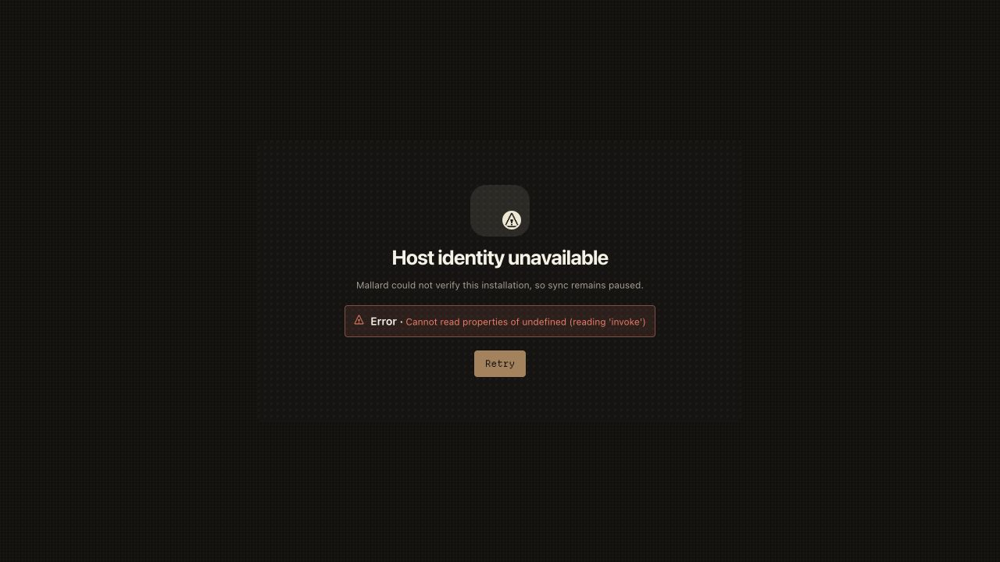

### 02 — Project Activity, dark theme

The commit rail and sync states are compact. The large unused canvas increases the sidebar’s visual weight.

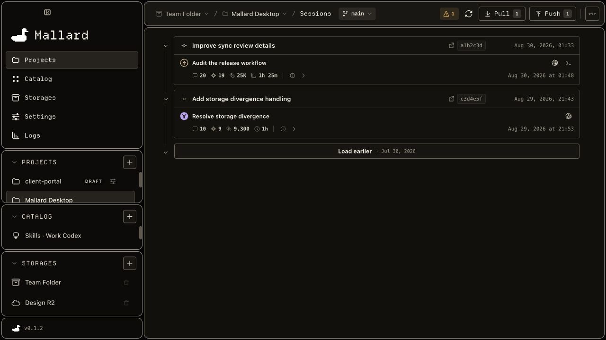

### 03 — Non-Git project Files

Blocked and warning states are visible. The user reaches this page through a breadcrumb switch.

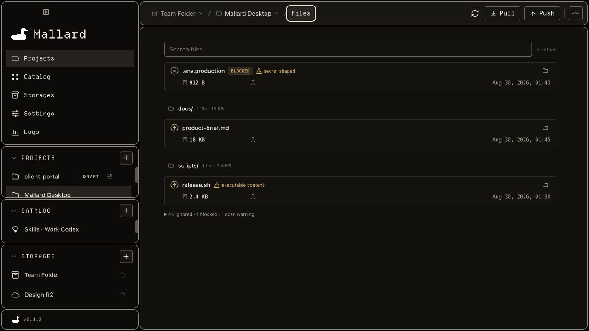

### 04 — Project Push, sessions

Held-for-Pull content is clear. The path bar and footer both expose the commit verb.

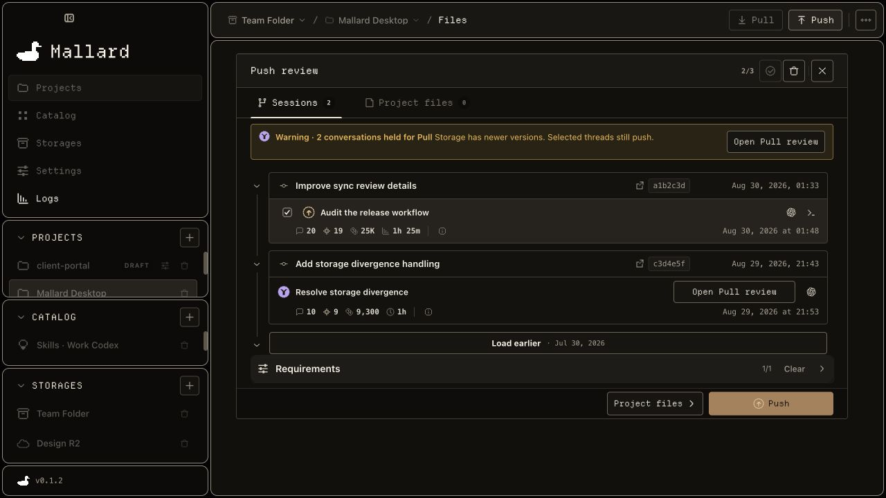

### 05 — Project Push, project files

The scan, search, blocked content, warnings, selection, and footer create a useful review surface.

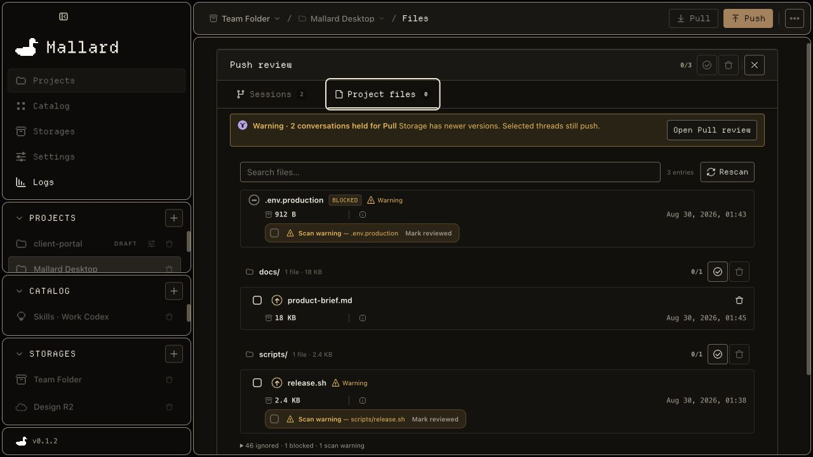

### 06 — Project Pull, sessions

Keep-both behavior and selected count are visible. The second commit location remains in the footer.

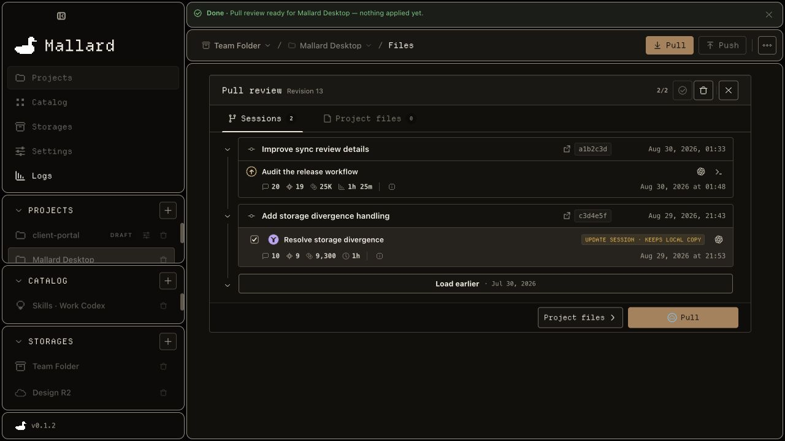

### 07 — Local-folder storage settings

The path, Browse action, save state, and repository inventory use one clear hierarchy.

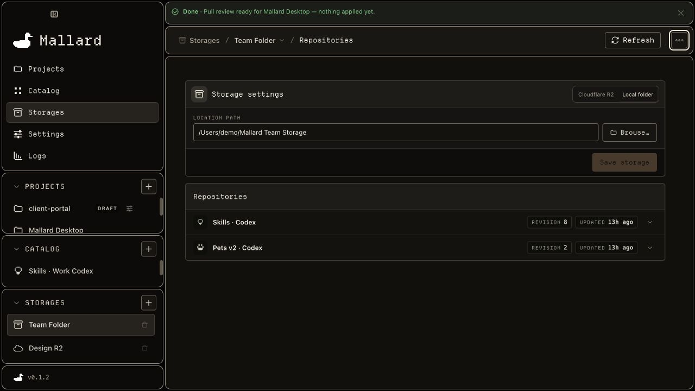

### 08 — Catalog skills

Local-ahead, storage-ahead, divergent, and blocked states read as one inventory.

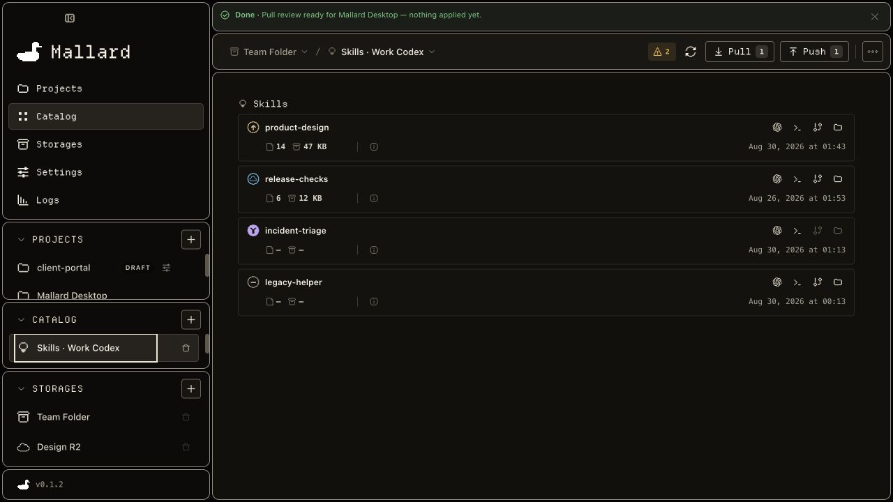

### 09 — Catalog Push review

The held-for-Pull warning is direct. The top and footer Push actions remain duplicated.

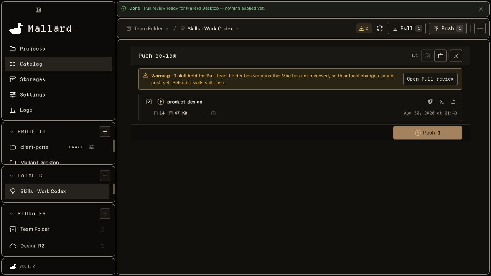

### 10 — Catalog Pull review

Update and install actions are easy to distinguish. The review preserves the same compact card grammar.

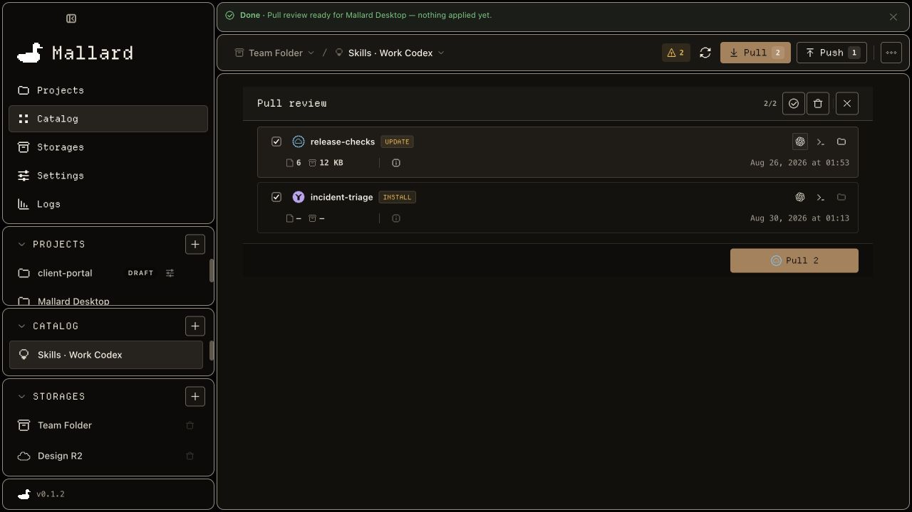

### 11 — Settings

Grouping, privacy copy, and control alignment are strong. The page begins with `h2` sections and has no page-level `h1`.

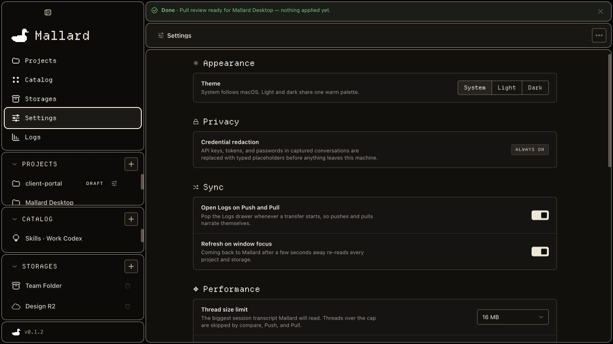

### 12 — Logs drawer

Filters and retained history are compact. When this drawer is visually closed, the same controls remain mounted and tabbable.

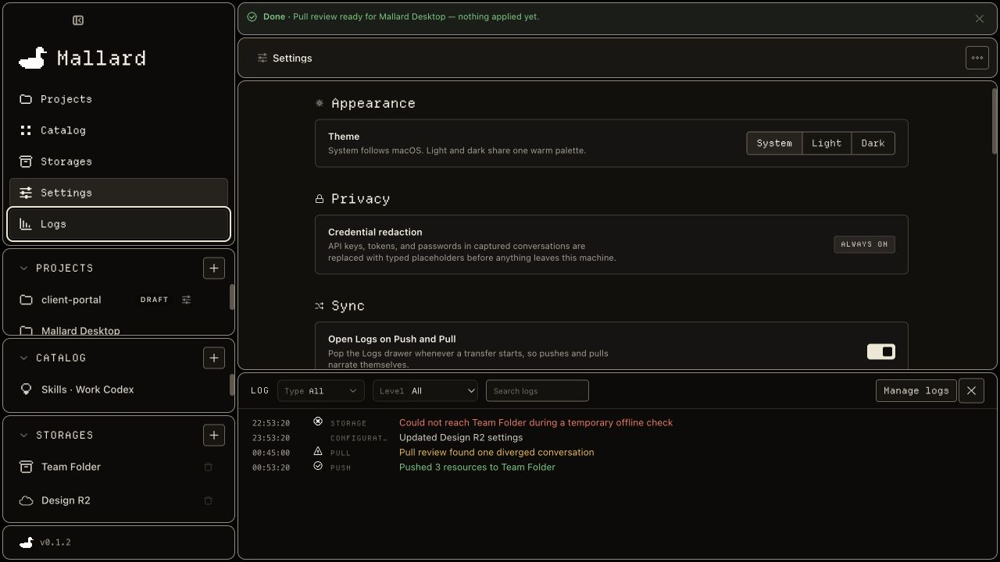

### 13 — Resumable project setup

The form is direct and layered. The custom radio group and low-contrast support text need repair.

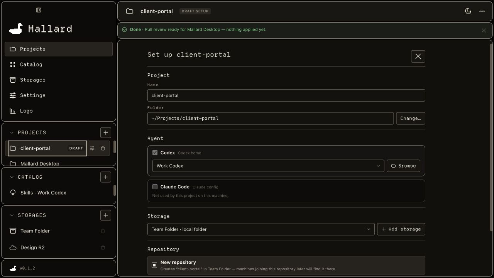

### 14 — Fresh-install empty state

The sidebar gives three first actions. The main pane only tells the user to select a completed project.

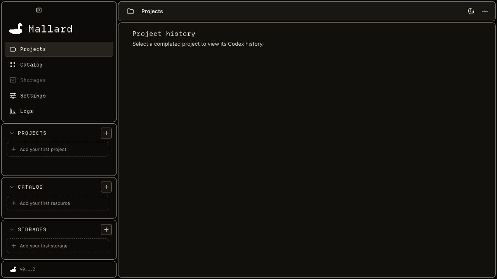

### 15 — Project Activity at 800 × 560

The sidebar consumes about 38% of the width. Ancestor labels compress, Sessions truncates, and Push/Pull become icon-only.

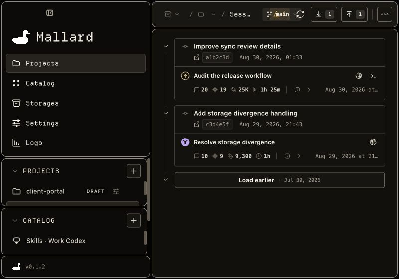

### 16 — Project Activity, light theme

The theme preserves the product identity. Muted timestamps and metadata are visibly faint and fail the measured normal-text contrast target.

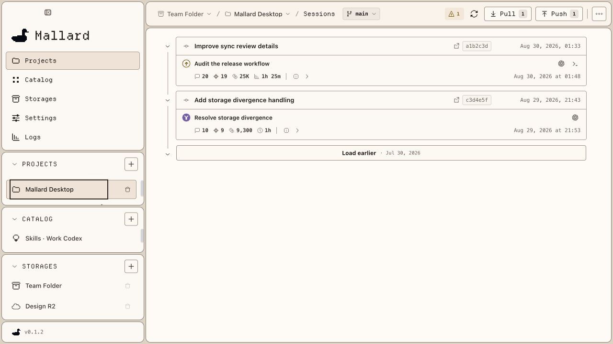
